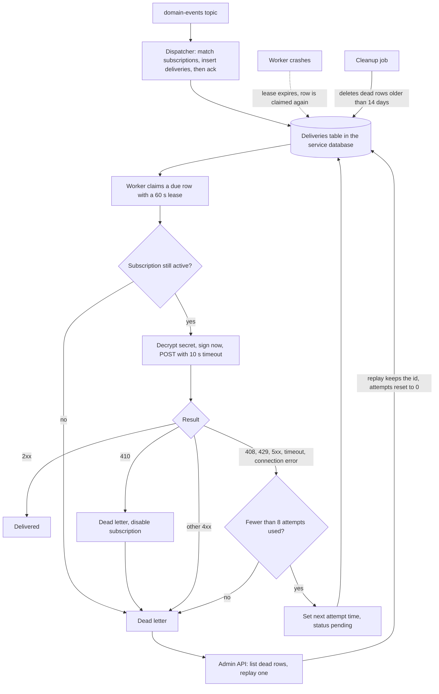

# Webhook delivery service

Today the core app publishes every business event to the `domain-events` topic, and nothing sends those events to customers. This service fills that gap. A dispatcher reads the topic and writes one delivery row per event and matching customer endpoint into the service's own database. Workers claim the due rows, send each one as a signed HTTP POST, and record the result. Retries wait in that database, not in the queue, because the queue cannot delay a message for more than 15 minutes and our retry waits reach 6 hours.

## Terms

- **Event**: one message from `domain-events`. It has an `event_id`, `event_type`, `account_id` and `payload`. The outbox relay may publish the same event more than once.
- **Subscription**: one customer endpoint, a row in `webhook_subscriptions`. It has a URL, a list of event types, an encrypted secret and a `status` of `active` or `disabled`.
- **Delivery**: one row in our `deliveries` table. It sends one event to one subscription, and it has its own id.
- **Delivery id**: the id of that row. We send it as `X-Webhook-Id`, so the receiver can skip repeats.
- **Dispatcher**: the process that reads `domain-events` and creates delivery rows.
- **Worker**: a process that sends due deliveries. Several worker instances run at once.
- **Lease**: a time-limited claim on a row. While it is valid, no other worker sends that row. If the worker dies, the lease expires and another worker takes the row.
- **Ack**: the message to the queue that a message is handled. An unacked message comes back after the visibility timeout (default 30 s).
- **Dead letter**: a delivery we have stopped trying. The row stays, with the reason and the last status code or error, so support can list it and replay it.
- **HMAC-SHA256 signature**: a keyed hash of the body. The receiver recomputes it with the subscription's secret to check the request is authentic and recent.
- **At-least-once**: every event reaches each endpoint one or more times, and never zero. Receivers must expect repeats.

## Flow

Notes:
- **Where state lives.** All delivery state is in the service's own Postgres database. The core database gets no new tables. We read `webhook_subscriptions`, and we write only its `status` and `disabled_reason` columns.
- **Why not the queue for retries.** The queue delays a message for at most 15 minutes, and our waits go up to 6 hours. The queue's dead-letter topic cannot be queried or partly replayed, so dead letters stay in our table.
- **Every row ends in one state.** A row is `pending` (will be tried again), `delivered`, or `dead`. A crash only leaves a lease to expire, so no row is lost.
- **Unchanged.** The outbox relay is not changed.

## Steps

1. **Dispatch.** Trigger: a message arrives on `domain-events`. The dispatcher selects the active subscriptions with the event's `account_id` whose `event_types` contain the event type or `'*'`. For each one it inserts a `pending` row. The row gets a new delivery id, a next-attempt time of now, and the event JSON stored as exact text. The text matters because the signature covers the exact bytes, and a JSON column could change them. A unique key on (event_id, subscription_id) makes a repeated message insert nothing. The dispatcher acks only after the inserts commit. If it crashes before the ack, the message returns and the repeat inserts do nothing. *Decided:* subscriptions are matched at dispatch time, so one created after the event does not get it.
2. **Claim.** Trigger: a worker polls about once per second. It claims up to a batch of due `pending` rows with no live lease, using `FOR UPDATE SKIP LOCKED` so two workers never take the same row. It sets a 60 s lease and adds 1 to `attempts`. *Decided:* counting at claim means a crash uses an attempt, so the limit of 8 always holds. The 60 s lease is well above the 10 s request timeout.
3. **Send.** The worker reads the subscription. If it is disabled, the row becomes dead with reason `subscription disabled` and is not sent. Otherwise the worker decrypts the secret with `libs/secrets.decrypt()`, keeps the plaintext in memory only, and does not store it. It sets `t` to the current unix seconds, computes HMAC-SHA256 over `<t>.<body>`, and POSTs the body with a 10 s timeout. The headers are `X-Webhook-Id: <delivery id>` and `X-Webhook-Signature: t=<t>,v1=<hex>`. It signs on every attempt, because receivers reject a `t` older than 5 minutes.
4. **Record the result.** The worker writes the outcome only if it still holds the lease. It always stores the status code or error text.
   - 2xx: status `delivered`.
   - 410: dead letter now, with reason `gone`. Set the subscription to `status='disabled'`, `disabled_reason='gone'`. *Decided:* also dead-letter that subscription's other `pending` rows, so they are not sent.
   - Any other 4xx except 408 and 429: dead letter now, no retry.
   - 408, 429, any 5xx, a timeout or a connection error: retry if fewer than 8 attempts have been made, otherwise dead letter.
5. **Retry wait.** Retryable failures use this schedule. Wait 30 s before attempt 2, 2 min before attempt 3, 10 min before attempt 4, 30 min before attempt 5, 1 h before attempt 6, 3 h before attempt 7, and 6 h before attempt 8. The worker sets the next-attempt time, sets the status back to `pending`, and clears the lease.
6. **Dead letter.** The row gets status `dead` and a `dead_at` time. It keeps its reason and last status code or error. It is kept for 14 days after `dead_at`.
7. **Admin list and replay.** Support lists a subscription's dead rows, with delivery id, reason, and last status code or error. Support replays one dead row. The row keeps its delivery id, goes back to `pending`, resets `attempts` to 0, and is due now, so it gets a fresh cycle of 8 attempts. *Decided:* a replay is refused if the subscription is disabled, because it would send to an endpoint that is turned off.
8. **Cleanup.** A scheduled job deletes dead rows whose `dead_at` is more than 14 days ago.

## Rules

- Deliveries are at-least-once. There is no ordering between events.
- Receivers dedupe by `X-Webhook-Id`. The id is the same on every attempt and on replay.
- Each (event, subscription) pair gets exactly one delivery row.
- Customer timeouts are 10 s.

## What happens when things fail

| What fails | What happens |
|---|---|
| Dispatcher crashes before ack | The message returns after the visibility timeout. Repeat inserts do nothing. Nothing is lost. |
| Dispatcher cannot write to the database | It does not ack, so the message returns and is tried again. |
| Worker crashes during a send or before it records the result | The lease expires after 60 s and another worker claims the row. The crashed attempt still counts. A receiver may get the same delivery id twice, and it dedupes on that id. |
| Worker stalls past its lease | Its result write is refused, because it no longer holds the lease. Another worker may resend. This is allowed by at-least-once. |
| Timeout, connection error, 408, 429 or 5xx | Retried on the schedule until 8 attempts are used, then dead. |
| Other 4xx | Dead at once, no retry. |
| 410 | Dead at once, subscription disabled, its other pending rows dead. |
| Subscription disabled while rows are pending | Those rows are dead at their next claim, without a send. |
| Service database unreachable | Workers and the dispatcher stop making progress. No row is lost, because state is only in the database. |

## Open questions

- Who may call the admin API, and how is it authenticated? The brief does not say.
- How long are delivered rows kept? The brief sets the 14-day rule only for dead rows.
- What happens if a secret cannot be decrypted, or an endpoint answers with a 3xx redirect? The brief does not say.
- How often do the workers poll and the cleanup job run? Not set. The worker poll is set to about 1 s above.