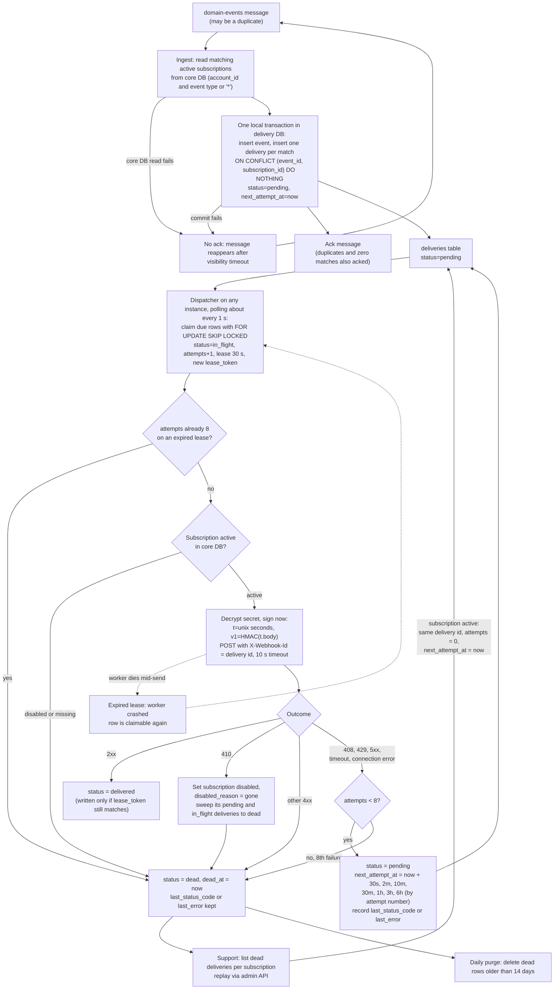

# Outbound webhooks: delivery service

This service turns `domain-events` messages into signed HTTP calls to customer endpoints. Today the outbox relay publishes every business event to the `domain-events` queue, and customers register endpoints in the core database, but nothing sends the events to them. The service has two stages. Ingest reads each message, finds the matching subscriptions and writes one delivery row per match into its own Postgres database. Dispatch claims due rows, signs and sends them, and retries or dead-letters them. Retries are scheduled in Postgres, not in the queue, because the queue can delay a message by at most 15 minutes and our waits go up to 6 h.

## Terms

- **Event**: one message from `domain-events`, with `event_id`, `event_type`, `account_id`, `occurred_at` and `payload`. The relay can publish the same event twice, so duplicates are normal.
- **Subscription**: a row in the core DB table `webhook_subscriptions`: a customer URL, the event types it wants (exact names, or `'*'` for all), an encrypted secret and a status (`active` or `disabled`).
- **Delivery**: one (event, subscription) pair. It is a row in our `deliveries` table, and its `id` is sent as `X-Webhook-Id`.
- **Attempt**: one HTTP send of a delivery. A delivery gets at most 8.
- **Dead**: a delivery that will not be sent again unless support replays it.
- **Replay**: an admin action that puts a dead delivery back to `pending` with a fresh cycle of 8 attempts.
- **Claim**: an instance takes a due row for itself with `FOR UPDATE SKIP LOCKED` (other instances skip locked rows instead of waiting) and marks it `in_flight`.
- **Lease**: the claim's expiry time, `lease_until`, 30 s after the claim. If it passes, any instance may claim the row again. `lease_token` is a random value set at each claim. A worker can write its result only while the token is still its own.
- **Core DB**: the existing database of the core app. We may read `webhook_subscriptions` and update only its `status` and `disabled_reason`. We add nothing to it.
- **Delivery DB**: our own Postgres database.
- **Ack**: telling the queue a message is handled. An unacked message becomes visible again after the visibility timeout.
- **`libs/secrets.decrypt()`**: the existing function that turns `secret_ciphertext` into the plaintext signing secret.

## Flowchart

## Guarantees and sharing the work

- Delivery is at-least-once. There is no ordering between events. A crashed worker never loses a delivery.
- Every instance runs both ingest and dispatch. Instances share work only through row claims, so no leader election or coordination service is needed.
- Each stage can be redone safely, so a crash in either loses nothing.

## Where state lives

| Where | What |
|---|---|
| `domain-events` queue | A message stays unacked until its rows are committed. This is the only durability the queue gives us. |
| Core DB | `webhook_subscriptions`, read-only for us except `status` and `disabled_reason`, which we write only to disable a subscription. |
| Delivery DB `events` | `event_id` (PK), `account_id`, `event_type`, `body` (the raw JSON, kept so every attempt signs identical bytes), `received_at`. |
| Delivery DB `deliveries` | `id` uuid, `event_id`, `subscription_id`, `status` (`pending`, `in_flight`, `delivered`, `dead`), `attempts`, `next_attempt_at`, `lease_until`, `lease_token`, `last_status_code`, `last_error`, `dead_at`, `delivered_at`. `UNIQUE (event_id, subscription_id)` gives exactly one delivery per pair, and so makes a duplicate message harmless. Index `(status, next_attempt_at)` serves the claim query. Index `(subscription_id, status, dead_at)` serves support listing. |

## Steps

**Ingest** (trigger: a `domain-events` message)
1. Read the matching subscriptions from the core DB: `account_id = $1 AND status = 'active' AND ($2 = ANY(event_types) OR '*' = ANY(event_types))`.
2. In one delivery-DB transaction, insert the event (`ON CONFLICT DO NOTHING`) and one `deliveries` row per match with `status = 'pending'` and `next_attempt_at = now()` (`ON CONFLICT (event_id, subscription_id) DO NOTHING`).
3. Ack only after the commit. A duplicate message inserts nothing new and is acked. A message with no matches is acked.
4. If either database is down, do not ack. The queue redelivers.

**Dispatch** (trigger: each instance polls about every 1 s with jitter, so attempt 1 goes out within 1 to 2 s of the insert)
1. Claim in one statement. Select rows where `status = 'pending' AND next_attempt_at <= now()`, or `status = 'in_flight' AND lease_until < now()`, with `FOR UPDATE SKIP LOCKED` and a batch limit. Set `status = 'in_flight'`, `attempts = attempts + 1`, `lease_until = now() + 30 s` and a fresh `lease_token`. The attempt is counted at claim time, so a worker that keeps crashing cannot loop forever.
2. If the row was reclaimed from an expired lease and already had 8 attempts, dead-letter it with `last_error = 'worker lost'` and do not send.
3. Read the subscription from the core DB (a short cache is fine). If it is disabled or missing, dead-letter the row with `last_error = 'subscription disabled'` or `'subscription missing'`. This check is needed because the dashboard can disable a subscription without telling us. It also covers a crash between the core-DB write and the sweep in step 7.
4. Decrypt the secret with `libs/secrets.decrypt()`.
5. Send `POST` with the event JSON (`deliveries`' stored `body`) and a 10 s timeout. Headers: `X-Webhook-Id` is the delivery id, the same on every attempt and every replay, so receivers can dedupe. `X-Webhook-Signature: t=<unix seconds>,v1=<hex>`, where `v1` is HMAC-SHA256 over `<t>.<raw body>` keyed with the secret. Receivers reject a `t` older than 5 minutes, so build `t` and the signature at send time, on every attempt.
6. Write the outcome with `WHERE id = $1 AND lease_token = $2`. If the lease was lost, discard the result: another instance owns the row, and the receiver dedupes on the id. The 30 s lease is longer than the 10 s timeout plus the write. A per-instance concurrency cap bounds the damage from slow endpoints.
7. Outcomes:
   - 2xx: `delivered`.
   - 408, 429, any 5xx, a timeout or a connection error: retry. After failed attempt *n* (1 to 7), set `status = 'pending'` and `next_attempt_at` to now plus 30 s, 2 min, 10 min, 30 min, 1 h, 3 h, 6 h respectively, with about 10% jitter. Record `last_status_code` or `last_error`. Failure 8 dead-letters.
   - 410: dead-letter the delivery, set `webhook_subscriptions.status = 'disabled'` and `disabled_reason = 'gone'`, then sweep every `pending` and `in_flight` delivery of that subscription to `dead` with `last_error = 'subscription disabled'`.
   - Any other 4xx: dead-letter now, no retry.

Dead-lettering sets `status = 'dead'` and `dead_at = now()` and keeps `last_status_code` or `last_error`.

**Admin API and purge**
- `GET /subscriptions/{id}/dead-deliveries` lists `id`, `event_type`, `dead_at`, `attempts`, `last_status_code` and `last_error`.
- `POST /deliveries/{id}/replay`, for a row that is currently `dead`, sets `status = 'pending'`, `attempts = 0`, `next_attempt_at = now()` and clears `dead_at` and the last error. The id is unchanged. It is refused with 409 while the subscription is disabled, so support must re-enable it in the dashboard first.
- A daily purge deletes `dead` rows with `dead_at` older than 14 days, delivered rows older than 7 days (my choice, to bound table size), and events with no remaining deliveries.

## What happens when things fail

| Failure | Result |
|---|---|
| Worker dies mid-ingest | The message is not acked and reappears after the visibility timeout. The unique constraint makes the redo safe. |
| Core DB or delivery DB down at ingest | No ack, so the queue redelivers. If it persists, messages end in the queue's own dead-letter topic. That topic cannot be queried or partly replayed, so it must be alerted on. |
| Relay republishes an event | The unique constraint absorbs it. |
| Worker dies mid-send | The lease expires, another instance reclaims the row, and the receiver may see a duplicate with the same `X-Webhook-Id`. This is the at-least-once guarantee. |
| Slow or hanging endpoint | The 10 s timeout and the concurrency cap limit the damage. |
| Receiver sees a stale signature | Does not happen on retries, since each attempt re-signs. |
| Subscription disabled while deliveries wait | They are dead-lettered, not sent, and are replayable once it is re-enabled. |

## Open questions

- Waiting deliveries are dead-lettered when a subscription is disabled (rather than held or deleted). This is my decision and needs confirming.
- The 7-day purge of delivered rows is my choice, not a stated requirement.
- Who is alerted when the queue's dead-letter topic fills, and what the retry threshold N is, are not decided.