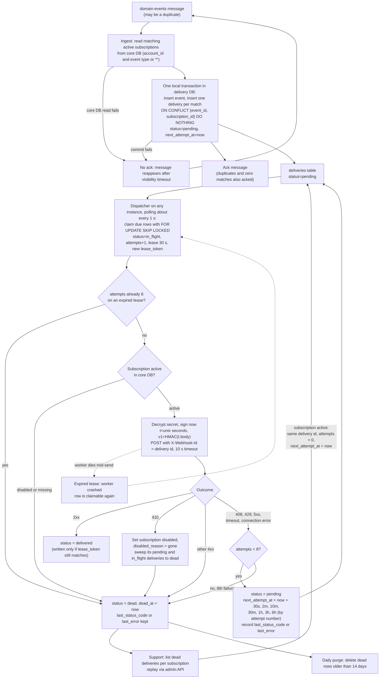

# Outbound webhooks: delivery service

## Design choices

- **Scheduler is Postgres, not the queue.** The queue can delay a message by at most 15 minutes. Retry waits go up to 6 h, and the 30 min, 1 h, 3 h and 6 h waits all exceed the cap. Holding a message unacked for hours would hide state and make "list dead deliveries" impossible. So the queue only feeds the service. Every delivery is a row in the service's own database, and a `next_attempt_at` column schedules the retries.
- **Fan-out and delivery are separate stages joined by a table.** The ingest stage only decides which subscriptions match and writes rows. The dispatch stage only sends. Each stage is idempotent, so a crash in either one loses nothing.
- **Instances share work through row claims.** Every instance runs both loops. Dispatchers claim rows with `FOR UPDATE SKIP LOCKED` and a lease. No leader election or coordination service is needed.

## Where state lives

| Where | What |
|---|---|
| `domain-events` queue | The message stays unacked until its rows are committed. This is the only durability the queue provides. |
| Core DB (read-only for us) | `webhook_subscriptions`. The service updates only `status` and `disabled_reason`, and only on a 410. |
| Delivery DB, `events` | `event_id` (PK), `account_id`, `event_type`, `body` (the raw JSON, so every attempt signs identical bytes), `received_at`. |
| Delivery DB, `deliveries` | `id` uuid (the `X-Webhook-Id`), `event_id`, `subscription_id`, `status` (`pending`, `in_flight`, `delivered`, `dead`), `attempts`, `next_attempt_at`, `lease_until`, `lease_token`, `last_status_code`, `last_error`, `dead_at`, `delivered_at`. `UNIQUE (event_id, subscription_id)` gives exactly one delivery per pair. An index on `(status, next_attempt_at)` serves the claim query. An index on `(subscription_id, status, dead_at)` serves support listing. |

## How the pieces work

**Ingest**
1. Read the matching subscriptions from the core DB: `account_id = $1 AND status = 'active' AND ($2 = ANY(event_types) OR '*' = ANY(event_types))`.
2. In one local transaction, insert the event (`ON CONFLICT DO NOTHING`) and one `deliveries` row per match with `status = 'pending'` and `next_attempt_at = now()`. Use `ON CONFLICT (event_id, subscription_id) DO NOTHING`.
3. Ack the message only after the commit.
4. A duplicate message hits the unique constraint, inserts nothing new and is acked. A message with zero matches is acked.

**Dispatch**
1. Each instance polls about every 1 s, with jitter, so attempt 1 starts within 1 to 2 s of the insert.
2. The claim query is a single statement. It selects rows where `status = 'pending' AND next_attempt_at <= now()`, or `status = 'in_flight' AND lease_until < now()`, using `FOR UPDATE SKIP LOCKED` and a batch limit. It sets `status = 'in_flight'`, `attempts = attempts + 1`, `lease_until = now() + 30 s` and a fresh `lease_token`.
3. The attempt is counted at claim time, so a worker that keeps crashing cannot loop forever.
4. A claimed row whose lease had expired and whose `attempts` was already 8 is dead-lettered with `last_error = 'worker lost'` instead of being sent again.
5. Before sending, read the subscription from the core DB (a short cache is fine) and decrypt the secret with `libs/secrets.decrypt()`.
6. Build `t` and the signature at send time, on every attempt. Send `X-Webhook-Id = deliveries.id`.
7. Write the outcome with `WHERE id = $1 AND lease_token = $2`. If the lease was lost, the result is discarded. The other claimer owns the row and the receiver dedupes on the id.
8. The lease (30 s) is longer than the 10 s timeout plus the write.

**Backoff**
- The wait after failed attempt *n* is 30 s, 2 min, 10 min, 30 min, 1 h, 3 h, 6 h for *n* = 1 to 7, with about 10% jitter.
- Failure 8 dead-letters the delivery.

**Outcomes**
- 2xx: `delivered`.
- 408, 429, 5xx, a timeout or a connection error: retry on the schedule.
- 410: dead-letter the delivery, set `webhook_subscriptions.status = 'disabled'` and `disabled_reason = 'gone'`, then sweep.
- Any other 4xx: dead-letter now.

**Disabled subscriptions** (a decision for you to confirm)
- Waiting deliveries are not sent. They are dead-lettered with `last_error = 'subscription disabled'` and are replayable.
- On a 410, the worker sweeps every `pending` and `in_flight` delivery for that subscription to `dead` immediately.
- The dashboard can also disable a subscription, and we do not see that event. So every claim re-checks the subscription's status and dead-letters the row if it is disabled or missing (`'subscription missing'`). This also covers a crash between the core-DB write and the sweep.
- Replay is refused with 409 while the subscription is disabled. Support must re-enable it in the dashboard first.

**Dead letters and admin API**
- `GET /subscriptions/{id}/dead-deliveries` lists `id`, `event_type`, `dead_at`, `attempts`, `last_status_code` and `last_error`.
- `POST /deliveries/{id}/replay` sets `status = 'pending'`, `attempts = 0`, `next_attempt_at = now()` and clears `dead_at` and the last error, where the row is currently `dead`. The delivery id is unchanged, and this starts a fresh cycle of 8 attempts.
- A daily purge deletes `dead` rows with `dead_at < now() - 14 days`. It also deletes delivered rows after 7 days (my choice, to bound table size) and events with no remaining deliveries.

## Failure handling

| Failure | Result |
|---|---|
| Worker dies mid-ingest | The message is not acked, becomes visible after the timeout and is redelivered. The unique constraint makes the redo safe. |
| Core DB or delivery DB down at ingest | Nack or do not ack. The queue redelivers. Persistent failure ends in the queue's own dead-letter topic, which must be alerted on because it cannot be replayed selectively. |
| Worker dies mid-send | The lease expires, another instance reclaims the row and the receiver may see a duplicate with the same `X-Webhook-Id`. This is the at-least-once guarantee. |
| Relay republishes an event | Handled by the unique constraint. |
| Slow or hanging endpoint | The 10 s timeout and a per-instance concurrency cap bound the damage. |
| Receiver rejects the signature as stale | Does not happen on retries, because each attempt re-signs. |

## Flowchart

