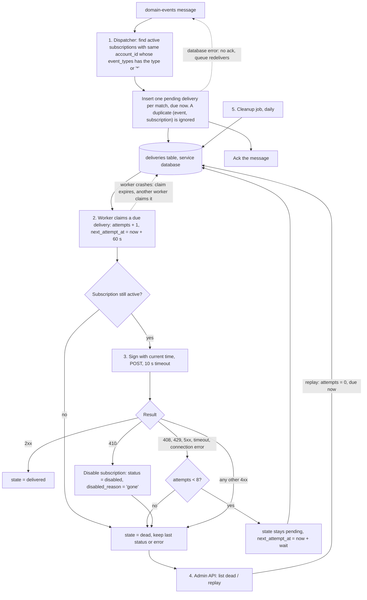

# Webhook delivery plan

The core app already publishes every business event to the `domain-events` topic, and customers already register webhook endpoints in `webhook_subscriptions`. This plan builds the service between them. A dispatcher turns each event into one stored delivery per matching subscription. Workers then sign and POST each delivery, retrying on a fixed schedule and dead-lettering failures. Deliveries live in the service's own Postgres table, because the queue's maximum delay (15 min) is shorter than our longest retry wait (6 h) and its dead-letter topic cannot be listed or replayed one by one.

## Terms

- **Event**: one message on `domain-events`: `event_id`, `event_type`, `account_id`, `occurred_at`, `payload`. The outbox relay can publish the same event twice, and the queue is at-least-once with no ordering.
- **Subscription**: a customer's row in `webhook_subscriptions` (core database): `url`, `event_types`, an encrypted secret, `status` ('active' or 'disabled') and `disabled_reason`.
- **Delivery**: one (event, subscription) pair, stored as one row in `deliveries` (the service's own database). Its `id` is sent as `X-Webhook-Id`.
- **Attempt**: one POST of a delivery. A delivery gets at most 8.
- **Dead**: a delivery that will not be retried automatically. Support can list and replay it.
- **Ack**: telling the queue a message is handled. An unacked message reappears after the visibility timeout (30 s by default).
- **Claim**: a worker's exclusive hold on a delivery. It is made by pushing `next_attempt_at` 60 s into the future. A 60 s hold covers the 10 s timeout plus recording the result.
- **`FOR UPDATE SKIP LOCKED`**: a Postgres clause that lets several workers select rows without waiting on or double-taking each other's rows.
- **HMAC-SHA256**: a keyed hash. Receivers recompute it with the shared secret to check the body is ours.

## Where state lives

- **Queue**: only events not yet acked.
- **`deliveries` table** (service database), one row per delivery:
  - `id`, `event_id`, `subscription_id`, `account_id`.
  - `body`: the message text, stored as received, so every attempt signs and sends identical bytes.
  - `state`: 'pending', 'delivered' or 'dead'.
  - `attempts`, `next_attempt_at`.
  - `last_status`, `last_error`, `dead_at`, `created_at`.
  - A unique key on (`event_id`, `subscription_id`).
- **Core database**: read-only for us, except that workers may update `status` and `disabled_reason` of `webhook_subscriptions`. We add nothing there.
- The secret is never copied. Workers read `secret_ciphertext` and call `libs/secrets.decrypt()` at send time.

## Flow

## Steps

1. **Dispatcher** (trigger: a `domain-events` message; several instances share the topic).
   - Query the matching active subscriptions, then insert all their deliveries in one database transaction, then ack.
   - Each new delivery is `pending` with `next_attempt_at = now`, so workers pick it up within a few seconds.
   - The unique (`event_id`, `subscription_id`) key plus `ON CONFLICT DO NOTHING` makes a duplicate message create nothing new.
   - No matching subscription: ack, store nothing.
   - If the database is down, do not ack. The queue redelivers and the result is the same.
2. **Claim** (trigger: workers poll every second; several instances).
   - A worker selects due `pending` rows (`next_attempt_at <= now`) with `FOR UPDATE SKIP LOCKED`, and in the same statement adds 1 to `attempts` and sets `next_attempt_at = now + 60 s`.
   - There is no separate lease column. If the worker dies, the pushed-forward time passes and any worker claims the row again. Delivery is never lost, but the POST may repeat (at-least-once).
   - Counting the attempt at claim time means a delivery that keeps crashing workers still ends up dead after 8 claims.
   - Before sending, the worker reads the subscription. If it is disabled or gone, the delivery goes dead with `last_error = 'subscription disabled'` and nothing is sent. This also covers deliveries waiting when a 410 disables their subscription: each is dead-lettered at its next claim, with no extra sweep.
3. **Send and record.**
   - Request: `POST` to the subscription URL with the stored body and a 10 s timeout.
   - `X-Webhook-Id` is the delivery `id`. It is the same on every attempt and every replay.
   - `X-Webhook-Signature: t=<unix seconds>,v1=<hex>`. `v1` is HMAC-SHA256 over `<t>.<raw body>` with the decrypted secret. Sign anew on every attempt, because receivers reject a `t` older than 5 minutes.
   - Record the result with an update that only applies if the row is still `pending` with the same `attempts` value. A slow worker whose claim expired then cannot overwrite a newer attempt.
   - The retry wait depends on the attempts used so far:

     | After failed attempt | 1 | 2 | 3 | 4 | 5 | 6 | 7 | 8 |
     |---|---|---|---|---|---|---|---|---|
     | Wait before the next | 30 s | 2 min | 10 min | 30 min | 1 h | 3 h | 6 h | none: dead |

   - Outcomes:
     - 2xx: `delivered`.
     - 408, 429, any 5xx, timeout, connection error: retry as above, or dead after the 8th.
     - 410: dead now, and set `status = 'disabled'`, `disabled_reason = 'gone'` on the subscription.
     - Any other 4xx: dead now, no retry.
   - Every failure stores the last HTTP status or the error text in `last_status` / `last_error`.
4. **Admin API** (trigger: a support request).
   - List: a subscription's `dead` deliveries with `last_status` and `last_error`.
   - Replay one: if the delivery is `dead` and its subscription is `active`, set `pending`, `attempts = 0`, `next_attempt_at = now`. The `id` is unchanged, so receivers can dedupe, and a fresh cycle of 8 attempts follows. Otherwise refuse, with a message that names the cause: not dead, or subscription disabled. Re-enabling a subscription is done in the dashboard, not here.
5. **Cleanup job** (trigger: daily). Delete `dead` rows whose `dead_at` is older than 14 days. Also delete `delivered` rows older than 14 days, to bound the table.

## Guarantees

- At-least-once. A duplicate event creates no second delivery, but a crash between POST and recording can repeat a POST. Receivers dedupe on `X-Webhook-Id`.
- No ordering between events. Several dispatchers and workers run in parallel.
- A crashed dispatcher or worker never loses work. The queue holds the event until the dispatcher stores its deliveries. The table holds each delivery until a worker records a final result.

## What happens when things fail

| Failure | What happens |
|---|---|
| Dispatcher crashes or database is down before ack | Message reappears after the visibility timeout. The unique key makes the retry safe. |
| Message keeps failing | The queue moves it to its dead-letter topic after N failed receives. That topic cannot be replayed per message, so set N high and alert on it. |
| Worker crashes after claiming | The 60 s claim expires and another worker takes the delivery. That attempt stays counted. |
| Worker crashes after the POST, before recording | Same as above. The receiver may see the POST twice with the same `X-Webhook-Id`. |
| Receiver times out, refuses, or returns 408, 429 or 5xx | Retry on the schedule. Dead after the 8th failure. |
| Receiver returns 410 | Delivery dead and subscription disabled. |
| Receiver returns any other 4xx | Delivery dead, no retry. |
| Subscription disabled or deleted while deliveries wait | Each waiting delivery goes dead at its next claim, without being sent. |
| Core database unreadable by a worker | The worker does not record a result. The claim expires and the delivery is retried, and the attempt stays counted. |

## Build and rollout

1. Create the service database and the `deliveries` table.
2. Build the dispatcher and workers. Run several instances of each.
3. Add the admin API and the cleanup job.
4. Read access to the core `webhook_subscriptions` is needed from the start, along with write access to `status` and `disabled_reason` only.

## Open questions

- Responses in the 1xx and 3xx range are not specified. This plan treats them like any other failure that cannot be retried: the redirect is not followed and the delivery goes dead. Confirm.
- The 14-day retention for `delivered` rows is our choice. The brief only asks for it on dead deliveries.
- Value of N for the queue's own dead-letter topic is not chosen.
