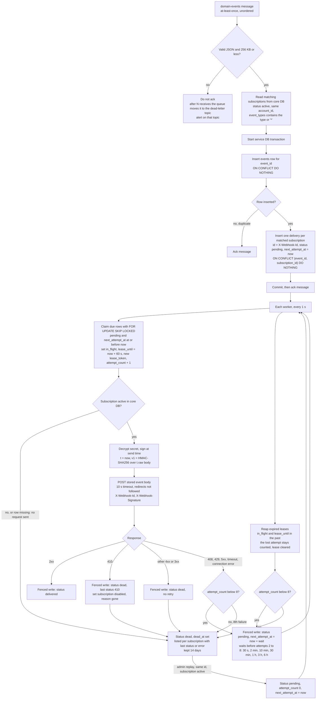

# Outbound webhooks: delivery service

Customers register webhook endpoints in the dashboard. Each endpoint is a row in `webhook_subscriptions` in the core database. The outbox relay publishes every business event to the `domain-events` queue topic. This service sits between the two. For each event and each matching endpoint, it sends a signed HTTP POST, retries when an attempt fails, and keeps the deliveries it gives up on as dead. Support can list dead deliveries and replay them.

## Terms

- **Event:** one business fact, such as `invoice.paid`. The core app records it in the outbox.
- **Subscription:** a customer's endpoint. It has a URL, a secret, a list of event types, and a status (`active` or `disabled`). It lives in the core database.
- **Outbox:** a table in the core database. The core app writes an event row in the same transaction as the business change it describes. The relay reads these rows and publishes them.
- **Queue topic (`domain-events`):** a managed message queue. It delivers each message at least once, so duplicates happen. It does not keep order.
- **Ack:** a consumer's confirmation that it handled a message. If a message is not acked, it reappears after the visibility timeout (30 s by default).
- **Dead-letter topic:** where the queue moves a message after too many failed receives. We cannot query or replay it.
- **Delivery:** one row in this service's database for one event and one subscription. It holds the retry state for that pair. Its id is sent to the customer as `X-Webhook-Id`.
- **Attempt:** one POST to the customer's URL. A delivery gets at most 8 attempts.
- **Lease:** a 60 s claim on a delivery. A worker holds the lease while it sends. The lease has a token that identifies the holder.
- **`FOR UPDATE SKIP LOCKED`:** a Postgres clause that lets many workers claim different rows at the same time. A worker skips rows that another worker has locked, instead of waiting for them.
- **Fenced write:** an update that applies only if the worker still holds the lease. The check compares the lease token.
- **HMAC-SHA256:** a keyed hash. The customer recomputes it with the shared secret to check the signature and the timestamp.
- **Dead:** a delivery that we have stopped trying. Dead deliveries are kept for 14 days so support can see and replay them.

## What the service guarantees

- Each (event, subscription) pair gets exactly one delivery, even if the same event message arrives twice.
- Delivery is at least once. A receiver can see the same delivery id more than once, so it dedupes on that id.
- Events are not delivered in any particular order.
- A crashed worker does not lose a delivery. Its unfinished work is picked up again.
- Several worker instances run at the same time with no coordinator. They share work through the database.

## Where state lives

- **Core database:** read-only for matching. The service reads `webhook_subscriptions` to find matching subscriptions and to check status before each send. It writes only `status` and `disabled_reason`, and only when a receiver answers 410.
- **Service database (its own Postgres):**
  - `events`: one row per `event_id`, with `event_id` as the primary key. It stores the event body exactly as received. Every attempt sends these same bytes, so the signature always matches.
  - `deliveries`: one row per (`event_id`, `subscription_id`), unique on that pair. Its `id` is the `X-Webhook-Id`. It also holds `status` (`pending`, `in_flight`, `delivered`, or `dead`), `attempt_count`, `next_attempt_at`, `lease_until`, `lease_token`, the last status code or error, and `dead_at`.
- **Queue:** holds only trigger messages. The queue can delay a message by at most 15 minutes, but the waits between attempts go up to 6 hours. So the schedule lives in the database, and workers poll it.

## How it works, step by step

1. **Receive a message.** If it is not valid JSON or is larger than 256 KB, do not ack it. After N receives, the queue moves it to the dead-letter topic, and an alert fires. Someone must fix it by hand.
2. **Match subscriptions.** Read the core database for active subscriptions with the same `account_id` whose `event_types` contains the event type or `'*'`.
3. **Record in one transaction.** In the service database, insert the `events` row. If that `event_id` already exists, the insert does nothing and the message is a duplicate: ack it and stop. If the row is new, insert one `deliveries` row per matched subscription. Pairs that already exist are skipped. Commit, then ack.
4. **Poll.** Every worker checks every second for due deliveries. A due delivery is `pending` with `next_attempt_at` at or before now. The worker claims it with `FOR UPDATE SKIP LOCKED`, sets it to `in_flight`, sets `lease_until` to now plus 60 s, writes a new `lease_token`, and adds 1 to `attempt_count`.
5. **Check the subscription.** If the subscription is no longer active in the core database, or its row is gone, mark the delivery dead without sending anything.
6. **Sign and send.** Decrypt the secret. Sign at send time: `t` is the current Unix time, and `v1` is HMAC-SHA256 over `t.` followed by the raw body. POST the stored event body with a 10 s timeout. Do not follow redirects. Send `X-Webhook-Id` and `X-Webhook-Signature`.
7. **Handle the response.** Each result is a fenced write.
   - 2xx: mark `delivered`.
   - 410: mark `dead` with last status 410, and set the subscription to `disabled` with reason `gone`.
   - Other 4xx or any 3xx: mark `dead`. Do not retry.
   - 408, 429, 5xx, timeout, or connection error: retry if fewer than 8 attempts have been made. Otherwise mark `dead`.
8. **Schedule a retry.** Set the delivery back to `pending` with `next_attempt_at` at now plus the wait. The waits before attempts 2 to 8 are 30 s, 2 min, 10 min, 30 min, 1 h, 3 h, and 6 h.
9. **Reap expired leases.** A worker that crashed leaves a delivery `in_flight` with an expired `lease_until`. The reaper clears the lease and keeps the lost attempt in `attempt_count`. If fewer than 8 attempts have been made, it schedules the next attempt on the normal wait. Otherwise it marks the delivery dead.
10. **Replay.** Support can replay a dead delivery if its subscription is active. The replay keeps the same delivery id, sets `attempt_count` to 0, and sets the delivery to `pending` with `next_attempt_at` at now. This starts a fresh cycle of 8 attempts.

## Failure cases

- **Malformed or oversized message:** not acked. After N receives, the queue moves it to the dead-letter topic. Recovery is manual, starting from the alert.
- **Crash before commit:** nothing is written. The message reappears after 30 s and is processed again.
- **Crash after commit, before ack:** the message reappears. The duplicate insert does nothing, and the message is acked.
- **Crash during a send:** the lease expires after 60 s. The reaper keeps the attempt counted and schedules the next one on the normal wait. The receiver may already have the first request, so it can see the same delivery id again.
- **Slow worker that lost its lease:** every result write is fenced by the lease token. If another worker has taken over, the old worker's result is discarded. The 10 s send timeout sits well inside the 60 s lease, so a live worker keeps its lease.
- **Subscription disabled (by a 410 or by the customer):** its pending deliveries are marked dead the next time they are claimed, with no request sent.
- **Replay:** only dead deliveries whose subscription is active can be replayed. The replay keeps the delivery id, resets `attempt_count` to 0, and starts a fresh cycle of 8 attempts.
- **Retention:** a cleanup job deletes dead deliveries 14 days after `dead_at`.

## Open points

- **`events` retention is not set.** Those rows must live at least as long as the queue can redeliver a message. If a row is deleted early, a late duplicate creates deliveries again.
- **Malformed messages can only be recovered by hand.** They leave the queue only through the dead-letter topic, which we cannot replay.
- **3xx is treated as permanent,** because redirects are not followed. The brief does not say this, so it needs confirmation.
- **The 410 path writes to two databases.** The subscription is disabled in the core database, and the delivery is marked dead in the service database. These cannot share a transaction. The order of the two writes, and what happens if one of them fails, still need to be decided.