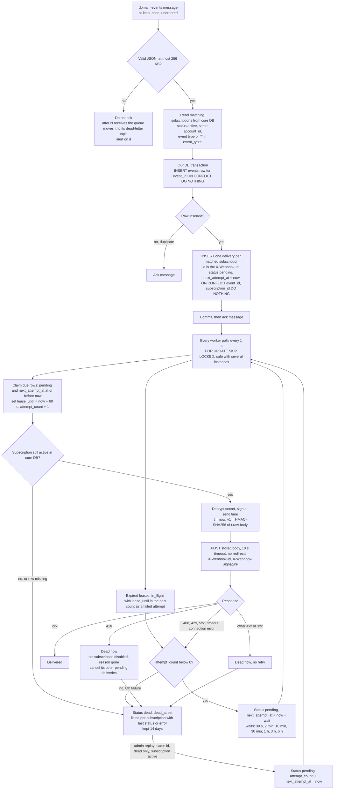

# Outbound webhooks: delivery service

## Flow from `domain-events` message to delivered or dead-lettered

## Where state lives

**Service database (its own Postgres):**

- `events(event_id PK, account_id, event_type, body text, received_at)`. `body` is the exact message JSON, stored as text so that replays send identical bytes. It is written once per event and serves as the duplicate check.
- `deliveries(id uuid PK, event_id, subscription_id, status pending | in_flight | delivered | dead, attempt_count, next_attempt_at, lease_owner, lease_until, last_status_code, last_error, dead_at, created_at, updated_at, UNIQUE(event_id, subscription_id))`.
  - `id` is the delivery id sent as `X-Webhook-Id`. It is fixed at insert and never changes, including on replay.
  - The unique key enforces one delivery per (event, subscription) pair.
- Partial index on `next_attempt_at` where status is pending or in_flight. Index on `(subscription_id, dead_at)` where status is dead, for the support listing.
- No secrets are stored here. The secret is read from the core DB and decrypted at send time, and it is never logged.

**Core database (`webhook_subscriptions` only):**

- The service reads matching subscriptions, and it reads a subscription again before each attempt to check that it is still active and to fetch the URL and ciphertext.
- Its database role has UPDATE on `status` and `disabled_reason` only, and that is the only write it makes there.
- Nothing is added to the core database.

**Queue:** carries only `domain-events`. Retry timing is not on the queue, because the queue delay caps at 15 minutes and the schedule runs to 6 h. The service uses its own consumer subscription on the topic.

## Scheduling and sharing work across instances

- Every instance runs the same loop, which polls every 1 s and claims due rows with `FOR UPDATE SKIP LOCKED` in batches. There is no leader, and instances can be added or removed freely.
- A claim sets a 60 s lease and increments `attempt_count` in the same committed write, before the HTTP call. A crash mid-send therefore leaves a visible record that the attempt started.
- Every outcome write is fenced with `WHERE id = $1 AND lease_owner = $me`. A worker whose lease expired and was taken over cannot overwrite the newer result.
- Attempt 1 is due at insert time, so it goes out within about 1 to 2 s of the event.

## Failure handling

- **Worker crash.** The lease expires, and the next poll treats the lost attempt as a failed attempt under the normal retry rule. The lost attempt counts toward the 8. The receiver can see the same `X-Webhook-Id` twice, which is allowed under at-least-once delivery.
- **Duplicate `domain-events` message.** The `events` insert conflicts, so the message is acked and no new deliveries are made. This also covers a redelivery after a crash between commit and ack.
- **Fan-in crash before commit.** Nothing is written, the message is not acked, and it is redelivered. The core-DB subscription read happens before the transaction, so a crash there is harmless.
- **Subscription disabled.** On a 410 the service disables the subscription and immediately marks that subscription's other pending deliveries dead, with reason `subscription disabled`. If a customer disables it instead, pending deliveries are dead-lettered at their next claim with no request sent. A send already in flight at the moment of disabling can still complete.
- **Replay.** Allowed only for dead deliveries whose subscription is active (checked in the core DB). It keeps the delivery id, resets `attempt_count` to 0 and `next_attempt_at` to now, and starts a fresh cycle of 8. A replay refused for a disabled subscription returns a conflict.
- **Retention.** A purge job deletes dead deliveries 14 days after `dead_at`. Events and their deliveries are purged together after 14 days, once nothing for them is pending or in flight.
- **Poison message.** A message that fails validation is not acked, so after N receives the queue moves it to its dead-letter topic. That topic cannot be queried or replayed, so it is an alert signal only and not part of the delivery state.

## Decisions and open questions

- **Redirects and 3xx.** The brief does not cover 3xx. This design does not follow redirects and dead-letters any 3xx at once, as with other 4xx. This needs confirming.
- **Dedupe window.** Duplicate detection depends on keeping `events` longer than the queue can redeliver a message. The queue facts do not give a redelivery bound, so the 14-day window is an assumption to confirm with the queue owner.
- **Fan-in time.** Matching uses subscriptions as they are when the message is consumed. A subscription created after the event does not receive it, and this should be stated in the product docs.
- **Per-subscription concurrency.** Not part of the brief. Deliveries are unordered, so no cap is needed for correctness. A cap can be added later if a customer endpoint is overloaded.
- **Attempt counting after a crash.** A crash before the request was sent still uses up one of the 8 attempts. That is simpler than tracking whether the request went out, and it is the chosen trade-off.