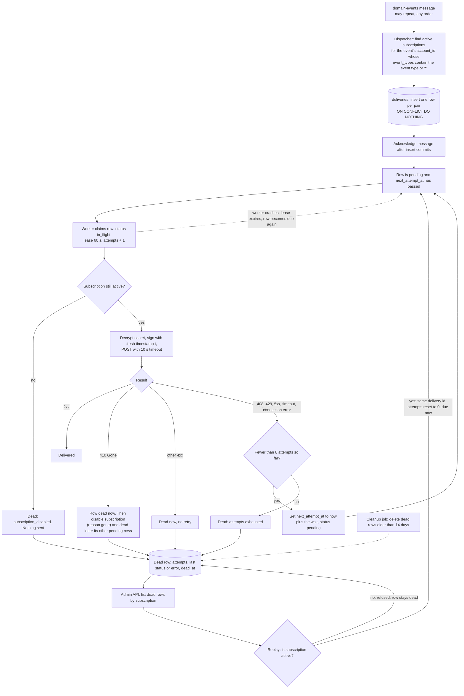

# Webhook delivery plan

## What this service does

Customers register webhook endpoints (their own HTTPS URLs) in the dashboard. Each registration is a row in the `webhook_subscriptions` table in the core database.

The core app records every business event (for example, `invoice.paid`) in an `outbox` table. It writes the event in the same database transaction as the change it describes, so an event is never recorded without its change, or the reverse. A separate process, the outbox relay, reads new outbox rows every second and publishes each one as a message to the `domain-events` topic in the message queue.

This service sits between that topic and the customers' endpoints. For each event, it sends one signed HTTP POST to each matching subscription. If a POST fails in a way that might succeed later, it retries on a fixed schedule. If the delivery still fails after the last attempt, or fails in a way that retrying cannot fix, the delivery is marked **dead** (a dead letter). Dead deliveries stay visible so support can see them and replay them.

## Terms

- **Delivery**: one (event, subscription) pair. It is stored as one row in the `deliveries` table.
- **Dispatcher**: the part that reads `domain-events` and creates delivery rows.
- **Worker**: the part that sends deliveries and handles retries. Several worker instances run at the same time.
- **Claim**: a worker marks a due row as its own, so no other worker sends it at the same time.
- **Lease**: the time limit on a claim, 60 seconds. If a worker dies while holding a claim, the lease runs out and another worker may claim the row.
- **Dead letter**: a delivery that is not sent again unless support replays it.
- **At-least-once**: every event is sent one or more times, never zero times. A receiver may get a repeat, so it ignores repeats by checking the `X-Webhook-Id` header.

## Flow

## Where state lives

All delivery state is in this service's own Postgres database, in one table, `deliveries`. Each row holds:

- `id`: the delivery id. It is sent as `X-Webhook-Id` on every attempt and on every replay.
- `event_id` and `subscription_id`, with a unique constraint on the pair. This is what stops duplicates.
- The exact event JSON bytes. Retries and replays send the same body that was signed.
- `status`: `pending`, `in_flight`, `delivered` or `dead`.
- `attempts`, `next_attempt_at`, `lease_until`.
- `last_status` or `last_error`, and `dead_at`.

The message queue is not a store we rely on. Once the Dispatcher acknowledges a message, the `deliveries` rows are the only record of that event.

The service also connects to the core database. It uses that connection only to read `webhook_subscriptions`, and to update that table's `status` and `disabled_reason` columns. It adds no tables there and changes nothing else.

The two databases cannot share a transaction. Where one step touches both, the steps are ordered so that a crash between them is fixed by a later check (see "Disabled subscriptions" below).

## Dispatch

The Dispatcher reads `domain-events`. For each message it reads the core database for active subscriptions with the event's `account_id` whose `event_types` contains the event type or `'*'`. It inserts one row per subscription, with `next_attempt_at` set to now.

The insert uses `ON CONFLICT (event_id, subscription_id) DO NOTHING`. A repeated message therefore creates no second delivery. The message is acknowledged only after the insert commits. If a Dispatcher crashes before the acknowledgement, the message comes back and the inserts do nothing.

The acknowledgement must happen within the queue's 30-second visibility timeout. If it does not, the message is redelivered while the first copy is still being handled. This is harmless for the same reason.

Matching happens once, at dispatch time. A subscription created after an event does not receive that event.

## Sending and retries

Workers check the `deliveries` table about once a second for rows that are pending and due. This keeps attempt 1 within a few seconds of the event.

To claim a row, a worker runs a short database transaction. It locks the row with `FOR UPDATE SKIP LOCKED`, so other workers skip locked rows instead of waiting for them. It sets the status to `in_flight`, sets `lease_until` to 60 seconds from now, and adds 1 to `attempts`. The transaction ends before any network call, so no database transaction is open during the HTTP request.

Before sending, the worker reads the subscription from the core database.

- If the subscription is disabled, the row becomes dead with reason `subscription_disabled`, and nothing is sent.
- Otherwise, the worker decrypts the secret with `libs/secrets.decrypt()`. It takes a fresh timestamp `t`, computes HMAC-SHA256 over the text `t.` followed by the stored body, and sends a POST with a 10-second timeout. The signature header is `X-Webhook-Signature: t=<t>,v1=<hex>`.

Outcomes of the POST:

- **2xx**: delivered.
- **410 Gone**: the endpoint no longer exists. The row becomes dead now. Then the worker sets the subscription to `disabled` with `disabled_reason = 'gone'` in the core database, and dead-letters the subscription's other pending rows. The core update runs first. If the worker crashes between the two steps, the pre-send check dead-letters the pending rows the next time they are claimed.
- **Any other 4xx**: dead now, no retry.
- **408, 429, any 5xx, timeout, or connection error**: if fewer than 8 attempts have been made, the row goes back to pending with `next_attempt_at` set to now plus the wait. Otherwise it becomes dead.

The waits before attempts 2 through 8 are 30 s, 2 min, 10 min, 30 min, 1 h, 3 h and 6 h. Each wait starts when the failed attempt ends. So attempt 8 happens about 10 hours 43 minutes after attempt 1, not counting the time each request takes.

The waits are stored in `next_attempt_at`, not in queue delays. The queue allows a delay of at most 15 minutes, and the longest wait here is 6 hours.

## Crash recovery and guarantees

A row that is `in_flight` with an expired `lease_until` can be claimed by any worker. A crashed attempt still counts toward the limit of 8.

If a worker crashes after the receiver accepted the POST but before the result was saved, the receiver gets the same event again. This is the at-least-once guarantee. Receivers ignore repeats by checking `X-Webhook-Id`.

The 60-second lease is longer than the 10-second request timeout, so a slow but healthy request keeps its lease. No order is kept between events. Any number of workers can run at once.

## Dead letters, replay and cleanup

A dead row keeps its attempt count and its last status code or error. Support lists a subscription's dead rows through the admin API.

To replay a dead row, the admin API first checks that the subscription is active. If it is disabled, the replay is refused and the row stays dead. Otherwise the row goes back to pending with `next_attempt_at` set to now and `attempts` reset to 0. It keeps the same delivery id and gets a new cycle of up to 8 attempts.

The cleanup job deletes dead rows whose `dead_at` is more than 14 days ago.

Open question: delivered rows are not covered by the cleanup rule. How long to keep them is a separate decision that has not been made.

## Disabled subscriptions

- A subscription disabled in the dashboard, or disabled after a 410, is checked before every send. Its waiting rows are dead-lettered without a send.
- After a 410, the subscription's pending rows are dead-lettered right away, so none of them waits for its next claim.
- A row that is already `in_flight` finishes its current attempt, and the result is recorded as usual. If that attempt fails and retries remain, the next claim sees the disabled subscription and dead-letters the row.
- Dead rows stay listable until the 14-day cleanup removes them.