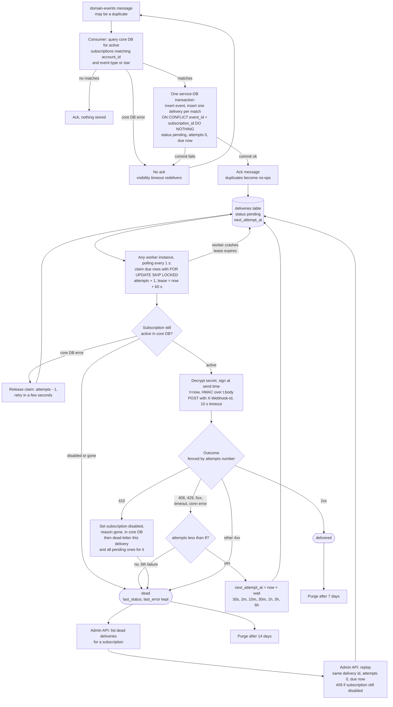

# Outbound webhooks: delivery service design

## Overview

The service reads business events from the `domain-events` queue topic. For each event it finds the customer webhook subscriptions that want it and sends each one a signed HTTP POST. Failed sends are retried on a schedule. A delivery that cannot succeed becomes **dead**. Dead deliveries stay on file so support can list and replay them.

Terms used below:

- **Delivery**: one (event, subscription) pair. It is the unit of work.
- **Fan-out**: turning one event into one delivery per matching subscription.
- **Dead-letter**: set a delivery's status to `dead`, so it gets no more automatic attempts. Support can replay it.
- **Lease**: a temporary claim on a delivery. It lapses by itself if the worker dies.
- **Core DB**: the existing database that holds `webhook_subscriptions`. **Service DB**: this service's own Postgres database.

## Decisions

- **The queue is used only to receive events.** It can delay a message by at most 15 minutes, but our retry waits go up to 6 h. Its dead-letter topic cannot be listed or partially replayed, and support needs both. So retries, scheduling and dead letters all live in the service DB.
- **Each delivery is one row in a `deliveries` table.** The row holds the delivery id, status, attempt count and next due time. Workers poll that table. This gives crash recovery and work sharing across instances without a separate coordinator.
- **Fan-out happens in one transaction.** A unique key on `(event_id, subscription_id)` makes duplicate `domain-events` messages harmless.

## Where state lives

| Store | What | Notes |
|---|---|---|
| Core DB | `webhook_subscriptions` | Read at fan-out, and again at the start of every send (to confirm the subscription is still active and to get the url and secret). The only write is setting `status='disabled'` and `disabled_reason='gone'` after a 410. |
| Service DB `events` | `event_id` PK, `body jsonb` | One copy of each message, stored unmodified because the exact body is signed. Messages are at most 256 KB. |
| Service DB `deliveries` | `id uuid` (sent as `X-Webhook-Id`), `event_id`, `subscription_id`, `status` (`pending`, `delivered`, `dead`), `attempts int`, `next_attempt_at`, `last_status int`, `last_error text`, `dead_at`, `delivered_at`. `UNIQUE (event_id, subscription_id)`. Index on `next_attempt_at WHERE status='pending'`; index on `(subscription_id, dead_at) WHERE status='dead'`. | This table is the schedule, the lock and the dead-letter store. |
| Service DB `delivery_attempts` | `delivery_id`, `attempt`, `started_at`, `status_code`, `error`, `duration_ms` | History for support. A replay appends new rows, so attempt numbers repeat across cycles. Order by `started_at`. |
| Queue | `domain-events` only | A message is acked only after the fan-out transaction commits. |

`next_attempt_at` is the only scheduling column. While `status='pending'` it means one of two things:

- Before a worker claims the row: the time the delivery is due.
- After a claim: the time the claim's lease expires.

There is no separate lock column.

## How it works

### Ingest

1. A consumer receives a message.
2. It queries the core DB for subscriptions with `status='active'`, the same `account_id`, and `event_types` containing the event type or `'*'`.
3. In one service-DB transaction it inserts the `events` row (`ON CONFLICT DO NOTHING`) and one `deliveries` row per match. Each delivery gets a new uuid, `attempts=0` and `next_attempt_at=now()`. Delivery inserts use `ON CONFLICT (event_id, subscription_id) DO NOTHING`.
4. It acks the message after the commit.

Failure cases:

- **Crash before the ack:** the queue redelivers the message, and the unique key makes the repeat a no-op.
- **No matching subscription:** the message is acked and nothing is stored.
- **Core DB or service DB unavailable:** the consumer does not ack, and the queue redelivers after the visibility timeout.
- **Poison messages:** the topic's own dead-letter topic is set to about 10 receives. It is only a safety net for malformed messages, and it should alert.

### Claim (several instances, no coordination)

Each worker polls every second, or sooner when it has spare capacity, and runs:

```sql
UPDATE deliveries SET attempts = attempts + 1,
       next_attempt_at = now() + interval '60 seconds'
WHERE id IN (SELECT id FROM deliveries
             WHERE status='pending' AND attempts < 8
               AND next_attempt_at <= now()
             ORDER BY next_attempt_at LIMIT 20
             FOR UPDATE SKIP LOCKED)
RETURNING *;
```

- `SKIP LOCKED` makes an instance skip rows another instance is already claiming, so instances take disjoint rows.
- The claim sets a 60 s lease. That is longer than the 10 s send timeout plus the time to decrypt and write.
- The claim increments `attempts`, so the count includes the attempt now starting. The new value also identifies this particular attempt. Outcome writes use it to detect a stale worker (see Outcome).

### Send

1. Read the subscription from the core DB. If it is disabled or gone, mark the delivery `dead` with `last_error='subscription_disabled'` and skip the send.
2. Decrypt the secret with `libs/secrets.decrypt()`.
3. Set `t` to the current Unix time. Every attempt, including the first, is signed at send time, because receivers reject a `t` older than 5 minutes. Sign `<t>.<raw body>` with HMAC-SHA256.
4. `POST` the stored body with headers `X-Webhook-Id: <delivery id>` and `X-Webhook-Signature: t=<t>,v1=<hex>`, and a 10 s timeout.
5. Record the attempt in `delivery_attempts`.

### Outcome

Every state write is guarded by `WHERE id=$1 AND status='pending' AND attempts=$n`, where `$n` is the `attempts` value this worker got at claim time. Suppose a worker's lease expires and another worker reclaims the row. The reclaim raises `attempts`, so the first worker's write matches nothing and cannot overwrite the newer attempt. At worst the receiver sees a duplicate, which the unchanged `X-Webhook-Id` lets it dedupe.

| Result | Action |
|---|---|
| 2xx | `status='delivered'` |
| 408, 429, 5xx, timeout, connection error | If `attempts < 8`, set `next_attempt_at = now() + wait[attempts]` with about 10% jitter. This replaces the lease time. After attempts 1 to 7 the waits are 30 s, 2 min, 10 min, 30 min, 1 h, 3 h and 6 h. If `attempts = 8`, dead-letter. |
| 410 | See "410 and waiting deliveries" below. |
| Any other 4xx | Dead-letter immediately, with no retry. |

Dead-lettering sets `status='dead'`, `dead_at=now()`, and `last_status` or `last_error`.

### Crash recovery

A crashed worker leaves its row `pending` with a lease time in the future. When the lease passes, any instance claims the row again. Nothing is lost. The interrupted attempt counts as spent, so a delivery that keeps crashing workers is still bounded at 8 attempts.

One case needs extra handling. If the 8th attempt is the one that crashes, the claim query never picks the row up again, because it requires `attempts < 8`. A janitor loop covers this. It runs on every instance, is safe to run concurrently, and dead-letters rows where `status='pending' AND attempts>=8 AND next_attempt_at<=now()`, with `last_error='worker lost'`.

### 410 and waiting deliveries

A 410 means the endpoint is gone for good. The worker:

1. Updates the core DB: `SET status='disabled', disabled_reason='gone' WHERE id=$1 AND status='active'`. This is idempotent.
2. In one service-DB transaction, dead-letters this delivery with `last_status=410`, and dead-letters every other `pending` delivery for that subscription with `last_error='subscription_disabled'`.

A crash between steps 1 and 2 still converges. The row is reclaimed, the subscription check at the start of the send sees the disabled status, and the row is dead-lettered. The same check covers a customer disabling a subscription in the dashboard.

So deliveries that were waiting move to the dead list, where they are visible and replayable. They are neither silently dropped nor sent to a disabled endpoint.

### Admin API

- `GET /subscriptions/{id}/dead-deliveries` lists dead deliveries, newest first and paged. Each entry has `last_status`, `last_error`, `dead_at`, the attempt history and the event type.
- `POST /deliveries/{id}/replay` first checks the core DB, then runs `UPDATE deliveries SET status='pending', attempts=0, next_attempt_at=now(), dead_at=NULL WHERE id=$1 AND status='dead'`. The delivery id is unchanged, and a fresh cycle of 8 attempts starts.
  - It returns 404 if the delivery does not exist and 409 if it is not dead, so repeat replays are harmless.
  - It returns 409 if the subscription is still disabled. This service may write only `status` and `disabled_reason`, and only to disable, so support must first have the customer re-enable the subscription in the dashboard.

### Retention

A purge job deletes dead deliveries where `dead_at < now() - 14 days`, and `delivered` rows after 7 days (7 days is a design choice, not a requirement). It also deletes `events` rows that have no remaining deliveries.

The delivered-row window is also the dedupe window for duplicate `domain-events` messages. A duplicate arriving after its delivered row is purged would be sent again.

## What happens on failure

| Failure | Result |
|---|---|
| Worker dies mid-send | The lease expires, another instance retries, and the receiver may see a duplicate with the same id. This is the at-least-once guarantee. |
| Consumer dies before ack | The message is redelivered and the unique key makes the second fan-out a no-op. |
| Fan-out transaction fails | The message is not acked, so it is redelivered. Nothing is lost. |
| Core DB down at send (the claim itself uses only the service DB) | The attempt is deferred, not spent. The worker releases the claim by decrementing `attempts` and setting a short `next_attempt_at`, so an outage does not use up the retry budget. |
| Slow or failing receiver | It occupies a worker slot for at most 10 s per attempt. Per-instance concurrency is capped, with a per-subscription in-flight cap so one bad endpoint cannot starve the rest. |
| Out-of-order events | Acceptable by requirement. Receivers can order by `occurred_at` in the payload. |

## Flowchart

