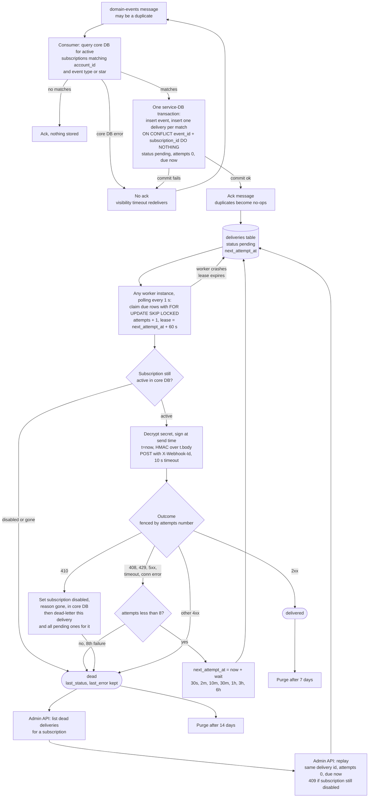

# Outbound webhooks: delivery service design

## Decisions

- **The queue is used only for ingest.** It can delay a message by at most 15 minutes, but retry waits go up to 6 h. The 6 h wait also exceeds what the queue's visibility timeout is meant for, and a topic's dead-letter topic cannot be listed or partially replayed. So retries, scheduling and dead letters all live in the service's own Postgres database.
- **One row per (event, subscription) is the unit of work.** It holds the delivery id, status, attempt count and next due time. Workers poll that table, which gives crash recovery and multi-instance sharing without a separate coordinator.
- **Fan-out is one transaction.** A unique key on `(event_id, subscription_id)` makes duplicate `domain-events` messages harmless.

## Where state lives

| Store | What | Notes |
|---|---|---|
| Core DB (read, plus `status` and `disabled_reason` updates) | `webhook_subscriptions` | Read at fan-out, at claim time (to check the subscription is still active) and at send time (url, secret). The only write is the 410 disable. |
| Service DB `events` | `event_id` PK, `body jsonb` (the raw message) | One copy per event. The exact bytes are signed, so store the body as received. Messages are at most 256 KB. |
| Service DB `deliveries` | `id uuid` (the `X-Webhook-Id`), `event_id`, `subscription_id`, `status` (`pending`, `delivered`, `dead`), `attempts int`, `next_attempt_at`, `last_status int`, `last_error text`, `dead_at`, `delivered_at`. `UNIQUE (event_id, subscription_id)`. Index on `next_attempt_at WHERE status='pending'`; index on `(subscription_id, dead_at) WHERE status='dead'`. | This table is the schedule, the lock and the dead-letter store. |
| Service DB `delivery_attempts` | `delivery_id`, `attempt`, `started_at`, `status_code`, `error`, `duration_ms` | History for support. Each replay cycle appends rows. |
| Queue | `domain-events` only | A message is acked only after the fan-out transaction commits. |

`next_attempt_at` is the only scheduling column. While `status='pending'`, it means either "due at this time" or, once a worker has claimed the row, "the claim lease expires at this time". There is no separate lock or lease column.

## How it works

**Ingest**
1. A consumer receives a message.
2. It queries the core DB for subscriptions with `status='active'`, the same `account_id`, and `event_types` containing the event type or `'*'`.
3. In one service-DB transaction it inserts the `events` row (`ON CONFLICT DO NOTHING`) and one `deliveries` row per match. Each delivery gets a new uuid, `attempts=0` and `next_attempt_at=now()`. Inserts use `ON CONFLICT (event_id, subscription_id) DO NOTHING`.
4. It acks the message after commit.

A crash before the ack makes the queue redeliver, and the unique key turns the repeat into a no-op. A message with no matching subscription is acked with nothing stored. If the core DB or the service DB is unavailable, the consumer does not ack, and the visibility timeout retries the message. The topic's dead-letter topic, set to about 10 receives, is only a safety net for malformed messages, and it should alert.

**Claim (several instances, no coordination)**
Each worker polls every second, or sooner when it has spare capacity, and runs:

```sql
UPDATE deliveries SET attempts = attempts + 1,
       next_attempt_at = now() + interval '60 seconds'
WHERE id IN (SELECT id FROM deliveries
             WHERE status='pending' AND attempts < 8
               AND next_attempt_at <= now()
             ORDER BY next_attempt_at LIMIT 20
             FOR UPDATE SKIP LOCKED)
RETURNING *;
```

`SKIP LOCKED` lets instances take disjoint rows. The 60 s lease is longer than the 10 s timeout plus decrypt and write time. The incremented `attempts` value is the fencing token for this attempt.

**Send**
1. Check the subscription status against the core DB. If it is disabled or gone, mark the delivery `dead` with `last_error='subscription_disabled'` and skip the send.
2. Decrypt the secret with `libs/secrets.decrypt()`.
3. Compute `t=now` at this moment, so every attempt, including the first, is signed at send time. Sign `<t>.<raw body>` with HMAC-SHA256.
4. `POST` the stored body with headers `X-Webhook-Id: <delivery id>` and `X-Webhook-Signature: t=..,v1=..`, and a 10 s timeout.
5. Record the attempt in `delivery_attempts`.

**Outcome.** Every state write is guarded by `WHERE id=$1 AND status='pending' AND attempts=$n`. A worker that lost its lease cannot overwrite a newer attempt. At worst the receiver sees a duplicate, which the stable `X-Webhook-Id` lets it dedupe.

| Result | Action |
|---|---|
| 2xx | `status='delivered'` |
| 408, 429, 5xx, timeout, connection error | If `attempts < 8`, set `next_attempt_at = now() + wait[attempts]` with about 10% jitter. The waits are 30 s, 2 min, 10 min, 30 min, 1 h, 3 h and 6 h. If `attempts = 8`, dead-letter. |
| 410 | See the 410 section below. |
| Any other 4xx | Dead-letter immediately, with no retry. |

Dead-lettering sets `status='dead'`, `dead_at=now()`, and `last_status` or `last_error`.

**Crash recovery.** A crashed worker leaves its rows `pending` with a lease time in the future. When the lease passes, any instance claims the row again. Nothing is lost, and the interrupted attempt counts as spent, so a delivery that keeps crashing workers is still bounded at 8. A janitor loop running on every instance, safe to run concurrently, dead-letters rows where `status='pending' AND attempts>=8 AND next_attempt_at<=now()` with `last_error='worker lost'`.

**410 and waiting deliveries**
1. The worker first updates the core DB: `SET status='disabled', disabled_reason='gone' WHERE id=$1 AND status='active'`. This is idempotent.
2. In one service-DB transaction it dead-letters this delivery with `last_status=410`. In the same transaction it dead-letters every other `pending` delivery for that subscription with `last_error='subscription_disabled'`.

A crash between steps 1 and 2 still converges. The row is reclaimed, the claim-time subscription check sees the disabled status, and the row is dead-lettered. The same check covers a customer disabling a subscription in the dashboard. Waiting deliveries therefore move to the dead list, where they are visible and replayable. They are neither silently dropped nor kept sending to a disabled endpoint.

**Admin API**
- `GET /subscriptions/{id}/dead-deliveries` lists dead deliveries with `last_status`, `last_error`, `dead_at`, attempt history and event type, newest first, paged.
- `POST /deliveries/{id}/replay` runs `UPDATE deliveries SET status='pending', attempts=0, next_attempt_at=now(), dead_at=NULL WHERE id=$1 AND status='dead'`. The delivery id is unchanged, and a fresh cycle of 8 attempts starts. It returns 404 or 409 if the row is not dead, which makes repeat replays harmless. It returns 409 if the subscription is still disabled; support must have the customer re-enable it in the dashboard first, since this service may write only `status` and `disabled_reason`.

**Retention.** A purge job deletes dead deliveries where `dead_at < now() - 14 days`, and `delivered` rows after 7 days (my choice, not a requirement). Orphaned `events` rows go with them. The delivered-row window is also the dedupe window for duplicate `domain-events` messages. A duplicate arriving after that would be re-sent.

## What happens on failure

| Failure | Result |
|---|---|
| Worker dies mid-send | The lease expires, another instance retries, and the receiver may see a duplicate with the same id. This is the at-least-once guarantee. |
| Consumer dies before ack | The message is redelivered and the unique key makes the second fan-out a no-op. |
| Fan-out transaction fails | The message is not acked, so nothing is lost. |
| Core DB down at send or claim | Attempts are deferred, not spent. The worker releases the claim by decrementing `attempts` and setting a short `next_attempt_at`, so an outage does not burn the retry budget. |
| Slow or failing receiver | It occupies a worker slot for at most 10 s per attempt. Per-instance concurrency is capped, with a per-subscription in-flight cap so one bad endpoint cannot starve the rest. |
| Out-of-order events | Acceptable by requirement. Receivers order by `occurred_at` in the payload. |

## Flowchart


