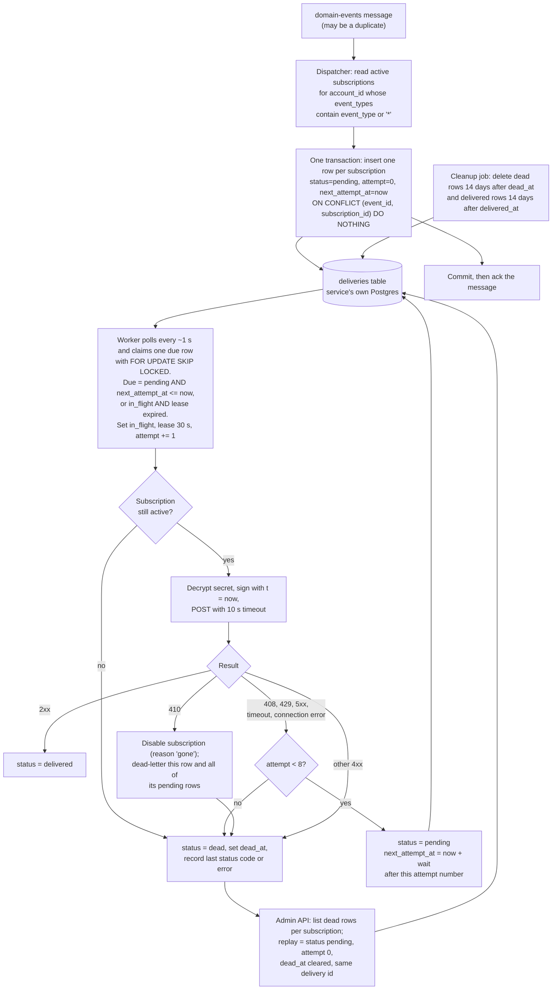

# Webhook delivery plan

This service sits between the `domain-events` topic (the queue) and customer endpoints. It turns each event into signed HTTP deliveries, retries failures, and dead-letters the ones that cannot succeed.

It has its own Postgres database, and all of its state is in one table, `deliveries`. One row is one (event, subscription) pair. Each row has a `status`: `pending`, `in_flight`, `delivered` or `dead`.

Retries do not use the queue. The queue's maximum delay is 15 minutes, and our waits go up to 6 hours. Instead, each row stores a `next_attempt_at` timestamp, and workers poll Postgres for rows that are due.

Components:
- **Dispatcher**: consumes `domain-events` and creates delivery rows.
- **Delivery workers**: several identical instances. They claim due rows and send them.
- **Admin API**: lists dead deliveries and replays them.
- **Cleanup job**: deletes old rows.

## Where state lives

`deliveries` is the only state this service owns. Columns:
- `id`: the delivery id, sent as `X-Webhook-Id`. It never changes, including on replay.
- `event_id`, `subscription_id`: unique together, so a duplicate event cannot create a second delivery.
- `body`: a copy of the event JSON, so sending never depends on another system. Events are at most 256 KB.
- `status`: `pending`, `in_flight`, `delivered` or `dead`.
- `attempt`: number of attempts started. A claim increments it before sending.
- `next_attempt_at`: when the row is next due.
- `lease_until`: when the current worker's claim expires.
- `last_status_code`, `last_error`: outcome of the latest attempt.
- `delivered_at`, `dead_at`: when the row reached that state. Used for retention.

Subscription data (url, secret, status) is read from the core database at send time, not copied, so edits apply immediately. The service writes only `status` and `disabled_reason` there.

## Behavior

**Matching and dedupe.** The dispatcher inserts all rows for a message in one transaction and acks the message after the commit. If it crashes before the ack, the queue redelivers the message, and the unique key makes the second insert a no-op.

**Multiple workers.** A worker claims a row with `FOR UPDATE SKIP LOCKED`, so no two workers take the same row. A new row is due immediately, so attempt 1 goes out about 1 s later (the polling interval).

**Crash recovery.** A claim sets a 30 s lease, which is longer than the 10 s timeout. If a worker dies mid-send, the lease expires and any worker claims the row again. That can send the same delivery twice. This is allowed: the guarantee is at-least-once, and the unchanged `X-Webhook-Id` lets receivers dedupe. No row is lost, because it stays in the table until it is delivered or dead.

Two rules keep this safe:
- A reclaim after a crash counts as an attempt. If the crashed attempt was already the 8th, the reclaim is dead-lettered instead of sent.
- A worker saves its result only if the row's `attempt` still equals the value it claimed. A slow worker whose lease expired therefore cannot overwrite a newer claim.

**Signing.** Each attempt is signed when sent: `X-Webhook-Signature: t=<now>,v1=hex(HMAC-SHA256(secret, "<t>.<raw body>"))`. A retry hours later still passes the receivers' 5-minute check.

**Retry waits.** After failed attempt 1 to 7, the wait before the next attempt is 30 s, 2 min, 10 min, 30 min, 1 h, 3 h and 6 h respectively. A failure of attempt 8 is dead-lettered.

**Disabled subscriptions.** A subscription can be disabled by a 410 or by the dashboard. Its waiting rows are dead-lettered, not sent and not silently dropped, with `last_error = 'subscription disabled'`. Workers check this at claim time. A 410 also dead-letters that subscription's pending rows immediately. Support can replay these rows after the customer re-enables the subscription. A replay is rejected while the subscription is still disabled.

**Replay.** The admin API lists a subscription's dead rows with `last_status_code` or `last_error`. A replay sets the row to `pending`, `attempt = 0`, `next_attempt_at = now`, and clears `dead_at`. The delivery id is kept, and the row gets a fresh cycle of 8 attempts.

**Retention.** Dead rows are deleted 14 days after `dead_at`. Delivered rows are also kept 14 days after `delivered_at`, so late duplicate events are still deduped. The 14 days for delivered rows is my choice, not a requirement. A duplicate event arriving after that could be delivered again.