# shop-api release pipeline: merge to production

## What this is

Today a person runs `existing/deploy.sh` from a laptop to deploy shop-api to staging or production, and CI only builds and unit-tests pull requests. This pipeline runs that same script from CI. Each merge to `main` starts one release run: it builds one image, tests it, deploys it to staging, waits for one human approval, canaries production for 15 minutes, then moves all of production to that image. Each gate stops the run before the next, more exposed step. Every deploy goes through `deploy.sh`.

The only deploy state is the SSM values that `deploy.sh` already writes. The run's own state (its steps, the approval record and the locks) lives in CI.

## Terms

- **SHA**: the commit ID of a merge to `main`. It is also the image tag, so one tag means one commit.
- **Squash merge**: a merge that records a pull request as one new commit. The commit's author can differ from the pull request's author.
- **Image**: a container built from a SHA and pushed to `registry.internal/shop-api`.
- **CI**: the CI system that runs the pipeline. A **runner** is the machine that runs a CI job.
- **Release run**: one CI pipeline execution for one merge SHA. Each step below is a job or gated stage of that execution.
- **Kubernetes context**: a cluster as `kubectl` knows it. The two contexts are `staging` and `production`. The namespace is `shop` in both.
- **Deployment, pod, rollout**: a deployment runs pods (copies of the app) from one image. A rollout replaces its pods with pods from a new image. `rollout status` waits for that to finish or time out.
- **Stable**: the `shop-api` deployment that serves production.
- **Canary**: `shop-api-canary`, a second production deployment that normally has 0 pods. While it has ready pods, the load balancer (the component that spreads user requests across pods) sends it about 10% of production traffic.
- **deploy.sh**: `existing/deploy.sh`. It runs migrations, sets the image on a deployment, waits for the rollout, then records tags in SSM.
- **SSM**: AWS Parameter Store, a key-value store. `/deploy/<env>/current_tag` holds the tag stable runs. `/deploy/<env>/previous_tag` holds the tag it ran before that. The canary is never recorded there.
- **Migration**: a database schema change that `deploy.sh` runs before the image changes. Migrations are forward-only: there are no down steps, and nothing in `deploy.sh` undoes one. Every migration must keep working with the previous image. `migrate up` applies only pending migrations, so running it again does nothing.
- **Rollback**: `deploy.sh rollback <env>`. It sets stable's image back to `previous_tag`, waits for the rollout, then writes `current_tag`. It does not touch the schema.
- **Lock**: a named CI lock that only one run can hold at a time. The pipeline uses `staging` and `production-deploy`.
- **Ahead**: the run's SHA descends from the environment's `current_tag` and is not the same commit. The runner checks this with `git merge-base --is-ancestor <current_tag> <SHA>` on the repo it has from the build. A run whose SHA is not ahead is **superseded**: it ends without deploying.
- **Smoke tests**: `make smoke ENV=staging`, about 3 minutes, against the staging URL.
- **Approval**: a manual CI job restricted to the `release-approvers` group. CI records who approved and when.
- **Deploy window**: Monday to Thursday, 09:00 to 15:00 UTC. A production deploy must start inside it. Once started, it may finish after 15:00.
- **Canary 5xx ratio**: the share of canary responses that are HTTP 5xx over the last minute, read from Prometheus (the metrics store): `sum(rate(http_requests_total{app="shop-api-canary",code=~"5.."}[1m])) / sum(rate(http_requests_total{app="shop-api-canary"}[1m]))`. If the canary got no requests in that minute, the query returns no value.
- **Fail closed**: when the metric has no value, or the query fails or times out, the run counts that as a failure. The first minute of the watch is the one exception (step 11).
- **Flaky test**: a test that sometimes fails for no code reason. One integration test is known to be flaky.
- **Postgres service container**: a database that the CI job starts for the integration tests.

## Diagram

Boxes are steps. Arrow labels are outcomes. Yellow diamonds are gates. Red boxes end the run or hand it to a person. Typical durations: unit tests about 4 minutes, integration tests about 12 minutes, smoke tests about 3 minutes, canary watch 15 minutes, approval up to 72 hours.

```mermaid
flowchart TD
  subgraph PRFLOW["A. Pull request: unchanged from today, never deploys"]
    PR1["Trigger: pull request opened or updated"] --> PR2["Build image in CI<br/>not pushed"]
    PR2 -->|"build fails"| PR5["PR check red<br/>nothing pushed, nothing deployed"]
    PR2 --> PR3["Unit tests: make test-unit, about 4 min<br/>no retry"]
    PR3 -->|"pass"| PR4["PR check green<br/>nothing pushed, nothing deployed"]
    PR3 -->|"fail"| PR5
  end

  subgraph RUN["B. Merge to main: one release run per merge commit SHA"]
    M1["Trigger: merge to main<br/>reads: merge commit SHA"] --> B1["Build image once<br/>tag = SHA, push to registry.internal/shop-api"]
    B1 -->|"build fails"| FAIL["Run failed<br/>no lock held<br/>announce reason in #deploys"]
    B1 --> UT["Unit tests: make test-unit<br/>no retry, about 4 min"]
    B1 --> IT1["Integration tests, attempt 1<br/>make test-integration, about 12 min<br/>Postgres service container"]
    IT1 -->|"fail"| IT2["Integration tests, retry 1 of 1<br/>same commit, no rebuild"]
    IT2 -->|"fail"| FAIL
    UT -->|"fail: running integration tests cancelled"| FAIL
    IT1 -->|"pass"| TJ["Both suites passed"]
    UT -->|"pass"| TJ
    IT2 -->|"pass"| TJ
    TJ --> SL["Take lock staging<br/>waits if another run holds it"]
    SL --> SS{"Is SHA ahead of staging current_tag?<br/>reads /deploy/staging/current_tag"}
    SS -->|"no: superseded"| SUP["Release lock staging<br/>run superseded, announce in #deploys"]
    SS -->|"check cannot run: SSM value missing or SHA not in history"| SFAIL["Release lock staging<br/>run failed, announce in #deploys"]
    SS -->|"yes"| S1["deploy.sh staging SHA<br/>migrate up, roll stable<br/>writes previous_tag then current_tag after rollout"]
    S1 -->|"migration or rollout fails: no automatic rollback"| SFAIL
    S1 --> S2["Smoke tests: make smoke ENV=staging<br/>about 3 min, staging URL"]
    S2 -->|"fail"| S3["deploy.sh rollback staging<br/>image back to previous_tag, writes current_tag after rollout"]
    S3 -->|"rollback succeeds"| SFAIL
    S3 -->|"rollback fails: staging lock stays held"| HUMANS["Run stuck: staging lock stays held<br/>a person checks staging and SSM, then clears the lock"]
    S2 -->|"pass"| SR["Release lock staging<br/>staging stays on SHA"]
    SR --> AP{"Manual approval, request names SHA<br/>group release-approvers only<br/>not merge commit author or PR author<br/>72 h from request"}
    AP -->|"no approval within 72 h, or rejected"| EXP["Run ends: expired or rejected<br/>nothing goes to production<br/>announce in #deploys"]
    AP -->|"approved"| WIN{"Inside deploy window?<br/>start Mon to Thu, 09:00 to 15:00 UTC"}
    WIN -->|"no"| WW["Wait for next window start<br/>no lock held, no deploy starts outside"]
    WW --> WIN
    WIN -->|"yes"| PL["Take lock production-deploy<br/>waits if another production deploy holds it"]
    PL --> WIN2{"Still inside window after the wait?"}
    WIN2 -->|"no"| PLR["Release lock production-deploy"]
    PLR --> WW
    WIN2 -->|"yes"| PS{"Is SHA ahead of production current_tag?<br/>reads /deploy/production/current_tag"}
    PS -->|"no: superseded"| PSR["Release lock production-deploy<br/>run superseded, announce in #deploys"]
    PS -->|"yes"| C1["deploy.sh canary SHA<br/>migrate up on shared production Postgres first<br/>canary 2 pods, about 10% of traffic, not in SSM"]
    C1 -->|"migration or canary rollout fails"| CO1["deploy.sh canary-off"]
    CO1 -->|"ok"| FAILP["Release lock production-deploy<br/>run failed, announce in #deploys"]
    CO1 -->|"fails"| HUMAN
    C1 -->|"canary ready: deploy.sh exits 0, watch clock starts"| C2["Watch canary 15 min<br/>check 5xx ratio every 15 s, 1-minute window"]
    C2 -->|"any value above 1%, or no value or query error after the first minute"| CO2["deploy.sh canary-off"]
    CO2 -->|"ok"| FAILP
    CO2 -->|"fails"| HUMAN
    C2 -->|"15 min, every check at or under 1%"| P1["deploy.sh production SHA<br/>migrate up finds nothing pending, rolls stable<br/>writes previous_tag then current_tag after rollout"]
    P1 -->|"rollout fails: no automatic rollback"| CO4["deploy.sh canary-off"]
    CO4 -->|"ok"| FAILP
    CO4 -->|"fails"| HUMAN
    P1 -->|"rollout ok"| CO3["deploy.sh canary-off, removes canary"]
    CO3 -->|"fails"| HUMAN
    CO3 -->|"ok"| DONE["Release lock production-deploy<br/>announce finished production deploy of SHA in #deploys"]
    DONE --> FIN(["Run complete"])
    HUMAN["Run stuck: production-deploy lock stays held<br/>a person confirms no canary pods and no canary traffic"]
  end

  classDef stop fill:#fde8e8,stroke:#b42318,color:#111
  classDef gate fill:#fff7d6,stroke:#8a6d00,color:#111
  class FAIL,SFAIL,FAILP,HUMANS,HUMAN,EXP,SUP,PSR stop
  class AP,WIN,WIN2,SS,PS gate
```

Notes on the diagram:

- `staging` is held from the ahead check through smoke tests and any rollback. It is released before approval.
- `production-deploy` is held from its check after the wait until the final canary-off.
- The run holds no lock while it waits for the staging lock, for approval, for the deploy window, or for the `production-deploy` lock.

## Steps

Each step gives its trigger, what it does, which part keeps the data, and what happens when it goes wrong.

1. **Pull request.** Trigger: a pull request is opened or updated. CI builds the image without pushing it, then runs `make test-unit` (about 4 minutes) with no retry. Nothing is pushed and nothing is deployed. Today unit tests run on pull requests and integration tests do not, and that does not change. If the build or tests fail, the PR check goes red and the author fixes and pushes again.

2. **Merge build.** Trigger: a merge to `main`. One release run starts for the merge commit's SHA. CI builds the image once, tags it with the SHA and pushes it to `registry.internal/shop-api`. Nothing is rebuilt after the tests: staging and production deploy that same image. The pushed image stays in the registry whatever the outcome, because nothing removes it. SSM names a tag only after a successful rollout, so an unused image is never recorded as current. If the build fails, the run fails, no lock is held, and the reason is announced in #deploys.

3. **Tests.** Trigger: the build succeeded. Unit tests (`make test-unit`, about 4 minutes, no retry) and integration tests (`make test-integration`, about 12 minutes, with a Postgres service container) run in parallel. Both must pass, and a test failure ends the run. Integration tests get one retry of the same commit, with no rebuild, because one test is known to be flaky. A unit failure ends the run at once and cancels the integration tests still running, because waiting for a suite that cannot change the outcome would waste about 12 minutes. An integration failure gets its retry first. The run ends only if that retry fails or unit tests have already failed.

4. **Staging lock and ahead check.** Trigger: both suites passed. The run takes the `staging` lock. If another run holds it, this run waits, and this design sets no time limit on that wait. Only after it holds the lock does the run check that its SHA is ahead of `/deploy/staging/current_tag`. The check runs after the lock so that two runs cannot both pass it and deploy out of order. If the SHA is not ahead, the run releases the lock and ends as superseded, announced in #deploys. If the SSM value is missing or the SHA is not in the repo's history, the check cannot run: the run releases the lock and fails. While it waits, the run has pushed its image and passed its tests, but has changed nothing.

5. **Staging deploy.** Trigger: the ahead check passed. With the `staging` lock held, the run runs `deploy.sh staging <SHA>`. The script runs migrations, rolls stable to the SHA, and waits up to 300 seconds for the rollout. It writes `previous_tag`, then `current_tag`, only after the rollout succeeds. If a migration or the rollout fails, the run releases the lock and fails. Nothing rolls back automatically (see Rules). The cluster may then run a half-new image while SSM is unchanged. The next run does not need a fix first. Its deploy sets the image to its own SHA and waits for the rollout, which replaces the half-new image. That works because the next SHA contains the failed merge, so the failed SHA's migrations are already in its history and stay applied. Its ahead check passes because `current_tag` still names the last good tag. A person may still act first, using the checks in "After a failure: checking SSM".

6. **Smoke tests.** Trigger: the deploy succeeded. The run runs `make smoke ENV=staging`, about 3 minutes, against the staging URL, which serves stable. If the tests pass, the run releases the `staging` lock and staging stays on the SHA. If they fail, the run runs `deploy.sh rollback staging`. That sets the image back to `previous_tag` and writes `current_tag` only after the rollout succeeds. Rollback does not touch the schema, so the failed SHA's migrations stay applied. That is safe only because of the migration rule. After a successful rollback, `previous_tag` and `current_tag` name the same image, so a second rollback changes nothing. A later run for a newer SHA still passes the ahead check, because the rolled-back tag is older. If the rollback succeeds, the run fails, releases the lock, and staging runs the `previous_tag` image. If the rollback fails, the run fails and keeps the `staging` lock. A person then checks staging and SSM, and clears the lock.

7. **Approval.** Trigger: staging passed and the `staging` lock is released. The run holds no lock while it waits. CI shows a manual approval job restricted to `release-approvers`. The request names the SHA it approves and states when the deploy window next opens. An approver approves or rejects the job in CI, and CI records who and when. The approver cannot be the author of the merge commit. The pull request author is excluded too when it differs, because a squash merge can change the commit author. The 72-hour limit runs from the request. If nobody approves within 72 hours, or the job is rejected, the run ends as expired or rejected. Nothing goes to production, staging stays on the SHA until a newer run supersedes it, and the outcome is announced in #deploys.

8. **Deploy window.** Trigger: the run is approved. If the time is outside the window, the run waits and holds no lock. No deploy starts outside the window. The 72-hour limit covers approval only, not this wait. A late-Thursday approval can wait about 90 hours for Monday 09:00.

9. **Production lock and checks.** Trigger: approved and inside the window. The run takes the `production-deploy` lock and waits if another production deploy holds it. It holds this lock until its final canary-off, so only one production deploy is in progress at a time. After the wait, the run checks the window again. If the window has closed, it releases the lock and returns to step 8. Otherwise it runs the ahead check against `/deploy/production/current_tag`, as in step 4. If the SHA is not ahead, it releases the lock and ends as superseded, announced in #deploys.

10. **Canary.** Trigger: both checks passed. The run runs `deploy.sh canary <SHA>`. This is the first production change. The script runs migrations first, on the shared production Postgres, while stable still runs the old image. It then sets the canary's image to the SHA, scales the canary to 2 pods, and waits up to 300 seconds for the rollout. The canary serves real users. The load balancer sends it about 10% of production traffic while it has ready pods. That share is set by the load balancer, not by the pod count. Canary changes are never written to SSM. The migration rule makes this safe: stable keeps serving on the new schema, and the migration stays applied if the canary fails. If the migration or canary rollout fails, the run runs `deploy.sh canary-off`, releases the lock, and fails.

11. **Watch.** Trigger: `deploy.sh canary` exits 0, which means its rollout finished within the 300-second limit. That is what "ready" means here. The 15-minute clock starts at that moment. If the command fails or times out, no watch starts and the run takes the canary-off path. For 15 minutes, every 15 seconds (this design's choice), the run evaluates the canary 5xx ratio over the last minute. Each evaluation covers the last minute, so a spike is seen by every check that covers it. The ratio counts all canary responses in that minute. One failed request in a minute with only one canary request reads 100%. The brief fixes the 1% limit, and the files give no traffic volume to set a minimum from, so no minimum applies. This is accepted because it fails safe. Any value above 1% fails the run at once, at any check, including the first. The first one-minute window after ready may hold no canary requests yet, so a no-value result is ignored during that first minute. After that minute, a no-value result fails the run, because the metric fails closed. A query that fails or times out counts as no value. On failure, the run runs `deploy.sh canary-off`, releases the lock and fails. The watch is not retried.

12. **Promote and finish.** Trigger: 15 minutes have passed and every check was at or under 1%. The run runs `deploy.sh production <SHA>`. The script runs `migrate up` again on the same image. It finds nothing pending, because the canary already applied the migrations. The run promotes the same SHA it canaried. A newer run cannot start its canary until this run releases `production-deploy`, so the SHA cannot change in between. The script rolls stable to the SHA, waits up to 300 seconds, and writes `previous_tag`, then `current_tag`, only after success. While that rollout runs, stable pods may be on either image. The run then runs `deploy.sh canary-off`, which scales the canary to 0 pods. The script returns once the scale is accepted and does not wait for pods to stop. Between promotion and canary-off, stable and canary both run the SHA. The run checks nothing on production after promotion, because the 15-minute watch is the last gate. When the final canary-off succeeds, the run releases `production-deploy` and announces the finished production deploy of the SHA in #deploys. If the stable rollout fails, the run runs `deploy.sh canary-off` and fails, with no rollback and no SSM write.

13. **Cancellation or error.** Trigger: a person cancels the run, or it errors. The run holds at most one lock at a time, and every lock is released on every exit path. `staging` is released before approval, and `production-deploy` is taken only after approval. So a cancel during the staging lock wait, or during approval, holds nothing. A cancel during the staging deploy or smoke tests releases `staging`. Once the run holds `production-deploy`, cleanup runs `deploy.sh canary-off` first if the canary has started, then releases `production-deploy`. The design intends every exit after canary start to run canary-off, including cancellation. If the runner itself dies, nothing in the run can do it (see Known risks).

## Failure summary

Each failure is announced in #deploys with the run, the step and the reason. The author of the merged commit and the team fix failures.

| Stage and failure | Result | Who acts next |
|---|---|---|
| Pull request build or unit tests | PR check red, nothing pushed or deployed | Author fixes and pushes |
| Merge build | Run fails, no lock held | Fix by a new merge |
| Unit tests | Run ends at once, running integration tests cancelled | Fix by a new merge |
| Integration tests, retry also fails | Run ends | Fix by a new merge |
| Staging lock held by another run | Run waits, no time limit set. Later runs also wait | A person clears a stuck lock (see open questions) |
| Staging check: SSM value missing, or SHA not in history | Run fails, nothing deployed, lock released | A person sets the value or checks history |
| Staging check: SHA not ahead | Run superseded, lock released | None: a newer run supersedes |
| Staging deploy: migration or rollout fails | Run fails, lock released, SSM not written for this deploy | A person decides from SSM, or the next run supersedes it |
| Smoke tests fail, rollback succeeds | Run fails, lock released, staging runs the `previous_tag` image | Fix by a new merge |
| Smoke tests fail, rollback fails | Run fails, `staging` lock stays held | A person checks staging and SSM, then clears the lock |
| Approval rejected, or 72 h pass | Run ends, nothing goes to production, staging stays on SHA | The next run supersedes staging |
| Deploy window closed | Run waits, no lock held | Starts at the next window |
| Production lock held by another run | Run waits | None |
| Window closed during the production lock wait | Lock released, run returns to waiting for the window | None |
| Production check: SHA not ahead | Run superseded, lock released | None |
| Canary deploy: migration or canary rollout fails | canary-off, lock released, run fails. Migrations stay applied | Fix by a new merge |
| Canary watch: above 1% at any check, or no value or query error after the first minute | canary-off, lock released, run fails | Fix by a new merge |
| Canary metric: no data for the canary, or the query fails | Every production run fails closed until the metric returns | Someone watches the metric |
| Promotion: stable rollout fails | canary-off, lock released, run fails. No rollback, SSM not written | A person decides from SSM |
| canary-off fails at any point | Run ends, `production-deploy` lock stays held | A person confirms no canary pods and no canary traffic, then clears the lock |
| Cancel or error after canary start | Cleanup runs canary-off, then releases the lock | If the runner dies, nothing runs canary-off. A person checks the canary |
| Announcement to #deploys fails | Locks, SSM and cluster unchanged. The CI run still shows its result | A person reads the CI run (see open questions) |

## After a failure: checking SSM

A person reads `/deploy/<env>/current_tag` and `/deploy/<env>/previous_tag` with `aws ssm get-parameter`. They also read the image stable runs with `kubectl get deploy/shop-api` in namespace `shop` in that environment's context, and compare both with the SHA in the #deploys message. SSM is written only after a successful rollout. So after a failed run, `current_tag` can name an image the cluster does not run. After a failed rollback, SSM is unchanged, so `current_tag` still names the failed SHA while the cluster may run either image. The options are:

- run `deploy.sh rollback <env>` only if `previous_tag` is the image wanted;
- run `deploy.sh <env> <tag>` on a SHA known to be good;
- leave the state, and let the next run supersede it.

Check first, because the script's writes depend on whether each step succeeded.

## Rules

- **Environments only move forward.** Before any staging or production deploy, the run checks that its SHA is ahead of that environment's `current_tag`. Rollback is the only deliberate backward move. The check stops an older approved run from putting production back on an older image after a newer one has shipped.
- **Failed deploys are not rolled back automatically.** `deploy.sh` writes `current_tag` only after a successful rollout, so `current_tag` names the last good image. Rollback goes to `previous_tag`, the tag before that good one, so an automatic rollback would not return to the last good image. A person decides from the SSM values instead. A failed rollback keeps the `staging` lock, because releasing it would let the next run's ahead check read a `current_tag` that may be wrong.
- **Retrying means a new merge.** The failed SHA's migrations may already be applied and its image may already be deployed. Integration tests get one retry of the same commit. Unit tests, smoke tests and the canary watch get no retry.
- **Every check after a wait reads SSM again.** No check trusts an earlier read.
- **Approval time limit.** The 72-hour limit covers approval only. The deploy window wait has no limit set here.
- **Canary metric fails closed.** No value, or a failed or timed-out query, counts as a failure, except during the first minute of the watch.

## Known risks

- A canary metric outage fails every production run closed. This is accepted for safety, and the metric should be watched.
- A single failed request in a quiet minute can fail the canary watch. This is accepted, because it fails safe.
- An approved run can be superseded while it waits for the window. The approval is then unused, and the approver must approve the newer run.
- An approved older run can still reach production while staging runs a newer SHA, if production is still behind. Each environment only moves forward on its own check.
- Staging stays on the new SHA after expiry, rejection or a production failure. The next run supersedes it.
- If the runner dies during the canary watch, nothing runs `canary-off`. If `canary-off` fails, a person confirms that no canary pods remain and that the load balancer sends them no traffic. In the production context, namespace `shop`, check that `deploy/shop-api-canary` shows 0 replicas and no ready canary pods, and that `sum(rate(http_requests_total{app="shop-api-canary"}[1m]))` is zero. The 5xx ratio cannot show this, because it has no value at zero traffic.

## Before the first run

These are set up outside the pipeline and must exist before the first run.

- CI must be able to push to `registry.internal/shop-api`, and must have credentials to run `deploy.sh` against both clusters.
- CI must support a manual approval job restricted to `release-approvers` that records who approved and when, and named locks `staging` and `production-deploy`.
- The runner must have the git history of `main`, for the ahead check.
- `/deploy/staging/current_tag` and `/deploy/production/current_tag` must exist in SSM.
- Staging: Kubernetes context `staging`, namespace `shop`, its own Postgres, internal only. Smoke tests use the staging URL.
- Production: Kubernetes context `production`, namespace `shop`. `shop-api` is stable and `shop-api-canary` is the canary, normally at 0 replicas. Stable and canary share one production Postgres.
- Integration tests need a Postgres service container. One integration test is known to be flaky.
- Announcements go to Slack #deploys.

## Open questions

- How long CI lets a job wait for a lock, or an approved run wait for the deploy window, before giving up. These files do not say. This design sets no limit.
- Who may clear a held lock, and how. These files do not say.
- Whether a waiting CI job holds a runner the whole time. Whether a restart of the runner or CI during the approval or window wait ends the run. Whether CI keeps one pipeline execution alive across those waits. Every check after a wait reads SSM again, so the run does not depend on an earlier read.
- Whether CI frees a lock held by a run that is cancelled.
- Whether CI closes an older approval request when a newer run starts, and whether both can be approved.
- Whether the approval screen can show the next window start time.
- Who checks that each migration works with the previous image. No gate in this pipeline checks it. It relies on the migration's author and review, which these files do not describe.
- What happens to requests on canary pods when `canary-off` scales them down, and how fast the load balancer stops sending them traffic.
- How many requests a normal minute gives the canary. Without that, how often one failed request trips the 1% limit is unknown.
- What users see during the stable rollout, and whether it replaces pods one at a time. The files do not give the deployment's update strategy.
- What the smoke tests check, and what staging users see during a rollback. The files give only the command, its length and the staging URL.
- How long pushed images stay in the registry. The files give no retention policy, and nothing in the pipeline removes them.
- Whether a person may run `deploy.sh` from a laptop to recover a failed run. The goal rules out laptop deploys for normal releases.
- How CI posts to #deploys, and whether a failed post is retried.
- How long a Prometheus query may take before it counts as failed. The files give no query timeout.