# shop-api release pipeline: merge to production

## Read this first

- The pull request path is unchanged: build and unit tests, nothing pushed, nothing deployed. Only a merge to `main` starts a release run.
- A release run builds one image, tags it with the commit SHA, and deploys that same image to staging. It then waits for one human approval, canaries production, and promotes it. Every deploy goes through `existing/deploy.sh`. The only release state is the SSM values that script already writes.
- Key: boxes are steps. Arrow labels are outcomes. Yellow diamonds are gates. Red boxes end the run.
- Typical durations: unit tests about 4 min, integration tests about 12 min, smoke tests about 3 min, canary watch 15 min, approval up to 72 h.

```mermaid
flowchart TD
  subgraph PRFLOW["A. Pull request: unchanged from today, never deploys"]
    PR1["Trigger: pull request opened or updated"] --> PR2["Build image in CI<br/>not pushed"]
    PR2 --> PR3["Unit tests: make test-unit, about 4 min<br/>no retry"]
    PR3 -->|"pass"| PR4["PR check green<br/>nothing pushed, nothing deployed"]
    PR3 -->|"fail"| PR5["PR check red<br/>nothing pushed, nothing deployed"]
  end

  subgraph RUN["B. Merge to main: one release run per merge commit SHA"]
    M1["Trigger: merge to main<br/>reads: merge commit SHA"] --> B1["Build image once<br/>tag = SHA, push to registry.internal/shop-api"]
    B1 -->|"build fails"| FAIL["Run ends as failed<br/>release any lock held<br/>announce reason in #deploys"]
    B1 --> UT["Unit tests: make test-unit<br/>no retry, about 4 min"]
    B1 --> IT1["Integration tests, attempt 1<br/>make test-integration, about 12 min<br/>Postgres service container"]
    IT1 -->|"fail"| IT2["Integration tests, retry 1 of 1<br/>same commit, no rebuild"]
    IT2 -->|"fail"| FAIL
    UT -->|"fail"| FAIL
    IT1 -->|"pass"| TJ["Both suites passed"]
    UT -->|"pass"| TJ
    IT2 -->|"pass"| TJ
    TJ --> SS{"Is SHA ahead of staging current_tag in SSM?<br/>reads /deploy/staging/current_tag"}
    SS -->|"no: superseded"| SUP["Run superseded and ends<br/>announce in #deploys"]
    SS -->|"yes"| S1["Staging deploy under lock staging<br/>deploy.sh staging SHA<br/>reads current_tag, runs migrations, rolls stable<br/>writes previous_tag then current_tag"]
    S1 -->|"migration or rollout fails"| FAIL
    S1 --> S2["Smoke tests: make smoke ENV=staging<br/>about 3 min, staging URL"]
    S2 -->|"fail"| S3["deploy.sh rollback staging<br/>image back to previous_tag, writes current_tag"]
    S3 -->|"rollback fails"| FAIL
    S3 -->|"rolled back, run ends"| FAIL
    S2 -->|"pass"| SR["Release lock staging"]
    SR --> AP{"Manual approval<br/>group release-approvers only<br/>not the merge commit author<br/>72 h limit"}
    AP -->|"no approval within 72 h"| EXP["Run expired<br/>nothing goes to production<br/>announce in #deploys"]
    AP -->|"rejected"| EXP
    AP -->|"approved"| WIN{"Inside deploy window?<br/>Mon to Thu, 09:00 to 15:00 UTC"}
    WIN -->|"no"| WW["Wait for next window start<br/>no deploy starts outside it"]
    WW --> WIN
    WIN -->|"yes"| PL["Take lock production-deploy<br/>waits if another production deploy holds it"]
    PL --> WIN2{"Still inside window after the wait?"}
    WIN2 -->|"no"| PLR["Release production-deploy lock"]
    PLR --> WW
    WIN2 -->|"yes"| PS{"Is SHA ahead of production current_tag in SSM?<br/>reads /deploy/production/current_tag"}
    PS -->|"no: superseded"| PSR["Release lock, run superseded<br/>announce in #deploys"]
    PS -->|"yes"| C1["Canary deploy: deploy.sh canary SHA<br/>runs migrations first, on shared production Postgres<br/>canary 2 pods, about 10% of traffic, not recorded in SSM"]
    C1 -->|"migration or canary rollout fails"| CO1["deploy.sh canary-off"]
    CO1 --> FAILP["Release lock, run failed<br/>announce in #deploys"]
    C1 -->|"ready"| C2["Watch canary 15 min<br/>sample 5xx ratio every 15 s, Prometheus 1-minute rate"]
    C2 -->|"any sample above 1%"| CO2["deploy.sh canary-off"]
    C2 -->|"sample has no canary data (fail closed)"| CO2
    CO2 --> FAILP
    C2 -->|"15 min, every sample at or under 1%"| P1["Promote: deploy.sh production SHA<br/>migrations no-op, rolls stable<br/>writes previous_tag then current_tag"]
    P1 -->|"rollout fails"| HUMAN["deploy.sh canary-off<br/>release lock, run failed<br/>no automatic rollback, a person decides from SSM"]
    P1 -->|"rollout ok"| CO3["deploy.sh canary-off, remove canary"]
    CO3 -->|"fails"| HUMAN
    CO3 -->|"ok"| DONE["Release lock production-deploy<br/>announce finished production deploy of SHA in #deploys"]
    DONE --> FIN(["Run complete"])
  end

  classDef stop fill:#fde8e8,stroke:#b42318,color:#111
  classDef gate fill:#fff7d6,stroke:#8a6d00,color:#111
  class FAIL,FAILP,HUMAN,EXP,SUP,PSR stop
  class AP,WIN,WIN2,SS,PS gate
```

## Decisions the brief left open

1. **One run per merge commit, run in merge order.** Each run holds the `staging` lock for its staging deploy and smoke tests. It holds `production-deploy` from canary start to the final canary-off. Every lock is released on every exit path.
2. **Environments only move forward.** Before any staging or production deploy, the run checks that its SHA is ahead of that environment's `current_tag` in SSM. If it is not, the run ends as superseded and is announced. This stops an older approved run from putting production back on an older image after a newer one has shipped. Rollback is the only deliberate backward move.
3. **The 72 h limit covers approval only.** An approved run waits for the next window, then runs the supersede check. A long wait therefore cannot deploy stale code. Approval requests should state when the window next opens.
4. **Canary measurement.** The 15-minute watch starts once `deploy.sh canary` reports the canary ready. Every 15 seconds the pipeline evaluates the Prometheus query from `existing/environments.md`. Any value above 1% fails the run. The 15-second interval is my choice. The brief's "at any point" is met because each sample uses a one-minute window.
5. **No data counts as a failure.** When the canary receives no requests, the ratio is 0 divided by 0 and the query returns no value. A plain "is it above 1%" check would pass silently, so the pipeline fails closed.
6. **The canary is always removed.** Any failure after the canary starts, including cancellation or a runner crash, runs `deploy.sh canary-off`. The canary is not in SSM, so the run's own log is the only record that it was up.
7. **No automatic rollback after a failed promotion.** `deploy.sh production` writes `previous_tag` only after a successful rollout. If the rollout fails, SSM still shows the old stable as `current_tag` and the tag before it as `previous_tag`. `deploy.sh rollback production` would then move stable to the wrong, older tag. A person decides from the SSM values.
8. **Approval rules.** The approver must be in `release-approvers`. The approver must not be the author of the merged commit. I also exclude the pull request author when it differs, because squash merges can change the commit author. A rejection ends the run and is announced.
9. **Expiry leaves staging on the new SHA.** Nothing reverts staging. The next run supersedes it anyway.
10. **Retries.** Integration tests get one retry of the same commit. Unit tests get none. Smoke tests and the canary watch are not retried.

## Carried over from the existing files

- **deploy.sh commands.** `staging|production <tag>` migrates, rolls stable, and writes SSM after rollout success. `canary <tag>` migrates production and runs the canary. `canary-off` scales the canary to 0. `rollback <env>` sets the stable image to `previous_tag` and changes the image only, not the schema.
- **SSM keys.** `/deploy/<env>/current_tag` and `/deploy/<env>/previous_tag`. The canary is never recorded there.
- **Migrations are forward-only.** There are no down steps. Every migration must work with the previous image. Production migrations run at canary start, which is the first production change, against the shared production Postgres while stable still runs the old image. Rollbacks never revert the schema.
- **Production topology.** `shop-api` is stable. `shop-api-canary` normally has 0 replicas and takes about 10% of traffic while it has ready pods. Stable and canary share one database.
- **Staging.** Kubernetes context `staging`, namespace `shop`, its own Postgres, internal only. Smoke tests are `make smoke ENV=staging` against the staging URL.
- **Tests.** Unit: `make test-unit`, about 4 min. Integration: `make test-integration`, about 12 min, needs a Postgres service container. One integration test is known to be flaky. Neither suite runs on pull requests today.
- **CI capabilities this relies on.** Push to `registry.internal/shop-api`. Credentials to run `deploy.sh` against both clusters. Manual approval jobs restricted to a group that record who approved and when. Named locks that only one run can hold.
- **Policy.** A production deploy may start Monday to Thursday, 09:00 to 15:00 UTC. It may finish after 15:00. Announcements go to Slack #deploys.

## Known risks

- A canary metric outage makes every production run fail closed. This is accepted for safety, but it should be watched.
- An approved run can be superseded while it waits for the window. The approval is then unused, and the approver must approve the newer run.
- If `canary-off` itself fails, a person must confirm that no canary pods remain and that the load balancer is no longer sending them traffic.