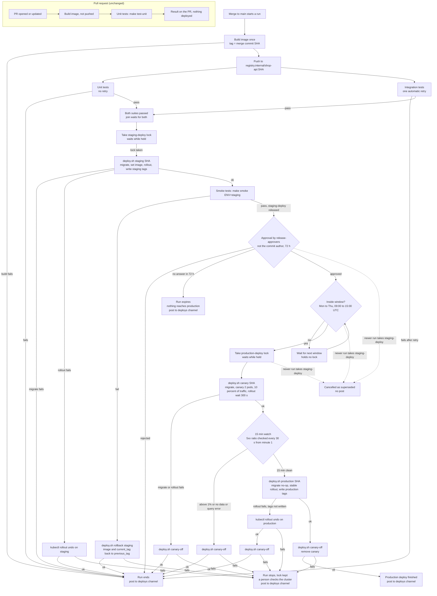

## shop-api release pipeline

Today a person runs `deploy.sh` from a laptop, and the script records the live tags in SSM Parameter Store. The pipeline makes CI run the same `deploy.sh` calls, so SSM stays the one record of what is live. Every merge to `main` builds one image, tests it, deploys it to staging, waits for one human approval, and rolls it out to production behind a 15-minute canary (a small second deployment that takes 10% of traffic). The gates run in this order so production only gets a build that passed the tests, ran on staging and was approved. Any failure ends the run and is posted to #deploys.

## Terms

- **CI**: the automation service that runs builds, tests and jobs. It holds the credentials for the registry, the clusters and SSM.
- **Merge commit**: the commit on `main` that a merged pull request creates. Its full SHA is the image tag.
- **Run**: one pipeline execution, started by one merge and keyed by its merge commit SHA.
- **Image**: the packaged shop-api container, stored at `registry.internal/shop-api`. Its tag is the full commit SHA.
- **Migration**: a change to the database schema. Migrations only go forward, with no undo step, and each must also work with the previous image.
- **deploy.sh**: the existing script. Modes: `staging`, `production`, `canary`, `canary-off`, `rollback`. The `staging`, `production` and `canary` modes run the migrations first.
- **Kubernetes**: the system that runs containers in clusters. A **deployment** keeps identical pods (running copies of the container) on the image it is told to run. A **rollout** replaces its pods with the new image. A **context** names the cluster a command targets. All deploys use namespace `shop`.
- **Staging**: Kubernetes context `staging`, with its own Postgres. Internal only.
- **Stable deployment**: `shop-api` on the `production` context. It serves production traffic.
- **Canary**: `shop-api-canary`, a second production deployment that normally has 0 pods. With 2 ready pods, the load balancer (the component that spreads requests across pods) sends it 10% of traffic. Stable and canary share the production Postgres.
- **SSM tags**: two values per environment in AWS Parameter Store, a key-value store. `current_tag` names what runs. `previous_tag` names what ran before. `deploy.sh` writes them only after a rollout succeeds. The canary is never recorded.
- **kubectl rollout undo**: returns a Kubernetes deployment to its previous revision. It does not change SSM tags.
- **Named lock**: a CI lock that only one run can hold at a time. The pipeline uses `staging-deploy` and `production-deploy`.
- **Manual approval job**: a CI job that pauses a run until a person approves it. CI records who approved and when.
- **release-approvers**: the CI group allowed to approve production.
- **Deployment window**: a production deploy may start Monday to Thursday, 09:00 to 15:00 UTC.
- **Unit tests**: `make test-unit`, about 4 minutes.
- **Integration tests**: `make test-integration`, about 12 minutes, with a Postgres service container. One test is known to be flaky.
- **Smoke tests**: `make smoke ENV=staging`, about 3 minutes, against the staging URL.
- **5xx rate**: the share of requests answered with a server error (HTTP 500 to 599). Prometheus, the metrics store, records it.
- **Superseded**: cancelled because a newer run took `staging-deploy`.
- **HOLD**: a run that stopped while it still holds a lock.

## Flow



A run that ends normally releases the locks it holds. Only HOLD keeps them. Dotted lines are waiting runs being cancelled as superseded.

## Steps

1. **Pull request (unchanged).** Trigger: a PR is opened or updated. CI builds the image without pushing it and runs `make test-unit`. Results appear on the PR. Nothing is pushed or deployed.
2. **Merge starts a run.** Trigger: a merge to `main`. Each merge gets its own run, keyed by its merge commit SHA. "Older" and "newer" mean merge order.
3. **Build and push.** Trigger: the run starts. CI builds one image from the merge commit, tags it with the full SHA and pushes it to `registry.internal/shop-api`. Nothing is rebuilt later. The push happens before the tests, so a failed run can leave an unused tag, which nothing deploys. If the build fails, the run ends and is posted.
4. **Tests in parallel.** Trigger: the push succeeded. Both suites start at once, and both must pass.
   - Unit tests get no retry.
   - Integration tests get one automatic retry, two attempts at most, because of the known flaky test.
   - Any failure ends the run and cancels the other suite if it is still running. If unit tests pass while integration is still retrying, the run waits for integration. Staging does not start until both pass.
5. **Staging deploy.** Trigger: both suites pass. The run takes `staging-deploy`, waiting if it is held. The CI job holding the lock runs `deploy.sh staging <SHA>` with CI's credentials. The script migrates the staging database, sets the image, waits up to 300 seconds for the rollout, and writes the staging SSM tags.
   - Migration fails: the run ends. The migration may be partly applied, but it still works with the old image, and the tags are unchanged. The lock is released.
   - Rollout fails: run `kubectl rollout undo` on staging, then end the run. The tags were not written, so SSM still names the old tag, which undo returns to. The lock is released. If undo fails, the run goes to HOLD.
6. **Staging smoke tests.** Trigger: step 5 succeeded. Run `make smoke ENV=staging`.
   - Pass: the run releases `staging-deploy` and moves to approval.
   - Fail: run `deploy.sh rollback staging`. It sets the image back to `previous_tag` and writes `current_tag` back to it. The tags were already written in step 5, so rollback is the right tool. The run ends and is posted. The lock is released when rollback finishes. If rollback fails, the run goes to HOLD.
7. **Approval.** Trigger: step 6 passed. A manual approval job restricted to `release-approvers` pauses the run. CI records who approved and when. The author of the merge commit may not approve. The 72-hour timer starts here.
   - Approved: go to step 8.
   - Rejected: the run ends and is posted. Staging keeps its tag.
   - No answer within 72 hours: the run expires, nothing goes to production, and it is posted.
8. **Deployment window.** Trigger: approval. The run checks the window, Monday to Thursday, 09:00 to 15:00 UTC. Outside it, the run waits and holds no lock. Inside it, the run goes to step 9. The canary must start inside the window. Once started, the deploy may finish after 15:00 UTC.
9. **Canary deploy.** Trigger: the window is open. The run takes `production-deploy`, waiting if it is held, and keeps it until step 11 ends. It runs `deploy.sh canary <SHA>`. The script migrates the production database, which stable and canary share. It sets `shop-api-canary` to the image, scales it to 2 pods (10% of traffic), and waits up to 300 seconds for the rollout.
   - Migration or rollout fails: run `deploy.sh canary-off`, end the run and post it. Stable is unchanged. The lock is released. If canary-off fails, the run goes to HOLD.
10. **Canary watch.** Trigger: the canary rollout is ready. For 15 minutes, from minute 1 to minute 15, the run checks the canary 5xx rate every 30 seconds. The first check waits one minute, because the query covers the last minute of traffic and a new canary has none yet. The query is in Notes.
    - Any check above 1%, with no data, or where the query fails (for example, Prometheus is unreachable): run `deploy.sh canary-off`, end the run and post it. Stable is unchanged. A failed query counts as a failed check, because the canary cannot be shown to be under 1%.
    - This step never touches the stable deployment.
11. **Promotion.** Trigger: 15 clean minutes. The run runs `deploy.sh production <SHA>`. Its migration is a no-op, because step 9 already applied it. The script sets the stable image, waits up to 300 seconds for the rollout, and writes the production tags. The canary keeps its 2 pods and its 10% share for the whole rollout, because this step changes only stable. Both run the same tag.
    - Stable rollout fails: run `kubectl rollout undo` on production, then `deploy.sh canary-off`. The tags were not written, so undo returns to the running tag. The run ends and is posted. The lock is released. If either command fails, the run goes to HOLD.
    - Success: run `deploy.sh canary-off` to remove the canary, release `production-deploy`, and post the result to #deploys. If canary-off fails, the run goes to HOLD.

## What happens when things fail

| When | What the run does | What is left behind | Lock | Who is told |
|---|---|---|---|---|
| Build fails | Run ends | Nothing deployed | None held | #deploys |
| Unit tests fail | Run ends; integration tests cancelled if running | Nothing deployed | None held | #deploys |
| Integration tests fail twice | Run ends; unit tests cancelled if running | Nothing deployed | None held | #deploys |
| Staging migration fails | Run ends | Migration may be partly applied; still works with the old image; tags unchanged | Released | #deploys |
| Staging rollout fails | `kubectl rollout undo` on staging; run ends | SSM still names the old tag | Released | #deploys |
| Staging smoke tests fail | `deploy.sh rollback staging`; run ends | Staging on `previous_tag` | Released after rollback | #deploys |
| Approval rejected | Run ends | Staging keeps its tag | None held | #deploys |
| No approval within 72 hours | Run expires | Staging keeps its tag; production unchanged | None held | #deploys |
| Canary migration or rollout fails | `deploy.sh canary-off`; run ends | Stable unchanged | Released | #deploys |
| Canary 5xx above 1%, no data, or query error | `deploy.sh canary-off`; run ends | Stable unchanged | Released | #deploys |
| Production stable rollout fails | `kubectl rollout undo` on production, then `canary-off`; run ends | SSM still names the old tag | Released | #deploys |
| Run superseded | Run cancelled | Nothing | None held | Nothing posted |
| `kubectl rollout undo`, `rollback` or `canary-off` command fails | Run stops | Cluster state not known; a canary may still take 10% of traffic | Kept until a person releases it | #deploys; a person checks the cluster |

## Rules when several merges are in flight

- Build and tests run for every merge at the same time.
- Each named lock is held by one run at a time. Other runs wait for it and are not failed.
- When a run takes `staging-deploy`, every older run that has not started its canary is cancelled. This covers runs still testing, waiting for `staging-deploy`, waiting for approval, waiting for the window, or waiting for `production-deploy`. Production should receive only the newest approved build, because an older approval would be stale.
- A run holding `staging-deploy` is never cancelled. A newer run can take that lock only after the holder releases it, so the holder finishes its smoke tests or rollback first.
- A run in canary or production is never cancelled. It finishes. Finishing a canary or production run cancels nothing.
- A run waiting for `production-deploy` keeps waiting. It is cancelled only when a newer run takes `staging-deploy`.
- Only a run that passed both suites can take `staging-deploy`, so only it can cancel older runs. A newer run that fails its tests, or never reaches `staging-deploy`, cancels nothing, and an older approved run stays valid.
- A cancelled run is not posted to #deploys, because a cancel is not a failure. It holds no lock at that moment.
- At most one run waits for approval at a time.

## Notes

- Migrations are forward-only, and nothing undoes them. Rollback changes the image and `current_tag`, not the schema.
- Choosing the undo: before the SSM tags are written, `current_tag` still names the running tag, so `kubectl rollout undo` returns the deployment to it. After they are written, `deploy.sh rollback` is correct. Rollback before the tags are written would go to `previous_tag`, one step too far back. A failed migration needs no undo, because the image did not change. A canary failure only calls `canary-off`, because the canary never changes stable.
- `deploy.sh rollback` does not change `previous_tag`, so a second rollback goes to the same tag again.
- After a staging rollback, staging runs `previous_tag`, the build it ran before this run. That build was cancelled for approval but stays on staging until the next deploy. The next deploy reads `current_tag`, which now names that build, and writes it to `previous_tag`, so the tags stay correct. The cancelled build can be restored to staging but cannot be approved.
- A run stopped in HOLD does not resume. Its later steps assume a cluster state nobody has checked, so a person decides the next step. Other runs wait while the lock is held. Starting again needs a new run.
- No data means the query returns no value for the last minute, which happens when the canary served no requests in that minute. That check fails the run, because a canary with no traffic cannot be shown healthy.
- The canary 5xx ratio, measured over the last minute:

```
sum(rate(http_requests_total{app="shop-api-canary",code=~"5.."}[1m]))
/ sum(rate(http_requests_total{app="shop-api-canary"}[1m]))
```

## Setup (outside a run)

- CI needs a manual approval job restricted to `release-approvers`, which records the approver and time.
- CI needs the named locks `staging-deploy` and `production-deploy`.
- Integration tests need a Postgres service container.
- CI needs push access to `registry.internal/shop-api`, and credentials to run `deploy.sh` against both clusters.

## Open questions

- The order in which runs get a named lock is not stated. We assume first come, first served.
- It is not stated whether CI can stop the commit author from approving. If it cannot, the approval job needs a manual check.
- The window rule says a production deploy may start in the window. This plan treats the canary start as the start, so promotion may finish after 15:00. The team should confirm this.
- An approval given outside the window waits with no time limit, and stays valid until the run is superseded. The team should confirm this.
- `deploy.sh rollback` does not change `previous_tag` (see Notes).
- After production is promoted, the pipeline has no automatic path back. How to roll back a bad production build is not defined.
- No data fails the run. At low canary traffic, one quiet minute fails a healthy canary. The team may want a minimum request count.
- Who checks the cluster after a HOLD, who releases a held lock, and how a stopped run is started again are not defined. A manual re-run is not defined either.
- No time limit is set for a held lock, or for runs waiting on it.
- Which CI credentials or roles run `deploy.sh` and read SSM for each cluster is not stated.