# shop-api release pipeline

Today shop-api reaches staging and production only when someone runs `existing/deploy.sh` from a laptop. CI builds and unit-tests pull requests and deploys nothing. This pipeline keeps that pull request behaviour and, on every merge to `main`, builds one image, tests it, deploys it to staging, waits for one human approval, then deploys it to production canary-first. It calls `deploy.sh` and keeps the state the script already keeps. It does not replace either.

## Terms

- **Tag, SHA**: the full commit SHA of the merged commit. The image is `registry.internal/shop-api:<SHA>`. It is built once per run and every later step deploys that same image.
- **`deploy.sh`**: the existing script. `staging <tag>` and `production <tag>` migrate, then roll the stable `shop-api` deployment. `canary <tag>` migrates, then runs the tag on the canary. `canary-off` scales the canary to 0 pods. `rollback <env>` puts the stable deployment back on `previous_tag`.
- **SSM state**: SSM Parameter Store holds `/deploy/<env>/current_tag` (what stable runs) and `/deploy/<env>/previous_tag` (what it ran before). The script writes both only after a rollout succeeds. The pipeline never writes them. It only reads `current_tag`.
- **Canary**: a second Kubernetes deployment, `shop-api-canary`, normally at 0 pods. `deploy.sh canary` sets the new image on it and scales it to 2 pods, next to the stable pods. While it has ready pods, the load balancer sends it 10 percent of traffic. Stable and canary share the production database. The canary is never recorded in SSM. The only record is the cluster, so `canary-off` is the cleanup on every canary exit path.
- **Migrations**: forward-only and run inside `deploy.sh` (`staging`, `canary` and `production` all call `migrate`). `migrate up` is a no-op when nothing is pending. Nothing undoes a migration, including `rollback`, which restores the image only. So a migrated database can sit under an older image, and every migration must work with the previous image. Nothing in this pipeline checks that. It is a rule for whoever writes and reviews migrations.
- **CI lock**: a named lock that only one run can hold. Other runs queue behind it. This pipeline uses `staging-deploy` and `production-deploy`.
- **Approval job**: a CI manual job restricted to a group. It records who approved and when. The group is `release-approvers`.
- **Superseded**: a run is superseded if its SHA is equal to, or an ancestor of, the environment's `current_tag`, or if staging has already moved to a newer commit. "Newer than" is decided in CI with git on a full-history checkout (not shallow), using `git merge-base --is-ancestor`. If `current_tag` is not a commit git knows, the check fails closed and the run ends as a failure.
- **Window**: a production deploy may start Monday to Thursday, 09:00 to 15:00 UTC. Once started it may finish after 15:00.
- **Colours**: green is a successful end. Red is a failure end and always announces in #deploys. Amber is a neutral end.

## Diagram

```mermaid
flowchart TD
  classDef bad fill:#fde2e2,stroke:#b42318,color:#000
  classDef good fill:#dcf5e3,stroke:#1a7f37,color:#000
  classDef neutral fill:#fff4d6,stroke:#9a6700,color:#000
  classDef gate fill:#e7eefc,stroke:#1f4fbf,color:#000

  subgraph PRFLOW["Pull request: today's behaviour, never deploys"]
    PR["Pull request opened or updated<br/>trigger: PR event"] --> PRB["Build image in CI<br/>reads: source<br/>writes: nothing, no push"]
    PRB --> PRU["make test-unit, about 4 min<br/>no retry"]
    PRU -->|pass| PROK["Check green on the PR<br/>run ends, no deploy"]:::good
    PRU -->|fail| PRBAD["Check red on the PR<br/>run ends, no announcement"]:::bad
    PRB -->|fail| PRBAD
  end

  subgraph MAINFLOW["Merge to main: full pipeline"]
    MERGE["Merge to main<br/>trigger: push to main<br/>starts one run per merge"] --> BUILD

    subgraph S1["1. Build once"]
      BUILD["Build image, tag = commit SHA, push<br/>writes: registry.internal/shop-api:SHA<br/>every later step deploys this tag, no rebuild"]
    end
    BUILD -->|fail| FAIL

    subgraph S2["2. Tests in parallel, both must pass"]
      UNIT["make test-unit, about 4 min<br/>no retry"]
      INT["make test-integration, about 12 min<br/>Postgres service container"]
      INTR["Integration retry, once, automatic<br/>covers the known flaky test"]
      INT -->|first attempt fails| INTR
    end
    BUILD --> UNIT
    BUILD --> INT
    UNIT -->|fail| FAIL
    INTR -->|second attempt fails| FAIL
    UNIT -->|pass| JOIN{"Both passed?"}
    INT -->|pass| JOIN
    INTR -->|pass| JOIN

    subgraph S3["3. Staging, one run at a time"]
      SLOCK["Take CI lock staging-deploy<br/>queues behind any run holding it"]
      SSUP{"Is SHA newer than staging<br/>current_tag? reads SSM"}
      DSTG["deploy.sh staging SHA<br/>reads: current_tag<br/>migrates staging DB forward-only, rolls shop-api<br/>writes after rollout: previous_tag, current_tag"]
      SMOKE["make smoke ENV=staging, about 3 min<br/>staging URL"]
      RB["deploy.sh rollback staging<br/>image only, schema stays migrated<br/>writes: current_tag = previous_tag"]
      SLOCK --> SSUP
      SSUP -->|yes| DSTG
      DSTG -->|ok| SMOKE
      SMOKE -->|fail| RB
    end
    JOIN -->|yes| SLOCK
    SSUP -->|no, already superseded| SUPER
    DSTG -->|fail: no rollback, tags not written| FAIL
    RB -->|then end run| FAIL

    subgraph S4["4. Approval"]
      APPROVE["Manual approval job<br/>group release-approvers only<br/>records who and when<br/>deadline: 72 h from this request<br/>staging lock already released"]:::gate
      AUTH{"Approver is the author of<br/>the merged commit?"}
      SSUP2{"Superseded? staging current_tag<br/>is now a newer commit"}
      APPROVE -->|approved| AUTH
      AUTH -->|yes: approval discarded, same deadline| APPROVE
      AUTH -->|no| SSUP2
    end
    SMOKE -->|pass| APPROVE
    APPROVE -->|rejected| FAIL
    APPROVE -->|no approval in 72 h| EXPIRE
    SSUP2 -->|yes| SUPER

    subgraph S5["5. Gate to production"]
      WIN{"Inside window now?<br/>Mon to Thu, 09:00 to 15:00 UTC<br/>start time only"}
      WAIT["Wait for next window opening<br/>the 72 h deadline still applies"]
      PLOCK["Take CI lock production-deploy<br/>one production deploy at a time<br/>queues behind other runs"]
      RECHK{"Window still open after<br/>waiting for the lock?"}
      PSUP{"Is SHA newer than production<br/>current_tag? reads SSM"}
      WIN -->|no| WAIT
      WAIT --> WIN
      WIN -->|yes| PLOCK
      PLOCK --> RECHK
      RECHK -->|no: release lock| WAIT
      RECHK -->|yes| PSUP
    end
    SSUP2 -->|no| WIN
    WAIT -->|72 h deadline passed| EXPIRE
    PLOCK -->|72 h deadline passed| EXPIRE
    PSUP -->|no, already superseded: release lock| SUPER

    subgraph S6["6. Production, canary first, lock held to the end"]
      CAN["deploy.sh canary SHA<br/>migrates production DB forward-only<br/>2 canary pods, 10 percent of traffic<br/>waits for rollout, 300 s<br/>not recorded in SSM"]
      WATCH["Watch canary for 15 min<br/>Prometheus, canary 5xx ratio, 1 min rate<br/>sample every 30 s, from first ready pod<br/>fail on any sample above 1 percent<br/>or on 2 min of no data"]
      PROD["deploy.sh production SHA<br/>reads: current_tag, migrate is a no-op<br/>rolls stable shop-api<br/>writes after rollout: previous_tag, current_tag"]
      CLEAN["deploy.sh canary-off<br/>scales canary to 0 pods"]
      COFF["deploy.sh canary-off<br/>scales canary to 0 pods<br/>no rollback of stable, no schema undo<br/>always-run cleanup job, also on cancel"]
      PSUP -->|yes| CAN
      CAN -->|ok| WATCH
      WATCH -->|15 min, every sample at or below 1 percent| PROD
      PROD -->|ok| CLEAN
    end
    CAN -->|fail| COFF
    WATCH -->|threshold breached or no data| COFF
    PROD -->|fail: stable may be part rolled| COFF
    COFF -->|then fail run, release lock| FAIL
    CLEAN -->|ok: release lock| DONE
    CLEAN -->|fail: canary may still be up| FAIL
  end

  FAIL["Failure end<br/>cancel the jobs that have not started, release locks<br/>canary-off cleanup still runs if the canary was started<br/>announce in #35;deploys: step, SHA, run link"]:::bad
  EXPIRE["Expiry end<br/>nothing goes to production, release locks<br/>announce in #35;deploys: SHA, run link"]:::bad
  SUPER["Superseded end, not a failure<br/>a newer commit is already ahead<br/>no deploy, release locks<br/>post a short note in #35;deploys"]:::neutral
  DONE["Production deploy finished<br/>announce in #35;deploys: SHA, previous_tag"]:::good
```

## Steps: trigger, reads, writes, failure path

| Step | Trigger | Reads | Writes | If it fails |
|---|---|---|---|---|
| PR build and unit tests | Pull request event | Source | Nothing (no push, no deploy) | Red check on the PR. No announcement. |
| Build | Push to `main` | Source | Image `registry.internal/shop-api:<SHA>` | Run ends. Announce. |
| Unit tests | Build passed | The build | Nothing | No retry. Run ends and the other test job is cancelled. Announce. |
| Integration tests | Build passed | The build, Postgres service container | Nothing | One automatic retry. If the retry fails, run ends and the unit job is cancelled. Announce. |
| Staging deploy | Both test jobs passed, `staging-deploy` lock held | SSM `staging/current_tag` | `staging/previous_tag` and `current_tag`, written by the script after rollout | Run ends. Announce. No rollback (see rollback rules). |
| Smoke tests | Staging deploy ok | Staging URL | Nothing | `deploy.sh rollback staging`, then the run ends. Announce. |
| Approval | Smoke passed | Approver identity, commit author | CI approval record (who, when) | Rejected: run ends. 72 h with no approval: expiry. Both announce. |
| Window and lock | Approved by someone other than the author | Clock, SSM `production/current_tag` | `production-deploy` lock | 72 h deadline passed: expiry. Superseded: neutral end. |
| Canary and watch | Window open, lock held | Prometheus | Canary pods only (not SSM) | `canary-off`, run ends, announce. |
| Stable roll | Canary clean for 15 min | SSM `production/current_tag` | `production/previous_tag` and `current_tag`, written by the script after rollout | `canary-off`, run ends, announce. |
| Canary removal | Stable roll ok | None | Canary scaled to 0 | Run ends, announce that the canary may still be up. |

After a successful production deploy the pipeline does nothing more. If problems show up later, a human decides and runs `deploy.sh rollback production`. The announcement carries `previous_tag`, the rollback target.

## Decisions I made

**Several merges in flight**

- Every merge gets its own run. Runs overlap freely through build and tests.
- Staging and production each have one CI lock, `staging-deploy` and `production-deploy`. The script reads `current_tag` and then writes `previous_tag`, so two concurrent deploys to one environment would corrupt rollback state.
- The staging lock covers deploy, smoke and any rollback. It is released before the approval wait.
- The production lock covers canary, the watch, the stable roll and canary removal. It is not held while waiting for approval or for the window.
- A run that waits for a lock does not look at why the earlier holder ended. It carries on when the lock is free and runs its own superseded check against `current_tag`. A failed or cancelled production run runs `canary-off` before it releases the lock, so the next run starts with the canary at 0 pods.
- "Latest wins" is one rule, the superseded check, applied in three places: before the staging deploy, after approval, and after taking the production lock. A superseded run ends with a neutral note and deploys nothing.
- It stops an old, slow approval from rolling production back to an older image. That would also put an older image on a database that newer migrations have already changed, and only one earlier image is guaranteed to work with a migrated schema.
- It also stops a re-run of a SHA that is already live. Otherwise the script would set `previous_tag` equal to `current_tag`, and `rollback` would then do nothing.
- An expired or failed run can be re-run by hand. The re-run restarts at the build and then goes through the superseded check.

**Approval and the window**

- The 72 hours run from the approval request. The same deadline also covers waiting for the window and for the production lock. An approval cannot sit unused and then deploy days later.
- The window is checked once before the lock and again after it, because a long lock wait can push the start past 15:00.
- CI can restrict an approval job to a group but cannot exclude the author. A check after the approval compares the recorded approver with the author of the merged commit. If they match, the approval is discarded and the gate stays open with the same deadline. Nobody is notified automatically. Any other member of `release-approvers` can still approve. If the author is the only approver available, the run waits until the 72 hour expiry.
- With squash merges the author is the pull request author, so the check works as intended.

**Canary measurement**

- The Prometheus query is the 1-minute canary 5xx ratio from `environments.md`: `sum(rate(http_requests_total{app="shop-api-canary",code=~"5.."}[1m])) / sum(rate(http_requests_total{app="shop-api-canary"}[1m]))`. It is sampled every 30 s from the moment `deploy.sh canary` returns, which is after its rollout status check.
- A single sample above 1 percent fails the run.
- Two minutes with no data also fails the run, because 0 divided by 0 returns nothing. A canary that looks fine because it receives no traffic is not a pass.
- `canary-off` is a cleanup job that always runs after the canary starts, whether the run passed, failed, was cancelled or timed out. "Cancel the jobs that have not started" on a failure end does not cancel this cleanup. The canary is not recorded anywhere else, so cleanup must not be skipped.

**Rollback only where it is safe**

- `rollback staging` runs after a smoke failure. By then the script has written the tags, so `previous_tag` is the correct target.
- It does not run when `deploy.sh staging` itself fails. The tags were not written, so `previous_tag` is two releases back and a rollback would overshoot. The same reasoning is why production has no automatic rollback. A failed stable roll gets `canary-off` and a human decision.

## Open questions

- Tags are SHAs only from the first pipeline run onward. If `current_tag` holds a tag from an old laptop deploy, the "newer than" check cannot be evaluated. The first run after adoption needs a human to confirm it, or it fails closed.
- The make targets are assumed to test the image built in step 1, or the same commit. The brief does not say how they consume the image.
- The plan assumes full-history checkout is available in CI. It was not checked.
- What `make smoke ENV=staging` checks is not described in the existing files. This plan assumes a non-zero exit code means failure.
- A canary or production failure after a migration leaves the old image on a migrated database. The plan relies on the migration rule in the terms.
- `deploy.sh rollback production` run by hand does not take the `production-deploy` lock, so it could overlap with a running pipeline deploy. Whether to route it through the pipeline is not decided.
- The plan assumes the CI system can run a cleanup job even when a run is cancelled, and releases a lock only after that job. `environments.md` does not say so. If it cannot, a cancelled run can leave a live canary.
- Images from runs that fail their tests stay in the registry, because the push happens before the tests. Nothing deploys them. Cleaning them up is not part of this pipeline.
- A 1 percent threshold on a 1-minute window is noisy at low traffic, for example 09:00 UTC. A single error among a few dozen requests can trip it. I kept the threshold as specified. A minimum request count per sample is the obvious next tuning, and it needs real traffic numbers.
- A failed `deploy.sh production` may leave the stable deployment part rolled out. The run only removes the canary and announces. Choosing between rolling forward and `rollback production` is left to a human.
- A failed `canary-off` leaves a live canary that nothing watches. The run fails and the announcement says so.
