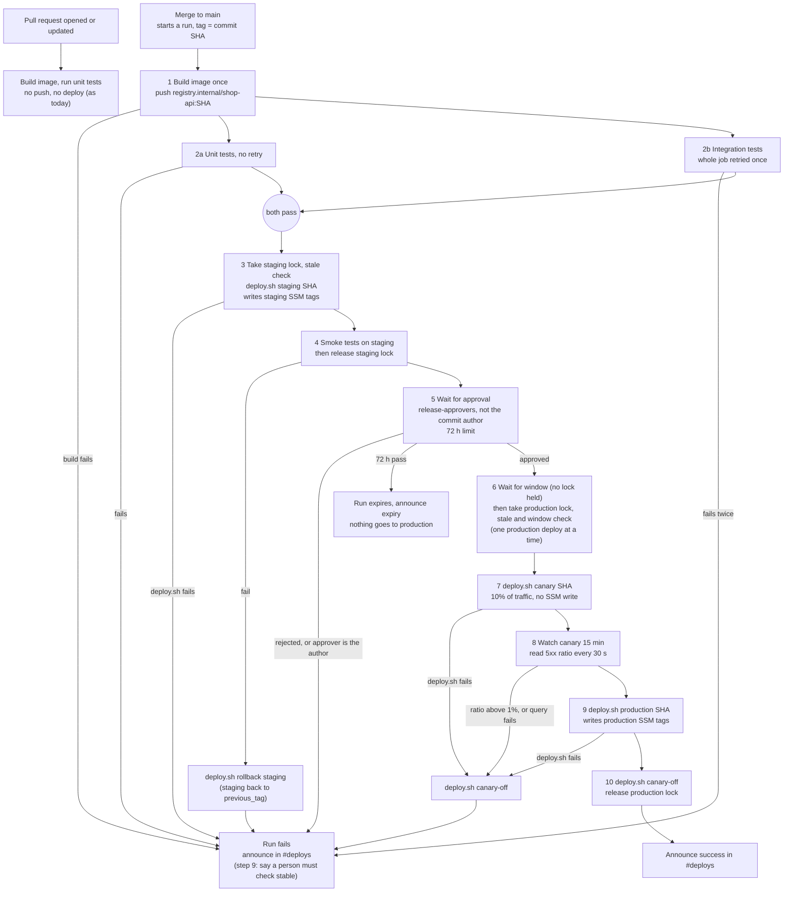

# shop-api release pipeline

Today shop-api is deployed by someone running `existing/deploy.sh` from a laptop, and CI only builds and unit-tests pull requests. This pipeline keeps that script and the state it keeps (the tags in SSM), and runs the script from CI instead. Every merge to `main` builds one image tagged with the commit SHA and tests it. It then deploys the image to staging and waits for one human approval. Last, it deploys to production through a 15-minute canary. Each step has one way to fail, and every failure ends the run and is announced in #deploys, so no deploy needs a laptop.

## Terms

- **SHA / tag**: the merged commit's SHA. It is the image tag and the only version the pipeline passes around. The image is `registry.internal/shop-api:<SHA>`.
- **deploy.sh**: the existing script. It migrates the database, changes the image on a Kubernetes deployment, and waits up to 300 s for the rollout. The pipeline only calls it. Its modes:
  - `staging <tag>` / `production <tag>`: migrate, roll the stable `shop-api` deployment to the tag, then write SSM `current_tag` and `previous_tag` (the old current). So `previous_tag` is always the tag from before the latest deploy. Tags are written only after the rollout succeeds.
  - `canary <tag>`: production only. Migrate, then run the tag on `shop-api-canary` with 2 pods. The load balancer sends those pods 10% of traffic. No SSM write.
  - `canary-off`: scale `shop-api-canary` to 0 pods. All traffic goes back to the stable deployment.
  - `rollback <env>`: set the stable deployment back to SSM `previous_tag` and write that as `current_tag`. It changes the image only; the schema stays.
- **SSM tags**: `/deploy/<env>/current_tag` and `/deploy/<env>/previous_tag` in AWS SSM Parameter Store. They are the only record of what each environment runs. Only deploy.sh writes them. The canary is never recorded.
- **Migration**: forward-only, with no undo. It applies only pending migrations, so running it twice is a no-op. Each one must work with the previous image. That is why rollback and canary-off are safe without undoing a schema change.
- **Lock**: a named CI lock that only one run can hold. A run that finds it held waits in line.
- **Smoke tests**: `make smoke ENV=staging`, about 3 min, against the staging URL.
- **Deployment window**: a production deploy may start Monday to Thursday, 09:00 to 15:00 UTC. Once started it may run past 15:00. The start is the `canary` call in step 7.
- **release-approvers**: the CI group allowed to approve. CI records who approved and when.
- **Canary 5xx ratio**: the Prometheus (metrics store) query below, read every 30 s.
  `sum(rate(http_requests_total{app="shop-api-canary",code=~"5.."}[1m])) / sum(rate(http_requests_total{app="shop-api-canary"}[1m]))`
- **Stale run**: a run for a commit that a newer run has overtaken. See "Several merges at once".

## Flow

Solid arrows are the main flow. Labelled arrows are failures. Everything that ends in "Run fails" posts to #deploys and releases any lock the run holds.

## Steps

Every failure below ends the run, announces it in #deploys, and releases any lock the run holds. This cleanup is a CI step that runs on any failure or cancellation, including a failure while waiting for a lock or the window (the run holds no production lock then). A migration that already ran stays applied.

1. **Build.** Trigger: a push to `main` (a merge). Tags and pull requests do not start it. Builds the image once and pushes it to the registry. Nothing is rebuilt later. Pull requests keep today's behaviour: build and unit tests only, no push, no deploy, and their failures are not announced. A failed build fails the run.
2. **Tests.** After the build, unit tests (`make test-unit`, about 4 min) and integration tests (`make test-integration`, about 12 min, with a Postgres service container) run in parallel. Both must pass. Unit tests get no retry. Integration tests get one automatic retry of the whole job, because one test is known to be flaky. That makes two attempts, each with a fresh Postgres container. The run fails only if the second attempt fails as well.
3. **Staging deploy.** Takes the staging lock, which protects the staging SSM tags from two deploys at once. Once it holds the lock, including after waiting in line, it does the stale check, then runs `deploy.sh staging <SHA>`. If deploy.sh fails, the run fails. No rollback runs, because the tags were not written and `rollback` would go to the wrong tag.
4. **Smoke tests.** Run against staging while the staging lock is still held. Then the lock is released. If they fail, run `deploy.sh rollback staging`, then fail the run. Rollback goes to `previous_tag`, the tag staging ran before this run's deploy. When they pass, this run cancels any older run that is between step 3 and step 6.
5. **Approval.** Staging stays on the new tag while the run waits. Only `release-approvers` may approve. After approval, the pipeline compares the recorded approver with the author of the merged commit and fails the run if they are the same. A rejection fails the run. If nobody approves within 72 hours, the run expires: it announces the expiry and ends. Nothing goes to production, and staging stays on that tag until the next run replaces it. A rejection also leaves staging as it is, because a rollback nobody asked for would add a mechanism the brief does not require.
6. **Window and production lock.** After approval, the run checks the clock every minute until it is inside the deployment window. It holds no lock while it waits, so an approval on Friday night waits until Monday 09:00 UTC. Then it takes the production lock, waiting in line if another run holds it. The lock is held until step 10 or a failure, so only one production deploy is in progress. Once it holds the lock, it does the stale check and the window check again. A stale run is cancelled. If the window has closed, it releases the lock and waits for the next window. The 72 hours cover only the wait for approval. The window and lock wait have no limit of their own, except that a newer run can make this run stale.
7. **Canary.** `deploy.sh canary <SHA>` migrates the production database, which canary and stable share, then starts 2 canary pods with 10% of traffic. The migration runs before the canary is proven because the canary needs the new schema to start. If the canary then fails, the migration stays applied. That is safe because every migration works with the previous image, which the stable deployment still runs. If deploy.sh fails, run `deploy.sh canary-off` and fail the run.
8. **Watch.** For 15 minutes after the canary rollout succeeds, read the canary 5xx ratio every 30 s. If any reading is above 1%, or Prometheus cannot be queried, run `deploy.sh canary-off` and fail the run. Production traffic is then all on the stable deployment, which never changed. An unwatched canary must not go on to production, which is why a failed query counts as a failure. If the canary got no traffic, the ratio has no value and counts as not above 1%.
9. **Production deploy.** `deploy.sh production <SHA>` rolls the stable deployment and writes the production SSM tags. The canary keeps running during this rollout. That is harmless: it runs the same tag, the second migration is a no-op, and the 300 s rollout wait applies to the stable deployment only. If it fails, run `deploy.sh canary-off` and fail the run. Do not run `rollback production`: the tags were not written, so rollback would go to the wrong tag. The #deploys failure message says that a person must check the stable deployment.
10. **Finish.** Run `deploy.sh canary-off`, release the production lock and announce the finished deploy in #deploys. If this canary-off fails, announce it as a failure.

## Several merges at once

A run is stale when a newer run exists: a run for a later commit on `main`. Each run asks CI for the list of runs on `main` and their step status. A stale run is cancelled at its next checkpoint, so only the newest commit goes forward and an older tag never replaces a newer one. The checkpoints are on arrival at step 3, right after the staging lock is taken, and right after the production lock is taken in step 6.

- Before step 3, a run is stale as soon as any newer run has started.
- From step 3 up to step 6, including while it waits for approval, a run is stale once a newer run has passed its smoke tests. The newer run cancels it in step 4, and the run also checks at its own checkpoints. An approval already given does not protect it, because a newer tag is already on staging. The newer run needs its own approval.
- Once a run holds the production lock, it is never cancelled. Newer runs wait behind the lock, then the checkpoint cancels them if they are stale.

Staging and production have separate locks because the two deploys write different SSM tags. A cancelled run is recorded in CI and is not announced, because it is not a failure.

## Open questions

- If `deploy.sh production` fails halfway, the stable deployment may be partly rolled. Kubernetes keeps the old pods serving during a rolling update, but the pipeline does not repair it. Who checks it, and how, is not decided.
- Whether CI can exclude the commit author from approving itself is unknown. The plan checks it after the approval instead.
- Whether CI lets one run cancel another, offers a run list with step status, and frees a lock when its runner dies mid-run, is unknown. If it does not free the lock, someone must release it by hand.

## Rolling out

Ending laptop deploys depends on removing the laptop credentials. That is outside this pipeline.
