# shop-api release pipeline

## What exists today (read this first)

The pipeline does not replace `deploy.sh`. It calls it and relies on the state the script already keeps. The parts that matter:

| Command | What it does | State it writes |
|---|---|---|
| `deploy.sh staging <tag>` / `deploy.sh production <tag>` | Runs DB migrations with image `<tag>`, then rolls the stable `shop-api` deployment to `<tag>` and waits up to 300 s for the rollout | Only after the rollout succeeds: `previous_tag` = old `current_tag`, `current_tag` = `<tag>` |
| `deploy.sh canary <tag>` | Production only. Runs migrations, then runs `<tag>` on `shop-api-canary` (2 pods, which get 10% of traffic while ready) | Nothing. The canary is never recorded |
| `deploy.sh canary-off` | Scales `shop-api-canary` to 0 pods | Nothing |
| `deploy.sh rollback <env>` | Sets stable `shop-api` to `previous_tag`. Changes the image only, not the schema | `current_tag` = `previous_tag` |

- **Live state is not in the repo.** It is in AWS SSM Parameter Store, per environment: `/deploy/<env>/current_tag` and `/deploy/<env>/previous_tag`.
- **Migrations only go forward.** Nothing undoes one, and running `migrate up` again does nothing. Every rollback and canary-off in this pipeline leaves the schema migrated. It is only safe because of the existing rule that every migration must keep working with the previous image.
- **Stable and canary share the production Postgres.** A canary's migrations are production migrations.
- **Images:** `registry.internal/shop-api:<tag>`. In this pipeline the tag is always the full commit SHA.
- **Deployment window:** a production deploy may *start* Monday to Thursday, 09:00 to 15:00 UTC. Once started, it may finish after 15:00.
- **CI can:** push to the registry, run `deploy.sh` against both clusters, run manual approval jobs limited to a group (it records who approved and when), and hold named locks that only one run can hold at a time.

Names used in the chart:

- `SHA` is the merged commit and the image tag.
- `STG_OLD` and `PROD_OLD` are the `current_tag` values the run reads from SSM just before it deploys to that environment.

Solid arrows are the normal path. Dotted arrows are failure paths. Red ends are failures, amber ends mean the run stopped without deploying, and green is success.

```mermaid
flowchart TD
  classDef fail fill:#fdecea,stroke:#b42318,color:#7a1a12
  classDef stop fill:#fff4e5,stroke:#b54708,color:#7a3306
  classDef ok fill:#e8f5e9,stroke:#2e7d32,color:#1b4d20

  subgraph S0["Pull requests · trigger: PR opened or updated · no registry or deploy credentials"]
    PR1["Build image<br/>not pushed"] --> PR2["make test-unit<br/>about 4 min, no retry"]
    PR2 --> PR3(["Pass or fail reported on the PR<br/>nothing pushed, nothing deployed"])
  end

  M0(["Merge to main<br/>trigger: push to main<br/>SHA = full commit SHA"])
  M0 --> B1

  subgraph S1["1 · Build · trigger: push to main · once per run"]
    B1{"Is tag SHA already in<br/>registry.internal/shop-api?"}
    B2["Build image, tag it SHA, push<br/>writes: registry.internal/shop-api:SHA"]
    B3["Reuse the existing image<br/>no rebuild"]
    B1 -->|no| B2
    B1 -->|"yes: re-run of this commit"| B3
  end
  B2 -.->|fail| XB
  XB(["Run fails<br/>announce in #35;deploys"]):::fail

  B2 --> T1
  B2 --> T2
  B3 --> T1
  B3 --> T2

  subgraph S2["2 · Tests in parallel · trigger: image SHA is in the registry · both use image SHA"]
    T1["make test-unit<br/>no retry"]
    T2["make test-integration<br/>about 12 min, Postgres service container"]
    T2R["make test-integration again<br/>one automatic retry, whole suite"]
    TJ["Both passed"]
    T1 -->|pass| TJ
    T2 -->|pass| TJ
    T2 -.->|fail| T2R
    T2R -->|pass| TJ
  end
  T1 -.->|fail| XT
  T2R -.->|fail| XT
  XT(["Run fails<br/>the other test job is cancelled<br/>image stays in registry, never deployed<br/>announce in #35;deploys"]):::fail

  TJ --> SL

  subgraph S3["3 · Staging · trigger: both test jobs passed · holds lock staging"]
    SL["Acquire lock staging<br/>waits while another run holds it"]
    SC{"reads SSM /deploy/staging/current_tag<br/>= STG_OLD<br/>How does it compare with SHA?"}
    SD["deploy.sh staging SHA<br/>migrates staging DB, rolls shop-api<br/>on success writes SSM staging:<br/>previous_tag = STG_OLD, current_tag = SHA"]
    SM["make smoke ENV=staging<br/>about 3 min"]
    SRB["deploy.sh rollback staging<br/>image back to previous_tag, schema stays<br/>writes SSM staging current_tag"]
    SRS["deploy.sh staging STG_OLD<br/>puts the last good image back<br/>not rollback: tags were never written"]
    SU["Release lock staging"]
    SL --> SC
    SC -->|"older, or not a main commit"| SD
    SC -->|"same: skip the deploy"| SM
    SD -->|ok| SM
    SM -->|pass| SU
    SD -.->|fail| SRS
    SM -.->|fail| SRB
  end
  SC -->|"newer main commit"| XU
  SRS -.-> XS
  SRB -.-> XS
  XS(["Run fails<br/>lock staging released<br/>announce in #35;deploys"]):::fail

  SU --> A0

  subgraph S4["4 · Approval · trigger: staging smoke tests passed · no lock held"]
    A0{"Is a newer run already<br/>waiting here or further along?"}
    A1["Approval job, group release-approvers<br/>page lists the commits and new migrations<br/>in production current_tag..SHA<br/>opening it cancels older runs waiting here<br/>deadline: 72 h after it opens"]
    A2{"reads SSM /deploy/production/current_tag, git log<br/>Did the approver author any commit<br/>in production current_tag..SHA?"}
    A0 -->|no| A1
    A1 -->|approved| A2
    A2 -.->|"yes: approval rejected,<br/>same deadline keeps running"| A1
  end
  A0 -->|yes| XU
  A1 -.->|"72 h with no valid approval"| XE
  XE(["Run expires<br/>nothing goes to production<br/>staging keeps SHA<br/>announce in #35;deploys"]):::stop

  A2 -->|no| G1

  subgraph S5["5 · Production gate · trigger: valid approval"]
    G1["Wait for the window<br/>Mon to Thu, 09:00 to 15:00 UTC"]
    G2["Acquire lock production<br/>one production deploy at a time"]
    G3{"Still inside the window?"}
    G4{"reads SSM /deploy/production/current_tag<br/>= PROD_OLD<br/>Is it SHA or a newer main commit?"}
    G5["Release lock production"]
    G1 --> G2 --> G3
    G3 -->|no| G5 --> G1
    G3 -->|yes| G4
  end
  G4 -->|"yes: release lock"| XU
  XU(["Superseded: a newer commit already covers this one<br/>run ends, nothing deployed here<br/>announce in #35;deploys"]):::stop

  G4 -->|"no: the deploy starts now"| C1

  subgraph S6["6 · Canary · trigger: lock held inside the window · lock production held"]
    C1["deploy.sh canary SHA<br/>migrates production DB, shared with stable<br/>shop-api-canary on SHA: 2 pods, 10% of traffic<br/>writes nothing to SSM"]
    C2["Query Prometheus every 30 s<br/>canary 5xx ratio over the last 1 m"]
    C3{"Ratio above 1%,<br/>or 3rd empty result in a row?"}
    C4{"15 min since the<br/>canary pods became ready?"}
    COFF["deploy.sh canary-off<br/>canary to 0 pods<br/>schema stays migrated"]
    C1 -->|"pods ready"| C2
    C2 --> C3
    C3 -->|no| C4
    C4 -->|"no: wait 30 s"| C2
    C1 -.->|fail| COFF
    C3 -.->|yes| COFF
  end
  COFF -.-> XC
  XC(["Run fails<br/>stable shop-api still on PROD_OLD<br/>lock production released<br/>announce in #35;deploys"]):::fail

  C4 -->|yes| P1

  subgraph S7["7 · Stable roll · trigger: canary healthy for 15 min · lock production held"]
    P1["deploy.sh production SHA<br/>migrate does nothing now, rolls shop-api<br/>on success writes SSM production:<br/>previous_tag = PROD_OLD, current_tag = SHA"]
    PX["deploy.sh production PROD_OLD<br/>puts the last good image back<br/>then deploy.sh canary-off"]
    P2["deploy.sh canary-off<br/>removes the canary, one retry"]
    P3["Release lock production"]
    P1 -->|ok| P2
    P2 -->|ok| P3
    P1 -.->|fail| PX
  end
  PX -.-> XP
  P2 -.->|"failed twice"| XK
  XP(["Run fails<br/>production back on PROD_OLD<br/>lock production released<br/>announce in #35;deploys"]):::fail
  XK(["Run fails<br/>production is on SHA, but the canary still has 2 pods of SHA<br/>someone must scale it to 0<br/>announce in #35;deploys"]):::fail
  P3 --> DONE(["Done: production on SHA<br/>announce in #35;deploys"]):::ok
```



## Decisions and why

### Several merges in flight

- **Newer wins.** `main` only moves forward (no force-pushes), so for any two runs, one commit is an ancestor of the other. "Newer" means that one. Deploying a newer commit ships everything older with it, so older runs stop instead of queueing behind it.
- **Staging is serialised by lock `staging`.** The lock is held from the deploy through the smoke tests or the rollback, so no other run can change staging while smoke tests run. It is released before the approval wait, so a 72-hour wait never blocks staging.
- **Staging never goes backwards.** If staging already runs a newer commit, the older run ends as superseded. If staging already runs `SHA` (for example a re-run after an expiry), the deploy is skipped and only the smoke tests run.
- **One run waits for approval at a time.** When a run's approval opens, older runs still waiting for approval are cancelled as superseded. A run that arrives after a newer run has already got there is superseded straight away.
- **Production never goes backwards.** After taking lock `production`, the run reads `current_tag`. If production already runs `SHA` or something newer, the run ends without deploying. This covers an older approved run that lost the race for the lock.
- **What a lock covers.** Lock `production` is held from the window check through canary removal, including every cleanup step. Every way out of a run releases the locks it holds.

### Approval

- Only `release-approvers` can approve. That limit is set on the CI approval job.
- **No self-approval for anything that ships.** A deploy can carry several merges, because of superseding. So the run rejects an approver who authored *any* commit in `production current_tag..SHA`, not only the merged one. Without this, a newer run could carry your own change past you. A rejected approval does not end the run. The approval stays open until the original 72-hour deadline.
- The approval page lists the commits and any new migration files in that range, so the approver sees everything going out.
- The 72 hours start when the approval opens. Waiting for the window or the lock comes after approval and does not count toward them. The longest window wait is from Thursday 15:00 to Monday 09:00 UTC.

### Deployment window

- **The deploy "starts" at `deploy.sh canary`, which runs migrations on the production DB.** So the window is checked again after the lock is taken, right before that command.
- If the run got the lock after 15:00, it releases the lock and waits for the next window.
- A canary that starts at 14:59 is allowed to finish its 15 minutes and the stable roll afterwards.

### How the canary is measured

- The watch starts when `deploy.sh canary` returns, which is when the canary pods are ready. It lasts 15 minutes.
- Every 30 s the run evaluates the query from `environments.md`:

  ```
  sum(rate(http_requests_total{app="shop-api-canary",code=~"5.."}[1m]))
  / sum(rate(http_requests_total{app="shop-api-canary"}[1m]))
  ```

- **"Above 1% at any point"** means any one sample above 0.01. Each sample covers the last minute and samples are 30 s apart, so every moment of the watch is covered by two samples.
- **An empty result fails the canary on the third in a row.** An empty result means no data, a NaN from zero requests, or Prometheus not answering. The load balancer only sends traffic to ready pods, so a canary that crashes stops producing data instead of producing 5xx. If the run cannot see the canary, it cannot call it healthy.
- **No minimum request count.** At 10% of weekday production traffic, a single 5xx should not exceed 1% of a minute's requests. If quiet periods cause false failures, add a minimum count.

### Failure paths

- **A failed `deploy.sh staging|production` is not followed by `rollback`.** The script writes tags only after a successful rollout, so after a failure `previous_tag` is still the release before the current one. `rollback` would go back one release too far. Instead the run redeploys the `current_tag` it read before deploying (`STG_OLD` or `PROD_OLD`). This also makes `previous_tag` equal `current_tag`, so a manual `rollback` of that environment does nothing until the next successful deploy.
- **A smoke test failure uses `deploy.sh rollback staging`, as required.** Here the deploy succeeded, so `previous_tag` is correct.
- **The canary failing leaves stable alone.** `deploy.sh canary-off` removes the canary, and stable keeps running `PROD_OLD` against a schema that `SHA` has already migrated.
- **Leftover canary after a successful roll.** If `canary-off` fails twice, the 2 canary pods run the same `SHA` as stable, so users are not affected. The run still fails so that a person scales the canary to 0.

### Migrations: a risk to know about

- No step in this pipeline undoes a migration. Every fallback runs an older image against a newer schema.
- **Superseding can make a deploy span several merges.** In that case `PROD_OLD` may be more than one release behind the migrations being applied.
- **The team rule therefore needs to be tighter:** a migration must keep working with the image production runs *now*, not only with the previous commit. The approval page lists the migrations in the range so the approver can check this. The pipeline cannot check it automatically.

### What goes to #deploys

Every message includes the SHA and a link to the run. Each kind of message adds the following.

| Message | Also includes |
|---|---|
| Failure | The step that failed, which cleanup ran, the environment's `current_tag` now, and whether a person must act (yes for the leftover-canary case and for a failed migration) |
| Expiry | When the approval opened, and that staging still runs this SHA |
| Superseded | The newer SHA that covers it |
| Production done | The approver, `PROD_OLD`, and the highest canary 5xx ratio seen |

### Re-runs and credentials

- **Re-runs reuse the image.** Re-running the pipeline for an existing `main` commit, for example after an expiry, finds the `SHA` tag already in the registry and does not rebuild it. Every run of a commit therefore deploys the same image. The re-run still goes through tests, staging and approval.
- **PR jobs never get registry push or deploy credentials.** Only jobs on `main` do, so a PR cannot deploy even by mistake.

### Assumptions to check against the CI system

- The CI can reject an approval by an author and keep the same approval job open. If it cannot, a rejected approval fails the run, and the commit must be re-run.
- Approval jobs can stay open for 72 hours.
- Named locks are released when a run is cancelled or crashes.
