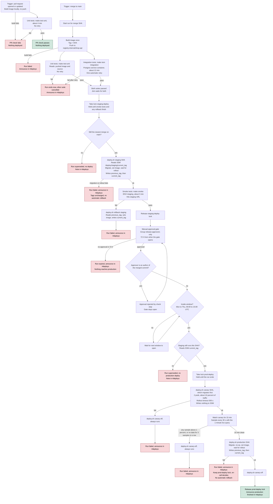

# shop-api release pipeline: from pull request to production

## Summary

Today, shop-api is deployed by hand from a laptop with `existing/deploy.sh`. CI only builds and unit-tests pull requests, and integration tests are run by hand. This pipeline runs on every merge to `main`. It builds one image, tests it, deploys it to staging, waits for one human approval, then rolls it out to production as a canary first. The same image moves through every stage, so nothing is rebuilt after the tests. The pipeline calls `deploy.sh` and uses the state that script already keeps. It replaces neither.

## Terms

- **Pull request (PR) check**: the CI run for a PR. It builds the image locally, without pushing, then runs unit tests. It never pushes or deploys.
- **SHA**: the full commit ID of the merged commit. The image is tagged with it.
- **Registry**: `registry.internal/shop-api`, where images are pushed.
- **deploy.sh**: the script that performs every deploy and rollback. Its commands are `staging <tag>`, `production <tag>`, `canary <tag>`, `canary-off` and `rollback <env>`. In this pipeline, each `<tag>` is a SHA.
- **Migration**: a database schema change, applied by `migrate up`. Migrations are forward-only. There are no down steps, nothing in the script undoes one, and `migrate up` does nothing when none is pending. Every migration must keep working with the previous image. That rule is what makes image-only rollback and the canary safe.
- **SSM Parameter Store**: an AWS key-value store. For each environment it holds `/deploy/<env>/current_tag`, the tag the stable deployment runs, and `/deploy/<env>/previous_tag`, the tag it ran before that. The script writes them only after a successful rollout. The canary is never recorded there.
- **Stable deployment** (`shop-api`): the deployment that serves production traffic.
- **Canary** (`shop-api-canary`): a second production deployment that normally has 0 replicas. While it has ready pods, the load balancer sends it 10% of traffic.
- **Rollback**: `deploy.sh rollback <env>` sets the stable image back to `previous_tag`. It does not touch the schema.
- **Canary 5xx ratio**: the share of canary requests that failed with a 5xx error over the last minute, read from Prometheus: `sum(rate(http_requests_total{app="shop-api-canary",code=~"5.."}[1m])) / sum(rate(http_requests_total{app="shop-api-canary"}[1m]))`.
- **Smoke tests**: `make smoke ENV=staging`. They take about 3 minutes and run against the staging URL.
- **Staging**: Kubernetes context `staging`, namespace `shop`. Internal only, with its own Postgres.
- **Production**: Kubernetes context `production`, namespace `shop`. Stable and canary share one production Postgres.
- **Lock**: a named CI lock that only one run can hold at a time.
- **Approval gate**: a CI job that waits for a person in the `release-approvers` group. CI records who approved and when.
- **Deployment window**: a production deploy may start Monday to Thursday, 09:00 to 15:00 UTC. Once started, it may finish after 15:00.
- **Superseded run**: a run that stops because a newer merge to `main` exists. It is not a failure.
- **#deploys**: the Slack channel for announcements.

## Diagram

## Notes on the diagram

**Tests.** Unit and integration tests run in parallel after the build, and both must pass. Unit tests get no retry. Integration tests get one automatic retry, run as a whole suite, because one test is known to be flaky. Any failure ends the run at once and cancels the other suite.

**Image.** One image per SHA. It is built and pushed once. A rerun reuses the pushed image. Tags are never overwritten. Staging, production and the canary all deploy that same tag.

**Superseded runs.** The newest merge wins, because each merge's image contains every earlier merge. An older run stops at the first gate that finds a newer merge: the staging check, or the check that staging still runs its SHA before production starts. A superseded run is not a failure, so it does not raise an alert. Approvers get a one-line note in #deploys, so a vanished approval button is explained. Older runs that are still testing are not cancelled.

**Staging.** The `staging-deploy` lock is held from the staging deploy through the smoke tests and any rollback. It is released before the approval wait, so other runs can use staging meanwhile. The lock exists because the script's SSM reads and writes are not atomic. A smoke-test failure rolls back, because by then the tags are written and `previous_tag` is correct. A staging rollout failure does not roll back. Its tags are not written, so `rollback` would set the image to `previous_tag`, which does not name what was running.

**Approval.** The gate opens after the smoke tests pass. The 72-hour clock starts then, not at merge. Only `release-approvers` may approve. If the approver is any author of the merged commit, a check step rejects the approval and the gate stays open for another approver. If CI cannot reopen a gate, the run ends and must be rerun.

**Window and production start.** The window is checked once, when production is about to start, before the canary. A run approved outside the window waits for the next opening and is not subject to the 72-hour expiry. Before it starts, the run confirms that staging still runs its SHA. Once production has started, it may run past 15:00, as policy allows. The stable rollout is part of the same deploy, so it is not window-checked again. The `prod-deploy` lock is taken just before the canary and held until the run ends, so only one production deploy runs at a time.

**Canary.** The canary's health is measured with the 5xx ratio above. Sampling starts after the canary rollout reports ready. Samples are taken every 30 seconds for 15 minutes. Any sample above 1 percent fails the run at once. Three samples in a row with no data also fail the run, because the canary's health is not proven. If the watch is clean, the stable deploy follows.

**Cleanup.** `deploy.sh canary-off` runs after any canary failure, because `deploy.sh canary` may already have scaled the canary up. It also runs when the run is cancelled, or its runner is lost, during the watch. The canary is never left taking traffic.

**Production deploy.** `deploy.sh production` runs its migration, which is a no-op because the canary step already applied it. It then sets the image, waits for the rollout and writes `previous_tag`, then `current_tag`. If the rollout fails, it stops before writing the tags, and there is no automatic rollback. On-call decides, and the `prod-deploy` lock is kept. The pipeline runs no production smoke tests. The brief asks for none, and adding them would be the team's decision.

## What happens when things fail

| Where | What fails | What happens next | Run result and alerts |
|---|---|---|---|
| PR check | Build or unit tests | Nothing is deployed | PR check fails |
| Build (merge) | Build fails | Run stops | Failed, announced in #deploys |
| Unit tests | Any failure | Integration tests cancelled | Failed, announced. No retry |
| Integration tests | Fails after one retry | Unit tests cancelled | Failed, announced |
| Staging check | A newer merge exists | No deploy | Superseded, one-line note in #deploys. Not an alert |
| Staging deploy | Migration or rollout fails | No automatic rollback. Tags unchanged | Failed, announced |
| Staging smoke tests | Any failure | `deploy.sh rollback staging`, lock held through it | Failed, announced |
| Approval | No approval within 72 h | Nothing reaches production | Expired, announced |
| Approval | Approver is an author of the merged commit | Check step rejects it, gate stays open | No alert |
| Approval | CI cannot reopen the gate | Run ends | Must be rerun |
| Window check | Outside the window | Waits for the next opening | Not subject to the 72 h expiry |
| Production start | Staging no longer runs this SHA | No production deploy | Superseded, note in #deploys |
| Canary deploy | Migration or rollout fails | `canary-off` runs | Failed, announced |
| Canary watch | Any sample above 1%, or 3 samples in a row with no data | `canary-off` runs | Failed, announced |
| Canary watch | Run cancelled or runner lost | `canary-off` runs | Canary removed |
| Production deploy | Rollout fails | Tags not written, no rollback. `prod-deploy` lock kept | Failed, announced. On-call decides |
| Production deploy | Success | `canary-off`, then lock released | Finished, announced in #deploys |

## Known problems in deploy.sh

Keep these in mind. The pipeline avoids the first one by never calling `rollback` after a failed deploy.

- **Rollback after a failed deploy goes to the wrong tag.** A failed rollout leaves `current_tag` unchanged. `rollback` then sets the image to `previous_tag`, which is not what was running.
- **Rollback does not move `previous_tag`.** After a rollback, `current_tag` and `previous_tag` hold the same value. A second rollback cannot go further back.
- **Re-running `deploy.sh <env> <current_tag>` by hand** overwrites `previous_tag` with the current tag and loses the real previous tag. Repairing this needs a person who knows the history.
- **Migrations are not undone** by a failed or cancelled run. This is why every migration must work with the previous image.

## How to build and roll out the pipeline

The CI system must provide these features:

- A manual approval job restricted to a group, which records the approver and the time.
- Named locks that only one run can hold: `staging-deploy` and `prod-deploy`.
- A Postgres service container for integration tests.
- Always-run cleanup steps, so `canary-off` runs after a failure or cancellation.
- Permission to push to `registry.internal/shop-api`, and credentials to run `deploy.sh` against both clusters. CI has these today.

## Open questions

- **Staging lock after a failed run.** The design holds `staging-deploy` through smoke tests and rollback. It does not say when the lock is released after a failed staging deploy or a failed rollback.
- **Rollback failure.** It is not decided what happens if `deploy.sh rollback staging` itself fails.
- **canary-off failure.** It is not decided what happens if `canary-off` fails, after a canary failure or after a successful production deploy.
- **Approval-gate supersession.** Decision text says superseded runs stop at the approval gate. The diagram has no check there. The stop comes from the check that staging still runs the SHA, which runs after approval. Confirm this is the intended behaviour.
- **Author identity.** "Author of the merged commit" needs a rule for commits with co-authors. The design does not say how CI finds the authors.
- **Lost runner during the watch.** `canary-off` must still run if the runner is lost. This depends on CI's always-run cleanup surviving a lost runner. That has not been verified.