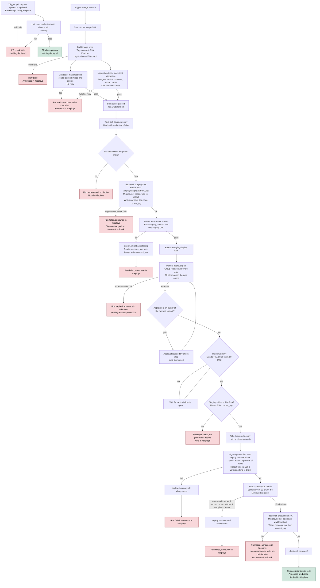

# shop-api release pipeline: from pull request to production

## Read this first

- Today, shop-api is deployed by hand from a laptop with `existing/deploy.sh`. CI only builds and unit-tests pull requests. This pipeline calls that script and keeps its state. It does not replace either.
- "SHA" means the full commit ID of the merged commit. The image is tagged with it.
- Deploy state lives in AWS SSM Parameter Store, per environment: `/deploy/<env>/current_tag` (the tag stable runs) and `/deploy/<env>/previous_tag` (the tag it ran before that). The script writes these only after a successful rollout. The canary is never recorded there.
- `deploy.sh rollback <env>` sets the stable image back to `previous_tag`. It does not touch the database schema.
- Migrations are forward-only. There are no down steps, and `migrate up` does nothing when no migration is pending. Every migration must work with the previous image. That rule is what makes image-only rollback and the canary safe.
- Production has a stable deployment, `shop-api`, and a canary, `shop-api-canary`. The canary normally has 0 replicas. While it has ready pods, the load balancer sends it 10 percent of traffic. Stable and canary share one production Postgres.
- Canary health is the 5xx ratio over the last minute: `sum(rate(http_requests_total{app="shop-api-canary",code=~"5.."}[1m])) / sum(rate(http_requests_total{app="shop-api-canary"}[1m]))`.
- Staging smoke tests are `make smoke ENV=staging`, about 3 minutes, against the staging URL.
- A production deploy may START Monday to Thursday, 09:00 to 15:00 UTC. Once started, it may finish after 15:00.
- Approvers are the `release-approvers` group in CI. Announcements go to the Slack channel #deploys.
- The CI features this design assumes: manual approval jobs restricted to a group that records approver and time, named locks that only one run can hold, a Postgres service container, and always-run cleanup steps.

## Diagram

## Decisions I made (not fixed by the brief)

1. **One image per SHA.** The image is built and pushed once, and staging, production and the canary all deploy that tag. A rerun reuses the pushed image. Tags are never overwritten.
2. **Test failures end the run at once.** If one suite fails, the other is cancelled. Only the integration suite is retried, once, as a whole suite.
3. **Newest merge wins.** Each merge's image contains every earlier merge, so only the newest run needs to reach production. Older runs stop at the first gate that finds a newer merge: the staging gate, the approval gate or the window check. A superseded run is not a failure, so it is not an alert, but approvers get a one-line note in #deploys so a vanished approval button is explained. Older runs that are still testing are not cancelled.
4. **Staging deploys are one at a time.** `staging-deploy` is held from the staging deploy through the smoke tests and any rollback. It is released before the approval wait, so other runs can use staging meanwhile. The reason for the lock is that the script's SSM reads and writes are not atomic.
5. **Production deploys are one at a time.** `prod-deploy` is taken just before the canary and held until the run ends. A run whose production deploy failed keeps the lock until on-call clears it.
6. **The 72-hour clock** starts when the approval gate opens, after staging smoke tests pass, not at merge.
7. **Self-approval is rejected.** If the approver is any author of the merged commit, a check step rejects the approval and the gate stays open for another approver. If CI cannot reopen a gate, the run ends and must be rerun.
8. **Window check.** The window is checked once, when production starts (before the canary). A run approved outside the window waits for the next opening and is not subject to the 72-hour expiry. Before starting, the run confirms that staging still runs its SHA. If not, it is superseded. Once production has started, it may run past 15:00, as the policy allows. The stable rollout is part of that same deploy, so it is not window-checked again.
9. **Canary measurement.** The query is the one given. Samples are taken every 30 seconds for 15 minutes, starting after the canary rollout reports ready. Any sample above 1 percent fails the run immediately. If there is no data for 3 samples in a row, the run also fails, because the canary's health is not proven.
10. **Cleanup always runs.** `canary-off` runs after any canary failure, because `deploy.sh canary` may already have scaled the canary up. It also runs when the run is cancelled or its runner is lost during the watch, so the canary is never left taking traffic.
11. **Stable rollout failure gets no automatic rollback.** If `deploy.sh production` fails during rollout, it stops before writing the tags. `previous_tag` then no longer names what is running, so `rollback` would set the wrong image. On-call decides, and the lock is kept.
12. **Staging rollout failure gets no automatic rollback** for the same reason. Smoke-test failure does roll back, because by then the tags have been written and `previous_tag` is correct.
13. **No production smoke tests.** The brief asks for none. Adding them would be a decision for the team.

## Problems in deploy.sh to fix or keep in mind

- **Rollback after a failed deploy goes to the wrong tag.** A failed rollout leaves `current_tag` unchanged. `rollback` then sets the image to `previous_tag`, which is not what was running. The pipeline avoids calling `rollback` in that case (decision 11).
- **Rollback does not move `previous_tag`.** After a rollback, `current_tag` and `previous_tag` hold the same value, so a second rollback cannot go further back.
- **Re-running `deploy.sh <env> <current_tag>` by hand** overwrites `previous_tag` with the current tag and loses the real previous tag. Repairs need a person who knows the history.
- **Migrations are not undone** by a failed or cancelled run. This is why every migration must work with the previous image.
