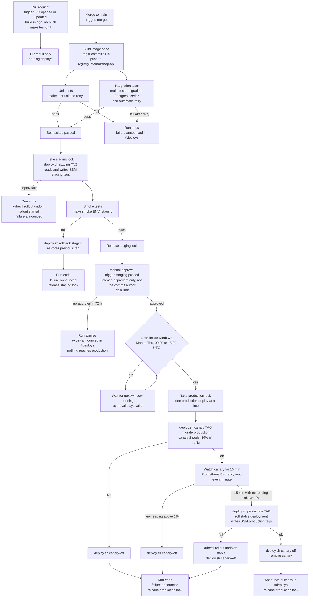

# shop-api release pipeline

## What this is

Today a person runs `existing/deploy.sh` from a laptop to put shop-api on staging and production. This pipeline replaces the laptop step. A merge to `main` builds one image, tests it, deploys it to staging, and waits for one human approval before a canary and then a full production deploy. The pipeline calls `deploy.sh` for every deploy and keeps the state that `deploy.sh` already keeps. It does not replace the script or its state.

## Terms

- **Pull request (PR) checks**: CI runs on every PR. It builds the image and runs unit tests. It never pushes an image and never deploys.
- **Merge run**: one pipeline run started by a merge to `main`. Each run builds its own image.
- **Image tag**: the name of an image. Every image is tagged with the commit SHA it was built from.
- **Registry**: where images are stored, `registry.internal/shop-api`.
- **deploy.sh**: the existing script that deploys shop-api. Its modes are `staging <tag>`, `production <tag>`, `canary <tag>`, `canary-off`, and `rollback <env>`.
- **SSM Parameter Store**: an AWS key-value store. `deploy.sh` keeps two values per environment there: `current_tag` (the tag the stable deployment runs) and `previous_tag` (the tag it ran before that). The repo does not keep live state, and the canary is never recorded there.
- **Stable deployment**: `shop-api` in production or staging. This is the main deployment.
- **Canary**: `shop-api-canary`, a second production deployment. It normally has 0 pods. When it has ready pods, the load balancer sends it 10% of production traffic.
- **Migration**: a database schema change. `deploy.sh` runs `migrate up` before every deploy. Migrations are forward-only: there are no down steps and nothing undoes one. Every migration must keep working with the previous image. Stable and canary share one production Postgres database.
- **Smoke tests**: `make smoke ENV=staging`, about 3 minutes, run against the staging URL.
- **Named lock**: a CI lock that only one run can hold at a time.
- **Manual approval**: a CI job that waits for a person. CI records who approved and when.
- **Deployment window**: production deploys may start only Monday to Thursday, 09:00 to 15:00 UTC. A deploy that has started may finish after 15:00.
- **Prometheus**: the metrics store. The canary check reads the canary 5xx ratio from it.
- **kubectl rollout undo**: a Kubernetes command that moves a deployment back to its previous revision.

## Diagram

## Notes on the diagram

**Pull requests.** A PR builds the image without pushing it, then runs unit tests. It never deploys. This is the same as today.

**Merge to main.** Each run builds one image, tagged with the commit SHA, and pushes it to the registry. Every later step deploys this same image. Nothing is rebuilt after the tests.

**Tests.** Unit tests (about 4 minutes) and integration tests (about 12 minutes) start together after the build. Integration tests need a Postgres service container. Integration tests get one automatic retry because one test is known to be flaky. Unit tests get no retry. Both suites must pass. If either fails, the run ends.

**Staging.** The run takes the staging lock. It runs `deploy.sh staging TAG`. This runs the migration first, then rolls the stable deployment to the new image. `deploy.sh` writes SSM tags only after the rollout succeeds. Then the run runs `make smoke ENV=staging`. If smoke tests fail, the run runs `deploy.sh rollback staging`, which restores the image from `previous_tag`, and the run ends. The rollback does not undo migrations. The staging lock is released after smoke tests pass or after the rollback.

**Approval.** The approval waits for a person in the `release-approvers` group. The author of the merged commit cannot approve. The 72-hour limit starts when the staging smoke tests pass. If nobody approves in time, the run expires and nothing reaches production. An approved run keeps its approval while it waits for the window or the lock. The approval does not expire while the run waits.

**Production window.** A run may start the canary only Monday to Thursday, 09:00 to 15:00 UTC. An approved run that reaches the window too late waits for the next opening. A deploy that has started may finish after 15:00.

**Production lock.** Only one production deploy may be in progress at a time. The run takes the production lock before the canary starts and releases it when the run finishes. A run that waits for the lock also waits for the window check to pass.

**Canary.** `deploy.sh canary TAG` runs the migration and starts the canary with 2 pods, which take 10% of traffic. The run then watches the canary for 15 minutes. Every minute it reads the canary 5xx ratio from Prometheus over the last minute: sum of rate of `http_requests_total` with `app="shop-api-canary"` and `code=~"5.."`, divided by the sum of the rate with `app="shop-api-canary"`. If any reading is above 1%, the run runs `deploy.sh canary-off` and fails. If the 15 minutes pass without such a reading, the run rolls the stable deployment with `deploy.sh production TAG`, then runs `deploy.sh canary-off` to remove the canary.

**Superseding.** Runs can overlap. When a newer run is approved, every older run that is still waiting for approval, the window, or the production lock is superseded. A superseded run is cancelled and is not announced. A run that is already in canary or stable production is never cancelled.

**Announcements.** The #deploys Slack channel gets three kinds of message: a failed run, an expired run, and a finished production deploy. A rejected approval ends the run and is not announced.

## What happens when things fail

| Step | Failure | What happens | Data left behind |
|---|---|---|---|
| PR build or unit tests | Any failure | PR check fails. Nothing deploys. | None |
| Build or push | Build or push fails | Run ends and failure is announced. | None |
| Unit tests | Any failure, no retry | Run ends and failure is announced. | None |
| Integration tests | Fails twice | Run ends and failure is announced. | None |
| Staging migration or rollout | Migration or rollout fails | Run ends, failure announced. If the rollout started, run `kubectl rollout undo` on staging. SSM tags were not written, so they still match the running image. A migration cannot be undone. | Migration may stay applied |
| Staging smoke tests | Any failure | `deploy.sh rollback staging` restores `previous_tag`. Run ends and failure is announced. | Migration stays applied |
| Approval | Nobody approves in 72 h | Run expires and the expiry is announced. Nothing goes to production. | None |
| Approval | Rejected | Run ends. Not announced. | None |
| Window | Approved outside window | Run waits for next opening. Approval stays valid. | None |
| Production lock | Another production deploy is running | Run waits for the lock, within the window rules. | None |
| Canary deploy | Migration or rollout fails | Run runs `deploy.sh canary-off`, then ends and is announced. Stable is not touched. | Migration may stay applied |
| Canary watch | Any reading above 1% | Run runs `deploy.sh canary-off`, then fails and is announced. Stable is not touched. | Migration stays applied |
| Canary watch | No reading returned | Counted as a failure. The check cannot show the canary is healthy. Run runs `deploy.sh canary-off` and fails. | Migration stays applied |
| Stable production deploy | Rollout fails | Run runs `kubectl rollout undo` on stable and `deploy.sh canary-off`. Run ends and failure is announced. | Migration stays applied |
| Stable production deploy | Succeeds | Run runs `deploy.sh canary-off` and announces success. | SSM production tags updated |

Migrations are forward-only. A failed run never undoes a migration. Every migration must work with the previous image, so a rollback of the image stays safe.

## Open questions

- Should `kubectl rollout undo` be used for stable production failures? It returns the deployment to its previous revision, which should match SSM `current_tag` because tags are written only after success. Confirm that this holds after earlier rollbacks.
- Should superseded runs be announced in #deploys? The brief lists only failures, expiries and finished production deploys.
- Should an approved run have a time limit while it waits for the window? The brief sets no limit after approval.
- Should the canary 5xx check also apply during the 15-minute watch at a finer interval than one minute?