# Release pipeline for shop-api

## What this is

Today shop-api reaches staging and production only when someone runs `existing/deploy.sh` from a laptop. CI builds and unit-tests pull requests and nothing else. This pipeline makes every merge to `main` able to reach production through automated gates plus one human approval, with no laptop deploys. It builds one image per merge, tests it, deploys it to staging, waits for a human, then rolls it to production through a canary. It calls the existing `deploy.sh` for every deploy, rollback and canary action. It keeps the state `deploy.sh` already keeps in SSM, and it adds no state of its own except CI locks.

## Terms

- **SHA / tag:** the merge commit's SHA. It is the image tag, `registry.internal/shop-api:SHA`. The image is built once, and staging and production deploy that same image.
- **SSM:** AWS SSM Parameter Store. For each environment it holds `/deploy/<env>/current_tag` (what the stable deployment runs) and `/deploy/<env>/previous_tag` (what it ran before). These two values are the only record of what runs where.
- **Stable / canary:** `shop-api` is the stable deployment. `shop-api-canary` is a second production deployment that normally has 0 pods. While it has ready pods the load balancer sends it about 10% of traffic. Stable and canary share the production database. SSM never records the canary.
- **Migration:** a database schema change that `deploy.sh` applies before it changes any image. Migrations are forward-only: nothing undoes one, and `migrate up` skips any already applied. Every migration must work with the previous image.
- **Smoke tests:** `make smoke ENV=staging`, about 3 min, run against the staging URL.
- **Lock:** a CI named lock that only one run can hold. Other runs queue for it.
- **Approval job:** a CI manual job restricted to a group. CI records who approved and when.
- **Descendant:** a commit is a descendant of another if the other is in its history. "SHA is a descendant of `current_tag`" means the run's commit is not older than what the environment runs.
- **Superseded:** a run whose SHA is not a descendant of the environment's `current_tag`. A newer commit already got there.
- **Deployment window:** Monday to Thursday, 09:00 to 15:00 UTC. A production deploy may only start inside it. Once started, it may finish after 15:00.
- **Prometheus:** the metrics system. The canary's 5xx ratio is read from it.
- **#deploys / `ANN`:** the Slack channel for announcements. `ANN` boxes in the diagram are posts to it.

## Flowchart

How to read it: solid arrows are the success path and dotted arrows are failure, expiry or skip paths. Each box shows its trigger (the arrow into it), what it reads or writes, and where it goes when it fails.

```mermaid
flowchart TD
  classDef gate fill:#fff4d6,stroke:#b8860b,color:#222
  classDef state fill:#e3f0ff,stroke:#2b6cb0,color:#222
  classDef bad fill:#fde2e2,stroke:#c53030,color:#222
  classDef good fill:#e2f6e5,stroke:#2f855a,color:#222
  classDef quiet fill:#eee,stroke:#777,color:#222

  subgraph PRFLOW["Pull request: unchanged from today"]
    direction TB
    PR["Trigger: PR opened or updated"] --> PRB["Build image (not pushed)<br/>make test-unit, about 4 min<br/>No registry push, no cluster credentials, no deploy"]
    PRB --> PRR["Result shown on the PR. END"]
  end

  M["Trigger: merge (any push) to main<br/>Run is keyed to the merge commit SHA"]

  subgraph BUILD["1. Build once"]
    B["Build image, tag = commit SHA<br/>WRITES registry.internal/shop-api:SHA<br/>Never rebuilt later in this run"]
  end

  subgraph TESTS["2. Tests, in parallel after the build"]
    direction TB
    U["2a Unit tests: make test-unit, about 4 min<br/>No retry"]
    I["2b Integration tests: make test-integration, about 12 min<br/>Postgres service container<br/>First attempt"]
    IQ{"Passed?"}
    IR["Automatic retry, once<br/>(whole job re-run)"]
    IQ2{"Passed?"}
    J(["Both green"])
    I --> IQ
    IQ -->|yes| J
    IQ -.->|no| IR --> IQ2
    IQ2 -->|yes| J
    U --> J
  end

  subgraph STG["3. Staging, automatic"]
    direction TB
    SL["Take lock staging-deploy<br/>Held until smoke tests end, queues if busy"]:::state
    SC{"READS /deploy/staging/current_tag<br/>Is SHA a descendant of it?<br/>(not older than what staging runs)"}:::gate
    SD["deploy.sh staging SHA<br/>Migrate staging DB (forward-only), set image, wait for rollout 300s<br/>WRITES previous_tag = old current_tag, current_tag = SHA<br/>only after rollout succeeded"]:::state
    SM["make smoke ENV=staging, about 3 min<br/>Reads staging URL"]
    RB["deploy.sh rollback staging<br/>READS previous_tag, image only, schema stays<br/>WRITES current_tag = previous_tag"]:::state
    SL --> SC
    SC -->|yes| SD --> SM
    SM -.->|fail| RB
  end

  SUP["Superseded by a newer commit: release lock,<br/>end run quietly, no announcement"]:::quiet

  subgraph APPR["4. Human approval"]
    direction TB
    A["Manual approval job<br/>Only release-approvers group may approve<br/>CI records who and when<br/>72 h clock starts here"]:::gate
    AC{"Approver is not the author<br/>of the merged commit?<br/>(CI cannot enforce this itself,<br/>so a gate step compares the recorded approver)"}:::gate
    A -->|approved| AC
    AC -.->|no: approval discarded| A
  end

  subgraph PROD["5. Production, one deploy at a time"]
    direction TB
    W{"Inside deployment window?<br/>Mon to Thu, 09:00 to 15:00 UTC<br/>(applies to the START only)"}:::gate
    WW["Wait, re-check every 5 min"]:::quiet
    PL["Take lock production-deploy<br/>Queues if another production deploy is running<br/>Held until canary is removed"]:::state
    W2{"Still inside window?<br/>(lock wait may have passed 15:00)"}:::gate
    PC{"READS /deploy/production/current_tag<br/>Is SHA a descendant of it?"}:::gate
    C["deploy.sh canary SHA<br/>Migrate PRODUCTION DB (forward-only, no undo),<br/>shop-api-canary 2 pods, about 10% of traffic, rollout 300s<br/>Writes nothing to SSM"]:::state
    WATCH["Watch canary for 15 min from rollout ready<br/>Prometheus query every 30 s, 5xx ratio over 1 min<br/>First 60 s ignored (window not yet canary-only)"]
    WD{"Any sample above 1%?<br/>Empty or unreachable data after warm-up<br/>counts as a breach"}:::gate
    PS["deploy.sh production SHA<br/>Migrate (no-op, already applied), roll stable shop-api, rollout 300s<br/>WRITES previous_tag = old current_tag, current_tag = SHA"]:::state
    RC["deploy.sh canary-off<br/>Scale canary to 0 (retry up to 3 times)"]
    REL["Release production-deploy lock"]:::state
    W -.->|no| WW -.-> W
    W -->|yes| PL --> W2
    W2 -.->|no: release lock| W
    W2 -->|yes| PC
    PC -->|yes| C --> WATCH --> WD
    WD -->|no, 15 min clean| PS --> RC --> REL
  end

  COFF["deploy.sh canary-off<br/>(best effort, always run if a canary was started,<br/>including on cancel)"]:::bad

  ANNOK["ANN #deploys: production deploy finished<br/>SHA, approver, time"]:::good
  ANNEXP["ANN #deploys: approval expired after 72 h<br/>nothing went to production, staging still on SHA"]:::bad
  ANNF["ANN #deploys: run failed<br/>SHA, failing step, link to run. END"]:::bad
  ANNW["ANN #deploys: deployed, but canary-off failed 3 times,<br/>canary still serving 10%, human action needed"]:::bad

  M --> B
  B --> U
  B --> I
  J --> SL
  SC -.->|no| SUP
  SM -->|pass: release lock| A
  AC -->|yes| W
  PC -.->|no| SUP
  A -.->|72 h without approval| ANNEXP
  REL --> ANNOK
  RC -.->|3 failures| ANNW

  B -.->|build or push fails| ANNF
  U -.->|fail: cancel sibling| ANNF
  IQ2 -.->|no: cancel sibling| ANNF
  SD -.->|fail: tags not written, no auto rollback| ANNF
  RB -.->|then end run, release lock| ANNF
  C -.->|fail| COFF
  WD -.->|yes: breach| COFF
  PS -.->|fail: tags not written| COFF
  COFF -.->|release lock| ANNF
```

## Notes on the steps

The diagram shows triggers, reads, writes and failure paths. These notes add only what it cannot show.

- **Pull request.** Same build and `make test-unit` as today. Pull requests get no registry push and no cluster credentials, so they cannot deploy.
- **1. Build.** Starts on any push to `main`. The run is keyed to the merge commit SHA. The registry tag is assumed immutable (see gaps).
- **2. Tests.** Unit and integration tests run in parallel and both must pass. Integration tests need a Postgres service container. Any test failure ends the run and cancels the sibling job. The integration retry re-runs the whole job, because the flaky test is not isolated. A retry costs another 12 min or so.
- **3. Staging.** The lock covers deploy, smoke tests and any rollback. The lock is needed because `deploy.sh staging` reads `current_tag` and writes `previous_tag`, so two overlapping runs would corrupt that pair and smoke tests could hit the wrong image. The lock is released on pass, on rollback, on supersede and on failure.
  - If the deploy itself fails, the pipeline does not roll back. The tags were not written, so `previous_tag` would be two versions old. It announces and ends.
  - If smoke tests fail, the staging deploy succeeded, so `previous_tag` is the right target. The run rolls back staging and ends.
- **4. Approval.** Only `release-approvers` may approve. CI records the approver but is not described as able to exclude the author, so a gate step compares the approver with the merge commit's author. If they match, the approval is discarded and the run keeps waiting on the same 72 h clock. After 72 h the run expires, nothing goes to production, and #deploys is told. The 72 h covers only this wait. After approval the run may still wait for the window, which over a weekend is up to about 66 h.
- **5. Production.**
  - *Window and lock.* The window is checked, then the `production-deploy` lock is taken, then the window is checked again, because waiting for the lock can run past 15:00. Out of window, the run waits and re-checks every 5 min. Approving after hours only queues the run. The lock gives "one production deploy at a time" and is held until the canary is removed.
  - *Supersede check.* Under the lock, the run reads `current_tag`. If SHA is not a descendant, the run ends quietly (see the next section).
  - *Canary.* `deploy.sh canary` migrates the production database, then starts 2 canary pods. Migration happens here, before the canary has proven anything and before the stable image changes.
  - *Stable roll.* `deploy.sh production` migrates again (a no-op, since `migrate up` skips applied migrations), rolls the stable deployment and writes the tags only after the rollout succeeds. Then `canary-off` removes the canary, retried up to 3 times. If all 3 fail, #deploys is told that the canary is still serving 10% and a human must act.
  - *Cleanup.* An always-run `canary-off` fires on any failure or cancellation after the canary started, because SSM does not record the canary and a stranded one would be invisible. If the stable roll fails, the tags are not written, the canary is removed, and a human decides what to do.
- **Announcements.** #deploys gets failures, expiries and finished production deploys. A superseded run is not announced.

## Decisions where several merges are in flight

The brief leaves this open, so this is what the pipeline does.

- **Runs are independent up to staging.** Each merge builds and tests its own SHA, and these can overlap freely.
- **Staging and production are each serialised by a lock.** See step 3 and step 5.
- **Older runs never deploy over newer ones.** Under each lock, a read-only check compares SHA with that environment's `current_tag`. If the run was overtaken it ends quietly as "superseded". Without this, a slow older run could downgrade production, which could also break compatibility, because migrations only have to work with the one previous image. A superseded run's approval request just goes stale, and approving it is harmless because the gate stops it.

## How the canary is measured

- **Query:** the 1-minute 5xx ratio from `environments.md`, sent to Prometheus:

      sum(rate(http_requests_total{app="shop-api-canary",code=~"5.."}[1m]))
      / sum(rate(http_requests_total{app="shop-api-canary"}[1m]))

- **Timing:** one sample every 30 s for 15 min, starting when `deploy.sh canary` returns (it waits for rollout). Samples in the first 60 s are ignored, because the 1-minute window still contains pre-canary data.
- **Coverage:** a 1-minute window sampled every 30 s means every moment of the watch falls inside at least one sampled window. That is how "at any point" is met.
- **Breach:** one sample above 0.01 fails the canary. A sample with no data (zero requests, so 0/0) or an unreachable Prometheus also counts as a breach after warm-up, because a canary that cannot be shown healthy must not go to 100%. This relies on weekday daytime traffic, which the window guarantees.
- **Limit:** one sample over 1% fails the run at once, even from a handful of requests. This is deliberately strict, and the cost is an occasional false abort at low traffic.

## Existing behaviour the pipeline relies on

- **State.** `deploy.sh` writes `current_tag` and `previous_tag` only after a rollout succeeds. The pipeline only reads them, for the supersede check.
- **Rollback.** `rollback` moves the image to `previous_tag` and leaves the schema alone. It is the right target only after a successful `staging` deploy, which is why staging is rolled back only on a smoke-test failure. `canary-off` also changes nothing but the canary's pod count.
- **Schema after failure.** A failed canary or staging rollback leaves the new schema in place. The fix is a new commit through the same pipeline.
- **CI abilities.** CI may push to `registry.internal/shop-api`, has credentials for both clusters, and supports group-restricted approval jobs and named locks.

## Known gaps and assumptions

- **No automatic rollback after a failed rollout,** in staging or in the production stable roll. The pipeline stops, removes the canary, announces, and leaves a human to decide. The reason is the tag behaviour above.
- **No automated production rollback.** After a finished deploy, `deploy.sh rollback production` is the manual path. It reverts the image only.
- **Registry tags are assumed immutable.** The pipeline pushes `registry.internal/shop-api:SHA` once per run. This is a registry setting that could not be verified from the files.

## Open questions

- Is the registry configured to keep tags immutable?
- Can CI exclude the commit author from approving natively? If so, the gate step can go.
