# Release pipeline for shop-api

## What this is

Every merge to `main` can reach production through automated gates and one human approval. Nobody deploys from a laptop. The pipeline calls the existing `deploy.sh` for every deploy, rollback and canary action. It keeps the state `deploy.sh` already keeps in SSM Parameter Store, and it adds no state of its own beyond CI locks.

How to read the diagram:

- Solid arrows are the success path.
- Dotted arrows are failure, expiry or skip paths.
- Each box names its trigger (the arrow into it), what it reads or writes, and where it fails to.
- `ANN` boxes are Slack posts to #deploys.

## Flowchart

```mermaid
flowchart TD
  classDef gate fill:#fff4d6,stroke:#b8860b,color:#222
  classDef state fill:#e3f0ff,stroke:#2b6cb0,color:#222
  classDef bad fill:#fde2e2,stroke:#c53030,color:#222
  classDef good fill:#e2f6e5,stroke:#2f855a,color:#222
  classDef quiet fill:#eee,stroke:#777,color:#222

  subgraph PRFLOW["Pull request: unchanged from today"]
    direction TB
    PR["Trigger: PR opened or updated"] --> PRB["Build image (not pushed)<br/>make test-unit, about 4 min<br/>No registry push, no cluster credentials, no deploy"]
    PRB --> PRR["Result shown on the PR. END"]
  end

  M["Trigger: merge (any push) to main<br/>Run is keyed to the merge commit SHA"]

  subgraph BUILD["1. Build once"]
    B["Build image, tag = commit SHA<br/>WRITES registry.internal/shop-api:SHA<br/>Never rebuilt later in this run"]
  end

  subgraph TESTS["2. Tests, in parallel after the build"]
    direction TB
    U["2a Unit tests: make test-unit, about 4 min<br/>No retry"]
    I["2b Integration tests: make test-integration, about 12 min<br/>Postgres service container<br/>First attempt"]
    IQ{"Passed?"}
    IR["Automatic retry, once<br/>(whole job re-run)"]
    IQ2{"Passed?"}
    J(["Both green"])
    I --> IQ
    IQ -->|yes| J
    IQ -.->|no| IR --> IQ2
    IQ2 -->|yes| J
    U --> J
  end

  subgraph STG["3. Staging, automatic"]
    direction TB
    SL["Take lock staging-deploy<br/>Held until smoke tests end, queues if busy"]:::state
    SC{"READS /deploy/staging/current_tag<br/>Is SHA a descendant of it?<br/>(not older than what staging runs)"}:::gate
    SD["deploy.sh staging SHA<br/>Migrate staging DB (forward-only), set image, wait for rollout 300s<br/>WRITES previous_tag = old current_tag, current_tag = SHA<br/>only after rollout succeeded"]:::state
    SM["make smoke ENV=staging, about 3 min<br/>Reads staging URL"]
    RB["deploy.sh rollback staging<br/>READS previous_tag, image only, schema stays<br/>WRITES current_tag = previous_tag"]:::state
    SL --> SC
    SC -->|yes| SD --> SM
    SM -.->|fail| RB
  end

  SUP["Superseded by a newer commit: release lock,<br/>end run quietly, no announcement"]:::quiet

  subgraph APPR["4. Human approval"]
    direction TB
    A["Manual approval job<br/>Only release-approvers group may approve<br/>CI records who and when<br/>72 h clock starts here"]:::gate
    AC{"Approver is not the author<br/>of the merged commit?<br/>(CI cannot enforce this itself,<br/>so a gate step compares the recorded approver)"}:::gate
    A -->|approved| AC
    AC -.->|no: approval discarded| A
  end

  subgraph PROD["5. Production, one deploy at a time"]
    direction TB
    W{"Inside deployment window?<br/>Mon to Thu, 09:00 to 15:00 UTC<br/>(applies to the START only)"}:::gate
    WW["Wait, re-check every 5 min"]:::quiet
    PL["Take lock production-deploy<br/>Queues if another production deploy is running<br/>Held until canary is removed"]:::state
    W2{"Still inside window?<br/>(lock wait may have passed 15:00)"}:::gate
    PC{"READS /deploy/production/current_tag<br/>Is SHA a descendant of it?"}:::gate
    C["deploy.sh canary SHA<br/>Migrate PRODUCTION DB (forward-only, no undo),<br/>shop-api-canary 2 pods, about 10% of traffic, rollout 300s<br/>Writes nothing to SSM"]:::state
    WATCH["Watch canary for 15 min from rollout ready<br/>Prometheus query every 30 s, 5xx ratio over 1 min<br/>First 60 s ignored (window not yet canary-only)"]
    WD{"Any sample above 1%?<br/>Empty or unreachable data after warm-up<br/>counts as a breach"}:::gate
    PS["deploy.sh production SHA<br/>Migrate (no-op, already applied), roll stable shop-api, rollout 300s<br/>WRITES previous_tag = old current_tag, current_tag = SHA"]:::state
    RC["deploy.sh canary-off<br/>Scale canary to 0 (retry up to 3 times)"]
    REL["Release production-deploy lock"]:::state
    W -.->|no| WW -.-> W
    W -->|yes| PL --> W2
    W2 -.->|no: release lock| W
    W2 -->|yes| PC
    PC -->|yes| C --> WATCH --> WD
    WD -->|no, 15 min clean| PS --> RC --> REL
  end

  COFF["deploy.sh canary-off<br/>(best effort, always run if a canary was started,<br/>including on cancel)"]:::bad

  ANNOK["ANN #deploys: production deploy finished<br/>SHA, approver, time"]:::good
  ANNEXP["ANN #deploys: approval expired after 72 h<br/>nothing went to production, staging still on SHA"]:::bad
  ANNF["ANN #deploys: run failed<br/>SHA, failing step, link to run. END"]:::bad
  ANNW["ANN #deploys: deployed, but canary-off failed 3 times,<br/>canary still serving 10%, human action needed"]:::bad

  M --> B
  B --> U
  B --> I
  J --> SL
  SC -.->|no| SUP
  SM -->|pass: release lock| A
  AC -->|yes| W
  PC -.->|no| SUP
  A -.->|72 h without approval| ANNEXP
  REL --> ANNOK
  RC -.->|3 failures| ANNW

  B -.->|build or push fails| ANNF
  U -.->|fail: cancel sibling| ANNF
  IQ2 -.->|no: cancel sibling| ANNF
  SD -.->|fail: tags not written, no auto rollback| ANNF
  RB -.->|then end run, release lock| ANNF
  C -.->|fail| COFF
  WD -.->|yes: breach| COFF
  PS -.->|fail: tags not written| COFF
  COFF -.->|release lock| ANNF
```

## Decisions where several merges are in flight

The brief leaves this open, so here is what the pipeline does.

- **Runs are independent up to staging.** Each merge builds and tests its own SHA. Builds and tests can overlap freely.
- **Staging is serialised by a lock.** `deploy.sh staging` reads `current_tag` and writes `previous_tag`. Two overlapping runs would corrupt that pair, and smoke tests could hit the wrong image. The `staging-deploy` lock covers deploy, smoke tests and any rollback.
- **Production is serialised by a lock.** The `production-deploy` lock is taken after the window check and held until the canary is removed. This gives "one production deploy at a time". The window is checked again after the lock is acquired, because waiting for the lock can run past 15:00.
- **Older runs never deploy over newer ones.** Under each lock, the run reads `current_tag` for that environment. If that tag is not an ancestor of the run's SHA, the run was overtaken and ends quietly as "superseded". This is a read-only check.
  - Without it, a slow older run could downgrade production. The downgrade could also break compatibility, because migrations only have to work with the one previous image.
  - A superseded run is not announced, to keep #deploys quiet. Its approval request just goes stale, and approving it is harmless because the gate stops it.
- **The 72 h expiry covers only the approval wait.** After approval, the run can wait outside the deployment window. Over a weekend that is up to about 66 h. The supersede check then decides whether it is still worth deploying.

## How the canary is measured

- **Query:** the 1-minute 5xx ratio from `environments.md`, sent to Prometheus.
- **Timing:** one sample every 30 s for 15 min, starting when `deploy.sh canary` returns (it waits for rollout). Samples in the first 60 s are ignored, because the 1-minute window still contains pre-canary data.
- **Coverage:** with a 1-minute window sampled every 30 s, every moment of the watch falls inside at least one sampled window. That is how "at any point" is met.
- **Breach:** one sample above 0.01 fails the canary. A sample with no data (zero requests, so 0/0) or an unreachable Prometheus also counts as a breach after warm-up. A canary that cannot be shown to be healthy must not go to 100%. This relies on weekday daytime traffic, which the deployment window guarantees.
- **Limit:** one sample over 1% fails the run immediately, even from a handful of requests. That is deliberately strict, and the cost is an occasional false abort at low traffic.

## What carried over from the existing files

- **Where state lives.** `/deploy/<env>/current_tag` and `/deploy/<env>/previous_tag` in SSM are the only record of what runs where. `deploy.sh` writes them only after a rollout succeeds. The pipeline only reads them for the supersede check.
- **The canary is not recorded anywhere.** Nothing in SSM says a canary is up. If a run dies or is cancelled mid-canary, a canary stays at 10% of traffic and nothing shows it. So an always-run cleanup issues `canary-off` on any failure or cancellation after the canary started. Removing the canary after the stable roll is retried and escalated, as the diagram shows.
- **Migrations are forward-only.** Nothing undoes them, and `rollback` and `canary-off` change images only.
  - Production's schema changes at the canary step, before the canary has proven anything and before the stable image changes. Every migration must therefore work with the previous image.
  - A failed canary or staging rollback leaves the new schema in place. The fix is a new commit through the same pipeline.
  - `migrate up` skips applied migrations, so the second migrate inside `deploy.sh production` does nothing.
- **Rollback semantics.** `rollback` moves to `previous_tag`, and that is the right target only after a successful `staging` deploy. This is why the pipeline rolls back staging only on smoke-test failure. It never rolls back after a failed rollout, because the tags were not written and `previous_tag` would then be two versions old.
- **Deployment window.** The window applies only to when a production deploy starts, which is the canary. A deploy that starts at 14:50 may finish after 15:00. Approving after hours only queues the run.
- **CI facts used.** CI may push to `registry.internal/shop-api`, has credentials for both clusters, and supports group-restricted approval jobs that record who approved and when. It also supports named locks that one run holds at a time. The Postgres service container is needed only by integration tests.
- **Pull requests.** They run the same build and `make test-unit` as today. They get no push or cluster credentials, so they cannot deploy.

## Known gaps and assumptions

- **No automatic rollback after a failed rollout.** This applies to staging, and to the production stable roll. The pipeline stops, removes the canary, announces, and leaves a human to decide. The reason is the tag behaviour above.
- **No automated production rollback.** After a finished deploy, `deploy.sh rollback production` is the manual path. It reverts the image only.
- **Registry tags are assumed immutable.** The pipeline pushes `registry.internal/shop-api:SHA` once per run. This is a registry setting I could not verify from the files.
- **The author check is a pipeline step.** CI records the approver but is not described as able to exclude the author, so a gate step compares the two. If the author approves, the approval is discarded and the run keeps waiting on the same 72 h clock.
- **Integration retry is the whole job.** The flaky test is not isolated, so a retry costs another 12 min or so.
