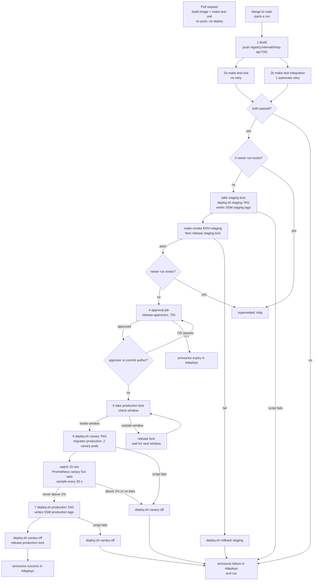

# shop-api release pipeline

Today shop-api reaches staging and production only when someone runs `existing/deploy.sh` from a laptop. CI builds and unit-tests pull requests and nothing else. This pipeline replaces the laptop. A merge to `main` builds one image, tests it, deploys it to staging, waits for one human approval, then deploys it to production through a canary. Every deploy still goes through `deploy.sh`, so the state it keeps stays where it is.

## Terms

- **Tag**: the full commit SHA of the merged commit. The image is `registry.internal/shop-api:<tag>`.
- **`deploy.sh`**: the existing script, called as `deploy.sh staging <tag>`, `canary <tag>`, `production <tag>`, `canary-off` or `rollback <env>`.
- **Stable / canary**: two Kubernetes deployments in production. `shop-api` is stable. `shop-api-canary` normally has 0 pods. While it has ready pods, the load balancer sends it 10% of traffic. Both share one production Postgres.
- **SSM tags**: `/deploy/<env>/current_tag` and `/deploy/<env>/previous_tag` in AWS Parameter Store. They record what stable runs and what it ran before. Only `deploy.sh` writes them, and only after a rollout succeeds. The canary is never recorded.
- **Migration**: a database change that `deploy.sh` applies before it rolls a deployment. Migrations are forward-only and nothing undoes them. Every migration must work with the previous image. Running one again does nothing.
- **Lock**: a named CI lock that only one run can hold at a time. A run that wants a held lock waits.
- **Approval job**: a CI job that waits for a person in the `release-approvers` group. CI records who approved and when.
- **Superseded**: a run stops quietly because a newer run for `main` exists (see rule 1).
- **Deployment window**: a production deploy may start Monday to Thursday, 09:00 to 15:00 UTC. A deploy that has started may finish after 15:00.

## Flow



## Steps

1. **Build.** Trigger: a merge to `main`. It builds the image once, tags it with the SHA and pushes it. Nothing is rebuilt later. If the build fails, the run fails. Pull requests still only build and run unit tests, and they never push, deploy or announce.
2. **Tests.** Trigger: build passed. `make test-unit` (about 4 min) and `make test-integration` (about 12 min, needs a Postgres service container) run in parallel. Integration tests get one automatic retry because one test is known to be flaky. Unit tests get none. Both must pass. Any remaining failure ends the run and is announced.
3. **Staging.** Trigger: both test jobs passed and no newer run exists. The run takes the staging lock, runs `deploy.sh staging <tag>`, then `make smoke ENV=staging` (about 3 min), and releases the lock. The script writes the staging SSM tags. If the staging deploy fails, the run ends and is announced. It does not call `rollback`, because the script writes tags only after success, so `previous_tag` would still name an older image than the one staging runs. If smoke tests fail, the run calls `deploy.sh rollback staging`, which puts staging back on `previous_tag`. The schema is not rolled back. The run then ends and is announced.
4. **Approval.** Trigger: smoke tests passed and no newer run exists. An approval job waits for a member of `release-approvers`. If nobody approves within 72 hours, the run expires, nothing goes to production, and the expiry is announced. If the approver is the author of the merged commit, that approval is discarded and the job keeps waiting for someone else within the same 72 hours.
5. **Window and production lock.** Trigger: approved. The run takes the production lock, then checks the deployment window. If it is outside the window, the run releases the lock and waits for the next window, then tries again. The lock is held until the canary is gone, so only one production deploy is in progress at a time.
6. **Canary.** Trigger: inside the window with the lock held. `deploy.sh canary <tag>` migrates the production database, then runs the tag on 2 canary pods. For 15 minutes the run asks Prometheus every 30 seconds, starting one minute after the rollout, for the canary 5xx ratio over the last minute:

   ```
   sum(rate(http_requests_total{app="shop-api-canary",code=~"5.."}[1m]))
   / sum(rate(http_requests_total{app="shop-api-canary"}[1m]))
   ```

   If any sample is above 1%, or Prometheus returns no data, the run calls `deploy.sh canary-off`, fails and announces. If `deploy.sh canary` itself fails, the run does the same.
7. **Production.** Trigger: 15 clean minutes. `deploy.sh production <tag>` rolls the stable deployment and writes the production SSM tags. The migration is a no-op because the canary step already ran it. Then the run calls `deploy.sh canary-off`, releases the production lock and announces the finished deploy. If the production deploy fails, the run calls `canary-off`, releases the lock, fails and announces. It does not roll back automatically, for the same reason as in step 3. Kubernetes keeps serving from the old pods, and `current_tag` still names the last good image. A person decides what to do next.

## Rules for the whole run

1. **Newer runs win.** A run stops as superseded when a newer run for `main` exists and the older one has not yet taken the production lock. It checks before taking the staging lock, before starting the approval job, and while waiting for approval, the window or the production lock. A run that holds a lock finishes its current step. A superseded run is not announced.
2. **Nothing new is stored.** The pipeline keeps no state of its own. Tags live in SSM, written only by `deploy.sh`. Approvals and locks live in CI. Metrics come from Prometheus.
3. **Announcements.** Failures, expiries and finished production deploys go to #deploys. Superseded runs and pull request runs do not.
4. **Migrations are never undone.** After a canary failure the schema may already have changed, and stable keeps working because every migration must work with the previous image.

## Rolling out

Add the pipeline and keep the laptop path working. After the first successful production run, remove laptop access to the clusters, so that every deploy goes through the pipeline.

## Open questions

- Can CI refuse an approval from the commit author by itself? If not, step 4 needs a small check job after the approval.
- Is a 1% ratio meaningful when the canary gets very little traffic? A single error could trip it.
- When a newer run exists and the older one is superseded, but the newer one then fails its tests, nothing reaches production until a fix merges. Is that acceptable?