# shop-api release pipeline: plan and flowchart

## Summary

Today a person runs `existing/deploy.sh` from a laptop to put shop-api on staging or production. Continuous integration (CI, the service that runs automated checks on code changes) only builds the image and runs unit tests on pull requests. Nothing is deployed automatically.

This plan adds a release pipeline that starts on every merge to `main`. It builds one image, runs the tests, deploys that image to staging, checks staging, waits for one human approval, and then deploys to production, canary first. No deploy runs from a laptop. The pipeline calls `deploy.sh` for every deploy and does not replace it. The state that `deploy.sh` keeps in AWS SSM Parameter Store remains the record of what is live.

**The stages, in order:**

1. **Pull request:** build the image and run unit tests. Nothing is pushed or deployed. This is today's behaviour.
2. **Merge to `main`:** start a release run. Build one image, tag it with the commit SHA, and push it to the registry.
3. **Tests:** unit and integration tests run in parallel. Both must pass.
4. **Staging:** deploy the image automatically, then run smoke tests. If they fail, roll staging back and end the run.
5. **Approval:** wait for one approval from the `release-approvers` group. The run can wait up to 72 hours and holds no lock while it waits.
6. **Production window:** a production deploy may only start Monday to Thursday, 09:00 to 15:00 UTC. If the run is approved outside that window, it waits.
7. **Canary:** run the new image on 2 pods that receive about 10% of production traffic. Watch its error rate for 15 minutes.
8. **Stable production:** roll the main production deployment to the new image, then remove the canary.

Failures, expired approvals and finished production deploys are announced in the Slack channel #deploys.

In one line: a merge reaches production only after automated tests, a passing staging check, one approval from a named group, and a canary that stays healthy for 15 minutes.

## What exists today

- **shop-api** runs on Kubernetes in two environments, both in the namespace `shop`. Kubernetes runs containers as **pods** and groups them into **deployments**. A deployment's **rollout** replaces its old pods with new ones, and the rollout command waits until the new pods are ready.
- **Staging** is the Kubernetes context `staging`. It has its own Postgres database and is reachable only inside the network. Its smoke test is `make smoke ENV=staging` (about 3 minutes).
- **Production** is the Kubernetes context `production`. It has two deployments:
  - `shop-api`, the **stable** deployment, which serves most traffic.
  - `shop-api-canary`, the **canary** deployment, which normally has 0 pods. While it has ready pods, the load balancer sends it about 10% of production traffic.
  - Stable and canary share one production Postgres database.
- **`deploy.sh` commands:**
  - `staging <tag>` or `production <tag>`: run database migrations, set the stable image, wait for the rollout, then record the tags.
  - `canary <tag>`: production only. Run migrations, then run `<tag>` on the canary (2 pods).
  - `canary-off`: scale the canary to 0 pods.
  - `rollback <env>`: set the stable image back to the recorded previous tag. The database schema is not changed.
- **State in SSM**, per environment:
  - `/deploy/<env>/current_tag`: the tag the stable deployment runs.
  - `/deploy/<env>/previous_tag`: the tag it ran before that.
  - The canary is never recorded.
- **Tests:**
  - Unit tests (`make test-unit`) take about 4 minutes.
  - Integration tests (`make test-integration`) take about 12 minutes and need a Postgres service container (a database that the CI job starts alongside the tests). One integration test is known to be flaky.
  - Today the integration tests run only by hand.
- **CI facts this plan relies on:**
  - CI can push images to `registry.internal/shop-api` (the image registry).
  - CI can run `deploy.sh` against both clusters.
  - CI supports approval jobs limited to a group. They record who approved and when.
  - CI supports named locks. Only one run can hold a given lock at a time.
- **Release policy:**
  - A production deploy may start Monday to Thursday, 09:00 to 15:00 UTC. Once started, it may finish after 15:00.
  - Approvers are the `release-approvers` group.
  - Announcements go to the Slack channel #deploys.

Prometheus (the metrics system) records the canary's error rate with this query, evaluated over the last minute:

    sum(rate(http_requests_total{app="shop-api-canary",code=~"5.."}[1m]))
    / sum(rate(http_requests_total{app="shop-api-canary"}[1m]))

## Terms used

- **Commit SHA**: the unique ID of a git commit. The pipeline uses it as the image tag, so each commit maps to one image.
- **Tag**: a label on an image. Here, every image's tag is its commit SHA. The SSM values also store tags.
- **Image**: the packaged shop-api container, stored in `registry.internal/shop-api`.
- **Migration**: a change to the database schema. Migrations only move forward. There is no undo, and `deploy.sh` never reverses one. Every migration must keep working with the previous image, because a rollback restores the image but not the schema.
- **Stable deployment**: the main production deployment, `shop-api`.
- **Canary**: a small second production deployment that receives about 10% of traffic while it has pods.
- **Lock**: a named CI lock. Staging and production each have one. Only one run can hold a given lock at a time.
- **Smoke test**: a short test against a live environment that checks it responds correctly.
- **Ancestor**: in git, commit A is an ancestor of commit B if A appears in B's history. The check `git merge-base --is-ancestor A B` tests this.
- **Superseded**: a run is superseded when its environment already runs a newer commit, meaning the run's commit is not newer than the environment's `current_tag`. A superseded run stops without deploying. A run whose commit is the same as `current_tag` is not superseded. It redeploys the same tag, which changes nothing.
- **5xx ratio**: the share of requests that fail with a server error (HTTP status 500 to 599).
- **Usable sample**: a canary reading taken while the canary served at least 100 requests in the last minute. Below that, the ratio is noise.

## Flowchart

```mermaid
flowchart TD
  subgraph PR["Pull request: build and unit tests only, never deploys"]
    P1["Trigger: PR opened or updated<br/>Reads: PR commit"] --> P2["Build image<br/>Not pushed"]
    P2 -->|pass| P3["Unit tests: make test-unit, about 4 min<br/>No retry"]
    P2 -->|fail| PF["PR check fails"]
    P3 -->|pass| PP["PR check passes"]
    P3 -->|fail| PF
  end

  subgraph REL["Merge to main: one release run per merge, keyed by commit SHA"]
    R1["Trigger: merge to main<br/>Starts a new run"] --> R2["Build image once<br/>Tag = commit SHA"]
    R2 -->|fail| FAIL
    R2 -->|pass| R3["Push registry.internal/shop-api:SHA<br/>Writes: registry<br/>Skipped if the tag already exists"]
    R3 --> UT["Unit tests: make test-unit, about 4 min<br/>No retry"]
    R3 --> IT["Integration tests: make test-integration, about 12 min<br/>Needs Postgres service container"]
    UT -->|fail| FAIL
    UT -->|pass| BOTH["Both suites passed"]
    IT -->|pass| BOTH
    IT -->|fail, first attempt| IT2["Automatic retry: integration tests run once more"]
    IT2 -->|fail| FAIL
    IT2 -->|pass| BOTH

    BOTH --> LS["Acquire staging lock"]
    LS --> SS{"Is SHA the same as, or newer than, staging current_tag?<br/>Newer means current_tag is an ancestor of SHA"}
    SS -->|no: superseded| SX["Release lock<br/>Run ends quietly, no announcement"]
    SS -->|yes| SD["deploy.sh staging SHA<br/>Reads: SSM current_tag<br/>Writes: migrations, then image, then SSM previous_tag and current_tag"]
    SD -->|fail| FAIL
    SD -->|ok| SM["Smoke tests: make smoke ENV=staging, about 3 min<br/>Reads: staging URL"]
    SM -->|fail| RB["Roll back staging: deploy.sh rollback staging<br/>Reads: SSM previous_tag<br/>Writes: image, then SSM current_tag"]
    RB -->|ok| FAIL
    RB -->|fail| PAGE
    SM -->|pass| RL["Release staging lock<br/>72-hour approval clock starts<br/>Run waits, holding no lock"]

    RL --> APP{"Manual approval<br/>Group: release-approvers<br/>Approver must not be the commit author"}
    APP -->|author approves| NC["Not counted, keep waiting"]
    NC --> APP
    APP -->|72 hours pass with no valid approval| EXP["Run expires<br/>Nothing goes to production<br/>Staging keeps this tag<br/>Announce in Slack #deploys"]
    APP -->|valid approval| LP["Acquire production lock"]

    LP --> WIN{"Inside deploy window?<br/>Start must be Mon to Thu, from 09:00 up to 15:00 UTC"}
    WIN -->|no| WT["Release production lock<br/>Wait for next window, holding no lock"]
    WT -->|window opens| LP
    WIN -->|yes| PS{"Is SHA the same as, or newer than, production current_tag?<br/>Same check as staging"}
    PS -->|no: superseded| PSX["Release lock<br/>Run ends quietly, no announcement"]
    PS -->|yes| CAN["deploy.sh canary SHA<br/>Migrates production, then canary: 2 pods, about 10% of traffic<br/>Writes: migrations only, canary is not in SSM"]
    CAN -->|fails, or not ready in 300 s| OFFF
    CAN -->|ready| W["Watch canary for 15 min<br/>Every 30 s: read canary 5xx ratio and request count from Prometheus"]
    W -->|usable sample above 1%| OFFF
    W -->|3 unusable samples in a row| OFFF
    W -->|15 min with no bad sample| PRD["deploy.sh production SHA<br/>Migrate is a no-op, then stable image<br/>Writes: SSM previous_tag, then current_tag"]
    PRD -->|fails| REC["Recovery: deploy.sh production with the current_tag read at run start<br/>Not a rollback"]
    REC -->|ok| OFFF
    REC -->|fails| PAGE
    PRD -->|ok| OFFO["deploy.sh canary-off<br/>Scale canary to 0"]
    OFFO -->|ok| DONE["Release production lock<br/>Announce finished production deploy in Slack #deploys"]
    OFFO -->|fails| FAIL
    OFFF["deploy.sh canary-off<br/>Scale canary to 0"] -->|ok| FAIL
    OFFF -->|fails| PAGE
    FAIL["Run fails: release any lock held<br/>Announce in Slack #deploys with failed stage and SHA"]
    PAGE["Page a human"] --> FAIL
  end

  classDef fail fill:#fde2e2,stroke:#b42318,color:#000
  classDef ok fill:#e3f4e8,stroke:#1a7f37,color:#000
  classDef quiet fill:#eeeeee,stroke:#666666,color:#000
  class PF,FAIL,PAGE fail
  class PP,DONE ok
  class SX,PSX,EXP quiet
```

## How to read the diagram

- **Order of steps**: each step starts when the step before it passes, unless the box says otherwise. Boxes that start a run or wait for something name their trigger on the first line.
- **Reads and writes**: lines beginning "Reads" show what a step looks at. Lines beginning "Writes" show what it changes. Writes to SSM happen only after a successful rollout.
- **Colours**: red ends the run as a failure. Grey ends it quietly, or with an expiry notice. Green is a success.
- **Locks**: a run may call `deploy.sh` against an environment only while it holds that environment's lock. The approval wait and the deploy-window wait hold no lock, so a 72-hour wait never blocks other runs.
- **Tags**: every image is tagged with its full commit SHA. Staging and production receive the same tag. Nothing is rebuilt after the tests.
- **Test failures**: if either suite fails, the run ends. If one suite fails while the other is still running, the other is stopped. The integration suite gets one automatic retry first.
- **Failed deploys are not rolled back automatically.** If `deploy.sh staging` or `deploy.sh production` fails, the run ends and leaves the environment as the script left it. The one exception is the production recovery step described below.
- **Page a human**: this happens only when a rollback or recovery deploy itself fails. These are the cases where the pipeline cannot restore a known-good state on its own.

## Decisions made

1. **Several merges in flight.** Each merge starts its own run and builds its own image. Runs never cancel each other. Inside an environment's lock, and before deploying, a run checks whether its commit is newer than the commit in that environment's `current_tag`, using `git merge-base --is-ancestor <current_tag> <SHA>`. The check passes when `current_tag` is the same commit as SHA or an earlier commit in its history. If it fails, the run is superseded and ends without a deploy or an announcement. This stops an older merge from overwriting a newer one. If `current_tag` is not a commit in this repo (for example, a tag from before this pipeline), the check passes.

2. **Approval.** The 72-hour clock starts when staging smoke tests pass. The approver must be in the `release-approvers` group and must not be the author of the merged commit. The author is found with `git log -1 --format=%ae <SHA>`. An approval by the author is not counted, and the run keeps waiting. The 72 hours apply only to waiting for approval. Once approved, a run that is waiting for a deploy window has no time limit. It ends only when the superseded check fails.

3. **Approved outside the window.** An approved run that reaches production outside the window releases its production lock and waits for the next window. The next window opens Monday at 09:00 UTC. The window is checked after the lock is acquired, so a long queue cannot start a deploy after 15:00. A deploy that has already started may finish after 15:00.

4. **Canary measurement.** The watch starts when `deploy.sh canary` reports the canary ready. For 15 minutes, every 30 seconds, the run reads two Prometheus values for the canary: the 5xx ratio (the query above) and its request count over the last minute. A sample is usable only if the request count is at least 100. A usable sample above 1% aborts the run at once. Three unusable samples in a row also abort the run. The 100-request floor and the 3-sample limit are choices that must be checked against real canary traffic.

5. **Stable deploy failure.** If `deploy.sh production SHA` fails, the run does not use `deploy.sh rollback production`. `previous_tag` is written only after a successful deploy, so it holds a version older than `current_tag`, which is not the version to restore. Instead the run runs `deploy.sh production <current_tag>`, using the `current_tag` read from SSM at the start of the run, and then runs `canary-off`. If the recovery fails, a human is paged. See the open questions for a side effect of this step.

6. **Staging rollback is safe.** A successful staging deploy has already written both `previous_tag` and `current_tag`. So `deploy.sh rollback staging` has a known-good version to return to.

7. **Tests.** Integration tests run once and get one automatic retry. They fail only if both attempts fail. Unit tests get no retry. Both suites must pass before anything reaches staging.

8. **Pull requests** behave as they do today. They build and run unit tests only. They do not push an image and do not run integration tests.

9. **Production finishes with a canary check, not a smoke test.** `canary-off` runs after a successful production deploy. If it fails, the production deploy has already succeeded, so the run fails and is announced, but production stays on the new tag.

## Rules carried over from the existing files

- Migrations only move forward. `canary` and `production` both run `migrate up` before rolling out. If the canary fails, its migrations stay applied, so the stable image must work with them. The pipeline never undoes a migration.
- `deploy.sh rollback <env>` restores only the image. The schema stays where it is.
- `deploy.sh` writes SSM tags only after a successful rollout. The canary is never recorded in SSM, so aborting the canary changes no stored state.
- Smoke tests run only against staging. This plan has no production smoke test. The canary 5xx check is the only automatic production check.
- Staging and production each have their own Postgres. Stable and canary share the production Postgres.
- The deployment window applies only to the start of a production deploy.
- Announcements go to the Slack channel #deploys.

## Open questions

- Should a production smoke test run after `deploy.sh production SHA` succeeds and before `canary-off`?
- What is the real canary request volume? If it is below 100 requests per minute, the usable-sample floor will abort healthy canaries.
- The brief asks to abort if the canary's 5xx rate goes above 1% "at any point". This plan aborts only on usable samples, and three unusable samples in a row also abort. Should unusable samples be able to trigger the 1% abort too?
- **Recovery side effect.** Running `deploy.sh production <current_tag>` in recovery also writes `previous_tag` to the current tag, because `deploy.sh` copies `current_tag` into `previous_tag` on every run. After recovery, both tags hold the same value, and the older rollback target is lost. Should recovery restore the tags directly in SSM, or should the script change?
- How does "page a human" work? The plan does not say who is paged or through what channel.
- If `deploy.sh staging` or `deploy.sh production` fails partway through a rollout, nothing rolls it back automatically. Is that acceptable?
- Should a waiting approval be cancelled automatically when a newer run reaches staging? This plan lets it wait, and it ends the run only once production has moved past that commit.
- `environments.md` lists no holidays. Are any days blocked for production deploys?
- Failed runs leave SHA-tagged images in the registry. Who deletes them, and when?