# shop-api release pipeline: plan and flowchart

Today a person runs `existing/deploy.sh` from a laptop, and CI only builds and unit-tests pull requests. The pipeline below keeps `deploy.sh` and its SSM state (`/deploy/<env>/current_tag` and `/deploy/<env>/previous_tag`). Every merge to `main` can reach production through automated gates plus one human approval. Pull requests still only build and unit-test.

## Flowchart

```mermaid
flowchart TD
  subgraph PR["Pull request: unchanged, never deploys"]
    PR1["Trigger: PR opened or updated<br/>Reads: PR commit"] --> PR2["Build image, no push"]
    PR2 -->|pass| PR3["Unit tests: make test-unit, about 4 min<br/>No retry"]
    PR2 -->|fail| PRF["PR check fails"]
    PR3 -->|pass| PRP["PR check passes"]
    PR3 -->|fail| PRF
  end

  subgraph MAIN["Merge to main: full release run"]
    M1["Trigger: push to main<br/>One run per merge, keyed by commit SHA"] --> M2["Build image once, tag = SHA"]
    M2 -->|fail| RUNFAIL
    M2 -->|pass| M3["Push registry.internal/shop-api:SHA<br/>Writes: registry. Skipped if tag exists"]
    M3 --> UT["Unit tests: make test-unit, about 4 min<br/>No retry"]
    M3 --> IT["Integration tests: make test-integration, about 12 min<br/>Postgres service container<br/>One automatic retry"]
    UT -->|fail| RUNFAIL
    IT -->|fails both attempts| RUNFAIL
    UT -->|pass| BOTH["Wait until both suites pass"]
    IT -->|pass| BOTH

    BOTH --> SL["Acquire lock: staging"]
    SL --> SS{"Superseded?<br/>SHA is not a descendant of<br/>/deploy/staging/current_tag"}
    SS -->|yes| SX["Release lock. Run ends as superseded. No announcement"]
    SS -->|no| SD["deploy.sh staging SHA<br/>Reads: SSM current_tag<br/>Writes: migrations, then image, then SSM previous_tag and current_tag"]
    SD -->|fails| RUNFAIL
    SD --> SM["Smoke tests: make smoke ENV=staging, about 3 min<br/>Reads: staging URL"]
    SM -->|fail| RB["deploy.sh rollback staging<br/>Reads: SSM previous_tag<br/>Writes: image, then SSM current_tag"]
    RB --> RUNFAIL
    SM -->|pass| SREL["Release lock: staging<br/>Run now waits for approval, holding no lock"]

    SREL --> APP{"Manual approval<br/>Group: release-approvers<br/>Approver must not be the commit author<br/>72 h limit"}
    APP -->|no approval in 72 h| EXP["Run expires. Nothing goes to production<br/>Staging keeps this tag. Announce in #deploys"]
    APP -->|commit author tries to approve| APPREJ["Approval not counted. Keep waiting"]
    APPREJ --> APP
    APP -->|approved by another member| PL["Acquire lock: production"]
    PL --> WIN{"Inside window?<br/>Start must be Mon to Thu, 09:00 to 15:00 UTC"}
    WIN -->|no| WAITW["Release lock. Wait, holding no lock"]
    WAITW -->|next window opens| PL
    WIN -->|yes| PS{"Superseded?<br/>SHA is not a descendant of<br/>/deploy/production/current_tag"}
    PS -->|yes| PSX["Release lock. Run ends as superseded"]
    PS -->|no| CAN["deploy.sh canary SHA<br/>Migrates production first, then canary: 2 pods, about 10% of traffic<br/>Migrations stay even if canary fails"]
    CAN -->|canary not ready in 300 s| COF
    CAN -->|ready| W["Watch canary for 15 min<br/>Sample canary 5xx ratio from Prometheus every 30 s"]
    W -->|any sample above 1%| COF["deploy.sh canary-off<br/>Scale canary to 0"]
    W -->|3 samples in a row with no usable canary traffic| COF
    W -->|15 min clean| PRD["deploy.sh production SHA<br/>Migrate is a no-op, then stable image<br/>Writes: SSM previous_tag, then current_tag"]
    PRD -->|rollout fails| REC["Recovery: deploy.sh production with the current_tag read before the run<br/>Not deploy.sh rollback"]
    REC --> COF
    PRD -->|ok| COK["deploy.sh canary-off<br/>Scale canary to 0"]
    COK --> DONE["Release lock: production<br/>Announce finished production deploy in #deploys"]

    COF --> RUNFAIL["Run fails: release any lock held<br/>Announce in #deploys with failed stage and SHA<br/>Rollback failure: page a human"]
  end

  classDef fail fill:#fde2e2,stroke:#b42318,color:#000
  classDef ok fill:#e3f4e8,stroke:#1a7f37,color:#000
  classDef quiet fill:#eeeeee,stroke:#666666,color:#000
  class PRF,RUNFAIL fail
  class DONE,PRP ok
  class SX,PSX,EXP quiet
```

## Reading the diagram

- Each node names its trigger and what it reads or writes. Red nodes end the run with an announcement in #deploys. Grey nodes end the run quietly or with an announcement for expiry.
- Staging and production each have a named CI lock. Holding a lock is the only way to call `deploy.sh` against that environment. Approval waiting holds no lock, so a 72-hour wait never blocks other runs.
- Image tags are the full commit SHA. The same tag goes to staging and production. Nothing is rebuilt after the tests.

## Decisions made

1. **Several merges in flight.** Every merge starts its own run and builds its own image. Runs do not cancel each other. Before deploying, a run checks, inside the lock, that its SHA descends from the SHA recorded in that environment's `current_tag` (`git merge-base --is-ancestor`). If it does not, the run is superseded and ends with no deploy and no announcement. This stops an older merge from overwriting a newer one. If `current_tag` is not a commit in the repo (for example, from before this pipeline), the check passes.
2. **Approval.** The 72-hour clock starts when staging smoke tests pass. The approver must be in `release-approvers` and must not be the author of the merged commit (`git log -1 --format=%ae <SHA>`). An approval by the author is not counted, and the run keeps waiting.
3. **Approved outside the window.** The 72 hours apply to approval only. An approved run that is outside the window releases its lock and waits for the next window (Monday 09:00 UTC). The window check runs after the lock is acquired, so a long queue cannot start a deploy after 15:00. A deploy that has started may finish after 15:00.
4. **Canary measurement.** The Prometheus query from `environments.md` is sampled every 30 seconds for 15 minutes, starting after `deploy.sh canary` reports the rollout ready. Any sample above 1% aborts at once. A sample counts as usable only if the canary served at least 100 requests in the last minute. Without that, the ratio is 0/0 or noise. Three usable-free samples in a row abort the run. The 100-request floor and the 3-sample limit are my choices and need checking against real canary volume.
5. **Stable failure recovery.** If `deploy.sh production SHA` fails, do not use `deploy.sh rollback production`. `previous_tag` is written only after a successful deploy, so it holds the version before `current_tag`, which is older than the one to restore. Re-run `deploy.sh production <current_tag>`, where `<current_tag>` was read from SSM before the run started, then run `canary-off`.
6. **Staging rollback** is safe because a successful staging deploy has already written `previous_tag` and `current_tag`.
7. **Tests.** Integration runs once, retries once automatically, and fails if both attempts fail. Unit tests get no retry. Both must pass before staging.
8. **PR behaviour** stays as today: build and unit tests only, no push and no integration tests.

## Constraints carried over from the existing files

- `deploy.sh` migrations are forward-only. `canary` and `production` both run `migrate up` before rolling out. A canary failure leaves the new migrations applied, so the stable image must work with them. The pipeline does not undo migrations.
- `deploy.sh rollback <env>` restores only the image. The schema stays where it is.
- `deploy.sh` writes SSM tags only after a successful rollout. The canary is never recorded in SSM, so a canary abort changes no state.
- Staging smoke tests run only against staging. Production has no smoke step in this plan, and the canary metric is its only automatic check.
- Staging Postgres is its own. Production Postgres is shared by stable and canary.
- The deployment window applies to the start of a production deploy only.
- Announcements go to Slack #deploys.

## Open questions

- Should a production smoke test run after `production SHA` succeeds, before `canary-off`?
- What is the real canary request volume? If it is below 100 requests per minute, the usable-sample floor will abort healthy canaries.
- Should a waiting approval be cancelled automatically when a newer run reaches staging? This plan lets it wait and then supersedes it only if production has moved past it.
- Holidays are not in `environments.md`. Are any production deploy days blocked?
- Registry retention: failed runs leave SHA-tagged images behind. Who deletes them?