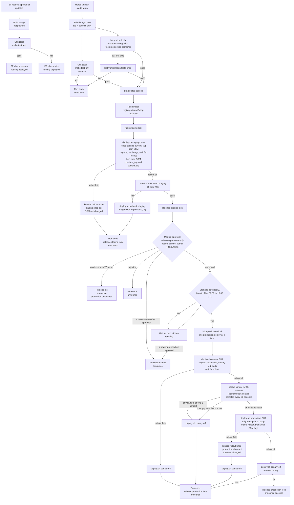

## shop-api CI/CD

Today, a person deploys shop-api by hand from a laptop, running `existing/deploy.sh`. This pipeline runs that same script from CI instead. Every merge to `main` can reach production after automated checks and one human approval. The image is built once and never rebuilt. The live state stays where the script already keeps it, in SSM Parameter Store (AWS's key-value store for settings).

**Terms used below**

- **Run**: one pipeline execution, started by one merge to `main`.
- **SHA**: the commit's unique ID. The pipeline also uses it as the image tag, the label that names one built image.
- **Image**: the packaged shop-api program (a container image) that Kubernetes runs.
- **Kubernetes, cluster, pod, deployment**: Kubernetes runs programs on clusters. Each cluster is named by a context (`staging` or `production`). Inside it, the namespace `shop` holds the shop-api objects. A **pod** is a running copy of the image. A **deployment** is the object that keeps the right number of pods running for one image tag. `kubectl` is the command-line tool that talks to a cluster.
- **Deploy**: telling a deployment to run a given image tag. `deploy.sh` also runs migrations first.
- **Rollout**: Kubernetes replaces old pods with new ones and waits until they are ready. `rollout status` waits up to 300 seconds and fails if the new pods are not ready by then.
- **Rollout undo**: `kubectl rollout undo` switches a deployment back to its previous ReplicaSet (the set of pods that ran before the failed rollout). It does not change any SSM value.
- **Migration**: a change to the database schema, such as a new column. `deploy.sh` runs pending migrations before it changes the image. Migrations only move forward. There is no down step, and nothing in the pipeline undoes one.
- **Stable**: the `shop-api` deployment that serves production traffic.
- **Canary**: `shop-api-canary`, a second production deployment that normally has zero pods. While it has ready pods, the load balancer (the component that spreads incoming traffic across pods) sends it 10 percent of production traffic. It shares the production database with stable.
- **SSM**: AWS Parameter Store. For each environment it holds `/deploy/<env>/current_tag` (the tag stable runs) and `/deploy/<env>/previous_tag` (the tag stable ran before that). The canary is never recorded there.
- **Registry**: `registry.internal/shop-api`, where built images are stored under their tags.
- **Lock**: a named CI lock. Only one run can hold a given lock at a time. A run releases its locks when it ends.
- **Smoke tests**: a short set of checks (`make smoke ENV=staging`, about 3 minutes) that call the staging URL after a deploy.
- **5xx error**: an HTTP response code from 500 to 599, meaning the server failed to handle a request. The canary's 5xx ratio is the share of its requests that failed this way.
- **Prometheus**: the metrics system that records request counts and error counts, and that the canary check queries.
- **Deployment window**: Monday to Thursday, 09:00 to 15:00 UTC. A production deploy may start only inside it. Once started, it may finish after 15:00.
- **Supersede**: cancel an older run that is still waiting, because a newer run has been approved. The cancelled run is announced.
- **Announce**: post a message to the Slack channel #deploys.

**In order, in plain words**

1. A pull request runs the build and unit tests. It never deploys.
2. Merging to `main` starts a run. The run builds the image once, tagged with the SHA.
3. Unit tests and integration tests run in parallel. Both must pass. Integration tests get one automatic retry, because one of them is known to be flaky. Unit tests get no retry. Any final failure ends the run.
4. The image is pushed to the registry.
5. The run deploys the image to staging, then runs smoke tests. If a smoke test fails, the run rolls staging back and ends.
6. A person in the `release-approvers` group (not the author of the merged commit) approves the run. Approval must come within 72 hours.
7. If the approval came outside the deployment window, the run waits for the next window to open.
8. Production receives the image as a canary, which takes 10 percent of traffic. The run checks the canary's 5xx ratio every 30 seconds for 15 minutes. If any reading is above 1 percent, the run turns the canary off and ends.
9. If the canary stays healthy, the stable deployment moves to the same image and the canary is turned off and removed.
10. The result is announced in #deploys.

**How to read the diagram.** Rectangles are steps. Diamonds are decisions. The text on each arrow is the outcome that takes that path. Failures that end a run, expiries, and finished production deploys are announced in #deploys. Pull request failures are reported on the pull request only.

## What each step reads and writes

| Step | Trigger | Reads | Writes | If it fails |
|---|---|---|---|---|
| PR check | pull request opened or updated | the PR's source | nothing outside CI | PR check fails, nothing deploys |
| Build | merge to `main` | source | image in the CI workspace | run ends |
| Unit tests | build done | source | test results | run ends, no retry |
| Integration tests | build done | source, Postgres service container | test results | one automatic retry, then run ends |
| Push | both test suites pass | the built image | `registry.internal/shop-api:SHA` | run ends |
| Staging deploy | push done, staging lock taken | SSM staging current_tag, staging cluster | migrations, staging image, then SSM staging previous_tag and current_tag | rollout fails: `kubectl rollout undo`. Smoke fails: `deploy.sh rollback staging` |
| Smoke tests | staging deploy ok | staging URL | nothing | `deploy.sh rollback staging`, run ends |
| Approval | smoke passed, staging lock released | release-approvers membership, commit author | approval record | 72 hours with no decision: run expires. Rejected: run ends. A newer approval: run is superseded |
| Window check | approved | clock | nothing | waits for the next window, and can still be superseded |
| Canary deploy | window open, production lock taken | production cluster | production migrations, canary image and replicas | rollout fails: `deploy.sh canary-off`, run ends |
| Canary watch | canary rollout ok | Prometheus canary 5xx ratio | nothing | any sample above 1 percent, or 2 empty samples in a row: `deploy.sh canary-off`, run ends |
| Production deploy | 15 minutes clean | production cluster | stable image, then SSM production previous_tag and current_tag | rollout fails: `kubectl rollout undo` on stable, then `deploy.sh canary-off`, run ends |
| Canary removal | stable rollout ok | production cluster | canary replicas set to 0 | run fails and is announced. Stable is already on the new tag, so a person checks it |

## Rules chosen where the brief left the choice open

- **Image**: pushed only after both test suites pass. Staging and production deploy that same image. Nothing is rebuilt.
- **Concurrent runs**: each run has its own SHA. The staging lock lets only one run deploy to staging at a time. A run holds it from its staging deploy until smoke tests pass, then releases it before waiting for approval. The production lock is held from the canary deploy until canary removal.
- **Superseding**: when a run is approved, every older run that is still waiting for approval or for the window is superseded. It is cancelled and announced. A run that has started its canary is never superseded. Production therefore receives only the newest approved commit that passed staging, never an older one after a newer one.
- **Approval**: only members of `release-approvers` can approve, and never the author of the commit. A rejection ends the run. If nobody decides within 72 hours, the run expires. The 72 hours covers only the wait for approval. Staging keeps the new tag, and production stays on its current tag.
- **Window**: the window limits when a production deploy starts. A run approved outside it waits for the next Monday to Thursday 09:00 UTC opening. A deploy that starts at 14:55 may finish after 15:00.
- **Canary watch**: the Prometheus expression from `environments.md` is evaluated every 30 seconds for 15 minutes, giving 30 readings. Each reading is the share of canary requests that returned a 5xx error over the last minute. Any reading above 0.01 (1 percent) fails the run. If the canary receives no requests, the division has nothing to divide, so the reading is empty. Two empty readings in a row also fail the run, because a canary with no traffic proves nothing.
- **Rollback versus undo**: smoke failures use `deploy.sh rollback`. The script writes SSM tags only after a successful rollout, so `previous_tag` is the tag that ran before the current one. Rolling back to it is therefore correct. A rollout failure is different. The script stops before it writes any tags, so SSM still names the old tag as current. `deploy.sh rollback` would move stable to `previous_tag`, which is older than the tag that was running, and would leave SSM wrong. `kubectl rollout undo` restores the pods that ran before the failed rollout, which matches SSM. That is why rollout failures use it.

## Carried over from the existing files

- **Migrations are forward-only.** There are no down steps. Every migration must work with the previous image, because a failed rollout or a rollback leaves the old image running on the migrated schema.
- **`rollback` changes only the image.** It sets current_tag from previous_tag but leaves previous_tag unchanged. A second rollback therefore sets the same tag again and does nothing new.
- **The canary is never recorded in SSM.** Only stable state is kept there.
- **Production window and approvers** come from `existing/environments.md` and are applied as written above.

## Known limits

- Laptop deploys still work. They bypass the locks, the approval and the run's state until laptop access is removed.
- Only pipeline runs take the locks. A deploy outside the pipeline is not blocked by them.
- The pipeline needs CI credentials for both clusters, as CI has today.
- Integration tests keep their known flaky test. The single retry covers it. A second failure ends the run.