# Release pipeline for shop-api

This document shows how a change gets from a pull request to production. The pipeline calls the existing `deploy.sh` script. It uses the state that script already keeps in AWS SSM Parameter Store (a key-value store) and adds no new state of its own.

## Overview

1. A pull request builds the image and runs unit tests. It never deploys.
2. A merge to `main` starts one run. The run builds one image, tags it with the commit SHA and pushes it to the registry.
3. Unit and integration tests run in parallel. Both must pass.
4. The run deploys the image to staging and smoke-tests it. If the smoke test fails, the run rolls staging back and ends.
5. A person in the `release-approvers` group approves. The author of the merged commit cannot approve it.
6. Inside the deployment window, the run starts a 15-minute canary in production. If the canary stays healthy, the run rolls out to all of production and removes the canary.

The same image is used at every stage. Nothing is rebuilt after the tests.

## Terms used below

- **SHA**: the full git commit hash of the merge. It is the image tag and the run's identity. The image is `registry.internal/shop-api:SHA`.
- **SSM tags**: two values that `deploy.sh` keeps for each environment (staging or production) in SSM. `/deploy/<env>/current_tag` is the tag the stable deployment runs. `/deploy/<env>/previous_tag` is the tag it ran before that.
- **Stable and canary**: production has two Kubernetes deployments. `shop-api` is the stable one. `shop-api-canary` is a trial deployment that normally has 0 pods. While it has ready pods, the load balancer sends it 10% of traffic. The canary is never recorded in SSM.
- **Lock**: a named CI lock that only one run can hold at a time. Other runs queue behind it.
- **Superseded**: a run is superseded when its SHA is already deployed to an environment, or is an ancestor of the SHA deployed there (so a newer version is already running). See "Several merges in flight".
- **Migrations**: database schema changes that `deploy.sh` applies before it changes any image. They only go forward: nothing undoes them.
- **`deploy.sh` commands used**:
  - `staging <tag>` and `production <tag>`: run migrations, roll the stable deployment to the tag, then write the SSM tags.
  - `canary <tag>`: production only. Runs migrations, then starts 2 canary pods on the tag.
  - `canary-off`: scales the canary to 0 pods.
  - `rollback <env>`: sets the stable image back to `previous_tag`.

## Flowchart

Red means failure, green means success, and yellow means a gate or decision. Every run that ends releases the locks it holds. Every arrow into "Announce failure" results in a post to #deploys.

```mermaid
flowchart TD
  classDef term fill:#eee,stroke:#666,color:#000
  classDef bad fill:#fde2e2,stroke:#c0392b,color:#000
  classDef good fill:#e1f5e1,stroke:#2e8b57,color:#000
  classDef gate fill:#fff4d6,stroke:#b8860b,color:#000

  subgraph PRFLOW["Pull request: unchanged, never deploys"]
    direction TD
    PR(["Pull request opened or updated"]):::term
    PRB["Build image<br/>reads: source<br/>writes: nothing, no push"]
    PRU["make test-unit, about 4 min<br/>no retry"]
    PROK(["Check green"]):::good
    PRFAIL(["Check red<br/>shown on the PR only, no #deploys post"]):::bad
    PR --> PRB
    PRB -->|fail| PRFAIL
    PRB --> PRU
    PRU -->|pass| PROK
    PRU -->|fail| PRFAIL
  end

  subgraph MAIN["Merge to main: one run per merge, tag = full commit SHA"]
    direction TD
    MERGE(["Merge to main"]):::term
    BUILD["Build image once, then push<br/>reads: source at SHA<br/>writes: registry.internal/shop-api:SHA<br/>never rebuilt later"]
    MERGE --> BUILD

    subgraph TESTS["Tests run in parallel, both must pass"]
      direction LR
      UNIT["make test-unit, about 4 min<br/>no retry"]
      INT["make test-integration, about 12 min<br/>Postgres service container"]
      INTR["Automatic retry, once<br/>known flaky test"]
      INT -->|fail| INTR
    end
    BUILD --> UNIT
    BUILD --> INT
    UNIT -->|pass| JOIN{"Both passed?"}:::gate
    INT -->|pass| JOIN
    INTR -->|pass| JOIN

    FAIL["Announce failure in #deploys<br/>failed step, SHA, run link,<br/>and what state staging or production was left in"]:::bad
    ENDFAIL(["Run ends: failed"]):::bad
    FAIL --> ENDFAIL

    BUILD -->|build or push fails| FAIL
    UNIT -->|fail: cancel the other test job| FAIL
    INTR -->|fail again: cancel unit job| FAIL

    JOIN --> SLOCK["Take lock staging-deploy<br/>queue behind any other run<br/>held until smoke passes or rollback ends<br/>why: deploy.sh reads then writes SSM tags"]:::gate
    SLOCK --> C1{"Superseded?<br/>reads /deploy/staging/current_tag<br/>is this SHA equal to it<br/>or an ancestor of it?"}:::gate
    C1 -->|yes| SUP(["Run ends: superseded<br/>no deploy, no alert<br/>locks released"]):::term
    C1 -->|no| STG["deploy.sh staging SHA<br/>reads: /deploy/staging/current_tag<br/>runs migrations on staging DB, forward only<br/>after rollout OK writes previous_tag = old current,<br/>current_tag = SHA"]
    STG -->|script fails| STGF["No rollback is run<br/>tags were not written, so rollback<br/>would pick the wrong tag"]:::bad
    STGF --> FAIL
    STG -->|ok| SMOKE["make smoke ENV=staging, about 3 min"]
    SMOKE -->|fail| RB["deploy.sh rollback staging<br/>reads previous_tag, sets image only<br/>writes current_tag = previous_tag<br/>schema stays as migrated"]:::bad
    RB --> FAIL
    SMOKE -->|pass| SREL["Release lock staging-deploy"]

    SREL --> APPROVE["Manual approval job<br/>only group release-approvers<br/>CI records who approved and when<br/>deadline 72 h from here<br/>no lock held while waiting"]:::gate
    APPROVE -->|72 h with no approval| EXPIRE["Announce expiry in #deploys<br/>nothing goes to production<br/>staging keeps this SHA"]:::bad
    EXPIRE --> ENDEXP(["Run ends: expired"]):::bad
    APPROVE -->|an approver rejects| FAIL
    APPROVE -->|approved| SELF{"Approver is the author<br/>of commit SHA?"}:::gate
    SELF -->|yes: approval void, same deadline| APPROVE
    SELF -->|no| WIN{"Inside deployment window?<br/>Mon to Thu, 09:00 to 15:00 UTC"}:::gate

    WIN -->|no| WAIT["Wait for next window start<br/>no lock held"]
    WAIT --> WIN
    WIN -->|yes| PLOCK["Take lock production-deploy<br/>one production deploy at a time<br/>held until the canary is removed<br/>or the run fails"]:::gate
    PLOCK --> WIN2{"Still inside window<br/>after waiting for the lock?"}:::gate
    WIN2 -->|no: release lock| WIN
    WIN2 -->|yes| C2{"Superseded?<br/>reads /deploy/production/current_tag<br/>is this SHA equal to it<br/>or an ancestor of it?"}:::gate
    C2 -->|yes| SUP
    C2 -->|no| CANARY["deploy.sh canary SHA<br/>the production deploy starts here<br/>runs migrations on the production DB,<br/>forward only, not undone by any step below<br/>2 canary pods, 10% of traffic<br/>writes nothing to SSM"]

    CANARY -->|script fails| OFF
    CANARY -->|ok| WATCH["Watch canary for 15 min<br/>Prometheus every 30 s<br/>canary 5xx ratio over last 1 min<br/>fail on any sample above 1%<br/>fail if no data for 2 samples in a row after minute 2"]:::gate
    WATCH -->|a sample fails the rule| OFF["deploy.sh canary-off<br/>runs on every failure after canary started<br/>scales shop-api-canary to 0"]:::bad
    OFF --> FAIL
    WATCH -->|15 min all clean| PROD["deploy.sh production SHA<br/>reads current_tag, migrate is a no-op<br/>after rollout OK writes previous_tag = old current,<br/>current_tag = SHA"]
    PROD -->|script fails| OFF
    PROD -->|ok| RM["deploy.sh canary-off<br/>remove the canary"]
    RM -->|fails| FAIL
    RM -->|ok| DONE["Announce finished production deploy in #deploys<br/>SHA, approver, time<br/>release lock production-deploy"]:::good
    DONE --> ENDOK(["Run ends: deployed"]):::good
  end
```

## State and failure rules that shape the flow

**State lives outside the repo.** `deploy.sh` keeps the SSM tags described above. The pipeline reads them but never writes them. Because the canary is not recorded anywhere, nothing outside the cluster says whether a canary is live. So `canary-off` runs after every failure once the canary has started, including a failure of `deploy.sh canary` itself.

**Migrations only go forward.**
- Nothing in `deploy.sh` undoes a migration. `rollback` and `canary-off` change images only.
- `deploy.sh canary` migrates the production database before any canary traffic exists. A failed canary therefore leaves production's schema ahead of the stable image.
- A failed smoke test likewise leaves staging's schema ahead of its rolled-back image.
- Every migration must keep working with the previous image. This is a rule for authors, and the pipeline cannot check it.
- Running `migrate up` again is a no-op, so the later `deploy.sh production` repeats the migration step harmlessly.

**Rolling back after a half-finished deploy would pick the wrong tag.**
- `deploy.sh staging` and `deploy.sh production` write the SSM tags only after the rollout succeeds.
- If either script fails partway, `current_tag` still names the old version. `rollback` would then restore `previous_tag`, which is one version too far back.
- So the pipeline runs `rollback staging` only after a smoke-test failure, when the deploy succeeded and the tags are correct. It never runs a rollback after a failed deploy script.
- After a failed deploy script, the cluster may be partway through a rollout while SSM still shows the old tag. The #deploys failure post says so, and a person inspects the cluster. The next successful deploy to that environment corrects SSM.
- There is no automatic production rollback, because the brief does not ask for one.

## Choices the brief left open

**Several merges in flight**
- Every merge gets its own run. Build and tests run in parallel across runs, with no locking.
- Staging uses the lock `staging-deploy`. It covers the deploy, the smoke tests and any rollback. It is needed because `deploy.sh` reads and then writes the SSM tags, and because the smoke tests must hit the build they were meant for.
- Production uses the lock `production-deploy`. It covers the span from canary start to canary removal.
- A run never holds both locks, so they cannot deadlock.
- Runs are not cancelled when a newer merge arrives, because cancelling mid-deploy could leave a canary live or the tags half-applied.
- Instead, each run checks whether it is superseded, right after it takes the lock. It reads `current_tag` and tests whether its SHA equals that tag or is an ancestor of it. If so, it stops. This stops an older run from deploying over a newer one, and it needs no new state. It works because `main` is linear, so a newer SHA contains every older change.
- A superseded run ends quietly. It is neither a failure nor an expiry, so nothing is posted.

**Approval**
- The 72-hour clock starts when the staging smoke tests pass. It covers the approval wait only. Waiting for the deployment window comes after approval and has no limit.
- The CI supports group-restricted approval and records the approver, but it has no "not the author" rule. The pipeline adds that check.
- If the recorded approver is the commit's author, the approval is void and the job stays open until the original deadline. If the CI cannot reopen an approval, the fallback is to end the run as failed, so it fails closed.
- Only the commit author is excluded, not co-authors. The check depends on mapping the CI identity to the git author.

**Deployment window**
- The window is Monday to Thursday, 09:00 to 15:00 UTC. It applies to the start of a production deploy, which is `deploy.sh canary`, because that is the first command to touch production. Once started, the deploy may finish after 15:00.
- A run approved outside the window waits without holding any lock.
- After it takes the lock, it checks the window again, because queuing may have pushed it past 15:00. If so, it releases the lock and waits for the next window.

**How the canary is measured**
- The metric is the canary's 5xx ratio over the last minute, from Prometheus. The query is in `environments.md`. It is sampled every 30 seconds for 15 minutes, which gives 30 samples. Any single sample above 1% fails the run immediately.
- No data is not a pass. The ratio is empty when the canary gets no requests. Samples with no data are ignored during the first 2 minutes. After that, 2 no-data samples in a row fail the run.
- There is no minimum request volume, so at low traffic a single 5xx can exceed 1%. I chose strict over lenient for that case.
- The canary keeps running during the stable rollout and is removed only afterwards.

**Announcements in #deploys**
- Posts happen for a failure at any main-branch step, a run expiring, an approver rejecting, and a finished production deploy.
- Pull request failures show only on the PR.
- If `canary-off` or the final canary removal fails, the post says the canary may still be serving 10% of traffic.

## Required for "no laptop deploys" but outside this pipeline

Remove the laptop credentials for both clusters and for SSM, so that CI is the only identity that can run `deploy.sh`.