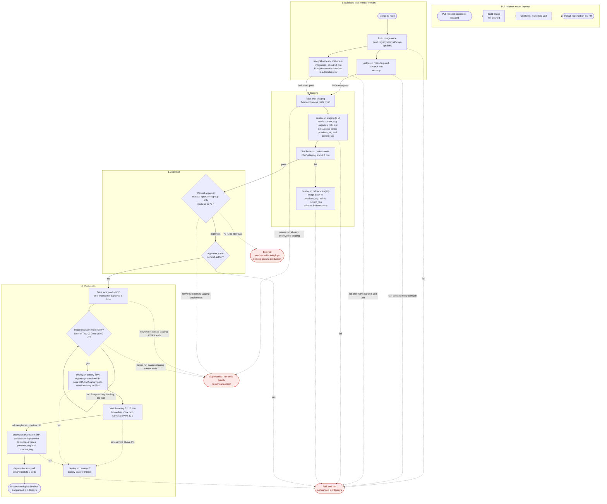

## shop-api release pipeline

This is the planned CI/CD pipeline for `shop-api`. Today someone deploys from a laptop by running `existing/deploy.sh`. The new pipeline runs that same script from CI and keeps its state in SSM Parameter Store (AWS's key-value store for configuration). It adds automated gates and one human approval, so no deploy needs a laptop.

A "run" is one execution of the pipeline for one merge to `main`.

### The path in brief

1. A merge to `main` builds one image, tagged with the commit SHA, and pushes it to the registry.
2. Unit and integration tests run in parallel. Both must pass.
3. The image deploys to staging, and smoke tests run against it.
4. A person in `release-approvers` approves. This must not be the commit's author.
5. Inside the deployment window, the image deploys to production as a canary. The canary is a small slice of production that takes 10% of traffic.
6. If the canary stays healthy for 15 minutes, the stable production deployment rolls to the same image, and the canary is removed.

Any failure, expiry or finished production deploy is announced in Slack `#deploys`. The one exception is a superseded run (see "Several merges in flight"), which ends quietly.

### Terms

- **SHA**: the commit SHA of the merged commit. It is the image tag, so the image is `registry.internal/shop-api:SHA`. Every `deploy.sh` command below uses it.
- **Stable and canary**: `shop-api` is the stable production deployment. `shop-api-canary` is a second deployment that normally has 0 pods. While it has ready pods, the load balancer sends it 10% of traffic. `deploy.sh canary` starts 2 pods.
- **SSM state**: for each environment, `/deploy/<env>/current_tag` is the tag the stable deployment runs, and `/deploy/<env>/previous_tag` is the tag it ran before. The canary is never recorded there.
- **Lock**: a named CI lock that only one run can hold at a time. The pipeline uses two, `staging` and `production`. Both are released however a run ends.
- **Migration**: a database schema change. `deploy.sh` applies pending migrations before it deploys.

### How to read the diagram

- Solid arrows are the normal path. Dashed arrows are failure or early-exit paths.
- Rounded nodes start or end a run. The shaded nodes are the three ways a run ends without finishing: Fail, Expired and Superseded.
- "Fail" means the run ends and the failure is announced in `#deploys`.
- A `deploy.sh` node says what it writes to SSM. "Writes nothing" means it leaves SSM alone.

### Rules the diagram shows

**Pull requests.** They build the image and run unit tests, as today. Nothing is pushed or deployed.

**Merges to `main`.**
- The image is built once and pushed with the SHA tag. Staging and production deploy that same tag. Nothing is rebuilt.
- Unit and integration tests run in parallel, and both must pass. A failure in either ends the run and cancels the other job.
- Integration tests get one automatic retry because one test is known to be flaky. Unit tests get none.

**Approval.**
- Only the `release-approvers` group can approve. CI records who approved and when.
- CI can restrict approval by group only. So after someone approves, a separate check compares the approver with the author of the merged commit. If they match, the run fails and the failure is announced.
- The 72-hour limit covers approval only. On expiry the run ends and nothing goes to production.

**Production.**
- A production deploy may start Monday to Thursday, 09:00 to 15:00 UTC. The start of the canary counts as the start of the deploy. After that the run may continue past 15:00, including the 15-minute watch and the stable rollout.
- The run takes the `production` lock first, then waits for the window while holding it. Waiting for the lock can take hours, so the window is checked only after the lock is acquired, just before the canary starts. The lock gives one production deploy at a time.
- If the canary stays clean for 15 minutes, `deploy.sh production SHA` rolls the stable deployment, and then `deploy.sh canary-off` removes the canary. If the canary fails, or the stable rollout fails, the run runs `canary-off` and fails.

### Decisions I made

- **Several merges in flight.**
  - Builds and tests run in parallel for every merge.
  - Staging is serialised by the `staging` lock, held from the start of the staging deploy until the smoke tests finish (or the rollback finishes). A run never deploys an older commit over a newer one. If a newer run has already deployed to staging, the older run ends as superseded when it gets the lock.
  - Once a newer run passes staging smoke tests, any older run still waiting for approval, for the production lock or for the window is cancelled as superseded. Approvers therefore only ever see the newest staged commit.
  - A run that has started its canary is never cancelled.
  - Superseded runs are not announced.
- **How the canary is measured.**
  - The 15 minutes start when `deploy.sh canary` returns, which means its pods are ready.
  - Every 30 seconds the pipeline queries Prometheus for the canary's 5xx ratio over the last minute:
    `sum(rate(http_requests_total{app="shop-api-canary",code=~"5.."}[1m])) / sum(rate(http_requests_total{app="shop-api-canary"}[1m]))`
  - One sample above 0.01 (1%) fails the canary immediately.
  - If Prometheus returns an error or no data for 3 samples in a row, the canary also fails, because it cannot be verified.

### What `deploy.sh` does and what to watch for

- **State.** Live state is in SSM, not in the repo (see Terms).
- **Tags are written only after a successful rollout.** `deploy.sh staging|production` first writes `previous_tag` = the old `current_tag`, then writes `current_tag` = the new tag.
- **Why a failed rollout is not rolled back automatically.**
  - `deploy.sh rollback <env>` goes to `previous_tag`. If a rollout failed before the tags were written, `previous_tag` points one release further back than the version that is actually running.
  - So the pipeline runs `rollback` only after staging smoke tests fail, when the tags are correct.
  - If `deploy.sh staging` or `deploy.sh production` itself fails, the run fails, the canary is removed where one exists, and a person decides what to do.
  - The failure message in `#deploys` says which environment is affected.
- **Rollback.** It changes the image and writes `current_tag`. It does not touch the schema or `previous_tag`.
- **Migrations are forward-only.**
  - `migrate up` runs inside `deploy.sh` for staging, canary and production. Re-running it applies nothing new.
  - Nothing undoes a migration. Rollback and `canary-off` leave the schema where it is.
  - Every migration must therefore work with the previous image.
  - The production database is migrated when the canary starts, before the 15-minute watch. Stable and canary share the production Postgres, so the canary's migration affects the stable pods too.
- **Credentials and environments.**
  - CI can push to the registry and can run `deploy.sh` against both clusters.
  - Staging is Kubernetes context `staging`. Production is context `production`. Both use namespace `shop`.