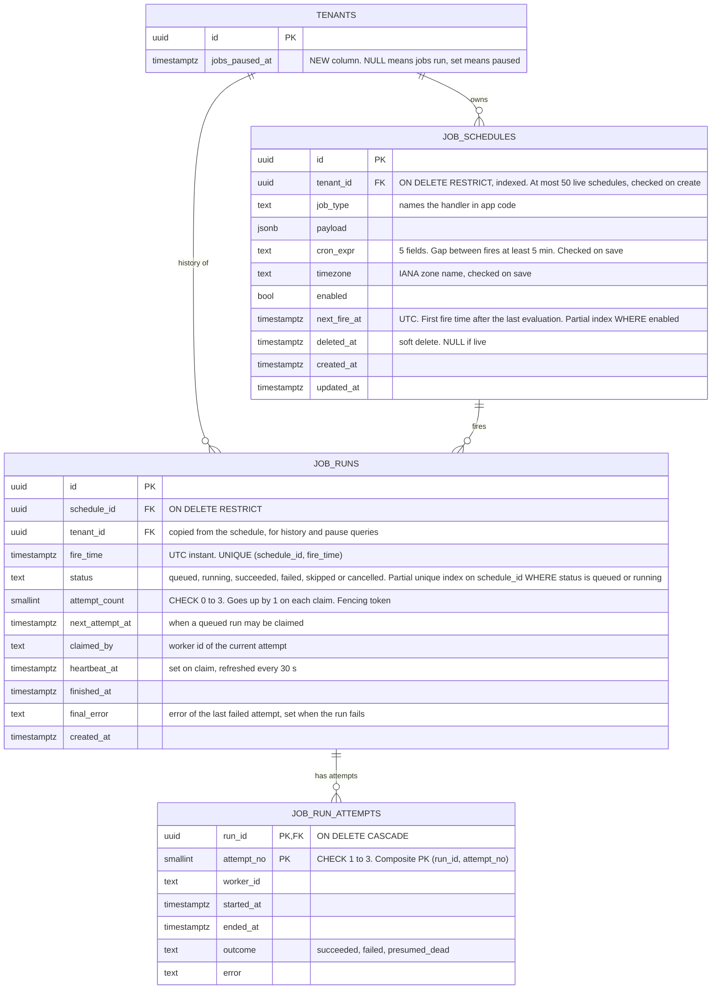

# Scheduled jobs per tenant: data model and run mechanics

## Summary

Tenants define recurring jobs as schedules stored in Postgres. Today the app has a tenants table and no job code. Three to ten identical worker processes run the same loop, with no leader and no separate scheduler. Each worker creates runs for due fire times, claims queued runs when it is idle, and runs one handler at a time. Unique keys, row locks and a counter stop two workers from doing the same work. A heartbeat lets another worker take over a run whose worker has died.

## Terms

- **Tenant**: one customer account. Its schedules and runs belong to it.
- **Schedule**: a recurring job that a tenant defines. It has a job type, a payload, a cron expression and a timezone.
- **Job type**: the name of the handler that does the job.
- **Payload**: the JSON data given to the handler.
- **Cron expression**: 5 fields (minute, hour, day of month, month, day of week), such as `0 9 * * 1` for 09:00 every Monday.
- **IANA timezone**: a named zone such as `Europe/Berlin`. Cron times are read in this zone.
- **Fire time**: the UTC instant at which a schedule should run.
- **Run**: one row in `JOB_RUNS`, for one fire time.
- **Attempt**: one try at a run. One row in `JOB_RUN_ATTEMPTS`. A run gets at most 3.
- **Worker**: one of the 3 to 10 identical app processes. Each runs the same loop. No separate scheduler service exists.
- **Worker id**: a unique text id that a process makes once at startup, for example from its host name, process id and a random suffix. Each claim writes it to `claimed_by`.
- **Idle worker**: a worker with no handler running. It becomes busy at a successful claim and stays busy until its handler returns. Only an idle worker claims.
- **Handler**: the app-code function that does the work for one job type.
- **Registry**: the map in app code from each job type name to its handler.
- **Claim**: a worker takes a due queued run and marks it `running`.
- **Heartbeat**: a timestamp that a running worker refreshes every 30 seconds to show it is alive.
- **Presumed dead**: a running run whose heartbeat is more than 2 minutes old.
- **Fencing token** (`attempt_count`): a number that goes up by 1 on each claim. A worker may write only while its number is still the current one.
- **Guarded write**: an `UPDATE` whose `WHERE` clause names the status and attempt count the worker expects. If the run has moved on, it changes zero rows.
- **Stop request**: a signal that asks a handler to stop, for example by cancelling its task.
- **Row lock**: a lock on one database row. Other transactions wait for it or skip it until the locking transaction ends.
- **SKIP LOCKED**: a Postgres option that makes a query skip rows another worker has locked, so no worker waits on another.
- **ON CONFLICT DO NOTHING**: an insert that is silently ignored when a row with the same key already exists.
- **Partial unique index**: a uniqueness rule that applies only to rows matching a condition.
- **Soft delete**: setting `deleted_at` instead of removing the row, so history stays readable.
- **Idempotent**: running the work twice leaves the same result as running it once.
- **Tick**: one run of a timer, such as the 30-second tick.
- **Database clock**: `now()` in Postgres. Every time check in this plan uses it, so the clocks of the worker machines never affect a rule.

## Tables

## How it runs

Each worker runs two timers. A 30-second timer creates runs and sweeps for dead workers. A 5-second timer claims runs, but it acts only while the worker is idle. A worker runs one handler at a time. While a handler runs, the same worker also runs a 30-second heartbeat timer. Times are stored as UTC. The evaluator handles daylight saving time: a local time that does not exist fires at the next valid instant, and an ambiguous one fires once.

### 1. Saving a schedule, enabling, resuming

- **Trigger**: a tenant creates or edits a schedule, enables a schedule, or resumes a tenant.
- **What it does**:
  - Checks that the cron has 5 fields, the timezone is an IANA name, and fires are at least 5 minutes apart.
  - On create, locks the tenant row, counts the tenant's live schedules, and rejects the save if there are already 50.
  - Sets `next_fire_at` to the first occurrence after now.
  - Enabling sets `enabled = true` and `next_fire_at` for that schedule.
  - Resuming clears `jobs_paused_at` and sets `next_fire_at` for every enabled schedule of the tenant, in the same transaction.
  - Neither enabling nor resuming catches up missed fire times or revives runs cancelled earlier.
  - Editing the cron or timezone does not cancel queued runs. They keep their fire times and still run. Only disabling and pausing cancel unstarted runs.
- **Data kept**: `JOB_SCHEDULES`, and `TENANTS` on resume.
- **On failure**: the save is rejected with a message, and nothing is written.

### 2. Creating runs (every worker, every 30 seconds)

- **Trigger**: the 30-second tick.
- **What it does**: selects due schedules with `FOR UPDATE SKIP LOCKED`. A due schedule is one that is `enabled`, not soft-deleted, whose tenant is not paused, and whose `next_fire_at <= now()`. A schedule another worker has locked is skipped. A paused tenant's schedules are not selected, so their `next_fire_at` stays old until resume resets it. This step does not check the 50-schedule limit, which is checked only on save.

  For each selected schedule, in a single transaction:
  1. Compute F, the latest occurrence at or before now. After an outage, `next_fire_at` can be well before F. Every earlier missed occurrence gets no rows and is dropped. So `fire_time` holds F, the most recent missed fire time.
  2. Check whether any run for this schedule has status `queued` or `running`. A run waiting to retry is `queued`, so it counts.
     - If none exists, insert a run for F with status `queued` and `next_attempt_at = F`.
     - If one exists, insert a run for F with status `skipped` and `finished_at = now()`. The skipped row does not clash with the partial unique index, which covers only `queued` and `running` rows.
  3. Set `next_fire_at` to the first occurrence after now. That is later than F, so the schedule is not due again until a new occurrence arrives.

- **Duplicate work**: the row lock lets only one worker create runs for a schedule at a time. The check in step 2 sees rows already committed. If a row for F already exists, `ON CONFLICT (schedule_id, fire_time) DO NOTHING` ignores the insert. This is a safety net only. The same transaction also moves `next_fire_at` forward, so the schedule is not selected again on a tick with no new occurrence.
- **Data kept**: `JOB_RUNS`, `JOB_SCHEDULES.next_fire_at`.
- **On failure**: the transaction rolls back. `next_fire_at` is unchanged, so the schedule is still due and the next tick tries again.

### 3. Claiming a run (every idle worker, every 5 seconds)

- **Trigger**: the 5-second tick, while the worker is idle.
- **What it does**:
  1. One statement picks one `queued` run whose `next_attempt_at <= now()`, whose schedule is enabled and not deleted, and whose tenant is not paused. It uses `FOR UPDATE SKIP LOCKED`. A new run and a retry look the same here. Both are queued rows that are due. Two workers cannot take the same run. A row another worker has locked is skipped. Once a claim commits, the row is `running` and no longer matches. If no row matches, the worker stays idle and tries again on the next 5-second tick.
  2. In the same statement it sets `status = running`, adds 1 to `attempt_count`, sets `claimed_by` to the worker id, and sets `heartbeat_at = now()`. It also inserts the `JOB_RUN_ATTEMPTS` row with `attempt_no` equal to the new `attempt_count`. That number is this attempt's fencing token. Setting `heartbeat_at` here means a worker that dies before its first heartbeat is still detected after 2 minutes.
  3. The worker looks up the handler for `job_type` in the registry and calls it with the payload only. The handler is not told the attempt number or how late the run is. Handlers live in app code, not in the database, because the payload is only data and the handler code ships with the deploy. The worker is busy from this point.
- **One run at a time**: a worker claims again only after its handler has returned. It stays busy even after a stop request (step 4). So a worker holds at most one run. The fleet runs at most as many handlers as there are workers (3 to 10), apart from the overlap described in step 4.
- **Late runs**: the first idle worker claims a queued run after it is created, even if its fire time has passed. The lateness is only pickup delay. Runs are created on the 30-second tick, so a run can appear up to 30 seconds after its fire time. It then waits up to 5 more seconds for a claim tick.
- **Bursts**: each idle worker claims one run per 5-second tick. If N runs are due at once and W workers are idle, the last one starts after about N / W ticks. For example, 30 runs on 3 idle workers take about 50 seconds to all start.
- **Data kept**: `JOB_RUNS`, `JOB_RUN_ATTEMPTS`.
- **On failure**: if no handler is registered for `job_type`, the attempt fails with the error `no handler`, and step 5 applies.

### 4. Running and heartbeats

- **Trigger**: a successful claim. The heartbeat timer starts then and stops when the handler returns.
- **What it does**: the handler runs. Every 30 seconds the worker runs:
  `UPDATE job_runs SET heartbeat_at = now() WHERE id = ? AND status = 'running' AND attempt_count = ?`
  The heartbeat has its own timer, so a slow handler does not stop it. A live worker keeps its run.
- **If zero rows change**: the worker has lost the run. It sends the handler a stop request and writes no outcome. It stays busy until the handler actually returns. Work the handler already did stays in place. A later attempt, if there is one, repeats it. This is acceptable because handlers are idempotent.
- **Overlap**: a run is taken over only after its heartbeat has been stale for 2 minutes, so its worker has stalled. The handler may still be running when the next attempt starts. The fencing token stops the old worker's database writes, but not the handler's side effects. Handlers are idempotent, so this is acceptable. The old worker stops at its next heartbeat that finds zero rows, or when its handler returns.
- **If the update itself errors** (for example, the database is unreachable): the worker logs the error and tries again at the next 30-second tick. The handler is not stopped. See open questions.
- **Data kept**: `JOB_RUNS.heartbeat_at`.
- **On failure**: as described above. A failed heartbeat write is retried; a zero-row heartbeat means the run was lost.

### 5. Outcome and retries

- **Trigger**: the handler returns or raises an error.
- **What it does**, in one transaction. Every write is a guarded write: `WHERE status = 'running' AND attempt_count = ?`.
  - **Success**: the run becomes `succeeded` with `finished_at = now()`. The attempt becomes `succeeded` with `ended_at = now()`.
  - **Error, and `attempt_count < 3`**: the attempt becomes `failed`, with its error and `ended_at = now()`. Then the run goes back to `queued` with `next_attempt_at = now() + wait`. The wait is 1 minute after attempt 1 and 5 minutes after attempt 2. The run keeps its row and its `fire_time`. This happens only if the schedule is still enabled and not deleted, and the tenant is not paused. Otherwise the run becomes `cancelled` with `finished_at = now()`. Its `final_error` stays empty, because the run did not fail. Its attempt keeps the `failed` outcome and error.
  - **Error, and `attempt_count = 3`**: the attempt becomes `failed`. The run becomes `failed` with `final_error` and `finished_at = now()`.
- **While a run waits to retry**: it stays `queued`. A fire time that arrives during the wait is recorded as `skipped` (step 2).
- **Data kept**: `JOB_RUNS`, `JOB_RUN_ATTEMPTS`.
- **On failure**: if a guarded write changes zero rows, the run was already taken over. The worker writes nothing.

### 6. Crash recovery

- **Trigger**: a sweep by any worker, every 30 seconds.
- **What it does**: finds runs with `status = 'running'` and `heartbeat_at < now() - 2 min`. For each one, in one transaction, every write is a guarded write: `WHERE status = 'running' AND attempt_count = ? AND heartbeat_at < now() - 2 min`. The sweep uses the attempt count it read. The heartbeat condition means a run whose worker has just refreshed it is not taken over.
  - The attempt becomes `presumed_dead` with `ended_at = now()` and `error = 'heartbeat timeout'`. This attempt counts as used.
  - Then the retry rule from step 5 applies, including its check of the schedule and tenant flags. If `attempt_count < 3`, the run goes back to `queued` with the same wait, or is cancelled if the flags are set. If `attempt_count = 3`, the run becomes `failed` with `final_error = 'heartbeat timeout'`.
- **Gap before a retry**: the wait counts from detection. So the next attempt can start up to about 2 minutes after the crash, plus the wait.
- **A worker that comes back**: its heartbeat and outcome writes change zero rows, because `status` or `attempt_count` has changed. It cannot overwrite the outcome of the worker that took over. If a heartbeat or outcome write and the sweep race, Postgres lets the first one to commit win. The second one re-checks its `WHERE` after the lock and changes zero rows, so it writes nothing.
- **Data kept**: `JOB_RUNS`, `JOB_RUN_ATTEMPTS`.
- **On failure**: a sweep that fails writes nothing for that run. The run stays `running` and the next sweep looks at it again.

### 7. Disabling, deleting and pausing

- **Trigger**: a tenant disables a schedule, deletes a schedule, or pauses a tenant.
- **What it does**, in one transaction:
  - Disabling sets `enabled = false`. Deleting sets `deleted_at` and also `enabled = false`, so a delete is a disable that keeps history. Pausing sets `jobs_paused_at`.
  - Sets `status = 'cancelled'` and `finished_at = now()` on the `queued` runs of that schedule, or of all the tenant's schedules when pausing. This includes runs waiting to retry. Their earlier attempts stay in `JOB_RUN_ATTEMPTS`, and the last attempt keeps its `failed` outcome and error. `final_error` stays empty, because the run did not fail.
  - Leaves `running` runs alone. They finish normally, and their outcome is written as in step 5. If such a run fails with retries left, the step 5 flag check cancels it instead of requeueing it.
- **Race protection**: the creation and claim queries also check the flags. So a run cannot be created or claimed while the cancellation is in progress.
- **Data kept**: `JOB_SCHEDULES`, `TENANTS`, `JOB_RUNS`.
- **On failure**: the whole transaction rolls back, so the flag and the cancellations are either both applied or neither.

### 8. History and cleanup

- **Reading history**: the tenant reads `JOB_RUNS` joined to `JOB_RUN_ATTEMPTS`, ordered by `fire_time`, using the index on `(tenant_id, fire_time)`. Every run shows its fire time and final status, including `skipped` and `cancelled`. Each attempt shows its worker, start and end times, and error.
- **Notifications**: none. Skipped and failed runs trigger nothing beyond what history shows.
- **Daily cleanup**: deletes terminal runs (`succeeded`, `failed`, `skipped`, `cancelled`) with `fire_time` older than 90 days, in batches. Their attempts go with them through `ON DELETE CASCADE`. `queued` and `running` rows are never deleted.
- **Soft-deleted schedules**: purged once their runs have been cleaned up.
- **Table size**: bounded by fire rate times 90 days, because dropped missed fire times leave no rows.
- **On failure**: rows already deleted stay deleted. The filter is by age, so the next daily run picks up the rest.

## What happens when things fail

| Failure | What happens |
|---|---|
| A worker dies during a run | No heartbeat for 2 minutes. Crash recovery (step 6) closes the attempt and retries or fails the run. |
| A worker dies right after claiming | The claim set `heartbeat_at`, so crash recovery still detects it after 2 minutes. |
| A handler is slow but its worker is alive | The heartbeat keeps running, so the run is not presumed dead. No maximum run time is set (see open questions). |
| A handler raises an error | Retry rule in step 5. If the tenant is paused or the schedule is disabled or deleted, the run is cancelled instead. |
| No handler for the `job_type` | The attempt fails with `no handler`, and step 5 applies. |
| A worker loses its run | It sends a stop request and writes nothing. It stays busy until the handler returns. Work already done stays, and the next attempt repeats it. |
| A worker's heartbeat cannot reach the database | The worker retries at the next tick. The handler keeps running. If the heartbeat stays stale for 2 minutes, crash recovery takes over, and the old worker's writes change zero rows once it reconnects. |
| A run's outcome transaction fails | It rolls back. The run stays `running` until its heartbeat goes stale, then crash recovery (step 6) applies. |
| Two workers see the same due schedule | The row lock lets one through. The duplicate insert does nothing. |
| A run-creation transaction fails | It rolls back. `next_fire_at` is unchanged, so the next tick retries. |
| A fire time arrives while a run is running or waiting to retry | A `skipped` run is recorded. |
| A schedule is disabled or deleted while running | Queued runs are cancelled. The running run finishes normally. |
| A tenant is paused or a schedule is edited while a run is queued | Pausing cancels queued runs. Editing the cron leaves them to run. |
| A tenant is paused and a running run then fails with retries left | The run is cancelled, not requeued, so it does not run after resume. |
| A worker shuts down normally (for example, a deploy) while its handler runs | It stops claiming and creating runs, and its sweep and timers stop. Its heartbeat keeps running until the handler returns, then it exits. If the process is killed first, crash recovery (step 6) applies after 2 minutes. |
| Many runs are due at once | They start in order, one per idle worker per 5-second tick. The last ones wait longer. None are dropped. |

## Build notes

- The only change to an existing table is the new nullable column `TENANTS.jobs_paused_at`. NULL means jobs run, so existing tenants need no backfill.
- The other three tables are new.

## Open questions

- **Maximum run time**: the brief sets none. A handler that hangs on a live worker runs forever, because its heartbeat keeps the run alive. Decide whether to add a limit.
- **Handler on a worker that cannot reach the database**: it runs until it ends, because the plan adds no stop rule for failed heartbeats. Decide whether to cancel it after heartbeats have failed for a set time.
- **Handler that ignores the stop request**: a handler that does not return after its stop request keeps its worker busy, so that worker claims nothing more. Decide whether a hard stop or a restart is needed.
- **Retry wait start**: the wait counts from crash detection, so the gap before a retry can be about 2 minutes longer than the wait. Confirm this, or count the wait from the last heartbeat.
- **Notifications**: the brief does not ask for alerts on failed or skipped runs. None are planned.
- **Poll rates**: the 5-second claim poll and the 30-second tick and sweep are chosen here. The brief gives no rates. Confirm them. A shorter claim poll would shorten bursts, at the cost of more database queries.