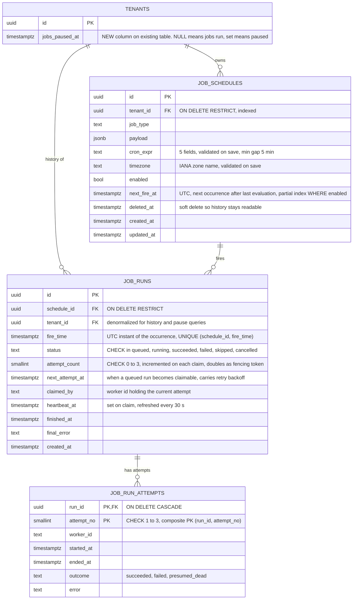

# Scheduled jobs per tenant: data model and run mechanics

## Entity diagram

## How it works

**Constraints.** `JOB_RUNS` has `UNIQUE (schedule_id, fire_time)`, so each fire time yields at most one run row. A partial unique index on active runs (`queued` or `running`) per schedule backs up the rule that only one run may be in progress. All times are `timestamptz` in UTC. The schedule's cron and timezone are kept as entered and evaluated in that zone, so DST is handled by the evaluator: a nonexistent local time fires at the next valid instant, and an ambiguous one fires once.

**Run creation.** Every worker runs a scheduler tick about every 30 seconds. Each tick selects due schedules (`enabled`, not soft-deleted, tenant not paused, `next_fire_at <= now()`) with `FOR UPDATE SKIP LOCKED`. For each one, in a single transaction:
1. Compute F, the latest cron occurrence at or before now. Older missed occurrences get no rows and are dropped.
2. If no run is queued or running for this schedule, insert a run for F with status `queued` and `next_attempt_at = F`. Otherwise insert a run for F with status `skipped` and `finished_at = now()`.
3. Set `next_fire_at` to the first occurrence after now.

The schedule row lock serializes concurrent ticks. `ON CONFLICT (schedule_id, fire_time) DO NOTHING` makes any duplicate insert harmless.

**Claiming.** A worker claims with one statement: pick one `queued` run with `next_attempt_at <= now()` whose schedule is enabled and whose tenant is not paused, using `FOR UPDATE SKIP LOCKED`. It then sets `status = running`, `attempt_count = attempt_count + 1`, `claimed_by`, and `heartbeat_at = now()`, and inserts the `JOB_RUN_ATTEMPTS` row. The returned `attempt_count` is the fencing token for this attempt.

**Heartbeats.** Every 30 seconds the running worker runs `UPDATE job_runs SET heartbeat_at = now() WHERE id = ? AND status = 'running' AND attempt_count = ?`. If zero rows change, the worker has lost the run. It stops the handler and writes no outcome.

**Retries.** On success, the run becomes `succeeded` and the attempt `succeeded`. On error, if `attempt_count < 3`, the run returns to `queued` with `next_attempt_at = now() + backoff`, where backoff is 1 minute after attempt 1 and 5 minutes after attempt 2. Otherwise the run becomes `failed`. Each outcome write is guarded by `WHERE status = 'running' AND attempt_count = ?`. A retry-waiting run stays `queued`, so a fire time arriving during the wait is recorded as `skipped`. Job handlers are idempotent, so a repeated partial run is acceptable.

**Crash recovery.** A sweep, run by any worker about every 30 seconds, finds runs with `status = 'running'` and `heartbeat_at < now() - 2 min`. In one transaction it closes the attempt as `presumed_dead` (`ended_at = now()`, `error = 'heartbeat timeout'`). If `attempt_count < 3`, the run goes back to `queued` with `next_attempt_at = now() + backoff`. If `attempt_count = 3`, it becomes `failed`. The wait is counted from detection, so the worst-case gap before a retry is about 2 minutes of detection plus the backoff. A presumed-dead worker that wakes up later issues guarded updates that match zero rows, because the status and `attempt_count` have changed. It cannot overwrite the outcome of the worker that took over.

**Pausing and disabling.** Disabling a schedule or pausing a tenant runs in one transaction that sets the flag and sets `status = 'cancelled'`, `finished_at = now()` on the schedule's or tenant's `queued` runs. `running` runs are left alone and finish normally. The creation and claim queries also check the flags, which closes races with the cancellation. Re-enabling or resuming sets `next_fire_at` to the first occurrence after now, so missed fire times are not caught up.

**History and cleanup.** Tenants read history with `JOB_RUNS` joined to `JOB_RUN_ATTEMPTS`, ordered by `fire_time`, with an index on `(tenant_id, fire_time)`. A daily cleanup deletes terminal runs (`succeeded`, `failed`, `skipped`, `cancelled`) with `fire_time < now() - 90 days` in batches. Attempts are removed by `ON DELETE CASCADE`. Never delete `queued` or `running` rows. Soft-deleted schedules are purged once their runs have aged out. Because dropped missed fire times leave no rows, table size is bounded by fire rate times 90 days.