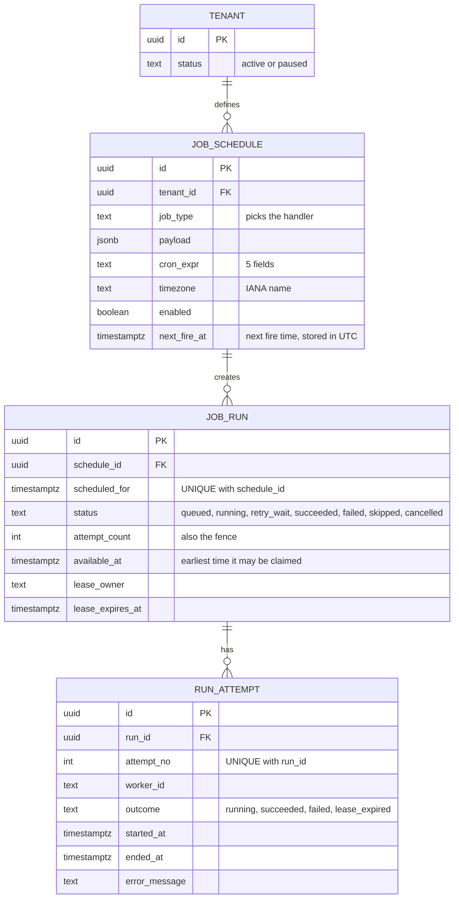

# Scheduled jobs per tenant

## Summary

Tenants define recurring jobs. Each job has a type, a JSON payload, a cron expression and a timezone. Today the app has a tenants table and nothing for jobs, so this adds four tables. Three to ten identical worker processes do the work and coordinate only through Postgres row locks and conditional updates, so there is no leader and no separate scheduler. Each run gets a number on every claim, and a worker can write only while its number is still the current one, so a worker that lost its run cannot overwrite the worker that took over.

## Terms

- **Schedule**: one recurring job for one tenant.
- **Cron expression**: a 5-field pattern (minute, hour, day of month, month, day of week) that sets when a schedule fires.
- **Timezone**: an IANA timezone name, such as `Europe/Berlin`. Fire times are computed in it.
- **Fire time**: one moment a schedule should run.
- **Run**: the row for one fire time. Its status is the overall outcome.
- **Attempt**: one try at a run, by one worker. A run gets at most 3.
- **Handler**: the code that does a job type's work. It receives the payload. Handlers are idempotent, so repeating partial work on a retry is safe.
- **Lease**: a worker's claim on a run. It is valid until `lease_expires_at`.
- **Heartbeat**: an update every 30 seconds that moves `lease_expires_at` to 2 minutes ahead.
- **Fence**: `attempt_count`. It goes up on every claim. A worker may write only while the count still matches the value it got when it claimed.
- **SKIP LOCKED**: a Postgres option that lets a query skip rows another worker has locked, instead of waiting for them.
- **Partial unique index**: a unique index that covers only rows with certain statuses.
- **Reaper**: cleanup code that every worker runs on each poll. It finds runs whose lease has expired.
- **In progress**: a run that is queued, running or waiting to retry.

## Diagram

## Notes on the tables

- The unique key on `JOB_RUN` (schedule_id, scheduled_for) means one fire time can produce only one run.
- A partial unique index allows only one in-progress run per schedule. It is the database backstop for "one run at a time".
- Run creation locks only the schedule's own row, so workers do not block one another.

## Limits

A tenant can have at most 50 schedules. The shortest interval between fire times is 5 minutes. The app checks both when a schedule is saved and rejects a schedule that breaks either limit.

## How it runs

Rules that apply to every step:

- If a fire time arrives while a run for the same schedule is in progress, the new run is written as `skipped` and nothing executes.
- If no worker was up through several fire times, only the most recent missed one gets a run. Older ones are dropped with no row.

Steps:

1. **Create runs (every worker, on each poll).** The worker locks enabled schedules of active tenants whose `next_fire_at` is at or before now. It uses SKIP LOCKED, so two workers never take the same schedule. In one transaction, for each locked schedule, it writes one run for the latest due fire time, with status `queued`, or `skipped` if a run is in progress. Then it moves `next_fire_at` to the first fire time after now, computed in the schedule's timezone.

2. **Claim (every worker, on each poll).** The worker locks one run that is `queued` or `retry_wait`, whose `available_at` has passed, and whose schedule is enabled and whose tenant is active. It uses SKIP LOCKED. In the same transaction it sets status `running`, sets `lease_owner` to its own id, sets `lease_expires_at` to now plus 2 minutes, adds 1 to `attempt_count`, and writes an attempt with outcome `running`. Once committed, the run no longer matches `queued` or `retry_wait`, so it cannot be claimed twice.

3. **Run and heartbeat.** The worker that claimed the run calls the handler for its `job_type` with its payload, in its own process. Every 30 seconds it sends a heartbeat. The heartbeat moves `lease_expires_at` to now plus 2 minutes, but only while `lease_owner` and `attempt_count` still match its claim and the status is `running`. If no row changes, the worker has lost the run and writes nothing more. Its handler may keep running until it returns. That is acceptable because handlers are idempotent.

4. **Finish.** When the handler returns or throws, the worker updates its attempt with the outcome, `ended_at` and `error_message` if there was one. It updates the run to match. Both updates happen only while the worker still holds the fence. A success sets the run to `succeeded`. A failure goes to the retry step.

5. **Retry.** If `attempt_count` is below 3, the run becomes `retry_wait`, its lease is cleared, and `available_at` is set to now plus 1 minute after attempt 1, or plus 5 minutes after attempt 2. After the third failed attempt, the run becomes `failed`.

6. **Crash recovery (the reaper, every worker, on each poll).** The reaper finds `running` runs whose `lease_expires_at` has passed. That means no heartbeat for 2 minutes. It locks each one with SKIP LOCKED, sets its open attempt to outcome `lease_expired` with `ended_at` now, and then applies the retry step. The dead attempt counts toward the 3, because `attempt_count` already went up at claim. If the schedule was disabled or the tenant paused in the meantime, the run is cancelled instead of retried. If the old worker wakes up later, its writes match no row and are dropped.

7. **Pause or disable.** When a tenant is set to `paused`, or a schedule is set to disabled, one transaction sets every `queued` or `retry_wait` run for it to `cancelled`. Runs already `running` are left alone and finish normally, as in the finish step. Claims also require enabled and active, so nothing starts in between.

8. **Resume or re-enable.** When a tenant is set to active, or a schedule is set to enabled, `next_fire_at` moves to the first fire time after now. Fire times missed in the meantime get no runs.

9. **History cleanup.** A periodic job, run by one worker, deletes finished runs (`succeeded`, `failed`, `skipped`, `cancelled`) whose `scheduled_for` is more than 90 days old. Their attempts go with them. Runs in progress are never deleted.

Tenants can view run history. It lists every run with its fire time and final status. Each run lists its attempts, with the worker that ran each one, its start and end times, and the error if there was one. History is kept for 90 days.

## What happens when things fail

| Situation | What happens |
|---|---|
| Two workers see the same due schedule | One locks it and the other skips it. The unique key blocks any duplicate run. |
| A fire time arrives while a run is in progress | The new run is written as `skipped`. Nothing executes. |
| No worker was up for several fire times | Only the latest one gets a run. Older ones are dropped with no row. |
| Run creation transaction fails | Nothing is written. The next poll tries again. |
| Handler fails, attempts left | The attempt is `failed`. The run goes to `retry_wait` with a 1 or 5 minute delay. |
| Handler fails on attempt 3 | The run becomes `failed`. |
| Worker dies (no heartbeat for 2 minutes) | The reaper closes the attempt as `lease_expired`, counts it, then retries or fails the run. |
| Worker loses its lease but keeps running | Its heartbeats and final writes match no row, so they are dropped. Its handler may repeat work, which is acceptable. |
| Pause or disable while a run is queued or waiting | The run is `cancelled`. |
| Pause or disable while a run is executing | The run finishes normally. |
| Re-enable or resume | No catch-up for fire times missed meanwhile. |
| History cleanup fails | Nothing is deleted. The next cleanup tries again. |
| Run older than 90 days | Deleted by the history cleanup. |

## Open questions

- Should a worker stop its handler as soon as it loses its lease, or let the handler finish? The design only stops the worker's writes.
- How often do the poll and the cleanup run, and which worker runs the cleanup?
- Are the 50-schedule and 5-minute limits enforced only in app code, or also in the database?