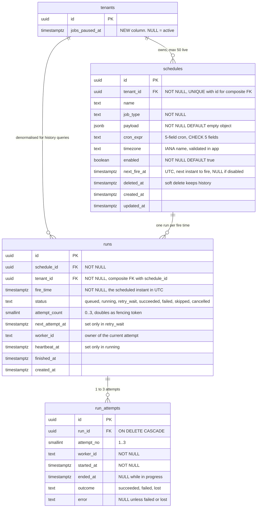

# Scheduled jobs per tenant: data model and mechanics

Today the app is a Postgres-backed system with a `tenants` table and nothing for jobs. This design adds four tables and one tenant column so tenants can define recurring jobs that run on a cron schedule. The 3 to 10 identical worker processes have no leader and no scheduler process, and Postgres is the only shared infrastructure (no Redis, no broker). Each worker loops: a scan turns due schedules into `runs` rows, a claim query hands each run to exactly one worker, and row locks, unique indexes and a fencing token on every outcome write keep the workers from colliding.

## Terms

- **Tenant**: a customer account. A tenant can have at most 50 live schedules.
- **Schedule**: a tenant's recurring job. It has a `job_type`, a JSON `payload`, a standard 5-field cron expression and an IANA timezone. Fire times are computed in that timezone. The shortest allowed interval is 5 minutes.
- **Fire time**: one instant when a schedule is due, stored as UTC.
- **Run**: what one fire time of a schedule produces. At most one run exists per fire time.
- **Attempt**: one try at a run. A run gets at most 3 attempts. A try by a worker presumed dead counts as used.
- **Active run**: a run in `queued`, `running` or `retry_wait`. Only one run of a schedule may be active at a time.
- **Skipped run**: a run recorded in history but never executed, because the schedule already had an active run when its fire time arrived.
- **Worker**: one of the identical processes. `worker_id` is free text (`host:pid:boot-uuid`), so a restarted process is a different worker. There is no worker table, because a registry would need its own liveness logic and the heartbeat already provides it.
- **Heartbeat**: a database update a running worker makes every 30 seconds to say it is alive.
- **Presumed dead**: a `running` run with no heartbeat for 2 minutes. Another worker may then retry it.
- **Fencing token**: the run's `attempt_count` at the time a worker claimed it. A worker can write an outcome only if the token still matches, so a worker that lost its run cannot overwrite the new owner's result.
- **`FOR UPDATE SKIP LOCKED`**: a Postgres row lock that makes a query skip rows other transactions have locked instead of waiting.
- **Partial index**: an index covering only rows that match a `WHERE` condition.
- **Handler**: application code that does the work for a `job_type`. The app keeps a registry from `job_type` to a handler function that receives `payload`. The registry is outside this data model. Handlers are idempotent, so a retry that repeats partial work is acceptable.
- **Reaper**: the part of each tick that finds presumed-dead runs and recovers them.

## ER diagram



### Constraints and indexes (not all expressible in the diagram)

- **`schedules`**
  - Composite `UNIQUE (tenant_id, id)`, so `runs` can reference it with `(tenant_id, schedule_id)` and cannot disagree about the tenant.
  - Partial index `(next_fire_at) WHERE enabled AND deleted_at IS NULL` drives the scan for due schedules.
  - A `BEFORE INSERT` trigger enforces the 50-schedule cap. It runs `SELECT 1 FROM tenants WHERE id = NEW.tenant_id FOR UPDATE` and then counts live schedules (`deleted_at IS NULL`). The tenant row lock serialises concurrent inserts, so two racing inserts cannot both pass at 49.
  - The 5-minute minimum interval is validated by the app on create and update. It walks consecutive fire times over a 12-month window in the schedule's timezone and rejects the schedule on any gap under 5 minutes, which catches irregular lists like `0,2 * * * *`. A DB CHECK cannot do this. The same walk rejects a schedule that has no fire time in the window.
- **`runs`**
  - `UNIQUE (schedule_id, fire_time)` is the at-most-one-run-per-fire-time guarantee. It holds even if two workers somehow both process the same schedule.
  - Partial unique index `UNIQUE (schedule_id) WHERE status IN ('queued','running','retry_wait')` is the one-active-run-per-schedule guarantee.
  - CHECKs tie the columns to the status:
    - `attempt_count BETWEEN 0 AND 3`.
    - `status='running'` implies `worker_id` and `heartbeat_at` are not null.
    - `status='retry_wait'` implies `next_attempt_at` is not null.
    - `status='skipped'` implies `attempt_count = 0`.
  - History index: `(tenant_id, fire_time DESC)`.
  - Claim index: `(next_attempt_at) WHERE status='retry_wait'`.
  - Queue index: `(created_at) WHERE status='queued'`.
  - Reaper index: `(heartbeat_at) WHERE status='running'`.
  - Cleanup index: `(fire_time)`.
- **`run_attempts`**
  - `UNIQUE (run_id, attempt_no)`.
  - `CHECK (attempt_no BETWEEN 1 AND 3)`.

### Rules that apply everywhere

- **Clock**: every stored timestamp and every timeout decision about a stored timestamp (heartbeat age, retry delay, dueness) uses the DB's `now()`, never a worker clock. This removes skew between workers. The only worker-side timing is a local duration timer (the handler timeout, the 100-second self-lost timer), which compares no timestamps between machines.
- **Leaving `running`**: every transition out of `running` clears `worker_id` and `heartbeat_at`. The CHECKs require them only while `running`. The worker that ran each attempt stays recorded in `run_attempts`.

## How it works

Every worker runs the same loop with a jittered tick of about 5 to 10 seconds. Each tick does up to four things in order: reap (section 5), create runs (section 1), claim (section 2), and clean up (section 7, about once a day per worker). If the DB is unreachable during a tick, the tick fails, is logged, and the loop tries again on the next tick. Each of these is one transaction that rolls back, so nothing is left half done. Handlers already running keep going, and the heartbeat rule in section 3 decides when they give up.

### 1. Run creation (the fire-time scan)

Trigger: every tick, on every worker. One transaction:

1. Select due schedules:
   ```sql
   SELECT s.* FROM schedules s JOIN tenants t ON t.id = s.tenant_id
   WHERE s.enabled AND s.deleted_at IS NULL AND t.jobs_paused_at IS NULL
     AND s.next_fire_at <= now()
   ORDER BY s.next_fire_at LIMIT 50
   FOR UPDATE OF s SKIP LOCKED
   ```
   A worker that loses the race for a schedule skips it and never sees it. If more than 50 are due, the rest stay due and the next tick picks them up. The order is oldest `next_fire_at` first across all tenants, so no tenant can hold others back for long.
2. For each schedule, compute `fire_time`, the **most recent** cron fire time at or before `now()`, in the schedule's timezone, stored as a UTC instant. The app computes it with a cron library, and the 5-minute validation walk uses the same function. Across a DST change, a local time that does not exist fires at the first instant after the gap, and a local time that occurs twice fires once, at its first occurrence. Usually `fire_time` equals `next_fire_at`, because the scan is only slightly late. They differ only when several fire times were missed. Then `fire_time` is the latest one, and the older ones are never computed, so they leave no history, as required.
3. Insert the run. If the schedule has an active run, insert it with `status='skipped'`. Otherwise insert it as `queued`. A queued run waits until a worker has capacity to claim it, and a fire time that arrives meanwhile is recorded as skipped. Use `ON CONFLICT (schedule_id, fire_time) DO NOTHING` in both cases. The active-run check is reliable because only this scan creates runs and it holds the schedule's row lock, so no other worker can add an active run between the check and the insert. An active run can only finish meanwhile, which does no harm. The partial unique index is a safety net for bugs: if it ever rejects a `queued` insert, the transaction fails and rolls back, and the next tick redoes the scan.
4. Set `next_fire_at` to the first fire time strictly after `now()`, in the same transaction. This always happens, whether the insert created a queued run, created a skipped run or hit the conflict and did nothing.

Failure: a crash mid-transaction rolls everything back, so the next worker redoes the scan with no partial state. Dueness is decided only by the row under lock, so concurrent workers produce at most one run per fire time.

**Creating a schedule**: the app computes the first fire time after `now()` and sets `next_fire_at` in the same `INSERT` that fires the 50-schedule trigger, so a live schedule never lacks a `next_fire_at`.

### 2. Claiming

Trigger: after the scan in each tick. The worker repeats the claim until nothing is claimable or it reaches its concurrency limit (an app setting). It runs each claimed handler concurrently, with its own heartbeat per run.

A claim is one statement plus an attempt insert in the same transaction:

```sql
UPDATE runs SET status='running', attempt_count = attempt_count + 1,
       worker_id = $me, heartbeat_at = now(), next_attempt_at = NULL
WHERE id = (
  SELECT r.id FROM runs r JOIN schedules s ON s.id = r.schedule_id
                          JOIN tenants t ON t.id = r.tenant_id
  WHERE (r.status = 'queued' AND s.enabled AND s.deleted_at IS NULL
         AND t.jobs_paused_at IS NULL)
     OR (r.status = 'retry_wait' AND r.next_attempt_at <= now())
  ORDER BY COALESCE(r.next_attempt_at, r.created_at) LIMIT 1
  FOR UPDATE OF r SKIP LOCKED)
RETURNING id, attempt_count;
```

Then `INSERT INTO run_attempts (run_id, attempt_no, worker_id, started_at)` with the returned `attempt_count`. For a retry this is a new row for attempt 2 or 3. The previous attempt row is already closed, because every failure or reaper transition closes it before the run enters `retry_wait`.

- Only one worker can win a given row, so a run is never executed by two workers at once by design. Presumed-dead workers are the one exception (section 5).
- The returned `attempt_count` is the worker's fencing token for the whole attempt.
- Ordering by the time a run became ready (`next_attempt_at` for retries, `created_at` for new runs) means a due retry is not starved behind newer queued runs.
- A queued run is claimable only if its schedule is still enabled and its tenant is not paused. This closes the race where a run is queued, then disabled or paused, before any worker picks it up.
- The `retry_wait` branch deliberately has no enabled or paused check. A retry belongs to a run that already started, and started runs finish normally (section 6). The join needs the schedule row only to exist, and soft-deleted schedules keep their row, so such a retry still runs.

Failure: if the worker dies between the update and the insert, the transaction rolls back and the run is still `queued` or `retry_wait`, as if never claimed. So a `running` run always has an open attempt row.

### 3. Heartbeats and fenced writes

Trigger: while a handler runs. Every 30 seconds the worker updates:

```sql
UPDATE runs SET heartbeat_at = now()
WHERE id = $run AND status = 'running' AND attempt_count = $token AND worker_id = $me
```

If this matches 0 rows, the worker has lost the run. It stops the handler on a best-effort basis and writes nothing further. The worker also keeps a local timer that restarts at each successful heartbeat. If the timer reaches about 100 seconds with no successful heartbeat (for example during a DB outage), the worker treats itself as lost and does the same. That is shorter than the reaper's 2 minutes, so a worker normally gives up before anyone takes over.

**Every outcome write is fenced the same way.** Success, failure and attempt closure go in one transaction, run update first and attempt update second:

```sql
UPDATE runs SET status = ..., finished_at = ...,
       worker_id = NULL, heartbeat_at = NULL
WHERE id = $run AND status = 'running' AND attempt_count = $token AND worker_id = $me;
-- only if that matched 1 row:
UPDATE run_attempts SET ended_at = now(), outcome = ..., error = ...
WHERE run_id = $run AND attempt_no = $token AND ended_at IS NULL;
```

On success the first statement sets `status='succeeded'` and `finished_at = now()`. Failure is covered in section 4.

Failure: a worker presumed dead that wakes up later holds an old token. After takeover, `attempt_count` is higher and `worker_id` differs, so its update matches 0 rows and the takeover worker's recorded outcome cannot be overwritten. That worker discards its result and does nothing more for the run. The `ended_at IS NULL` guard on the attempt row adds a second layer. If the DB is down when a handler finishes, the worker retries this write until it succeeds or its fencing check fails.

### 4. Retries

Trigger: a handler throws or times out. The same fenced transaction as section 3 ends the attempt with `outcome='failed'` and the error text, and the first statement sets:

- If `attempt_count < 3`: `status='retry_wait'` and `next_attempt_at = now() + interval`, computed by the database inside that statement. The interval is 1 minute after attempt 1 fails and 5 minutes after attempt 2 fails.
- If `attempt_count = 3`: `status='failed'`, `finished_at = now()`.

Nothing waits on the delay. Each tick's claim query finds the run once `next_attempt_at` has passed, so a retry starts within one tick of its due time, and increments the attempt number.

A run in `retry_wait` still counts as the schedule's active run. A fire time that arrives meanwhile is recorded as skipped.

**Handler timeout**: the worker enforces a per-job-type timeout with a local duration timer started when the handler starts, and treats expiry as a thrown error. On expiry it signals the handler to stop on a best-effort basis, records the failure at once through the fenced transaction, and stops heartbeating that run. A handler that ignores the signal may keep running in the background, and a retry may then overlap with it. This is accepted because handlers are idempotent. The brief gives no timeout duration (see open questions).

**No registered handler**: a `job_type` with no registered handler is an ordinary failed attempt, so the run fails after 3 attempts with that error.

### 5. Crash recovery (reaper)

Trigger: every tick, on every worker. First a plain read lists candidates:

```sql
SELECT id FROM runs
WHERE status = 'running' AND heartbeat_at < now() - interval '2 minutes'
```

Then, for each candidate, in its own transaction:

1. Lock and re-check it: `SELECT id, attempt_count FROM runs WHERE id = $id AND status = 'running' AND heartbeat_at < now() - interval '2 minutes' FOR UPDATE SKIP LOCKED`. If no row comes back, someone else handled it or it finished or heartbeated meanwhile, so skip it. The lock lasts until this transaction ends, so nothing can change the run before the steps below. This lock and re-check replace the token fence, so the reaper's updates need no `attempt_count` or `worker_id` condition.
2. Close the open attempt with `outcome='lost'`, `error='no heartbeat for 2 minutes, worker presumed dead'` and `ended_at = now()`.
3. Apply the same run update as a failure (section 4). The presumed-dead attempt counts as used, so the run goes to `retry_wait` with the 1 or 5 minute delay if attempts remain, otherwise to `failed` with `finished_at = now()`.

The next worker to claim the run takes the next attempt. If the old worker was only stalled, both may briefly run the handler. This is accepted because handlers are idempotent, and the fencing token keeps the stale worker from recording anything.

**If all workers were down**: on recovery the first tick reaps stale `running` rows, then the scan gives each schedule at most one new run, for its latest missed fire time. The scan is subject to the active-run check, so a reaped run still in `retry_wait` makes the new fire time `skipped`.

### 6. Pausing and disabling

Disabling a schedule or pausing a tenant stops new runs and cancels runs not yet started. Runs already executing finish normally, including their remaining retries.

- **Disable a schedule**, in one transaction: set `enabled=false` and `next_fire_at=NULL`, then `UPDATE runs SET status='cancelled', finished_at=now() WHERE schedule_id=$s AND status='queued'`.
- **Pause a tenant**, in one transaction: set `tenants.jobs_paused_at = now()` and cancel that tenant's `queued` runs the same way.
- **Race with claim**: claim re-checks `enabled` and `jobs_paused_at`, so a run queued just before the pause cannot start afterwards. The cancel step only keeps history accurate.
- **Leftover queued runs**: a scan that read the tenant just before a pause committed can insert a `queued` run just after the pause's cancel step. Claim ignores it, so it would sit as `queued`, count as the schedule's active run, and make every fire time after resume `skipped`. To prevent this, the resume and enable transactions first cancel any `queued` runs of the tenant or schedule, the same way. Disabling needs no such step, because the scan re-checks `enabled` after taking the schedule's row lock.
- **No catch-up on re-enable or resume**: a paused tenant's schedules keep stale `next_fire_at` values, which would fire on resume if left alone. So resume runs as one transaction in the app: cancel the tenant's `queued` runs, clear `jobs_paused_at`, and for each enabled live schedule of the tenant (at most 50) compute the first fire time after `now()` and update `next_fire_at`. Enabling a single schedule does the same for that schedule. Fire times that passed meanwhile never become runs or history entries. A failure leaves the tenant paused with nothing half-applied.
- **Assumption to confirm**: a run in `retry_wait` has already started, so a pause or disable lets its remaining retries continue. If product wants a pause to also stop pending retries, add `retry_wait` to the cancel statements and the claim guard. The schema does not change.
- **Editing the cron expression or timezone** recomputes `next_fire_at` in the same update.
- **Deleting a schedule** is a soft delete (`deleted_at`, `enabled=false`, queued runs cancelled), so its history is kept for the retention window. The row stays, so a run already in `retry_wait` keeps retrying.

### 7. History and cleanup

History is kept for 90 days.

- **Tenant history API**: `SELECT ... FROM runs WHERE tenant_id=$t ORDER BY fire_time DESC` with keyset pagination on `(fire_time, id)`. Each run shows its fire time and final status (`runs.status`). Attempts come from `run_attempts` by `run_id`, showing the worker, start and end times, outcome and error. Skipped and cancelled runs are history rows with no attempts.
- **Cleanup**: each worker starts cleanup about once every 24 hours from its own local timer. Nothing records that it already ran today. It takes `pg_try_advisory_lock(<job-cleanup key>)`, and a worker that does not get the lock skips cleanup, so runs never overlap. An extra run is harmless because the delete is idempotent. The winner runs the batched delete below until it deletes nothing:
  ```sql
  DELETE FROM runs WHERE id IN (
    SELECT id FROM runs
    WHERE fire_time < now() - interval '90 days'
      AND status IN ('succeeded','failed','skipped','cancelled')
    LIMIT 1000 FOR UPDATE SKIP LOCKED)
  ```
  Only finished runs are deleted. Active runs normally cannot be that old: running runs are reaped, `retry_wait` runs are claimed, and queued runs are claimed or cancelled. A leftover queued run in a tenant that stays paused forever would remain, which is accepted. `run_attempts` rows go with deleted runs through `ON DELETE CASCADE`. Soft-deleted schedules with no runs left are then purged. Batching keeps locks and WAL small. If volume grows, range-partitioning `runs` by `fire_time` would replace deletes with dropping partitions, but that is not needed at launch.

## What happens when things fail

| Failure | Result |
|---|---|
| DB unreachable during a tick | The tick fails and is logged. The next tick retries. Running handlers continue. |
| Worker crashes mid-scan or mid-claim | The transaction rolls back. The next worker redoes it. |
| Worker unable to heartbeat for about 100 seconds | It stops its handler best-effort and writes nothing. |
| Worker dead or stalled for 2 minutes | The reaper closes the attempt as `lost` and moves the run to `retry_wait` or `failed`. |
| Stale worker finishes late | Its fenced write matches 0 rows. It discards the result. |
| DB down when a handler finishes | The worker retries the outcome write until it succeeds or the fence rejects it. |
| Handler throws or times out | The attempt is `failed`. The run goes to `retry_wait` (1 minute, then 5 minutes) or to `failed` after attempt 3. |
| No handler for the `job_type` | Ordinary failed attempts, then `failed` after 3. |
| Fire time arrives while a run is active | A `skipped` run is recorded. |
| All workers down through several fire times | Only the latest missed fire time runs. |

## Guarantees

| Requirement | Enforced by |
|---|---|
| At most one run per fire time | `UNIQUE (schedule_id, fire_time)` plus the schedule row lock |
| One active run per schedule | Active-run check under the schedule lock, with overflow recorded as `skipped`, and the partial unique index as backstop |
| Only the latest missed fire time runs | The scan computes only the most recent fire time at or before `now()` |
| Dead worker cannot overwrite the takeover | Fencing on `attempt_count` and `worker_id` in every outcome write |
| 3 attempts, 1 and 5 minute backoff, dead worker counts | `attempt_count` CHECK, `next_attempt_at`, and the reaper reusing the failure path |
| No catch-up after pause or disable | `next_fire_at` recomputed on enable and resume |
| 50 schedules per tenant | Trigger holding a tenant row lock |
| 90-day history | Daily batched delete with cascade |

## Open questions

- Handler timeout duration per job type is not specified by the brief. Needs a product or engineering decision.
- Per-worker concurrency limit value is not specified.
- DST handling (nonexistent local time fires just after the gap, repeated local time fires once) is my choice, not in the brief. Confirm with product.
- Whether a pause or disable should also stop pending retries (section 6, assumption to confirm).
