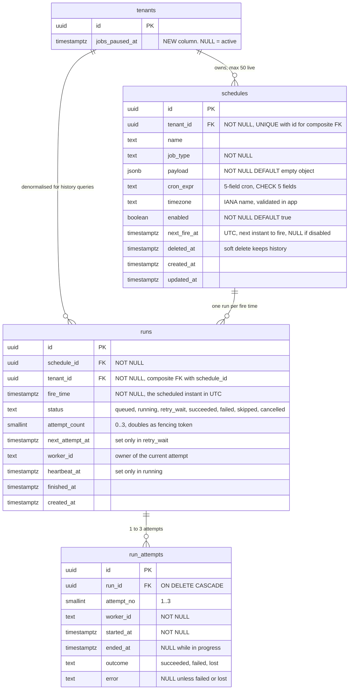

# Scheduled jobs per tenant: data model and mechanics

## ER diagram



### Constraints and indexes (not all expressible in the diagram)

- **`schedules`**
  - Composite `UNIQUE (tenant_id, id)`, so `runs` can reference it with `(tenant_id, schedule_id)` and cannot disagree about the tenant.
  - Partial index `(next_fire_at) WHERE enabled AND deleted_at IS NULL` drives the scan for due schedules.
  - A `BEFORE INSERT` trigger enforces the 50-schedule cap. It runs `SELECT 1 FROM tenants WHERE id = NEW.tenant_id FOR UPDATE` and then counts live schedules (`deleted_at IS NULL`). The tenant row lock serialises concurrent inserts, so two racing inserts cannot both pass at 49.
  - The 5-minute minimum interval is validated by the app on create and update. It walks consecutive fire times over a 12-month window in the schedule's timezone and rejects the schedule on any gap under 5 minutes, which catches irregular lists like `0,2 * * * *`. A DB CHECK cannot do this.
- **`runs`**
  - `UNIQUE (schedule_id, fire_time)` is the at-most-one-run-per-fire-time guarantee. It holds even if two workers somehow both process the same schedule.
  - Partial unique index `UNIQUE (schedule_id) WHERE status IN ('queued','running','retry_wait')` is the one-active-run-per-schedule guarantee.
  - CHECKs tie the columns to the status:
    - `attempt_count BETWEEN 0 AND 3`.
    - `status='running'` implies `worker_id` and `heartbeat_at` are not null.
    - `status='retry_wait'` implies `next_attempt_at` is not null.
    - `status='skipped'` implies `attempt_count = 0`.
  - History index: `(tenant_id, fire_time DESC)`.
  - Claim index: `(next_attempt_at) WHERE status='retry_wait'`.
  - Queue index: `(created_at) WHERE status='queued'`.
  - Reaper index: `(heartbeat_at) WHERE status='running'`.
  - Cleanup index: `(fire_time)`.
- **`run_attempts`**
  - `UNIQUE (run_id, attempt_no)`.
  - `CHECK (attempt_no BETWEEN 1 AND 3)`.
- **Clock**: every timestamp comes from the DB's `now()`, never from a worker clock. This removes skew between workers from every timeout.
- **Worker identity**: `worker_id` is free text (`host:pid:boot-uuid`), so a restarted process is a different worker. There is no worker table, because a registry would need its own liveness logic and the heartbeat already provides it.

## How it works

Every worker runs the same loop, with a jittered tick of about 5 to 10 seconds. Each tick does four things in order: reap, create runs, claim, and (once a day) clean up. There is no leader. Postgres row locks with `FOR UPDATE SKIP LOCKED` keep the workers from colliding.

### 1. Run creation (the fire-time scan)

In one transaction:

1. Select due schedules:
   ```sql
   SELECT s.* FROM schedules s JOIN tenants t ON t.id = s.tenant_id
   WHERE s.enabled AND s.deleted_at IS NULL AND t.jobs_paused_at IS NULL
     AND s.next_fire_at <= now()
   ORDER BY s.next_fire_at LIMIT 50
   FOR UPDATE OF s SKIP LOCKED
   ```
   A worker that loses the race for a schedule skips it and never sees it.
2. For each schedule, compute `fire_time`, the **most recent** cron fire time at or before `now()`, in the schedule's timezone, stored as a UTC instant. If workers were down through several fire times, the older ones are never computed, so they leave no history, as required.
3. Insert the run. If an active run exists for this schedule (queued, running or retry_wait), insert it with `status='skipped'`. Otherwise insert it as `queued`. Use `ON CONFLICT (schedule_id, fire_time) DO NOTHING` in both cases. The partial unique index is the backstop: a `queued` insert that conflicts on it is retried as `skipped`.
4. Set `next_fire_at` to the first fire time strictly after `now()`, in the same transaction.

Crashing mid-transaction rolls everything back, so the next worker redoes the scan with no partial state. Dueness is decided only by the row under lock, so concurrent workers produce at most one run per fire time.

### 2. Claiming

Claim is a single statement plus an attempt insert in the same transaction:

```sql
UPDATE runs SET status='running', attempt_count = attempt_count + 1,
       worker_id = $me, heartbeat_at = now(), next_attempt_at = NULL
WHERE id = (
  SELECT r.id FROM runs r JOIN schedules s ON s.id = r.schedule_id
                          JOIN tenants t ON t.id = r.tenant_id
  WHERE (r.status = 'queued' AND s.enabled AND s.deleted_at IS NULL
         AND t.jobs_paused_at IS NULL)
     OR (r.status = 'retry_wait' AND r.next_attempt_at <= now())
  ORDER BY r.created_at LIMIT 1
  FOR UPDATE OF r SKIP LOCKED)
RETURNING id, attempt_count;
```

Then `INSERT INTO run_attempts (run_id, attempt_no, worker_id, started_at)` with the returned `attempt_count`.

- Only one worker can win a given row, so a run is never executed by two workers at once by design. Presumed-dead workers are the one exception, covered below.
- The returned `attempt_count` is the worker's **fencing token** for the whole attempt.
- A queued run is claimable only if its schedule is still enabled and its tenant is not paused. This closes the race where a run is queued, then disabled or paused, before any worker picks it up.

### 3. Heartbeats and fenced writes

While the handler runs, the worker updates every 30 seconds:

```sql
UPDATE runs SET heartbeat_at = now()
WHERE id = $run AND status = 'running' AND attempt_count = $token AND worker_id = $me
```

If this matches 0 rows, the worker has lost the run. It stops the handler on a best-effort basis and writes nothing further. If the worker cannot complete a heartbeat for about 100 seconds (for example during a DB outage), it also treats itself as lost.

**Every outcome write is fenced the same way.** Success, failure and attempt closure all go in one transaction:

```sql
UPDATE runs SET status = ..., finished_at = ...
WHERE id = $run AND status = 'running' AND attempt_count = $token AND worker_id = $me;
-- only if that matched 1 row:
UPDATE run_attempts SET ended_at = now(), outcome = ..., error = ...
WHERE run_id = $run AND attempt_no = $token AND ended_at IS NULL;
```

A worker presumed dead that wakes up later holds an old token. After takeover, `attempt_count` is higher and `worker_id` differs, so its update matches 0 rows and the takeover worker's recorded outcome cannot be overwritten. The `ended_at IS NULL` guard on the attempt row adds a second layer.

### 4. Retries

When a handler throws or times out, the fenced transaction ends the attempt with `outcome='failed'` and the error text, and then:

- If `attempt_count < 3`: `status='retry_wait'`, `worker_id` and `heartbeat_at` cleared, `next_attempt_at = now() + interval`. The interval is 1 minute after attempt 1 fails and 5 minutes after attempt 2 fails.
- If `attempt_count = 3`: `status='failed'`, `finished_at = now()`.

When `next_attempt_at` passes, the normal claim query picks the run up and increments the attempt number.

A run in `retry_wait` still counts as the schedule's active run. A fire time that arrives meanwhile is recorded as skipped.

### 5. Crash recovery (reaper)

Every worker runs this each tick, and `SKIP LOCKED` keeps them from fighting:

```sql
SELECT id, attempt_count FROM runs
WHERE status = 'running' AND heartbeat_at < now() - interval '2 minutes'
FOR UPDATE SKIP LOCKED
```

For each row, in one transaction:

1. Close the open attempt with `outcome='lost'`, `error='no heartbeat for 2 minutes, worker presumed dead'` and `ended_at = now()`.
2. Apply the same transition as a failure. The presumed-dead attempt counts as used, so there is a `retry_wait` with the 1 or 5 minute delay if attempts remain, otherwise `failed`.

The next worker to claim the run takes the next attempt. If the old worker was only stalled, both may briefly run the handler. This is accepted because handlers are idempotent, and the fencing token keeps the stale worker from recording anything.

If all workers were down, the reaper and scan resume on recovery. Stale `running` rows are reaped first, and each schedule then gets at most one new run for its latest missed fire time. Reaping and run creation both happen in the first tick, and the second is subject to the active-run check, so a reaped run still in `retry_wait` makes the new fire time `skipped`.

### 6. Pausing and disabling

- **Disable a schedule**, in one transaction:
  - Set `enabled=false` and `next_fire_at=NULL`.
  - `UPDATE runs SET status='cancelled', finished_at=now() WHERE schedule_id=$s AND status='queued'`.
- **Pause a tenant**, in one transaction:
  - Set `tenants.jobs_paused_at = now()`.
  - Cancel that tenant's `queued` runs the same way.
- **Running runs** are untouched and finish normally, including their remaining retries.
- **Race with claim**: claim re-checks `enabled` and `jobs_paused_at`, so a run that was queued just before the pause cannot start afterwards. The cancel step only keeps history accurate.
- **No catch-up on re-enable or resume**, because the scan only advances `next_fire_at` for schedules it can see. A paused tenant's schedules keep stale `next_fire_at` values, which would fire on resume if left alone. The resume transaction therefore clears `jobs_paused_at` and recomputes `next_fire_at` for every enabled schedule of the tenant to the first fire time after `now()`. Enabling a single schedule does the same for that schedule. Fire times that passed meanwhile never become runs or history entries.
- **Assumption to confirm**: a run in `retry_wait` has already started, so a pause or disable lets its remaining retries continue. If product wants a pause to also stop pending retries, add `retry_wait` to the cancel statements and the claim guard. The schema does not change.
- **Editing a schedule's cron expression or timezone** recomputes `next_fire_at` in the same update.
- **Deleting a schedule** is a soft delete (`deleted_at`, `enabled=false`, queued runs cancelled), so its history is kept for the retention window.

### 7. History and cleanup

- **Tenant history API**: `SELECT ... FROM runs WHERE tenant_id=$t ORDER BY fire_time DESC` with keyset pagination on `(fire_time, id)`. Attempts come from `run_attempts` by `run_id`, showing the worker, start and end times, outcome and error. A run's final status is `runs.status`.
- **Skipped and cancelled runs** are history rows with no attempts.
- **Cleanup**: once a day, one worker takes `pg_try_advisory_lock(<job-cleanup key>)` and runs the batched delete below until it deletes nothing:
  ```sql
  DELETE FROM runs WHERE id IN (
    SELECT id FROM runs
    WHERE fire_time < now() - interval '90 days'
      AND status IN ('succeeded','failed','skipped','cancelled')
    LIMIT 1000 FOR UPDATE SKIP LOCKED)
  ```
  `run_attempts` rows go with them through `ON DELETE CASCADE`. Soft-deleted schedules with no runs left are then purged. Batching keeps locks and WAL small. If volume grows, range-partitioning `runs` by `fire_time` would replace deletes with dropping partitions, but that is not needed at launch.

### Guarantees

| Requirement | Enforced by |
|---|---|
| At most one run per fire time | `UNIQUE (schedule_id, fire_time)` plus the schedule row lock |
| One active run per schedule | Partial unique index, with overflow recorded as `skipped` |
| Only the latest missed fire time runs | The scan computes only the most recent fire time at or before `now()` |
| Dead worker cannot overwrite the takeover | Fencing on `attempt_count` and `worker_id` in every outcome write |
| 3 attempts, 1 and 5 minute backoff, dead worker counts | `attempt_count` CHECK, `next_attempt_at`, and the reaper reusing the failure path |
| No catch-up after pause or disable | `next_fire_at` recomputed on enable and resume |
| 50 schedules per tenant | Trigger holding a tenant row lock |
| 90-day history | Daily batched delete with cascade |
