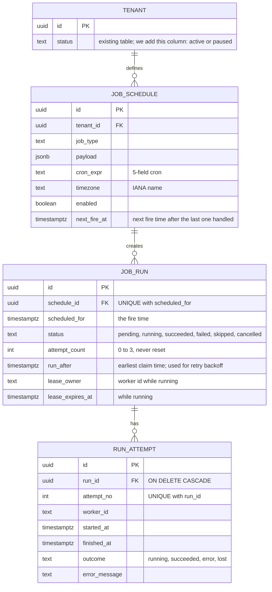

## Scheduled jobs per tenant

Today the app is a Postgres-backed system with a tenants table and nothing for jobs. This adds recurring jobs: a tenant defines a schedule (job type, JSON payload, cron expression, timezone), and the app runs it on time. Every worker (3 to 10 identical processes, no leader, no scheduler process) runs the same loops against Postgres. The loops turn due schedules into runs, claim and execute runs, and clean up after dead workers. Row locks and unique constraints keep two workers from doing the same thing, so we need no Redis or broker.

### Terms
- **Schedule**: one recurring job owned by one tenant. A tenant can have at most 50.
- **Fire time**: an instant when the cron expression, read in the schedule's IANA timezone, says the job should start.
- **Run**: one fire time of one schedule. A retry is another attempt of the same run, not a new run.
- **Attempt**: one try at executing a run. A run gets at most 3.
- **Active run**: a run that is `pending` or `running`. `succeeded`, `failed`, `skipped` and `cancelled` are final.
- **Worker id**: a random UUID a worker process generates at start. A restarted process gets a new id, so it is never confused with its dead predecessor.
- **Lease**: a worker's claim on a running run. It lasts until `lease_expires_at`, which is 2 minutes after the last heartbeat.
- **Heartbeat**: the update a running worker sends every 30 seconds to push `lease_expires_at` forward.
- **Presumed dead**: a run whose lease has expired (no heartbeat for 2 minutes).
- **SKIP LOCKED**: a Postgres option on `SELECT ... FOR UPDATE` that skips rows another worker has locked, so each worker gets different rows.
- **Handler**: code in the worker program for one `job_type`. Every worker contains every handler. Handlers are idempotent, so a retry that repeats partial work is fine.

### Data model

Constraints beyond the diagram:
- `UNIQUE (schedule_id, scheduled_for)` on `job_run`: a fire time can never produce two runs.
- A partial unique index on `job_run (schedule_id) WHERE status IN ('pending','running')`: a schedule never has two active runs. It is a safety net; the poll step checks first.
- All time comparisons use the database clock (`now()`), never a worker's clock.

### How it runs
Each worker runs these loops. Each step is one transaction unless noted. Finishing a run does nothing to its schedule: the next run always comes from step 1 and `next_fire_at`.

1. **Poll for due schedules** (every 10 seconds). Select schedules where `enabled`, the tenant is `active` and `next_fire_at <= now()`, using `FOR UPDATE SKIP LOCKED`. For each locked schedule:
   - Compute the most recent fire time `<= now()` from `cron_expr` and `timezone`. Older missed fire times are dropped: no run row, no history entry.
   - If the schedule already has an active run, insert a run for that fire time with status `skipped`. This includes a retry still waiting for its `run_after`. Otherwise insert one with status `pending`, `attempt_count` 0 and `run_after = now()`.
   - Use `INSERT ... ON CONFLICT DO NOTHING`, so a duplicate is not an error and does not abort the transaction. It is a safety net only: the row lock and the advancing `next_fire_at` already keep workers apart, and an edit always sets `next_fire_at` after `now()`.
   - In the same transaction, set `next_fire_at` to the first fire time after `now()`, whether the run was inserted, skipped or a duplicate.
2. **Claim a run** (every 5 seconds, only when the worker has a free slot; if it finds nothing it waits for the next tick). A worker runs up to 4 runs at once, one per slot. Select one `pending` run with `run_after <= now()`, whose schedule is enabled and whose tenant is active, using `FOR UPDATE SKIP LOCKED`. In one transaction, set `status = 'running'`, add 1 to `attempt_count`, set `lease_owner` to this worker's id and `lease_expires_at = now() + 2 minutes`, and insert a `run_attempt` with `attempt_no = attempt_count`, this worker's id, `started_at = now()` and outcome `running`. If the worker crashes after this commits but before the handler starts, the attempt stays `running`, the lease expires, and the reaper marks it `lost`, which uses up the attempt.
3. **Execute.** The worker looks up the handler for `job_type` and calls it with `payload`. A `job_type` with no handler counts as a failed attempt. The heartbeat runs on its own timer beside the handler, so a slow handler does not block it:
   `UPDATE job_run SET lease_expires_at = now() + 2 minutes WHERE id = ? AND status = 'running' AND lease_owner = ? AND attempt_count = ?`.
   If it updates no row, the worker has lost the run. It stops the handler if it can and writes nothing more. A transient database error on a heartbeat is not a loss; only a zero-row result is. Until the worker notices (at most 30 seconds), its handler may run beside the new attempt; idempotent handlers make that acceptable. There is no time limit on a handler, so a stuck handler in a live worker keeps its lease.
4. **Finish.** When the handler returns, update the run with the same `WHERE` guard as the heartbeat. In the same transaction, and only if that update touched a row, close the attempt (the one with this `attempt_no` and outcome `running`). A crash before commit leaves both undone and the reaper handles it.
   - On success, set the run to `succeeded` and the attempt to `succeeded`, even if the schedule was disabled or the tenant paused meanwhile.
   - On error, close the attempt as `error` with `error_message`, then apply the retry rule.
   - If the guarded update touches no row, the run was taken over, so the worker discards its result. This guard is what stops a presumed-dead worker overwriting the new outcome. It also means an attempt is closed exactly once when finish and the reaper race: whichever commits first wins, and the other finds no matching row.
5. **Retry rule** (used by finish and by the reaper). `attempt_count` is kept, never reset.
   - If the schedule is disabled or the tenant paused, set the run to `cancelled`.
   - Else if `attempt_count` is 3, set it to `failed`.
   - Else set it back to `pending`, clear `lease_owner` and `lease_expires_at`, and set `run_after = now() + 1 minute` (after attempt 1) or `now() + 5 minutes` (after attempt 2).

   A stale heartbeat from the old worker then fails its guard: the run is no longer `running`, or it runs under a new lease owner and a higher `attempt_count`.
6. **Reaper** (every 30 seconds, in every worker). Select `running` runs with `lease_expires_at < now()` using `FOR UPDATE SKIP LOCKED`. Close each one's open attempt as `lost` with the error "worker presumed dead". That attempt stays counted. Then apply the retry rule.
7. **Pause and disable.** Disabling a schedule or pausing a tenant (setting its `status` to `paused`) also sets the affected `pending` runs to `cancelled`, in the same transaction. That includes retries waiting for `run_after`. Running runs are left alone and finish normally: a success is recorded as `succeeded`, and a failure becomes `cancelled` through the retry rule. Steps 1 and 2 pick nothing new up for a disabled schedule or paused tenant.
8. **Re-enable and resume.** In one transaction, set `enabled` or `status` back and set `next_fire_at` to the first fire time after `now()` for each affected schedule. That is why nothing missed during the pause runs.
9. **History cleanup** (every worker, once an hour). Delete final runs with `scheduled_for` older than 90 days, in batches. Their attempts go with them through the cascade. Tenants see history by joining `job_run` (fire time, final status) to `run_attempt` (worker, start and end times, error).

### Rules checked when a schedule is saved
- At most 50 schedules per tenant. The save locks the tenant row, counts, then inserts.
- The cron expression must be valid 5-field cron. Reject it if any two consecutive fire times over the next 7 days are less than 5 minutes apart.
- On create, and whenever `cron_expr` or `timezone` is edited, `next_fire_at` is the first fire time after `now()`.

### What happens when things fail
| Failure | Result |
|---|---|
| Handler throws or `job_type` unknown | Attempt `error`, then the retry rule |
| Worker dies mid-run, or crashes after claiming or before finish commits | Lease expires after 2 minutes; the reaper marks the attempt `lost` (it used an attempt), then the retry rule |
| Stale worker finishes late, or finish races the reaper | Its guarded update touches no row; its result is discarded and the attempt is closed once |
| No worker up through several fire times | Only the latest fire time runs on recovery |
| Two workers see the same schedule | Row lock plus unique `(schedule_id, scheduled_for)`: one run |
| Fire time arrives while a run is active | A `skipped` run is recorded |
| Third attempt fails or is lost | Run is `failed` |

### Rollout
One migration adds `tenant.status` and the three tables. Then deploy the workers. Nothing else changes.

### Open questions
- Does the existing tenants table already have a status or paused column? If so, use it instead of adding one.
- The 10-second poll, 5-second claim, 30-second reaper and hourly cleanup intervals, and the limit of 4 concurrent runs per worker, are our choices, not from the brief.
- The brief does not say how tenants create, edit or delete schedules, or what deleting a schedule does to its runs and history. Until decided, schedules are disabled rather than deleted.
- The brief sets no time limit on a handler. Should a handler that runs far too long be stopped?
