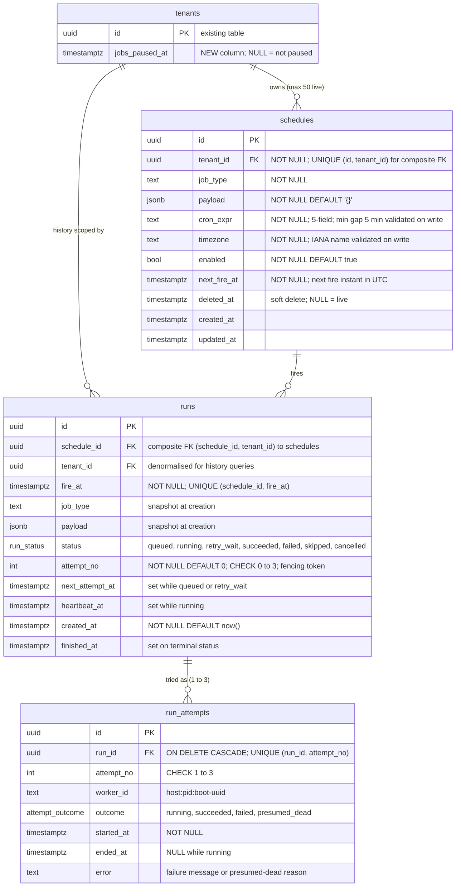

# Scheduled jobs per tenant: schema and mechanics

Postgres is the only coordination point. Workers stay correct through row locks (`FOR UPDATE SKIP LOCKED`), unique constraints and a per-run fencing token (`runs.attempt_no`). Every timestamp comes from Postgres `now()`, never from a worker's clock, so clock skew between workers can't affect fire times, leases or backoff.

## Tables



### Constraints and indexes beyond the diagram

| Object | Definition | Purpose |
|---|---|---|
| `runs_one_per_fire` | `UNIQUE (schedule_id, fire_at)` | At most one run per fire time, however many workers notice it. |
| `runs_one_active` | `UNIQUE (schedule_id) WHERE status IN ('queued','running','retry_wait')` | At most one run of a schedule in progress at a time. |
| `runs_status_shape` | `CHECK`: `running` needs `heartbeat_at` and `attempt_no >= 1`; `queued`/`retry_wait` need `next_attempt_at`; terminal statuses need `finished_at`; `skipped` has `attempt_no = 0` | Keeps each row's fields consistent with its status. |
| `schedules_limit` trigger | `BEFORE INSERT` (and on undelete): `SELECT ... FROM tenants WHERE id = NEW.tenant_id FOR UPDATE`, then reject if there are already 50 live schedules | Enforces the 50-schedule cap on every write path. The tenant row lock stops two concurrent inserts from both passing the count. |
| `schedules_due_idx` | `(next_fire_at) WHERE enabled AND deleted_at IS NULL` | Lets the tick find schedules that are due. |
| `runs_claimable_idx` | `(next_attempt_at) WHERE status IN ('queued','retry_wait')` | Lets workers find runs to claim. |
| `runs_stale_idx` | `(heartbeat_at) WHERE status = 'running'` | Lets the reaper find runs whose worker went quiet. |
| `runs_history_idx` | `(tenant_id, fire_at DESC)` | Serves the tenant history page. |
| `runs_cleanup_idx` | `(created_at) WHERE status IN ('succeeded','failed','skipped','cancelled')` | Lets cleanup find expired runs. |

"In progress" means any non-terminal status: `queued`, `running` or `retry_wait`. A run waiting out its retry backoff still blocks the schedule's next fire time. Otherwise a 5-minute schedule whose run is in its 5-minute backoff would have two live runs.

Cron validation happens in the app when a schedule is created or edited. It parses the expression, checks the timezone against the IANA database, and walks one year of fire times in that zone. It rejects the schedule if any two consecutive fire instants are less than 5 minutes apart. DST rule: a local time that doesn't exist (spring forward) fires at the first valid instant after it. A local time that happens twice (fall back) fires once, at its first occurrence. That keeps fire instants unique, which `runs_one_per_fire` depends on.

## How it works

Each worker runs the same loop about every 10 seconds, in this order: **reap, create runs, claim**. Each step is its own short transaction and skips rows other workers have locked. No leader is needed.

### Run creation

```sql
SELECT s.*, now() AS db_now
FROM schedules s JOIN tenants t ON t.id = s.tenant_id
WHERE s.enabled AND s.deleted_at IS NULL AND t.jobs_paused_at IS NULL
  AND s.next_fire_at <= now()
ORDER BY s.next_fire_at
LIMIT 100
FOR UPDATE OF s SKIP LOCKED;
```

For each locked schedule, the worker does this in the same transaction:

1. It computes `fire_at` as the **latest** fire time `<= db_now`, starting from `next_fire_at`. Older missed fire times are dropped and get no row.
2. It checks for an in-progress run of this schedule. If there is none, it inserts `status = 'queued', next_attempt_at = now()`. If there is one, it inserts `status = 'skipped', finished_at = now()`. Both inserts use `ON CONFLICT (schedule_id, fire_at) DO NOTHING` as a backstop. The run copies `job_type` and `payload`, so editing a schedule later doesn't change a run that was already created or its history.
3. It sets `next_fire_at` to the first fire time `> db_now`.

The schedule row lock means only one worker handles a given due schedule at a time. The unique constraints still hold if that ever fails. The partial unique index means a second active run can never be committed, even by a buggy path.

### Claiming

```sql
WITH c AS (
  SELECT r.id FROM runs r
  JOIN schedules s ON s.id = r.schedule_id
  JOIN tenants t ON t.id = r.tenant_id
  WHERE r.status IN ('queued','retry_wait') AND r.next_attempt_at <= now()
    AND s.enabled AND s.deleted_at IS NULL AND t.jobs_paused_at IS NULL
  ORDER BY r.next_attempt_at
  LIMIT 1
  FOR UPDATE OF r SKIP LOCKED)
UPDATE runs SET status = 'running', attempt_no = attempt_no + 1,
       heartbeat_at = now(), next_attempt_at = NULL
FROM c WHERE runs.id = c.id
RETURNING runs.id, runs.attempt_no, runs.job_type, runs.payload;
```

In the same transaction the worker inserts `run_attempts (run_id, attempt_no, worker_id, outcome = 'running', started_at = now())`. Each worker claims only as many runs as it has free slots.

### Heartbeats and fencing

The worker holds the pair `(run_id, attempt_no)` it was given at claim time. `attempt_no` is the fencing token. Every write the worker makes is conditional on that token.

- Heartbeat, every 30 seconds:
  `UPDATE runs SET heartbeat_at = now() WHERE id = $run AND attempt_no = $n AND status = 'running'`.
  If 0 rows change, the worker has lost the run. It stops the handler as best it can and records nothing.
- Completion, in one transaction:
  - `UPDATE runs SET status = ..., finished_at = ... WHERE id = $run AND attempt_no = $n AND status = 'running'`
  - `UPDATE run_attempts SET outcome = ..., ended_at = now(), error = $err WHERE run_id = $run AND attempt_no = $n AND outcome = 'running'`

  If either update changes 0 rows, the worker rolls back.

A worker that was presumed dead and comes back finds that the reaper has changed `status`, or a newer claim has raised `attempt_no`. Its updates then match nothing, so it can't overwrite the outcome recorded by the worker that took over. When the reaper and a late completion race, the row lock decides: whichever commits first wins, and the other matches 0 rows. Because handlers are idempotent, two workers briefly running the same job is acceptable. Only the recorded outcome has to be single.

### Retries

When an attempt fails, the completion transaction sets the run's next state from `attempt_no`:

| Failed attempt | Next state |
|---|---|
| 1 | `retry_wait`, `next_attempt_at = now() + 1 minute` |
| 2 | `retry_wait`, `next_attempt_at = now() + 5 minutes` |
| 3 | `failed`, `finished_at = now()` |

If the schedule has been disabled or deleted, or its tenant paused, since the attempt started, the run goes to `cancelled` instead of `retry_wait`. A retry would be a new start, and new starts aren't allowed while paused. The failed attempt and its error stay in history. `CHECK (attempt_no <= 3)` makes a fourth attempt impossible.

### Crash recovery

This is the reap step:

```sql
SELECT id, attempt_no FROM runs
WHERE status = 'running' AND heartbeat_at < now() - interval '2 minutes'
FOR UPDATE SKIP LOCKED;
```

For each run, in one transaction:

1. Mark the current attempt `presumed_dead`, with `ended_at = now()` and `error = 'no heartbeat since <heartbeat_at>'`.
2. Move the run on using the same rules as a failed attempt. A presumed-dead attempt counts as a used attempt, so backoff is 1 minute, then 5 minutes, then `failed` after the third. A paused or disabled run goes to `cancelled`. Backoff is measured from the moment the reaper declares the attempt dead.

If every worker was down, the first worker back reaps stale runs **before** it creates runs. Then it creates one run per due schedule, for the most recent missed fire time only. If the previous run is still in progress after reaping (for example in `retry_wait`), that recovered fire time is recorded as `skipped`, as the one-active-run rule requires.

### Disabling, pausing and re-enabling

Both disabling and pausing work in one transaction:

- **Disable a schedule:** `UPDATE schedules SET enabled = false`, which locks the schedule row and so serialises with run creation. Then `UPDATE runs SET status = 'cancelled', finished_at = now() WHERE schedule_id = $1 AND status IN ('queued','retry_wait')`.
- **Pause a tenant:** set `tenants.jobs_paused_at = now()`. Then `SELECT 1 FROM schedules WHERE tenant_id = $1 FOR UPDATE`, which waits for any run creation in progress for that tenant to commit. Then cancel all of the tenant's `queued` and `retry_wait` runs. The cancel statement runs after those locks are held, so it sees any run that was created at the same moment.

Runs that are already `running` aren't touched and finish normally. If they fail or die, they go to `cancelled` rather than being retried. The claim query also checks `enabled` and `jobs_paused_at`, as a second guard.

**Re-enable or resume:** set `enabled = true`, or clear `jobs_paused_at`. In the same transaction, recompute `next_fire_at` as the first fire time after `now()` for the affected schedules, so missed fire times aren't caught up. Resuming a tenant doesn't change a schedule's own `enabled` flag. Schedules the tenant disabled separately stay disabled.

Editing a schedule's `cron_expr` or `timezone` also recomputes `next_fire_at` from `now()`.

**Delete a schedule:** this is a soft delete. It sets `deleted_at` and `enabled = false` and cancels pending runs, the same as disabling. The row stays so its run history remains readable for 90 days. Deleted schedules don't count toward the 50 limit.

### History and cleanup

Tenants read history from `runs`, one row per fire time with its final status, using `runs_history_idx`. Each run joins to its `run_attempts` for the worker, start and end times, and error. Skipped runs have no attempts.

Cleanup runs on every worker roughly hourly. Batches use `SKIP LOCKED`, so concurrent workers split the work instead of conflicting:

```sql
DELETE FROM runs WHERE id IN (
  SELECT id FROM runs
  WHERE created_at < now() - interval '90 days'
    AND status IN ('succeeded','failed','skipped','cancelled')
  LIMIT 5000
  FOR UPDATE SKIP LOCKED);
```

The worker repeats the batch until it deletes 0 rows. `run_attempts` rows are removed by cascade. The same job hard-deletes soft-deleted schedules that have no remaining runs.

## Requirement to mechanism

| Requirement | Enforced by |
|---|---|
| One run per fire time | `UNIQUE (schedule_id, fire_at)`, plus the schedule row lock during creation |
| One in-progress run per schedule; later fire times skipped | Partial unique index `runs_one_active`; `skipped` rows inserted at creation |
| Only the latest missed fire time runs | Creation computes the latest fire time `<= now()` and advances `next_fire_at` past `now()` |
| Heartbeat 30 s, dead after 2 min | `runs.heartbeat_at`, the reap step and `runs_stale_idx` |
| 3 attempts, 1 min and 5 min backoff, dead counts as an attempt | `attempt_no` with `CHECK <= 3`; `next_attempt_at`; reaper and completion share one transition rule |
| A dead worker can't overwrite the new outcome | `attempt_no` fencing token on every heartbeat and completion write |
| Pause or disable stops new runs; running runs finish; pending runs cancelled; no catch-up | `enabled` and `jobs_paused_at` checked at creation and claim; cancel inside the same locked transaction; `next_fire_at` recomputed on resume |
| 50 schedules, 5-minute minimum, IANA timezone | `schedules_limit` trigger; validation when a schedule is written |
| 90-day history with attempts | `runs` and `run_attempts`; batched `SKIP LOCKED` cleanup |

## Open points

- **Volume.** At very high run counts, monthly partitioning of `runs` would make cleanup cheaper. Postgres can't enforce the partial unique index `runs_one_active` across partitions, though, because it doesn't include the partition key. Until volume calls for it, I'd keep `runs` as one table and use batched deletes.
- **Status after a failure while paused.** A run that fails or dies while its tenant is paused or its schedule is disabled is recorded as `cancelled`, not `failed`. Product should confirm that's the status they want tenants to see.
