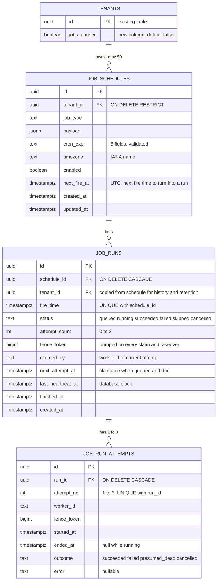

# Scheduled jobs per tenant: data model and mechanics

## What this is

Today the app is a Postgres-backed SaaS with a tenants table and no support for jobs. Tenants define recurring jobs, and the app runs each one at the fire times its cron expression gives. Three to ten identical worker processes do all the work. Each runs the same tick, which turns due schedules into one run per fire time. Workers then claim queued runs, send heartbeats while they work, retry failures, and take over runs whose worker has died. Postgres is the only shared store, so the database enforces the guarantees (unique keys, row locks and fence tokens) instead of a leader or a queue, and it is the one clock everyone uses.

## Terms

- **Tenant**: one customer account. The tenants table already exists.
- **Schedule**: one recurring job of one tenant. It has a job type, a JSON payload, a cron expression and a timezone.
- **Cron expression**: five fields (minute, hour, day of month, month, day of week) that say when a schedule fires.
- **IANA timezone**: a named zone such as `Europe/Berlin`. Fire times are computed in it.
- **Fire time**: one moment when a schedule is due. Stored in UTC.
- **Run**: the work for one fire time of one schedule. Its status is `queued`, `running`, `succeeded`, `failed`, `skipped` or `cancelled`.
- **Unfinished run**: a run that is `queued` or `running`.
- **Terminal run**: a run that is `succeeded`, `failed`, `skipped` or `cancelled`.
- **Attempt**: one try at a run, by one worker.
- **Worker**: one of the 3 to 10 identical processes. Each makes its own `worker_id` at start, for example from host, process id and a random suffix.
- **Tick**: the job every worker runs about every 10 seconds, with jitter (a small random delay so workers do not all wake at once).
- **Claim**: a worker takes one queued run and marks it running for itself.
- **Heartbeat**: a running worker's regular "still alive" write to its run.
- **Presumed dead**: a running worker that has sent no heartbeat for 2 minutes.
- **Sweep**: the check, run by every worker with the tick, that finds presumed-dead runs.
- **Taken over**: another worker has claimed a run after its previous worker was presumed dead.
- **Fence token**: a number that goes up each time a run is claimed or taken over. A worker may write to a run only while its own token is still the current one.
- **F_latest**: the most recent fire time at or before now.
- **F_next**: the first fire time after now.
- **Idempotent**: running it twice gives the same result as running it once. Job handlers must be idempotent, so a repeated attempt is safe.
- **SKIP LOCKED**: a row-lock option that skips rows another transaction already holds, instead of waiting for them.
- **ON CONFLICT DO NOTHING**: an insert that does nothing if a row with the same unique key already exists.
- **Partial unique index**: a unique index that covers only the rows matching a condition.
- **Composite foreign key**: a foreign key over two columns at once.
- **CHECK**: a rule the database enforces on every row, rejecting rows that break it.

## Entity diagram

## Constraints the diagram cannot show

Mermaid cannot show partial indexes or composite foreign keys, so this list is the authority for those. It also lists the rules the database and the app enforce.

- `JOB_RUNS`: `UNIQUE (schedule_id, fire_time)`. At most one run per fire time.
- `JOB_RUNS`: partial unique index on `(schedule_id) WHERE status IN ('queued','running')`. At most one unfinished run per schedule. A `skipped` row is outside the index, so it does not conflict.
- `JOB_RUNS`: composite foreign key `(schedule_id, tenant_id)` referencing `JOB_SCHEDULES (id, tenant_id)`. A run cannot point at another tenant's schedule.
- `JOB_RUNS`: `CHECK (attempt_count BETWEEN 0 AND 3)` and a `CHECK` on the status list.
- `JOB_RUNS` indexes: `(status, next_attempt_at)` for claiming; `(last_heartbeat_at) WHERE status = 'running'` for the sweep; `(tenant_id, fire_time)` for history; `(fire_time)` for cleanup.
- `JOB_RUN_ATTEMPTS`: `UNIQUE (run_id, attempt_no)` and `CHECK (attempt_no BETWEEN 1 AND 3)`.
- `JOB_SCHEDULES`: partial index `(next_fire_at) WHERE enabled`, which the tick reads.
- Maximum 50 schedules per tenant, checked by the app. The create transaction runs `SELECT ... FROM tenants WHERE id = $1 FOR UPDATE`, counts the tenant's schedules, then inserts. The lock makes concurrent creates wait for each other.
- Shortest interval 5 minutes, checked when a schedule is saved. The app lists a year of fire times in the schedule's timezone and rejects any gap under 5 minutes.
- Heartbeat, claim and sweep compare times with the database's `now()`, not worker clocks, so clock differences between workers do not matter.
- Only one existing table changes: `tenants` gets `jobs_paused`. Everything else is new.

## Steps

### Step 1. Tick: turn due schedules into runs

- **Trigger:** every worker, about every 10 seconds, with jitter. Each batch of schedules is handled in one transaction.
- **What it does:**
  1. Select due schedules: `enabled`, tenant not paused, `next_fire_at <= now()`, locked with `FOR UPDATE SKIP LOCKED`. Two workers never handle the same schedule at once.
  2. For each schedule, compute `F_latest` and `F_next` in its timezone.
  3. If the schedule already has an unfinished run (the partial unique index would be hit), insert a `skipped` row for `F_latest`. Otherwise insert a `queued` row for `F_latest` with `next_attempt_at = now()`. Both use `ON CONFLICT (schedule_id, fire_time) DO NOTHING`, so a repeat from another worker does nothing.
  4. Set `next_fire_at = F_next`.
- **Missed fire times:** fire times older than `F_latest` get no rows and are dropped. After an outage, only the most recent missed fire time can run. A `skipped` row is written only for that latest missed fire time, and only when a run is still unfinished.
- **Data kept:** the run rows. The tick changes only `next_fire_at` on the schedule.
- **If it goes wrong:** the batch transaction rolls back. Nothing is written and `next_fire_at` is unchanged, so the next tick sees the same schedule as due.

### Step 2. Claim: start a queued run

- **Trigger:** a worker looks for work. How often is open question 6.
- **What it does:** one SQL statement, in one transaction, which also writes the attempt row. A `WITH` clause lets one statement do several steps.
  1. Pick one `queued` run where `next_attempt_at <= now()`, `attempt_count < 3`, the schedule is enabled and the tenant is not paused. Lock that run row with `FOR UPDATE OF run SKIP LOCKED`.
  2. Set `status = 'running'`, `attempt_count = attempt_count + 1`, `fence_token = fence_token + 1`, `claimed_by = this worker`, `last_heartbeat_at = now()`.
  3. Insert the attempt row with the new `attempt_no`, this worker's id, the new fence token and `started_at`.
- **Why one run at a time holds:** only one unfinished run per schedule can exist, so a claimed run is the only running run for its schedule.
- **Data kept:** the run row (status, counts, fence token) and a new attempt row.
- **If it goes wrong:** no row is picked and nothing changes. The claim re-checks `enabled` and `jobs_paused`, so a run that became ineligible before it was claimed cannot start.

### Step 3. Heartbeat: show the run is still alive

- **Trigger:** every 30 seconds while the handler runs.
- **What it does:** sets `last_heartbeat_at = now()` where `id = this run`, `fence_token = this attempt's token` and `status = 'running'`.
- **Data kept:** the run row.
- **If it goes wrong:** zero rows change. The run was taken over, so the worker stops its handler and writes nothing more. A taken-over attempt may be partly done, and the taker-over repeats it. That is acceptable because handlers are idempotent.

### Step 4. Finish or retry: record the outcome

- **Trigger:** the handler succeeds or fails.
- **What it does:** writes the attempt row and the run in one transaction, guarded by the fence token.
  - Success: attempt outcome `succeeded`; run `succeeded` with `finished_at = now()`.
  - Attempt 1 fails: run `queued` with `next_attempt_at = now() + 1 minute`.
  - Attempt 2 fails: run `queued` with `next_attempt_at = now() + 5 minutes`.
  - Attempt 3 fails: run `failed` with `finished_at = now()`.
  - A failed attempt stores the error text on its attempt row.
- **Data kept:** the attempt row and the run row.
- **If it goes wrong:** if the run was taken over, the guard matches zero rows and the outcome is discarded (see the fencing rule below). A worker that crashes writes nothing here, and step 5 recovers the run.

### Step 5. Sweep: recover a run whose worker died

- **Trigger:** every worker runs the sweep with the tick. It finds runs with `status = 'running'` and `last_heartbeat_at < now() - 2 minutes`.
- **What it does:** for each such run, in one transaction:
  1. Bump `fence_token`. The presumed-dead worker can no longer write to this run.
  2. Set its current attempt to `outcome = 'presumed_dead'` and `ended_at = now()`. This counts as a used attempt.
  3. Choose the new run status:
     - `cancelled` if the schedule is now disabled or the tenant is paused;
     - `failed` if `attempt_count = 3`;
     - otherwise `queued`, with the same waits as step 4: 1 minute after attempt 1, 5 minutes after attempt 2.
- **Timing:** the 2 minutes are counted from the last heartbeat. The retry wait is counted from the moment the sweep detects the death. That is an assumption; see open question 2.
- **Data kept:** the run row and its current attempt row.
- **If it goes wrong:** if the transaction fails, nothing changes. The run still has an old heartbeat, so a later sweep finds it again.

### Step 6. Disable or pause: stop new runs

- **Trigger:** a schedule is disabled, or a tenant is paused (`jobs_paused = true`).
- **What it does:** in one transaction, sets the `queued` runs of the affected schedules, or of the whole tenant, to `cancelled`. `running` runs are left alone and finish normally. The tick skips disabled schedules and paused tenants, so no new runs appear.
- **Data kept:** the run rows.
- **If it goes wrong:** the change is one transaction, so either all the queued runs are cancelled or none are.

### Step 7. Enable or resume: no catch-up

- **Trigger:** a schedule is enabled, or a tenant is resumed.
- **What it does:** in the same transaction, recomputes `next_fire_at` from `now()` (the `F_next` only) for each affected schedule.
- **Why no catch-up:** fire times missed while the schedule was disabled or the tenant paused never become runs.

### Step 8. History: what tenants see

- **What it shows:** `JOB_RUNS` (fire time and final status), joined to `JOB_RUN_ATTEMPTS` (worker, start, end, outcome and error).
- **Skipped and cancelled runs:** they appear as runs with no attempts, or with the attempts that had already happened.
- **Retention:** history is kept for 90 days. See step 9.

### Step 9. Cleanup: delete old history

- **Trigger:** a periodic batched delete, for example 1000 rows at a time.
- **What it does:** deletes terminal runs with `fire_time < now() - 90 days`. Their attempts are deleted with them (cascade). Queued and running runs are never deleted. The 90 days are counted from `fire_time`, not `finished_at`; see open question 4.
- **If volume grows:** partition `JOB_RUNS` by month on `fire_time` and drop whole partitions instead of deleting in batches.

## Rule for every write: fencing

Every write an attempt makes filters on its own fence token and on `status = 'running'`. A worker that lost its run therefore matches zero rows, and its outcome is discarded. The outcome of the worker that took over always stands. This keeps a presumed-dead worker that wakes up from overwriting the result of the worker that took over.

## Cases that span steps

| Situation | What happens | Steps |
|---|---|---|
| A worker is down through several fire times | Only the most recent missed fire time runs. Older ones get no rows. | 1, 7 |
| A fire time arrives while the previous run is still running | A `skipped` row is written for that fire time. The new run is not executed. | 1 |
| A worker dies mid-run | No heartbeat for 2 minutes. The sweep records the attempt as `presumed_dead`, counts it, and either queues the next attempt, fails the run or cancels it. | 5 |
| A presumed-dead worker wakes up and tries to write | Its writes match zero rows and are discarded. | Fencing rule |

## Open questions

1. A queued retry (a run that has already had an attempt) is cancelled when its schedule is disabled or its tenant paused. This reads "not yet started" as "not yet started again". Confirm.
2. The retry wait for a presumed-dead attempt is counted from the sweep's detection, not from the last heartbeat. Confirm.
3. DST: cron fires in local wall-clock time. A local time that does not exist (clocks spring forward) runs at the next valid instant. An ambiguous local time (clocks fall back) runs once. Confirm.
4. The 90 days are counted from `fire_time`, not `finished_at`. Confirm.
5. No worker registry table is added. `worker_id` is an opaque per-process string. Add a `WORKERS` table only if the tenant UI needs worker health.
6. The first version does not say how often a worker runs the claim, or which worker runs the cleanup. Decide both.