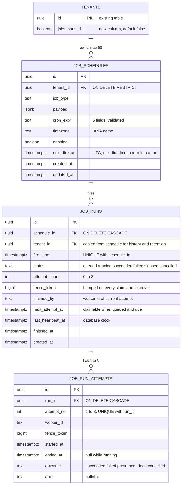

# Scheduled jobs per tenant: data model and mechanics

## Entity diagram

## Constraints and indexes the diagram cannot show

- `JOB_RUNS`: `UNIQUE (schedule_id, fire_time)`. This is the guarantee of at most one run per fire time.
- `JOB_RUNS`: partial unique index on `(schedule_id) WHERE status IN ('queued','running')`. This guarantees at most one unfinished run per schedule. A `skipped` row is outside the index, so it does not conflict.
- `JOB_RUNS`: composite foreign key `(schedule_id, tenant_id)` referencing `JOB_SCHEDULES (id, tenant_id)`. This stops a run from pointing at another tenant's schedule.
- `JOB_RUNS`: `CHECK (attempt_count BETWEEN 0 AND 3)` and a `CHECK` on the status list.
- `JOB_RUNS` indexes: `(status, next_attempt_at)` for claiming; `(last_heartbeat_at) WHERE status = 'running'` for the crash sweep; `(tenant_id, fire_time)` for history; `(fire_time)` for retention.
- `JOB_RUN_ATTEMPTS`: `UNIQUE (run_id, attempt_no)` and `CHECK (attempt_no BETWEEN 1 AND 3)`.
- `JOB_SCHEDULES`: partial index `(next_fire_at) WHERE enabled`, which the tick reads.
- Limit of 50 schedules per tenant: enforced in the application. The create transaction takes `SELECT ... FROM tenants WHERE id = $1 FOR UPDATE`, counts the tenant's schedules, then inserts. The lock serialises concurrent creates.
- Shortest interval of 5 minutes: enforced on save. The app enumerates a year of fire times in the schedule's timezone and rejects any gap under 5 minutes.
- Heartbeat, claim and sweep compare against the database's `now()`, not worker clocks, so clock skew between workers does not matter.

## How it works

**Run creation (the tick).** Every worker runs a tick about every 10 seconds, with jitter. Each tick runs one transaction per batch:
1. Select due schedules: `enabled`, tenant not paused, `next_fire_at <= now()`, `FOR UPDATE SKIP LOCKED`. Two workers never handle the same schedule at once.
2. For each schedule, the app computes the most recent fire time at or before now (`F_latest`) and the first fire time after now (`F_next`), in the schedule's timezone.
3. If a run is already unfinished for the schedule (the partial unique index would be hit), insert a `skipped` row for `F_latest`. Otherwise insert a `queued` row with `next_attempt_at = now()`. Both use `ON CONFLICT (schedule_id, fire_time) DO NOTHING`, so a repeat is harmless.
4. Set `next_fire_at = F_next`.

Any fire times older than `F_latest` are dropped with no rows. Recovery therefore runs only the most recent missed fire time. A skipped row is written only for the latest missed fire time, when a run is still unfinished.

**Claiming.** One statement, inside a transaction, with the attempt row inserted in the same transaction (CTE):
- Choose one `queued` row where `next_attempt_at <= now()`, `attempt_count < 3`, the schedule is enabled and the tenant is not paused. Use `FOR UPDATE OF run SKIP LOCKED`.
- Set `status = 'running'`, `attempt_count = attempt_count + 1`, `fence_token = fence_token + 1`, `claimed_by = worker`, `last_heartbeat_at = now()`.
- Insert the `JOB_RUN_ATTEMPTS` row with that `attempt_no`, the worker, the new fence token and `started_at`.

The partial unique index means a claimed run is the only unfinished run for its schedule, so the one-at-a-time rule holds.

**Heartbeats.** A running worker updates `last_heartbeat_at` every 30 seconds: `WHERE id = $run AND fence_token = $f AND status = 'running'`. If zero rows change, the run was taken over. The worker stops the handler and writes nothing further. Handlers are idempotent, so a partly completed attempt that is repeated is acceptable.

**Retries and backoff.** A failure writes the attempt row and the run in one transaction, guarded by the fence:
- After attempt 1 fails: `status = 'queued'`, `next_attempt_at = now() + 1 minute`.
- After attempt 2 fails: `status = 'queued'`, `next_attempt_at = now() + 5 minutes`.
- After attempt 3 fails: `status = 'failed'`, `finished_at = now()`.

**Crash recovery (the sweep).** Every worker runs the sweep with the tick. It finds runs where `status = 'running'` and `last_heartbeat_at < now() - 2 minutes`. For each, in one transaction:
- Bump `fence_token`, which fences off the presumed-dead worker.
- Set the current attempt's row to `outcome = 'presumed_dead'`, `ended_at = now()`.
- Choose the new status: `cancelled` if the schedule is now disabled or the tenant is paused; `failed` if `attempt_count = 3`; otherwise `queued` with `next_attempt_at = now() + backoff`, using the same 1 and 5 minute waits as above.

The 2 minutes are measured from the last heartbeat. The retry wait is measured from the moment the sweep detects the death. This reading is an assumption; see the open questions.

**Fencing.** Every write made by an attempt filters on its own fence token and on `status = 'running'`. A worker that lost its run therefore matches zero rows and its outcome is discarded. The taker-over's outcome always stands.

**Pausing and disabling.**
- Disable a schedule, or pause a tenant (`jobs_paused = true`): in one transaction, set `queued` runs for the affected schedules or tenant to `cancelled`. Leave `running` runs alone so they finish normally. The tick skips these schedules, so no new runs are created.
- Enable a schedule, or resume a tenant: in the same transaction, recompute `next_fire_at` from `now()` for each affected schedule (`F_next` only). Nothing is caught up, because the fire times missed while disabled are never turned into runs.
- The claim re-checks `enabled` and `jobs_paused`, so a run that became ineligible before it was claimed cannot start.

**History.** Tenants read `JOB_RUNS` (fire time, final status) joined to `JOB_RUN_ATTEMPTS` (worker, start, end, outcome, error). Skipped and cancelled runs appear as runs with no attempts, or with the attempts that had already happened.

**Cleanup.** A periodic batched delete removes terminal runs with `fire_time < now() - 90 days`, for example 1000 at a time. Attempts cascade. Queued and running runs are never deleted. If volume grows, partition `JOB_RUNS` by month on `fire_time` and drop whole partitions instead.

## Open questions and decisions to confirm

1. A queued retry (one already attempted) is cancelled when its schedule is disabled or its tenant paused. This reads "not yet started" as "not yet started again". Confirm.
2. The retry wait for a presumed-dead attempt is measured from detection, not from the last heartbeat. Confirm.
3. DST: cron fires in local wall-clock time. A local time that does not exist (spring forward) runs at the next valid instant. An ambiguous local time (fall back) runs once. Confirm.
4. The 90 days are measured from `fire_time`, not `finished_at`. Confirm.
5. Mermaid cannot express partial indexes or the composite foreign key, so the constraints list above is the authority for those.
6. No worker registry table is added. `worker_id` is an opaque per-process string (for example host, pid and a random suffix). Add a `WORKERS` table only if the tenant UI needs worker health.
7. Existing tables: the only change is `tenants.jobs_paused`. Everything else is new.