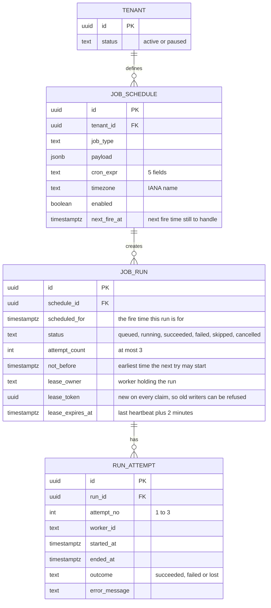

# Scheduled jobs per tenant

## What this is

Tenants define recurring jobs, such as "send the weekly digest". Each job is a schedule with a cron expression and a timezone. Each fire time of a schedule becomes one run, and a run is executed by one worker at a time. The only shared store is Postgres, so 3 to 10 identical workers coordinate through rows in the database. A worker takes a run by setting a lease on it, renews the lease with heartbeats, and records the result. If a worker dies, its lease expires, and another worker takes over. Every try is recorded as an attempt.

Today the app has a tenants table and nothing for jobs.

## Terms

- **Schedule**: a tenant's recurring job. It holds the job type, a JSON payload, a cron expression, an IANA timezone (such as `Europe/Berlin`) and an enabled flag.
- **Fire time**: a moment when a schedule is due. Fire times come from the cron expression, computed in the schedule's timezone.
- **Run**: the work for one fire time. A schedule has at most one run per fire time.
- **Attempt**: one try at a run, by one worker.
- **Lease**: a claim on a run. It has an owner and an expiry time. The owner must keep renewing it.
- **Heartbeat**: the renewal a worker sends every 30 seconds while it runs a job.
- **Reaper**: the check each worker makes for runs whose lease has expired. The database update ensures that only one worker takes each expired run.
- **SKIP LOCKED**: a Postgres clause that lets a worker skip rows another worker has already locked, so workers do not wait on each other.
- **Idempotent handler**: a job handler that is safe to run again, so a retry that repeats partial work is acceptable.

## Tables

Constraints the diagram does not show:

- **Schedules**: at most 50 per tenant, and the interval between fire times is at least 5 minutes. The create action checks both.
- **Runs**: unique on (schedule_id, scheduled_for), so two workers cannot create the same run.
- **Runs**: a partial unique index allows only one run per schedule with status queued or running. A run that is waiting for a retry counts as queued. This is what makes sure only one run is in progress at a time.
- **Attempts**: unique on (run_id, attempt_no).

## How it works

1. **Create runs.** Every worker polls on a regular interval. It selects enabled schedules of active tenants whose next_fire_at is due, locking them with SKIP LOCKED, so two workers never handle the same schedule at once. It takes the most recent fire time that is due. Older missed fire times are dropped and get no row. It inserts the run for that fire time. If the insert hits the unique key, another worker already made it, so nothing happens. If another run of the schedule is still queued or running, the new run is inserted with status skipped. Last, it moves next_fire_at to the first fire time after now.
2. **Claim a run.** Every worker also looks for a queued run whose not_before has passed and that is locked with SKIP LOCKED. The worker sets status to running, sets lease_owner to itself, creates a new lease_token, sets lease_expires_at to now plus 2 minutes, and adds 1 to attempt_count. In the same transaction it inserts an attempt row with the worker id and started_at. It claims only if the tenant is active and the schedule is enabled.
3. **Heartbeat.** While the job runs, the worker sets lease_expires_at to now plus 2 minutes every 30 seconds. The update applies only if lease_token still matches. If no row changes, the worker has lost its lease. It stops heartbeating, and its final write will be refused.
4. **Finish.** When the handler returns, the worker writes the result only if lease_token still matches. On success, the run becomes succeeded and the attempt gets outcome succeeded and ended_at. On failure, the attempt gets outcome failed and the error message. If attempt_count is below 3, the run goes back to queued with not_before set to now plus 1 minute after the first attempt, or now plus 5 minutes after the second. Otherwise the run becomes failed.
5. **Crash recovery.** Every worker's reaper runs on the same poll. It finds running runs whose lease_expires_at is in the past, which means no heartbeat for 2 minutes. In one update it marks the attempt as lost with ended_at set, and it clears the lease and sets the run to queued or failed by the same rules as step 4. The dead attempt was already counted at claim, so it is not counted again. Clearing the status back to queued means the old worker's heartbeat and final write no longer match, so they are refused.
6. **Pausing and disabling.** When a tenant is paused, or a schedule is disabled, the same transaction sets its queued runs to cancelled. Running runs are not touched and finish normally. Claims also check tenant and schedule status, so a run cannot start even if a cancel was missed. Resuming or re-enabling sets next_fire_at to the first fire time after now, so missed fire times are not caught up.
7. **History.** Tenants can see each run with its scheduled_for and final status. Each run shows its attempts, with worker_id, started_at, ended_at and error_message. Runs are kept for 90 days. A daily purge deletes runs whose scheduled_for is more than 90 days old. Their attempts are deleted with them through the foreign key cascade.

## What happens when things fail

| What fails | What happens |
|---|---|
| Worker crashes during a run | Its lease expires after 2 minutes. The reaper marks the attempt lost and requeues or fails the run. |
| Heartbeat cannot reach the database | The worker keeps trying. Once its lease is gone, it stops and its final write is refused. |
| Old worker finishes after losing its lease | Its write is refused because lease_token no longer matches. The new worker's outcome stands. |
| Handler returns an error | The attempt is failed. The run is retried after 1 minute, or after 5 minutes before the third attempt. After attempt 3 it is failed. |
| Workers were down for several fire times | Only the most recent missed fire time runs. Older ones are dropped with no history entry. |
| Previous run still active at a new fire time | The new run is recorded as skipped and not executed. |
| Two workers see the same due schedule | SKIP LOCKED lets one of them take it. The other moves on. |
| Schedule disabled or tenant paused | Queued runs are cancelled. Running runs finish. No new run starts. |

## Building it

- Create the four tables and the unique keys and partial index listed above in one migration.
- Put the 50-schedule limit and the 5-minute minimum in the create-schedule action.
- Run the poll, reaper and purge as periodic queries in the worker loop. No separate scheduler process is needed.

## Open questions

- The brief does not say whether the 90 days counts from the fire time or the finish time. This plan uses the fire time.
- This plan counts queued and waiting-to-retry runs as "in progress" for the skip rule. Confirm this is intended.
- The brief requires that a worker which lost its lease cannot overwrite the outcome. It does not say whether the worker must stop running the handler. This plan only refuses its writes.