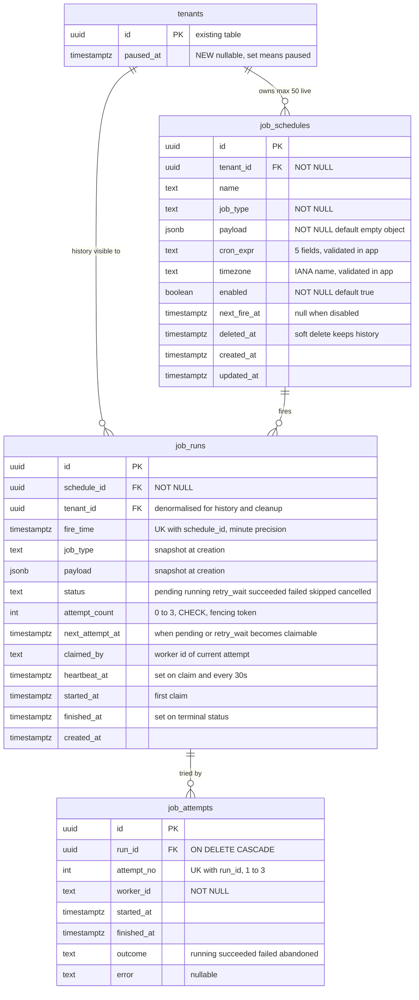

# Scheduled jobs per tenant: data model and mechanics

## Summary

Today the app is a Postgres-backed system with a `tenants` table and nothing for jobs. This design adds scheduled jobs: tenants define recurring jobs (for example "send the weekly digest") and the app runs them on their schedule. We run 3 to 10 identical workers with no leader, no scheduler process, no Redis and no broker, so Postgres is the only coordinator. Each worker repeats one loop: it creates a run row for every due schedule, claims runs with row locks, executes them, and recovers runs whose worker died. Unique indexes and a per-attempt fencing number guarantee that a fire time produces at most one run and that a stale worker cannot overwrite a newer outcome.

## Terms

- **Tenant:** a customer account. It owns schedules and can be paused.
- **Schedule:** a recurring job definition owned by one tenant. It has a job type, a JSON payload, a standard 5-field cron expression and an IANA timezone (for example `Europe/Paris`). Fire times are computed in that timezone.
- **Fire time:** one moment a schedule is due. Fire times are whole minutes.
- **Run:** one fire time of one schedule. It has a status and its own history entry.
- **Attempt:** one execution try of a run. A run gets at most 3 attempts in total.
- **In progress:** a run with status `pending`, `running` or `retry_wait`.
- **Worker:** one of the identical processes. It has a worker id.
- **Heartbeat:** a timestamp the running worker refreshes every 30 seconds. A run with no heartbeat for 2 minutes means its worker is presumed dead.
- **Reaper:** the step of the loop that finds runs whose heartbeat is stale and takes them over.
- **Fencing token:** the run's `attempt_count` at the moment a worker claimed it. Every write by that worker is conditioned on it, so a worker that lost the run cannot change anything.
- **`FOR UPDATE SKIP LOCKED`:** a Postgres clause that locks the rows it selects and silently skips rows another transaction already locked. Workers therefore never wait on each other, and each row goes to one worker.
- **Soft delete:** setting `deleted_at` instead of removing the row, so run history survives.

## Rules that hold everywhere

- The database clock (`now()`) is the only clock used for due times, heartbeats and backoff, so worker clock skew cannot matter.
- A tenant has at most 50 live schedules. The shortest allowed interval between fires is 5 minutes.
- Each fire time produces at most one run.
- Only one run of a schedule is in progress at a time. A fire time that arrives meanwhile is recorded as `skipped` and not executed.
- If no worker was up through several fire times, only the most recent missed one runs. Older ones are dropped with no history entry.
- Run history is kept for 90 days.
- Job handlers are idempotent, so a retry that repeats partial work is acceptable.

## ER diagram



### Constraints and indexes

Each one is here for a reason given after it.

- `job_runs`: `UNIQUE (schedule_id, fire_time)`. At most one run per fire time, however many workers notice it.
- `job_runs`: `UNIQUE (schedule_id) WHERE status IN ('pending','running','retry_wait')`. At most one in-progress run per schedule. `skipped` is not in that set, so any number of skipped rows can exist.
- `job_runs`: `CHECK (attempt_count BETWEEN 0 AND 3)`, and a `CHECK` that terminal statuses have `finished_at` set.
- `job_runs`: index `(next_attempt_at) WHERE status IN ('pending','retry_wait')` serves the claim query.
- `job_runs`: index `(heartbeat_at) WHERE status = 'running'` serves the reaper.
- `job_runs`: index `(tenant_id, fire_time DESC)` serves the history UI.
- `job_runs`: index `(fire_time)` serves cleanup.
- `job_attempts`: `UNIQUE (run_id, attempt_no)`.
- `job_schedules`: index `(next_fire_at) WHERE enabled AND deleted_at IS NULL` serves the poll for due schedules.
- The foreign key from `job_runs` to `job_schedules` is `ON DELETE RESTRICT`. Schedules are soft-deleted, so history survives until the 90-day cleanup.
- 50-schedule cap: a `BEFORE INSERT` trigger locks the tenant row (`SELECT ... FOR UPDATE`), counts the tenant's live schedules (`deleted_at IS NULL`) and rejects the insert at 50. The lock stops two concurrent inserts from both passing the count.
- 5-minute minimum interval: this cannot be a CHECK, because lists like `0,2 * * * *` produce uneven gaps. On create and update, the API computes the smallest gap between consecutive fires over a full cycle, including DST transitions, and rejects the schedule if it is under 5 minutes. The stored expression is therefore always already validated.

## How it works

Every worker repeats the same loop every few seconds, with jitter: **reap, create runs, claim and execute, cancel orphans, and occasionally clean up history**. Each numbered step below is one part of that loop.

### 1. Run creation

Trigger: a schedule's `next_fire_at` is due. In one transaction a worker runs:

```sql
SELECT s.* FROM job_schedules s JOIN tenants t ON t.id = s.tenant_id
WHERE s.enabled AND s.deleted_at IS NULL AND t.paused_at IS NULL
  AND s.next_fire_at <= now()
FOR UPDATE OF s SKIP LOCKED LIMIT 20;
```

For each locked schedule, the worker:

1. Computes the latest fire time at or before `now()` in the schedule's timezone. Only this one runs; older missed ones are dropped silently. DST cases (skipped or repeated local times) are left to the cron library and fixed by tests.
2. Inserts a run with `ON CONFLICT (schedule_id, fire_time) DO NOTHING`, copying `job_type` and `payload` from the schedule. If the schedule has no in-progress run, the status is `pending` and `next_attempt_at = now()`. If one exists (`pending`, `running` or `retry_wait`, so a run waiting to retry also counts), the new run is inserted as `skipped` with `finished_at = now()` and no attempts.
3. Sets `next_fire_at` to the first fire time after `now()`.
4. Commits.

Data is kept in `job_schedules` and `job_runs`. If the transaction fails, nothing changes and the next loop retries it. The two unique indexes protect the invariants even if this application logic is wrong. The pause and disable checks run again at claim time.

### 2. Claiming and executing

Trigger: a run is `pending` or `retry_wait` with `next_attempt_at <= now()`.

```sql
WITH c AS (
  SELECT r.id FROM job_runs r
  JOIN job_schedules s ON s.id = r.schedule_id
  JOIN tenants t ON t.id = r.tenant_id
  WHERE r.status IN ('pending','retry_wait') AND r.next_attempt_at <= now()
    AND s.enabled AND s.deleted_at IS NULL AND t.paused_at IS NULL
  ORDER BY r.next_attempt_at FOR UPDATE OF r SKIP LOCKED LIMIT 1)
UPDATE job_runs r SET status='running', attempt_count=attempt_count+1,
  claimed_by=$worker, heartbeat_at=now(), started_at=COALESCE(started_at, now())
FROM c WHERE r.id = c.id RETURNING r.*;
```

In the same transaction the worker inserts the `job_attempts` row (`attempt_no = attempt_count`, `outcome = 'running'`). It then runs the handler outside the transaction and keeps `(run_id, attempt_no)` as its fencing token. Retries are claimed through this same query. If the claim transaction fails, nothing changed and the run stays claimable.

The loop also runs a separate statement that sets `cancelled` on any `pending` or `retry_wait` run whose schedule is disabled or deleted, or whose tenant is paused. This closes the race where a run is created just as someone pauses.

### 3. Heartbeats

Trigger: every 30 seconds while the handler runs.

```sql
UPDATE job_runs SET heartbeat_at = now()
WHERE id=$run AND status='running' AND attempt_count=$my_attempt;
```

If it updates 0 rows, the worker has lost the run (it was reaped and taken over). It must stop and discard its result.

### 4. Finishing an attempt and retrying

Trigger: the handler returns or throws. Every outcome write is conditioned on the fencing token: `WHERE id=$run AND status='running' AND attempt_count=$my_attempt`. If 0 rows are affected, the worker does nothing more. So a worker presumed dead cannot overwrite the outcome recorded by the worker that took over, and cannot touch the newer attempt's row either. The attempt row update is also conditioned on `outcome = 'running'`.

- **Success:** the run becomes `succeeded` with `finished_at` set, and the attempt becomes `succeeded`.
- **Failure with `attempt_count < 3`:** the attempt becomes `failed` with `error` filled in. The run becomes `retry_wait` with `next_attempt_at = now() + interval`: 1 minute after attempt 1, 5 minutes after attempt 2.
- **Failure on attempt 3:** the attempt becomes `failed` and the run becomes `failed` with `finished_at` set.

If the worker crashes before writing, the reaper (step 5) handles it.

### 5. Crash recovery (reaper)

Trigger: every worker runs this each loop. It uses the same locking pattern, so only one worker handles each stale run.

```sql
SELECT id FROM job_runs
WHERE status='running' AND heartbeat_at < now() - interval '2 minutes'
FOR UPDATE SKIP LOCKED;
```

For each stale run, in one transaction:

1. Mark the current attempt `abandoned`, with `finished_at = now()` and `error = 'worker presumed dead, no heartbeat'`.
2. The attempt was already counted at claim time, so the presumed-dead worker has used one of the 3 attempts. If `attempt_count < 3`, set the run to `retry_wait` with the same 1-minute or 5-minute backoff, counted from detection (about 2 minutes after the last heartbeat). Otherwise set it to `failed` with `finished_at`.

A full outage is covered too. If every worker is down, the run stays `running` until the first worker returns and the reaper handles it. Run creation then makes the single most recent missed fire time (step 1). That run executes late, by design. If the old run is still in `retry_wait`, the new fire time is recorded as `skipped`, which fits the one-run-at-a-time rule.

### 6. Disabling, pausing and resuming

- **Disable a schedule:** one transaction sets `enabled = false` and `next_fire_at = NULL`, and cancels its `pending` and `retry_wait` runs. A `running` run is left alone and finishes normally.
- **Pause a tenant:** set `tenants.paused_at = now()` and cancel `pending` and `retry_wait` runs of all the tenant's schedules. The creation and claim queries both check `paused_at`.
- **An executing run that fails after a disable or pause:** its retry would be a new start, so the cancel statement in step 2 cancels it. The failed attempt stays in history with its error.
- **Re-enable or resume:** in one transaction the app recomputes `next_fire_at` as the first fire time after `now()` for each affected schedule (at most 50 per tenant). No stale `next_fire_at` is left, so nothing is caught up.

### 7. History and cleanup

- **Tenant history API:** lists `job_runs` for a tenant (`fire_time`, final `status`) with `job_attempts` joined (worker, start and end times, error), using the `(tenant_id, fire_time DESC)` index. `skipped` and `cancelled` runs show with no attempts.
- **Retention:** about once an hour, any worker may run cleanup, but first it takes `pg_try_advisory_lock(<fixed key>)` so only one does at a time. It deletes in batches of about 1000:

```sql
DELETE FROM job_runs WHERE id IN (
  SELECT id FROM job_runs
  WHERE fire_time < now() - interval '90 days'
    AND status IN ('succeeded','failed','skipped','cancelled')
  LIMIT 1000 FOR UPDATE SKIP LOCKED);
```

Attempts go with their runs through `ON DELETE CASCADE`. Soft-deleted schedules with no runs left can be removed in the same job. Non-terminal runs are never deleted. If a batch fails, the next hourly run continues.

## What happens when things fail

| Step | Failure | Result |
|---|---|---|
| Run creation | Transaction fails or worker dies mid-way | Nothing is committed. Another worker retries on the next loop. |
| Run creation | Two workers see the same fire time | `SKIP LOCKED` and `UNIQUE (schedule_id, fire_time)` allow only one run. |
| Claim | Two workers want the same run | `SKIP LOCKED` gives it to one. |
| Handler | Throws on attempt 1 or 2 | `retry_wait`, retried after 1 or 5 minutes. |
| Handler | Fails on attempt 3 | Run is `failed`. |
| Worker | Dies while running | After 2 minutes without heartbeat the reaper abandons the attempt and retries or fails the run, counting the attempt as used. |
| Worker | Presumed dead but still alive | Its heartbeat and outcome writes match 0 rows, so it stops and its result is discarded. |
| All workers | Down for several fire times | Only the most recent missed fire time runs on recovery. |
| Schedule or tenant | Disabled or paused | New runs stop, unstarted runs are cancelled, executing runs finish. |

## Assumptions and open points

- **Latency:** the delay from due time to the start of a run is at most the poll interval plus the claim wait, so a few seconds.
- **Retry wait and disable:** I treated a run waiting for a retry as "not yet started", so disabling or pausing cancels it. If retries must continue instead, remove that status from the cancel statements and the claim filter.

## Later, if needed

- **Partitioning:** if run volume gets large, partition `job_runs` by month on `fire_time`, so cleanup becomes dropping partitions. Not needed at the start.
