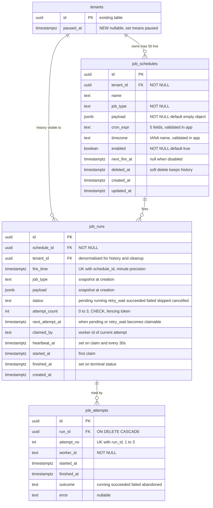

# Scheduled jobs per tenant: data model and mechanics

## Approach

- Postgres is the only coordinator. Every worker runs the same loop and uses row locks (`FOR UPDATE SKIP LOCKED`) plus unique indexes to decide who acts.
- The database clock (`now()`) is the only clock used for due times, heartbeats and backoff. Worker clock skew therefore cannot matter.
- A run is one fire time of one schedule. Each execution try of a run is an attempt.
- Each attempt takes a number from `attempt_count`. That number is the fencing token, so a stale worker cannot write over a newer attempt.

## ER diagram



### Constraints and indexes

- `job_runs`: `UNIQUE (schedule_id, fire_time)` guarantees at most one run per fire time, however many workers notice it.
- `job_runs`: `UNIQUE (schedule_id) WHERE status IN ('pending','running','retry_wait')` guarantees at most one in-progress run per schedule. `skipped` is not in that set, so any number of skipped rows can exist.
- `job_runs`: `CHECK (attempt_count BETWEEN 0 AND 3)`.
- `job_runs`: `CHECK` that terminal statuses have `finished_at` set.
- `job_runs`: index `(next_attempt_at) WHERE status IN ('pending','retry_wait')` serves the claim query.
- `job_runs`: index `(heartbeat_at) WHERE status = 'running'` serves the reaper.
- `job_runs`: index `(tenant_id, fire_time DESC)` serves the history UI.
- `job_runs`: index `(fire_time)` serves cleanup.
- `job_attempts`: `UNIQUE (run_id, attempt_no)`.
- `job_schedules`: index `(next_fire_at) WHERE enabled AND deleted_at IS NULL` serves the poll.
- `job_schedules`: the foreign key from `job_runs` is `ON DELETE RESTRICT`. Schedules are soft-deleted, so history survives until the 90-day cleanup.
- 50-schedule cap: a `BEFORE INSERT` trigger locks the tenant row (`SELECT ... FOR UPDATE`), counts the tenant's live schedules (`deleted_at IS NULL`) and rejects the insert at 50. The lock stops two concurrent inserts from both passing the count.
- 5-minute minimum interval: this cannot be a CHECK, because lists like `0,2 * * * *` produce uneven gaps. The API computes the smallest gap between consecutive fires over a full cycle, including DST transitions, and rejects the schedule if it is under 5 minutes. It runs this on create and update. The stored expression is therefore always already validated.

## How it works

Every worker runs the same loop every few seconds, with jitter: **reap, create runs, claim and execute, cleanup occasionally**.

### 1. Run creation

In one transaction, a worker runs:

```sql
SELECT s.* FROM job_schedules s JOIN tenants t ON t.id = s.tenant_id
WHERE s.enabled AND s.deleted_at IS NULL AND t.paused_at IS NULL
  AND s.next_fire_at <= now()
FOR UPDATE OF s SKIP LOCKED LIMIT 20;
```

For each locked schedule, the worker does the following:

1. It computes the latest fire time at or before `now()` in the schedule's timezone. This is the only missed fire time that runs. Older ones are dropped silently, with no history entry. DST rules (skipped or repeated local times) are handled by the cron library and are fixed by tests.
2. It inserts a run using `ON CONFLICT (schedule_id, fire_time) DO NOTHING`.
   - If there is no in-progress run for the schedule, the status is `pending` and `next_attempt_at = now()`.
   - If one exists (`pending`, `running` or `retry_wait`), the new run is inserted as `skipped` with `finished_at = now()` and no attempts.
3. It sets `next_fire_at` to the first fire time after `now()`.
4. It commits.

`SKIP LOCKED` means workers don't queue on each other. The two unique indexes still protect the invariants if the application logic is ever wrong. A run created by this step still gets the tenant-pause and disable checks again at claim time (section 2).

### 2. Claiming

```sql
WITH c AS (
  SELECT r.id FROM job_runs r
  JOIN job_schedules s ON s.id = r.schedule_id
  JOIN tenants t ON t.id = r.tenant_id
  WHERE r.status IN ('pending','retry_wait') AND r.next_attempt_at <= now()
    AND s.enabled AND s.deleted_at IS NULL AND t.paused_at IS NULL
  ORDER BY r.next_attempt_at FOR UPDATE OF r SKIP LOCKED LIMIT 1)
UPDATE job_runs r SET status='running', attempt_count=attempt_count+1,
  claimed_by=$worker, heartbeat_at=now(), started_at=COALESCE(started_at, now())
FROM c WHERE r.id = c.id RETURNING r.*;
```

In the same transaction the worker inserts the `job_attempts` row (`attempt_no = attempt_count`, `outcome = 'running'`). It then executes the handler outside the transaction. The worker keeps `(run_id, attempt_no)` as its fencing token.

A separate cleanup statement runs in the loop. It sets `cancelled` on any `pending` or `retry_wait` run whose schedule is disabled or deleted, or whose tenant is paused. This closes the race where a run is created just as someone pauses.

### 3. Heartbeats

Every 30 seconds the worker runs:

```sql
UPDATE job_runs SET heartbeat_at = now()
WHERE id=$run AND status='running' AND attempt_count=$my_attempt;
```

If it updates 0 rows, the worker has lost the run (it was reaped and taken over). It must stop and discard its result.

### 4. Finishing an attempt and retrying

Every outcome write is conditioned on the same fence: `WHERE id=$run AND status='running' AND attempt_count=$my_attempt`. If 0 rows are affected, the worker does nothing more. So a worker that was presumed dead cannot overwrite the outcome recorded by the worker that took over, and it cannot touch the newer attempt's row either. The attempt row update is also conditioned on `outcome = 'running'`.

- **Success:** the run becomes `succeeded` with `finished_at` set, and the attempt becomes `succeeded`.
- **Failure with `attempt_count < 3`:** the attempt becomes `failed` with `error` filled in. The run becomes `retry_wait` with `next_attempt_at = now() + interval`. The interval is 1 minute after attempt 1 and 5 minutes after attempt 2. The retry is claimed through the same claim query as everything else.
- **Failure on attempt 3:** the run becomes `failed` and `finished_at` is set.

A run in `retry_wait` is still in progress. A new fire time that arrives while it waits is recorded as `skipped`.

### 5. Crash recovery (reaper)

Every worker runs this each loop. It uses the same locking pattern, so only one worker handles each stale run:

```sql
SELECT id FROM job_runs
WHERE status='running' AND heartbeat_at < now() - interval '2 minutes'
FOR UPDATE SKIP LOCKED;
```

For each stale run, in one transaction:

1. Mark the current attempt `abandoned`, with `finished_at = now()` and `error = 'worker presumed dead, no heartbeat'`.
2. The attempt was already counted at claim time, so the presumed-dead worker has used one of the 3 attempts. If `attempt_count < 3`, set `retry_wait` with the same 1-minute or 5-minute backoff, counted from detection. Otherwise set `failed`.

This also covers a full outage. If every worker is down, the run stays `running` until the first worker comes back. The reaper then handles it and the creation step creates the single most recent missed fire time (section 1). Because the unique in-progress index still holds the old run, that new fire time may be recorded as `skipped` if the old run is still in `retry_wait`. This is consistent with the one-run-at-a-time rule.

### 6. Disabling, pausing and resuming

- **Disable a schedule:** one transaction sets `enabled = false` and `next_fire_at = NULL`, and cancels its `pending` and `retry_wait` runs. A `running` run is left alone and finishes normally.
- **Pause a tenant:** set `tenants.paused_at = now()` and cancel `pending` and `retry_wait` runs of all the tenant's schedules. The creation and claim queries both check `paused_at`.
- **Failure of an already-executing run after a disable or pause:** the retry would be a new start, so the cleanup in section 2 cancels it. The failed attempt stays in the history with its error.
- **Re-enable or resume:** the app recomputes `next_fire_at` as the first fire time after `now()` for each affected schedule (at most 50 per tenant) in the same transaction. A stale `next_fire_at` from before the pause is never left in place, so nothing is caught up.

### 7. History and cleanup

- **Tenant history API:** list `job_runs` for a tenant (`fire_time`, final `status`), with `job_attempts` joined (worker, start and end times, error). `skipped` and `cancelled` runs show with no attempts. It uses the `(tenant_id, fire_time DESC)` index.
- **Retention:** a cleanup step runs about once an hour. Any worker may do it, but it first takes `pg_try_advisory_lock(<fixed key>)` so only one does at a time. It deletes in batches of about 1000:

```sql
DELETE FROM job_runs WHERE id IN (
  SELECT id FROM job_runs
  WHERE fire_time < now() - interval '90 days'
    AND status IN ('succeeded','failed','skipped','cancelled')
  LIMIT 1000 FOR UPDATE SKIP LOCKED);
```

  Attempts go with their runs through `ON DELETE CASCADE`. Soft-deleted schedules with no runs left can be removed in the same job. Non-terminal runs are never deleted.

## Assumptions and open points

- **Fire-time precision:** fire times are whole minutes. Latency from the due time to the start of a run is at most the poll interval plus the claim wait, so a few seconds.
- **Retry wait and disable:** I treated a run waiting for a retry as "not yet started", so disabling or pausing cancels it. If the intent is that the retries must continue, remove that status from the cancel statements and the claim filter.
- **Backoff for presumed-dead workers:** the 1-minute and 5-minute waits are counted from when the reaper notices, which is about 2 minutes after the last heartbeat.
- **Large outages:** a run created after a long outage executes late, by design. It is the most recent missed fire time and it does run.
- **Partitioning:** if run volume gets large, partition `job_runs` by month on `fire_time`, so cleanup becomes dropping partitions. This is not needed at the start.
