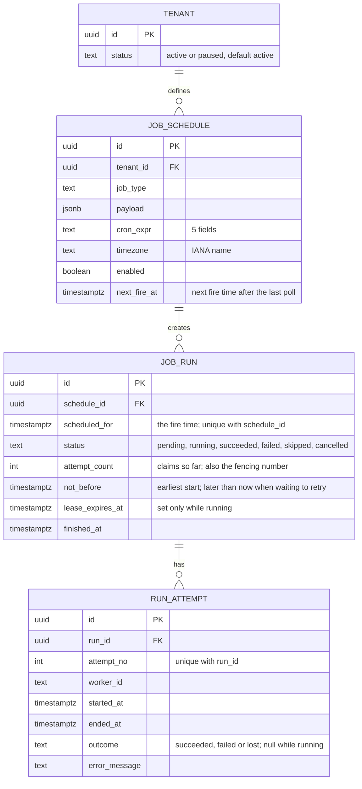

# Scheduled jobs per tenant

Today the app is a Postgres-backed SaaS app with a `tenant` table and nothing for jobs. This design adds four pieces: schedules, runs, attempts, and a pause flag on tenants. Every worker process runs the same loop. It turns due schedules into runs, claims runs, executes them, and cleans up. There is no leader and no scheduler process. Postgres row locks and unique indexes are the only coordination, so any number of workers (3 to 10 today) can run the loop at once.

## Terms

- **Tenant**: a customer account. It is `active` or `paused`.
- **Schedule**: a tenant's recurring job. It has a job type, a JSON payload, a 5-field cron expression and an IANA timezone name such as `Europe/Paris`.
- **Fire time**: one moment a schedule is due, computed from the cron expression in the schedule's timezone and stored as UTC.
- **Run**: what one fire time produces. It has one final status and up to 3 attempts.
- **Attempt**: one try at executing a run, by one worker. It records the worker, start, end and error.
- **Worker id**: a text id each worker process makes up at startup (host, process id, random suffix).
- **In progress**: a run whose status is `pending` or `running`. A `pending` run is either not yet started or waiting to retry.
- **Lease**: the run's `lease_expires_at`. While it is in the future, the run's worker is presumed alive.
- **Heartbeat**: the worker pushes the lease out to now plus 2 minutes, every 30 seconds.
- **Fencing check**: every worker write to a run says `WHERE id = ? AND status = 'running' AND attempt_count = <my attempt number>`. If no row changes, the worker has lost the run and stops.
- **`FOR UPDATE SKIP LOCKED`**: a Postgres row lock. Rows another transaction has locked are skipped, so workers never wait for each other or take the same row.
- **Reaper**: a step every worker runs in its loop. It finds runs whose lease has expired.
- **now()**: always the database clock, never a worker's clock, so worker clock skew cannot matter.

## Tables

Constraints and indexes:
- `job_run` has `UNIQUE (schedule_id, scheduled_for)`. This is what guarantees at most one run per fire time, however many workers notice it.
- `job_run` has a partial unique index on `(schedule_id) WHERE status IN ('pending','running')`. This guarantees at most one run in progress per schedule.
- `run_attempt` has `UNIQUE (run_id, attempt_no)`, and `job_run` and `run_attempt` rows are removed with their parents by `ON DELETE CASCADE` from run to attempt only. A schedule with history cannot be deleted (see open questions).
- Partial indexes serve the loop: `job_schedule(next_fire_at) WHERE enabled`, `job_run(not_before) WHERE status = 'pending'`, `job_run(lease_expires_at) WHERE status = 'running'`, and `job_run(schedule_id, scheduled_for DESC)` for history.

## How it works

Each worker repeats steps 2, 3 and 6 in a loop, every few seconds (5 s is a starting value, not a requirement), plus step 8 occasionally. Step 4 runs beside a job while it executes.

1. **A tenant saves a schedule** (API call). In one transaction the app locks the tenant row, so two simultaneous saves cannot both see 49 schedules and both insert. It then checks:
   - the cron expression has 5 fields and the timezone is a valid IANA name;
   - the tenant has fewer than 50 schedules;
   - the shortest gap between consecutive fire times over the next 7 days is at least 5 minutes.

   It then computes `next_fire_at` as the first fire time after now. Editing the cron or timezone recomputes it the same way. If a check fails, the API rejects the save and writes nothing.

2. **Create runs** (every worker, every loop). In one transaction, the worker selects up to a small batch of schedules that are enabled, belong to an active tenant, and have `next_fire_at <= now()`. It locks them with `FOR UPDATE SKIP LOCKED`, and it also share-locks the tenant row. That share lock stops a pause from slipping in between the check and the insert. For each schedule it does the following:
   - Takes the most recent fire time that is at or before now. Older missed fire times are dropped, with no history row. This is the whole recovery rule after downtime.
   - Inserts a run for that fire time. Its status is `skipped` (with `finished_at` set and no attempts) if the schedule already has a run in progress. Otherwise it is `pending` with `not_before = now()`. `ON CONFLICT DO NOTHING` on the unique pair makes a repeat harmless.
   - Sets `next_fire_at` to the first fire time after now.

   If the transaction fails, it rolls back. The schedule stays due and the next loop retries it.

3. **Claim a run** (every worker, every loop). In one transaction, the worker selects one `pending` run with `not_before <= now()`, using `FOR UPDATE SKIP LOCKED`. It sets the run to `running`, adds 1 to `attempt_count`, and sets `lease_expires_at = now() + 2 minutes`. It also inserts a `run_attempt` row with that attempt number and its worker id. Because the claim and the attempt row commit together, a crash cannot leave one without the other. If there is nothing to claim, the worker moves on.

4. **Execute and heartbeat**. The worker runs the job handler. Every 30 seconds it extends the lease, using the fencing check. If a heartbeat changes no row, the run now belongs to someone else, so the worker stops. If a heartbeat fails because the database is unreachable, the worker tries again at the next beat. If the database stays unreachable for 2 minutes, the reaper will reclaim the run. Handlers are idempotent, so the repeated partial work is acceptable.

5. **Finish an attempt**. In one transaction, the worker updates the run with the fencing check, then closes its attempt row. If the fencing check changes no row, it rolls back, so a worker that was presumed dead cannot overwrite the outcome of the worker that took over.
   - On success, the run becomes `succeeded`.
   - On failure, the attempt is `failed` with the error. If `attempt_count` is below 3 and the schedule is still enabled and the tenant still active, the run goes back to `pending` with `not_before` set to now plus 1 minute (after attempt 1) or 5 minutes (after attempt 2). A used attempt is never given back.
   - If attempt 3 failed, the run is `failed`.
   - If the schedule was disabled or the tenant paused meanwhile, the run becomes `cancelled` instead of retrying.

6. **Reap dead workers** (every worker, every loop). The worker selects `running` runs with `lease_expires_at < now()`, using `FOR UPDATE SKIP LOCKED`. For each one it marks the open attempt `lost` with the error "worker presumed dead", then treats it exactly like a failed attempt in step 5. The attempt was already counted when it was claimed, so a presumed-dead worker uses up one of the 3 attempts. The run becomes `pending` with the same backoff, `failed` after the third, or `cancelled` if the schedule is disabled or the tenant paused. The old worker's later writes fail the fencing check.

7. **Disable, pause or resume** (API call). In one transaction:
   - Disabling a schedule sets `enabled = false`. Pausing a tenant sets `status = 'paused'`. Both then set the status of that schedule's (or tenant's) `pending` runs to `cancelled`. This includes runs waiting to retry. Runs already `running` are left alone and finish normally. A claim that races with this either committed first (the run runs) or finds the run `cancelled`.
   - Re-enabling a schedule, or resuming a tenant (all of its schedules), recomputes `next_fire_at` as the first fire time after now. Without this, step 2 would see an old `next_fire_at` and run the most recent missed fire time, which is the catch-up the requirement forbids.

8. **Clean up history** (every worker, once an hour at most). It deletes `job_run` rows in batches of about 1,000 where `scheduled_for` is older than 90 days and the status is not in progress. It uses `SKIP LOCKED`. Their attempts go with them. Two workers cleaning at once is harmless, and a failed batch is retried next time.

9. **Tenants read history**. They read their runs (fire time `scheduled_for` and final `status`) and each run's attempts (worker, `started_at`, `ended_at`, `error_message`). `skipped` and `cancelled` runs appear with no attempts.

## When things fail

| What happens | Result |
|---|---|
| Several workers see the same fire time | The row lock and the unique pair mean one run. Others skip or conflict harmlessly. |
| Previous run still in progress at a fire time | A `skipped` run is recorded. Nothing executes. |
| No worker up for several fire times | On recovery, only the latest fire time gets a run. Older ones leave no trace. |
| Worker dies mid-run | The lease expires after at most 2 minutes. The reaper marks the attempt `lost` and the run retries, if attempts remain. |
| Worker is presumed dead but still alive | Its heartbeat and finish writes fail the fencing check. It stops. It cannot overwrite the new outcome. |
| Handler fails 3 times | The run is `failed`, with 3 attempts and errors in history. |

## Building and rolling out

1. A migration adds the three tables, their constraints and indexes, and the `status` column on `tenant` (default `active`) if the column does not exist yet.
2. Deploy the worker code. All workers are identical, and a mix of old and new workers is safe because old ones never touch the new tables.
3. Turn on the API that creates schedules.

## Open questions

- There is no maximum run time. A hung handler whose heartbeat keeps going would hold its run in progress forever, so every later fire time of that schedule would be skipped.
- Deleting a schedule is not in the brief. Until it is decided, a schedule with history cannot be deleted. Disable it instead.
- How a fire time behaves when daylight saving time skips or repeats it depends on the cron library chosen, and is not decided.
- The 5 s loop interval is a guess. Fire times can start up to that long late.
