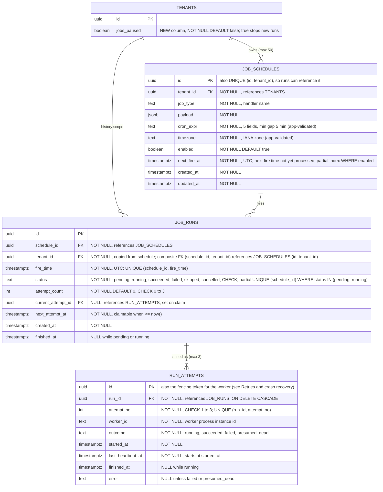

# Scheduled jobs per tenant: data model and runtime design

## Overview

A **tenant** is one of our customer accounts. Each tenant defines **schedules**, such as "send the weekly digest every Monday at 09:00 Berlin time". A schedule names a **job type** (the code that does the work), carries a JSON **payload** (settings passed to that code), and has a **cron expression** (the recurrence pattern) and a **timezone**. We run each schedule's job at its **fire times**.

Three to ten identical **worker** processes run the same code. There is no leader and no separate scheduler: no process is in charge of the others. The only shared infrastructure is our Postgres database. There is no Redis and no message broker. The workers coordinate only through database row locks and database constraints.

Each worker wakes up every 15 seconds (a **tick**) and does three things:

1. **Create runs** for schedules whose fire time has arrived.
2. **Claim** a pending run and execute it.
3. **Reap** runs whose worker has gone silent, so another worker can retry them.

In short: each schedule is one row, each fire time gets one **run** row, and each try at executing a run gets one **attempt** row.

## Key terms

- **Schedule:** a recurring job definition: a job type, a JSON payload, a cron expression and a timezone.
- **Fire time:** one scheduled moment, stored in UTC (Coordinated Universal Time, a fixed clock with no seasonal changes).
- **Run:** the record of one fire time. Each fire time produces at most one run.
- **Attempt:** one try at executing a run. A run gets at most 3 attempts.
- **Heartbeat:** a periodic "I am still working" update that a worker writes to its attempt.
- **Presumed dead:** an attempt whose heartbeat is more than 2 minutes old. We assume its worker crashed.
- **Backoff:** the wait before a retry.
- **Idempotent:** a handler is idempotent if running it twice has the same effect as running it once. So a retry that repeats partial work is safe.
- **Transaction:** a group of database changes that either all happen or none do.
- **Row lock:** a lock on one database row. `FOR UPDATE` takes the lock. `FOR UPDATE SKIP LOCKED` means "lock the rows I can get, and skip rows another worker has already locked, without waiting."
- **Unique constraint:** a rule the database enforces, so two rows cannot share the same values. A **partial** unique index applies the rule only to rows that match a condition.
- **Fencing token:** a value that proves a worker still has the right to write. Here it is the attempt's ID.
- **Reaper:** the cleanup step each worker runs on every tick, to find attempts whose worker has gone silent.
- **Cron expression:** a 5-field recurrence pattern. For example, `0 9 * * 1` means minute 0, hour 9, on Mondays (weekday 1): 09:00 every Monday.
- **IANA timezone:** a named zone such as `Europe/Berlin`. It knows the local clock changes for daylight saving time (DST).

## Entity diagram



## What the statuses mean

**Run status** (`job_runs.status`):

- `pending`: waiting to start. This includes a run waiting for its next retry.
- `running`: an attempt is in progress.
- `succeeded`, `failed`, `skipped`, `cancelled`: finished. `finished_at` is set.
  - `succeeded`: the handler finished successfully.
  - `failed`: all 3 attempts failed.
  - `skipped`: a fire time arrived while an earlier run was still pending or running. The skipped run never executes.
  - `cancelled`: a run that had not started was stopped because its schedule was disabled or its tenant was paused.

**Attempt outcome** (`run_attempts.outcome`):

- `running`: the worker holds the attempt and is working.
- `succeeded` or `failed`: the handler finished, one way or the other.
- `presumed_dead`: the worker stopped sending heartbeats, so another worker may retry.

**Attempts are optional.** A `pending`, `skipped` or `cancelled` run can have zero attempts, because it never started. A `running` run always has at least one attempt.

## Life of a run

1. A fire time arrives. A `pending` run is created, or a `skipped` run if an earlier run is still active.
2. A worker claims the `pending` run. It becomes `running`, and a new attempt starts.
3. If the handler succeeds, the run becomes `succeeded`.
4. If the handler fails, or the worker goes silent and is presumed dead, the attempt is recorded as failed or presumed dead. If attempts remain, the run goes back to `pending` and waits for its backoff. Otherwise it becomes `failed`.
5. If the schedule is disabled or the tenant is paused while the run is `pending`, it becomes `cancelled`. A `running` run is not touched.

## How the schema meets the fixed requirements

- **One run per fire time:** `UNIQUE (schedule_id, fire_time)` on `job_runs` blocks duplicates. Workers also lock the schedule row before inserting a run (see Run creation), so two workers never race to create the same run.
- **One active run per schedule:** a partial unique index on `job_runs (schedule_id)` for rows whose status is `pending` or `running`. "Active" includes `pending` because a run waiting for its retry is still the schedule's current run. `skipped` and finished rows are outside the index, so they can be inserted while a run is active.
- **Attempt cap:** `CHECK (attempt_count <= 3)`, `CHECK (attempt_no BETWEEN 1 AND 3)` and `UNIQUE (run_id, attempt_no)` stop a run from getting a fourth attempt, or two attempts with the same number.
- **50 schedules per tenant:** a `BEFORE INSERT` trigger on `job_schedules` locks the tenant row (`SELECT ... FOR UPDATE`), counts the tenant's existing schedules and rejects the insert at 50. The lock also makes concurrent creates for the same tenant wait for each other. The application can do the same count inside its own transaction instead.
- **5-minute minimum and valid timezone:** the application checks both when a schedule is saved, using a cron library. A database `CHECK` cannot read cron syntax. An optional stored `min_gap_seconds` column with `CHECK (min_gap_seconds >= 300)` would make the rule visible to the database.
- **Clocks:** every timestamp comes from the database's clock (`now()`), never from a worker's clock. If worker clocks drift, the workers still agree on the time. Fire times are stored in UTC and computed from the schedule's own timezone.

## Run creation

Every worker runs a tick every 15 seconds. That is far shorter than the 5-minute minimum gap between fire times, so a due run is noticed within seconds. Each tick does the following in one transaction:

1. Select the due schedules: `enabled`, tenant not paused, and `next_fire_at <= now()`. Use `FOR UPDATE SKIP LOCKED`. Rows that another worker has already locked are skipped, not waited for. So each schedule is handled by one worker at a time.
2. For each schedule, compute L, the latest fire time that is `<= now()`. Fire times between the old `next_fire_at` and L are dropped silently, with no history row. This implements "only the most recent missed fire time runs".
3. Check whether the schedule has a `pending` or `running` run.
   - If it does, insert a row for L with `status = 'skipped'` and `finished_at = now()`.
   - If it does not, insert a row for L with `status = 'pending'` and `next_attempt_at = now()`.
   - Both inserts use `ON CONFLICT (schedule_id, fire_time) DO NOTHING`. If a row for L already exists, the insert does nothing.
4. Set `next_fire_at` to the first fire time after `now()`, then commit.

**Why this creates no duplicates:** the row lock means only one worker processes a given schedule at a time, so the active-run check and the insert cannot race. The unique constraints are a backstop in case that ever fails.

**Enabling a schedule or resuming a tenant** recomputes `next_fire_at` as the first fire time after `now()`. The tick ignores disabled schedules and does not advance them, so re-enabling never fills in missed fire times. `next_fire_at` only moves forward, so a fire time that was dropped can never be created again.

**Daylight saving time:** a local time that does not exist (clocks jump forward) fires at the next valid instant. A local time that happens twice (clocks fall back) fires once.

## Claiming

A worker claims a run in one transaction. A run is **claimable** when it may start now.

1. Lock one claimable run with `FOR UPDATE SKIP LOCKED`. A run is claimable when:
   - its status is `pending`,
   - `next_attempt_at <= now()`,
   - its schedule is enabled, and
   - its tenant is not paused.

   The enabled and not-paused checks are part of the same claim statement, so a run cannot start after a disable or pause has committed.
2. Set the run's status to `running` and increment `attempt_count`.
3. Insert a `run_attempts` row with `outcome = 'running'`, the `worker_id`, `started_at = now()` and `last_heartbeat_at = now()`.
4. Set `current_attempt_id` to the new attempt.

## Heartbeats

While a handler runs, the worker updates its attempt every 30 seconds:

```sql
UPDATE run_attempts SET last_heartbeat_at = now()
WHERE id = :attempt AND outcome = 'running'
```

If zero rows change, the attempt is no longer `running`. Another worker or the reaper has taken it over. The worker stops its handler as soon as it can and never writes an outcome. Handlers are idempotent, so a little extra work before it stops is harmless.

## Retries and crash recovery

**Handler failure.** In one transaction, mark the attempt `failed` with `finished_at` and `error`. Then:

- If `attempt_count < 3`, set the run back to `pending` with `next_attempt_at = now() + backoff`. The backoff is 1 minute after attempt 1 and 5 minutes after attempt 2.
- Otherwise, set the run to `failed` with `finished_at = now()`.

**Presumed-dead worker.** Each tick also runs the reaper. The reaper finds attempts whose `outcome` is `running` and whose `last_heartbeat_at` is more than 2 minutes old. It locks them with `SKIP LOCKED` and marks each one `presumed_dead`, with `finished_at` and an error such as "no heartbeat for 2 minutes". Then it applies the same run transition as a failure. The dead attempt counts as one of the 3 attempts.

**Fencing.** Every write from a worker has the form `WHERE id = :attempt AND outcome = 'running'`. The attempt's ID is the fencing token. Once the reaper has marked an attempt `presumed_dead`, a late success or failure from the old worker matches zero rows, so it cannot overwrite the outcome. The run row is changed only in the same transaction, and only when the attempt update matched. If the old worker and the reaper race, the row lock makes one wait for the other. The second one then sees that the outcome is no longer `running`.

**Backoff timing.** The backoff is counted from the moment the failure or presumed death is recorded. A retry may therefore start a little after the exact 1-minute or 5-minute mark. This is an interpretation to confirm (see Decisions to confirm).

## Pausing and disabling

- **Disable a schedule:** in one transaction, set `enabled = false` and set the schedule's `pending` runs to `cancelled` with `finished_at = now()`.
- **Pause a tenant:** set `tenants.jobs_paused = true` and do the same for all of that tenant's schedules.
- **Running runs are not touched.** They finish normally. A worker that claimed a run just before the commit is already running, so it also finishes.
- **Runs waiting for a retry** have status `pending`, so they are cancelled too. This treats a run between attempts as not started. This is an interpretation to confirm.
- **Resume or re-enable:** recompute `next_fire_at` as described above. Nothing is caught up.

## History and retention

- **History query:** the tenant's `job_runs`, newest `fire_time` first, each joined to its `run_attempts` ordered by `attempt_no`. The `(tenant_id, fire_time DESC)` index serves this query.
- **Cleanup:** a daily cleanup job deletes old runs in batches. Postgres's plain `DELETE` has no `LIMIT`, so each batch selects its rows first:
  ```sql
  DELETE FROM job_runs
  WHERE id IN (
    SELECT id FROM job_runs
    WHERE fire_time < now() - interval '90 days' AND finished_at IS NOT NULL
    LIMIT 1000
  )
  ```
  Active runs have `finished_at` NULL, so they are never deleted. Their `run_attempts` rows are removed by `ON DELETE CASCADE`.
- **Volume option:** monthly range partitions on `fire_time`, with old partitions dropped after 90 days, avoid large deletes entirely.
- **Dropped missed fire times** never get rows, so they need no cleanup.

## Index summary

- `job_schedules`:
  - index on `tenant_id`;
  - partial index on `next_fire_at WHERE enabled`, for the tick's due-schedule query.
- `job_runs`:
  - `UNIQUE (schedule_id, fire_time)`;
  - partial `UNIQUE (schedule_id) WHERE status IN ('pending', 'running')`;
  - partial index on `(next_attempt_at) WHERE status = 'pending'`, for claims;
  - `(tenant_id, fire_time DESC)`, for history;
  - `(fire_time)`, for retention.
- `run_attempts`:
  - `UNIQUE (run_id, attempt_no)`;
  - partial index on `(last_heartbeat_at) WHERE outcome = 'running'`, for the reaper.

## Decisions to confirm

1. **Runs waiting for a retry are cancelled on disable or pause.** The brief only says runs not yet started are cancelled. This design treats a run between attempts as not started.
2. **Backoff is counted from when the failure or presumed death is recorded,** not from when the last attempt started.
3. **The tick interval (15 seconds) is a design choice.** It only needs to be well under the 5-minute minimum gap.