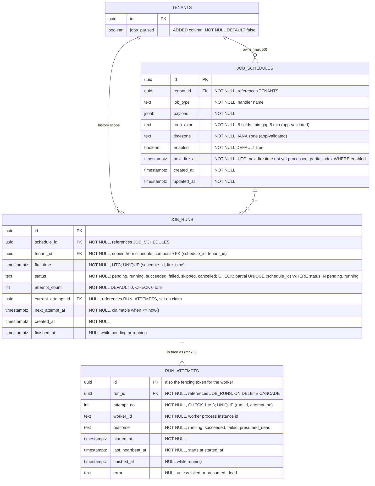

# Scheduled jobs per tenant: data model and runtime design

## Entity diagram

## How the schema meets the fixed requirements

- **One run per fire time:** `UNIQUE (schedule_id, fire_time)` on `job_runs`, plus the row lock on the schedule during run creation (see below). The lock means two workers never both create a run for the same fire time.
- **One in-progress run per schedule:** a partial unique index on `job_runs (schedule_id) WHERE status IN ('pending', 'running')`. `pending` counts as in progress because a run waiting for its retry is still the schedule's current run. `skipped` is outside the index, so skipped rows can be inserted while a run is active.
- **Attempt cap:** `CHECK (attempt_count <= 3)`, `CHECK (attempt_no BETWEEN 1 AND 3)`, `UNIQUE (run_id, attempt_no)`.
- **50 schedules per tenant:** a `BEFORE INSERT` trigger on `job_schedules` that locks the tenant row (`SELECT ... FOR UPDATE`) and counts existing rows. The lock also serializes concurrent creates for the same tenant. The application can do the same check inside its transaction instead.
- **5-minute minimum and valid timezone:** checked when a schedule is written, using a cron library. A database `CHECK` cannot evaluate cron. An optional stored `min_gap_seconds` column with `CHECK (min_gap_seconds >= 300)` would make the rule visible to the database.
- **Clocks:** every timestamp comes from the database `now()`, never from worker clocks. Fire times are stored in UTC and computed from the schedule's timezone.

## Run creation

Every worker runs a tick, for example every 15 seconds, which is well under the 5-minute minimum interval:

1. Begin a transaction and select due schedules: `enabled`, tenant not paused, `next_fire_at <= now()`, using `FOR UPDATE SKIP LOCKED`.
2. For each one, compute the latest fire time L that is `<= now()`. Fire times between the old `next_fire_at` and L are dropped silently with no history row. This is the "only the most recent missed fire time runs" rule.
3. Check for an active run (`pending` or `running`) on the schedule.
   - If one exists, insert a run for L with `status = 'skipped'` and `finished_at = now()`.
   - Otherwise insert a run for L with `status = 'pending'` and `next_attempt_at = now()`.
   - Use `ON CONFLICT (schedule_id, fire_time) DO NOTHING`.
4. Set `next_fire_at` to the first fire time after `now()`, then commit.

Enabling a schedule or resuming a tenant recomputes `next_fire_at` as the first fire time after `now()`. Disabled schedules are ignored by the tick and are not advanced, so re-enabling never backfills. `next_fire_at` only moves forward, so a fire time that was dropped or cleaned up can never be recreated.

DST: a local time that does not exist (spring forward) fires at the next valid instant. A repeated local time (fall back) fires once.

## Claiming

A worker claims in one transaction:

- Lock one claimable run with `FOR UPDATE SKIP LOCKED`. Claimable means `status = 'pending'`, `next_attempt_at <= now()`, the schedule is enabled, and the tenant is not paused.
- Set `status = 'running'`, increment `attempt_count`, and insert a `run_attempts` row with `outcome = 'running'`, `worker_id`, `started_at = now()`, and `last_heartbeat_at = now()`.
- Set `current_attempt_id` to the new attempt.

The enabled and unpaused checks sit in the same statement as the claim. A run therefore cannot start after a disable or pause commits.

## Heartbeats

A running worker updates every 30 seconds:

`UPDATE run_attempts SET last_heartbeat_at = now() WHERE id = :attempt AND outcome = 'running'`

If zero rows match, the lease is gone. The worker stops its handler where it can and never writes an outcome. Handlers are idempotent, so partial work that continues briefly is acceptable.

## Retries and crash recovery

**Handler failure:** in one transaction, set the attempt to `failed` with `finished_at` and `error`. Then:

- If `attempt_count < 3`, set the run to `pending` with `next_attempt_at = now() + backoff`, where backoff is 1 minute after attempt 1 and 5 minutes after attempt 2.
- Otherwise set the run to `failed` with `finished_at = now()`.

**Presumed-dead worker:** each tick also runs a reaper. It finds attempts with `outcome = 'running'` and `last_heartbeat_at < now() - 2 minutes`, locked with `SKIP LOCKED`. It sets those attempts to `presumed_dead` with `finished_at` and an error such as "no heartbeat for 2 minutes". Then it applies the same run transition as the failure path. The dead attempt counts toward the 3 attempts.

**Fencing:** every attempt write is `WHERE id = :attempt AND outcome = 'running'`. The run is updated only in the same transaction, and only when that attempt row matched. The reaper's change to `presumed_dead` therefore makes a late success or failure from the zombie worker match zero rows, so it is discarded. If the zombie and the reaper race, the row lock serializes them and the second writer sees `outcome <> 'running'`.

The backoff is measured from the moment the failure or presumed death is recorded, so the retry may land slightly after the exact 1 or 5 minute mark. This is an interpretation to confirm.

## Pausing and disabling

- **Disable a schedule:** in one transaction, set `enabled = false` and set `pending` runs for that schedule to `cancelled` with `finished_at = now()`.
- **Pause a tenant:** set `tenants.jobs_paused = true` and do the same for all of that tenant's schedules.
- **Running runs** are not touched. They finish normally.
- **Runs waiting for a retry** have `status = 'pending'`, so they are cancelled. This treats a run between attempts as not started. It is an interpretation to confirm.
- **A worker that claimed just before the commit** is already running and finishes normally.
- **Resume or re-enable** recomputes `next_fire_at` as described above, with no catch-up.

## History and retention

- **History query:** `job_runs WHERE tenant_id = ? ORDER BY fire_time DESC`, joined to `run_attempts ORDER BY attempt_no`. This needs an index on `(tenant_id, fire_time DESC)`.
- **Cleanup:** a daily batched job runs `DELETE FROM job_runs WHERE fire_time < now() - interval '90 days' AND finished_at IS NOT NULL`, with a LIMIT per batch. Active runs have `finished_at` NULL, so they are never deleted. `run_attempts` cascades through `ON DELETE CASCADE`.
- **Volume option:** monthly range partitions on `fire_time`, dropping partitions older than 90 days, avoids large deletes.
- **Dropped missed fire times** never get rows, so they need no cleanup.

## Index summary

- `job_schedules`: index on `tenant_id`; partial index on `next_fire_at WHERE enabled`.
- `job_runs`: `UNIQUE (schedule_id, fire_time)`; partial `UNIQUE (schedule_id) WHERE status IN ('pending', 'running')`; partial index on `(next_attempt_at) WHERE status = 'pending'` for claims; `(tenant_id, fire_time DESC)` for history; `(fire_time)` for retention.
- `run_attempts`: `UNIQUE (run_id, attempt_no)`; partial index on `(last_heartbeat_at) WHERE outcome = 'running'` for the reaper.

## Decisions to confirm

1. Runs waiting for a retry are cancelled on disable or pause. The brief only covers runs not yet started.
2. Backoff is measured from when the failure or presumed death is recorded, not from the exact time the last attempt started.
3. The tick interval (15 seconds here) is a design choice. It only needs to be well under 5 minutes.