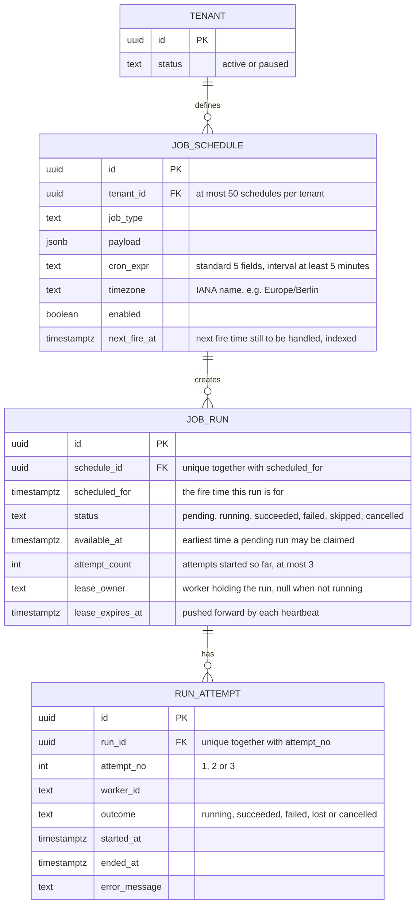

## Scheduled jobs per tenant

Tenants (our customer accounts) define recurring jobs, such as "send the weekly digest". Each job runs on that tenant's schedule.

The system runs as several identical worker processes that share one Postgres database. Nothing else is shared: no Redis, no message broker, and no leader or separate scheduler process. Workers coordinate only through rows in Postgres. Every worker can do every part of the work, and no worker is in charge.

The work happens in three stages:

1. A worker turns due schedules into runs.
2. A worker claims a pending run and executes it. While it works, it renews its claim (its lease). When it finishes, it records the outcome only if it still owns the run.
3. A periodic check, the reaper, finds runs whose worker has died so that another worker can retry them.

### Terms

- **Schedule**: a tenant's recurring job. It has a job type (which handler to run), a JSON payload (the input data for that handler), a cron expression, and a timezone.
  - The cron expression is a standard 5-field pattern: minute, hour, day of month, month, day of week. For example, `0 9 * * 1` means 09:00 every Monday.
  - The timezone is an IANA name such as `Europe/Berlin`. Cron times are read in that timezone, so "09:00 on Monday" means 09:00 local time in Berlin, including across daylight saving changes.
- **Fire time**: one moment a schedule is due, for example "Monday 09:00 in Europe/Berlin".
- **Run**: the one planned execution for one fire time. Each fire time produces at most one run.
- **Attempt**: one try at a run by one worker. A run gets at most 3 attempts.
- **Lease**: a worker's claim on a run. It expires 2 minutes after the worker's last heartbeat, unless the worker renews it.
- **Heartbeat**: a lease renewal. A running worker renews its lease every 30 seconds.
- **Reaper**: a periodic check, run by any worker, that finds runs whose lease has expired.
- **Fence**: an ownership check on every write a worker makes to a run. The check confirms that the worker ID and attempt count the worker received when it claimed the run still match the stored values. A worker that no longer owns the run fails the check, and its write changes nothing.

Database terms used below:

- **Transaction**: a group of database statements that either all take effect or none do.
- **Unique constraint**: the database refuses two rows that have the same values in the listed columns.
- **`FOR UPDATE SKIP LOCKED`**: when a worker selects rows, it locks them so no other worker can take them at the same time. Rows that another worker has already locked are skipped, not waited for. This is how workers avoid grabbing the same work.
- **`ON CONFLICT DO NOTHING`**: when an insert would break a unique constraint, the database skips the insert instead of failing.
- **Cascade delete**: deleting a parent row also deletes its child rows.
- **Partial index**: an index that covers only the rows matching a condition. It is small and fast to search.

### Schema

The `TENANT` table already exists. The other three tables are new.

Key constraints:

- `JOB_RUN (schedule_id, scheduled_for)` is unique. This guarantees at most one run per fire time, even when several workers notice the same fire time.
- `RUN_ATTEMPT (run_id, attempt_no)` is unique.
- Deleting a run deletes its attempts (`ON DELETE CASCADE`).
- The 50-schedule limit and the 5-minute minimum interval are checked when a schedule is saved.

### How it works

**Creating runs.** Every worker polls in a loop and looks for due schedules. A schedule is due when `next_fire_at` is at or before the current time. For each due schedule, the worker does the following in one transaction, so all the changes commit together or not at all:

1. Select schedules that are enabled, belong to an active tenant, and have `next_fire_at <= now()`. Lock them with `FOR UPDATE SKIP LOCKED`. Each schedule is then handled by only one worker at a time.
2. If several fire times have passed, for example because no worker was running, keep only the most recent one. Drop the older ones without creating any history entries.
3. If an earlier run of the same schedule is still `pending` or `running`, insert the new run with status `skipped`. A skipped run is never executed and has no attempts. Otherwise, insert it as `pending` with `available_at` set to its fire time. A run waiting for a retry is still `pending`, so a fire time that arrives during that wait is also skipped.
4. Insert with `ON CONFLICT DO NOTHING` on `(schedule_id, scheduled_for)`. If another worker already created the run for this fire time, the insert does nothing and no duplicate is made.
5. Set `next_fire_at` to the first fire time after the current time, computed in the schedule's timezone.

**Claiming runs.** A worker claims one pending run with a single database statement, so the claim either fully happens or does not happen at all. The statement picks the oldest run with `status = 'pending'` and `available_at <= now()`, using `FOR UPDATE SKIP LOCKED` so that workers do not compete for the same run. In that same statement, it:

- sets `status = 'running'`,
- sets `lease_owner` to the worker's ID,
- sets `lease_expires_at` to now plus 2 minutes,
- increments `attempt_count`,
- inserts a `RUN_ATTEMPT` row with outcome `running`.

The worker starts the job only after the claim succeeds. Each process uses its own worker ID, for example hostname, process ID, and a random suffix.

**Heartbeats.** While a job runs, the worker renews its lease every 30 seconds. A renewal sets `lease_expires_at` to now plus 2 minutes. The renewal applies only if `lease_owner` and `attempt_count` still match the values the worker received when it claimed the run. If the update changes no rows, the worker has lost the run. It stops working on the run and records no outcome.

**Finishing and retries.** When the job ends, the worker writes its result only if the fence check still passes. A worker that lost its lease therefore cannot overwrite the outcome recorded by the worker that took over.

- On success, the attempt becomes `succeeded` and the run becomes `succeeded`.
- On failure, the attempt becomes `failed` and `error_message` is set. Then:
  - If `attempt_count` is below 3, the run goes back to `pending`, and `available_at` is set to now plus the wait. The wait is 1 minute before attempt 2 and 5 minutes before attempt 3.
  - If `attempt_count` is 3, the run becomes `failed`.

**Crash recovery.** If a worker dies, its run stays `running` and its lease runs out. The reaper looks for `running` runs whose `lease_expires_at` is in the past. For each one, it runs a single update that checks again that the lease is expired, so two reapers cannot both act on the same run. The update:

- marks the dead worker's attempt `lost`,
- clears `lease_owner`,
- applies the failure rule above. The run goes back to `pending` after the wait, or becomes `failed` if `attempt_count` is already 3.

A lost attempt counts toward the 3-attempt limit. If the dead worker wakes up later, its fence check no longer matches, so its writes change nothing.

The fence checks `attempt_count` as well as `lease_owner`. Every claim increments `attempt_count`, so an old worker cannot match the run even if it has the same worker ID as a newer one.

**Overlaps and missed fire times.** Both are handled when runs are created. A new fire time is skipped while an earlier run is pending or running. Missed fire times collapse to the most recent one.

**Pausing, disabling, and resuming.**

- When a schedule is disabled, or its tenant is paused, the same transaction marks that schedule's (or tenant's) `pending` runs as `cancelled`. Cancelled runs stay in history.
- Runs that are already `running` are not touched. They finish normally.
- Creating and claiming runs also skip disabled schedules and paused tenants. So nothing new starts even if a cancellation was missed.
- When a schedule is re-enabled or a tenant is resumed, `next_fire_at` is set to the first fire time after now. Fire times that passed while paused are not run and get no history entries.

**History and cleanup.** Tenants can see every run with its fire time and final status. They can also see every attempt with its worker, start and end times, and error. A periodic job deletes runs whose `scheduled_for` is more than 90 days old and whose status is neither `pending` nor `running`. Their attempts are deleted with them through the cascade. The job deletes in small batches so it does not lock the tables for long.

**Indexes.**

- `JOB_SCHEDULE(next_fire_at)` is a partial index covering only enabled schedules. It keeps the search for due schedules fast.
- `JOB_RUN(status, available_at)` supports claiming.
- `JOB_RUN(status, lease_expires_at)` supports the reaper.