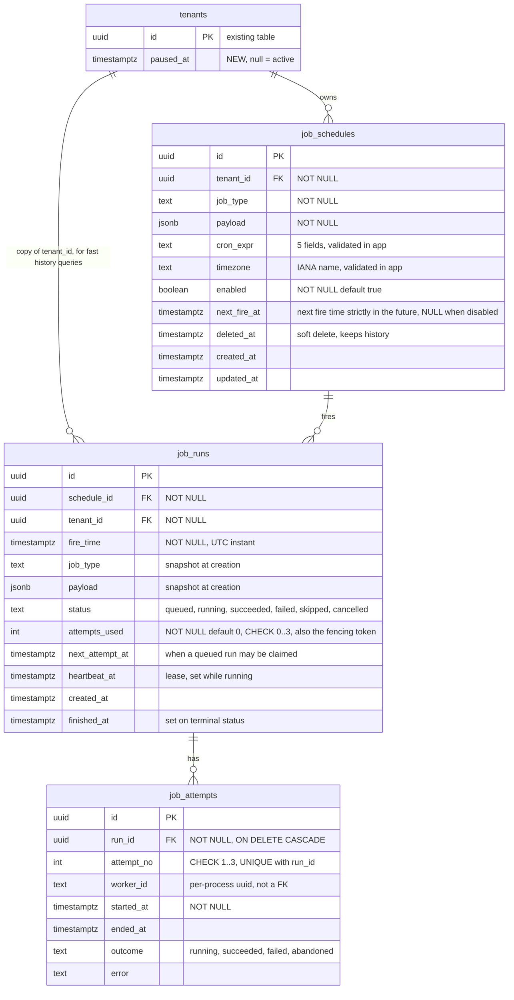

# Scheduled jobs per tenant: data model and mechanics

## Overview

Tenants define recurring jobs. Every worker process runs the same loop against Postgres. Postgres row locks and unique constraints do all the coordination. There is no leader, no scheduler process and no broker.

Terms used below:

- **Schedule**: a tenant's recurring job definition (cron expression, timezone, job type, payload).
- **Fire time**: one moment at which a schedule is due.
- **Run**: the record of one fire time. It ends up executed (`succeeded` or `failed`), `skipped` or `cancelled`.
- **Attempt**: one try at executing a run. A run has at most 3.
- **Lease**: a running run's claim on its worker. The worker keeps it alive by updating a heartbeat timestamp.
- **Reaper**: the step of the worker loop that finds runs whose lease expired.
- **Stale worker**: a worker that was presumed dead and replaced, but is in fact still running its handler.
- **Fence**: a `WHERE` condition that makes a stale worker's writes match zero rows (see "Finishing and fencing"). The fencing token is `job_runs.attempts_used`. It increases with every claim, so a worker holding an old value no longer matches.

Two Postgres features appear throughout. `FOR UPDATE SKIP LOCKED` selects and locks rows, and skips rows that another transaction already holds locked instead of waiting for them. So workers never block each other. `FOR SHARE` on a row allows other `FOR SHARE` locks but conflicts with updates to that row. We use it on the tenant row so that a pause and a run creation cannot interleave.

Every worker repeats this loop every few seconds, with jitter:

1. create due runs (the "fire" step);
2. claim a run;
3. reap dead runs;
4. occasionally, clean up old data.

All time comparisons use the database `now()`, never worker clocks. Clock skew between workers therefore cannot cause early expiry or double firing.

## ER diagram



Statuses: `queued` (waiting to be claimed, including waiting out a retry delay), `running`, and the terminal statuses `succeeded`, `failed`, `skipped` and `cancelled`. "In progress" means `queued` or `running`.

Attempt outcomes: `running`, `succeeded`, `failed`, and `abandoned` (the worker was presumed dead).

**Constraints and indexes not shown above**

- `job_runs` has `UNIQUE (schedule_id, fire_time)`. This guarantees at most one run per fire time.
- `job_runs` has a partial unique index `UNIQUE (schedule_id) WHERE status IN ('queued','running')`. This guarantees at most one in-progress run per schedule.
- `job_attempts` has `UNIQUE (run_id, attempt_no)`.
- `job_runs.status` and `job_attempts.outcome` have CHECK constraints on their allowed values.
- `job_runs.schedule_id` is `ON DELETE RESTRICT`. Schedules are soft-deleted (`deleted_at` set, `enabled=false`) so history survives.
- Polling indexes:
  - `job_schedules (next_fire_at) WHERE enabled AND deleted_at IS NULL`
  - `job_runs (next_attempt_at) WHERE status='queued'`
  - `job_runs (heartbeat_at) WHERE status='running'`
  - `job_runs (tenant_id, fire_time DESC)` for the history UI
  - `job_runs (fire_time)` for cleanup
- The 50-schedule limit is enforced in the create transaction. It takes `pg_advisory_xact_lock(hash(tenant_id))`, counts the tenant's schedules where `deleted_at IS NULL`, then inserts. The lock makes two concurrent creates for one tenant run one after the other.
- Postgres cannot check the 5-field cron format, the IANA timezone or the 5-minute minimum interval declaratively. Application code validates them on create and update. The interval check computes the smallest gap between consecutive fire times over a long look-ahead window.

## How it works

### Run creation (the "fire" step)

One transaction does the following:

1. Select due schedules with `FOR UPDATE SKIP LOCKED`. Due means `enabled`, not deleted, and `next_fire_at <= now()`. A schedule locked by another worker is skipped.
2. For each schedule, take `FOR SHARE` on its tenant row and skip the schedule if `paused_at` is set. Pausing updates the same row, which conflicts with that lock, so a pause and a fire are strictly ordered.
3. Compute the most recent fire time at or before `now()` in the schedule's timezone, using the cron library's "previous fire" function. Older missed fire times are dropped without a history entry.
4. Insert the run with `ON CONFLICT (schedule_id, fire_time) DO NOTHING`. Copy `job_type`, `payload` and `tenant_id` from the schedule onto the run. `job_type` and `payload` are a snapshot, so later edits to the schedule do not change this run.
   - If the schedule already has a `queued` or `running` run, insert the new run as `skipped`, with `finished_at = now()` and no attempts.
   - Otherwise insert it as `queued` with `next_attempt_at = now()`.
5. Set the schedule's `next_fire_at` to the first fire time after `now()`, and commit.

Three things guarantee at most one run per fire time. The schedule row is locked. `next_fire_at` advances in the same transaction. The unique constraint backs both up. The partial unique index likewise backs up the one-in-progress rule, even if the check in step 4 were raced.

Fire times are stored as UTC instants. At a DST change, some local times do not exist and others occur twice. We follow the cron library's rule for these and test it.

### Claiming

A worker selects one `queued` run with `next_attempt_at <= now()`, using `FOR UPDATE SKIP LOCKED`. In the same transaction it:

- sets `status='running'`, `attempts_used = attempts_used + 1`, and `heartbeat_at = now()`;
- inserts a `job_attempts` row with `attempt_no = attempts_used` (the new value), its `worker_id`, `started_at`, and `outcome='running'`.

The worker remembers the new `attempts_used` value as its attempt number. It then runs the handler outside the transaction.

The claim re-checks `status='queued'` after taking the row lock. If a pause or disable cancelled the run concurrently, the worker gets zero rows, so the claim and the cancellation never both succeed.

### Heartbeats

Every 30 seconds the worker runs:

```sql
UPDATE job_runs SET heartbeat_at = now()
WHERE id = :run AND status = 'running' AND attempts_used = :my_attempt_no
```

If zero rows are updated, the worker has lost its lease. It must stop and discard its result. The 2-minute timeout allows about four missed beats before the worker is presumed dead.

### Finishing and fencing

When the handler ends, the worker, in one transaction:

- updates its attempt `WHERE id = :attempt AND outcome='running'`, setting `ended_at`, `outcome` and `error`;
- updates the run `WHERE id = :run AND status='running' AND attempts_used = :my_attempt_no`. On success it sets `status='succeeded'` and `finished_at`. On failure it applies the retry rule below.

If either update affects zero rows, the worker was presumed dead and replaced. It writes nothing and rolls back. This is the fence. The reaper marks the old attempt `abandoned`, and the takeover's claim increments `attempts_used`. A stale worker therefore matches neither `WHERE` clause and cannot overwrite the new worker's outcome.

### Retries

After a failed attempt, the worker or the reaper applies the same rule. It is one shared function, so both paths behave identically:

- If `attempts_used >= 3`, set `status='failed'` and `finished_at = now()`.
- Otherwise set `status='queued'`, clear `heartbeat_at`, and set `next_attempt_at = now() + interval '1 minute'` after attempt 1, or `now() + interval '5 minutes'` after attempt 2.

The run stays in progress while it waits, because `queued` falls under the partial unique index. A fire time that arrives during a retry wait is therefore recorded as `skipped`. Backoff is measured from when the failure was recorded. For a dead worker, that is when the reaper noticed, which is up to a few seconds past the 2-minute mark.

### Crash recovery

- **Dead worker.** Any worker periodically selects runs where `status='running' AND heartbeat_at < now() - interval '2 minutes'`, using `FOR UPDATE SKIP LOCKED`. For each one it closes the current attempt as `abandoned` with the error "worker presumed dead" and `ended_at = now()`, then applies the retry rule. A presumed-dead worker therefore uses up one of the 3 attempts.
- **No worker up for several fire times.** When workers return, the fire step finds the schedule overdue. It creates a run only for the most recent missed fire time and silently drops the earlier ones. If the schedule still has an in-progress run, the new run is recorded as `skipped`. Stale `running` rows are reaped as above.
- **Worker dies between claim and handler start.** This looks like any other dead worker, because the heartbeat was set at claim.

### Pausing, disabling, resuming

"Unstarted" below means `status='queued' AND attempts_used=0`: queued and never attempted.

- **Disable a schedule.** In one transaction, set `enabled=false` and `next_fire_at=NULL`. Also cancel its unstarted runs: set `status='cancelled'` and `finished_at=now()`. The schedule row lock serializes this against the fire step. Running runs finish normally.
- **Pause a tenant.** In one transaction, set `tenants.paused_at=now()` and cancel the unstarted runs of all the tenant's schedules. The fire step holds `FOR SHARE` on the tenant row, so no run can be created after the pause commits.
- **Re-enable or resume.** Re-enabling sets `next_fire_at` to the first fire time after `now()`. Resuming clears `paused_at` and recomputes `next_fire_at` the same way for all of the tenant's enabled schedules. Missed fire times are never caught up.
- **Edit cron or timezone.** This also recomputes `next_fire_at`.
- **Delete a schedule.** This is a soft delete: disable it and set `deleted_at`.

**Assumption to confirm:** a run that has used an attempt and is waiting out its retry delay counts as "already started". It keeps retrying after a disable or pause, and only runs with `attempts_used=0` are cancelled. If product wants waiting retries cancelled too, drop the `attempts_used=0` condition. Nothing else in the design changes.

### History and cleanup

- Tenants read history from `job_runs` (fire time and final status), joined to `job_attempts` for each attempt's worker, start and end times, and error. `skipped` and `cancelled` runs have no attempts. Silently dropped missed fire times have no rows, as required.
- Cleanup can run on any worker, but it takes `pg_try_advisory_lock` so only one runs at a time. It deletes in batches (for example 1000 rows, `FOR UPDATE SKIP LOCKED`) from `job_runs` where `fire_time < now() - interval '90 days'` and the status is terminal (`succeeded`, `failed`, `skipped` or `cancelled`). `ON DELETE CASCADE` removes the attempts with them. It then hard-deletes soft-deleted schedules that have no remaining runs.

## Known limits and trade-offs

- Start latency is bounded by the poll interval, a few seconds. That is fine for minute-granularity cron.
- A handler may run more than once if a worker is wrongly presumed dead, for example after a long GC pause. The fence stops the stale result from being recorded, but not its side effects. This is acceptable because handlers are idempotent.
- `job_runs.tenant_id` is deliberately denormalized to keep tenant history queries and the pause cancellation fast. It stays consistent with `schedule_id` because it is always copied from the schedule on insert. If wanted, a composite foreign key `(schedule_id, tenant_id)` to `job_schedules` can enforce it.
