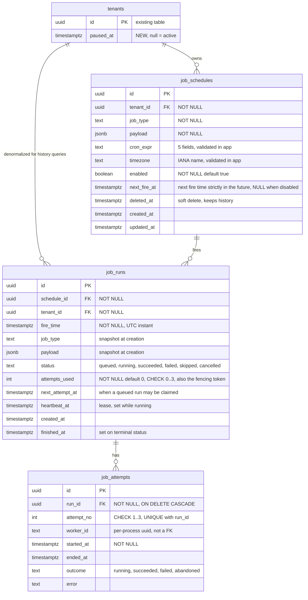

# Scheduled jobs per tenant: data model and mechanics

## ER diagram

**Constraints and indexes not shown above**

- `job_runs` has `UNIQUE (schedule_id, fire_time)`. This is what guarantees at most one run per fire time.
- `job_runs` has a partial unique index `UNIQUE (schedule_id) WHERE status IN ('queued','running')`. This guarantees at most one in-progress run per schedule.
- `job_attempts` has `UNIQUE (run_id, attempt_no)`.
- `job_runs.status` and `job_attempts.outcome` have CHECK constraints on their allowed values.
- `job_runs.schedule_id` is `ON DELETE RESTRICT`. Schedules are soft-deleted (`deleted_at`, `enabled=false`) so history survives.
- Polling indexes:
  - `job_schedules (next_fire_at) WHERE enabled AND deleted_at IS NULL`
  - `job_runs (next_attempt_at) WHERE status='queued'`
  - `job_runs (heartbeat_at) WHERE status='running'`
  - `job_runs (tenant_id, fire_time DESC)` for the history UI
  - `job_runs (fire_time)` for cleanup
- The 50-schedule limit is enforced in the create transaction. It takes `pg_advisory_xact_lock(hash(tenant_id))`, counts schedules where `deleted_at IS NULL`, then inserts.
- The 5-field cron, the IANA timezone, and the 5-minute minimum interval are validated in application code on create and update. The interval check computes the smallest gap between consecutive fire times over a long look-ahead window. Postgres cannot check this declaratively.

**Conventions**

- All timing comparisons use the database `now()`, never worker clocks, so clock skew between workers cannot cause early expiry or double firing.
- Every worker runs the same loop every few seconds, with jitter: create due runs, claim a run, reap dead runs, and occasionally clean up. No leader is needed.

## How it works

### Run creation (the "fire" step)

1. In one transaction, select due schedules with `FOR UPDATE SKIP LOCKED`. Due means `enabled`, not deleted, and `next_fire_at <= now()`. Workers never block each other.
2. For each schedule, take `FOR SHARE` on its tenant row and skip it if `paused_at` is set. This makes pause and fire mutually ordered.
3. Compute the most recent fire time at or before `now()` in the schedule's timezone, using the cron library's "previous fire" function. Older missed fire times are dropped without a history entry.
4. If a run with status `queued` or `running` exists for the schedule, insert the new run as `skipped`. Its `finished_at` is `now()` and it has no attempts. Otherwise insert it as `queued` with `next_attempt_at = now()`. The insert uses `ON CONFLICT (schedule_id, fire_time) DO NOTHING`. The job type and payload are snapshotted onto the run.
5. Set `next_fire_at` to the first fire time after `now()` and commit.

At-most-once per fire time holds for three reasons. The schedule row is locked. `next_fire_at` advances in the same transaction. The unique constraint backs both up. The partial unique index backs up the one-in-progress rule even if the check in step 4 were raced.

Fire times are stored as UTC instants. For local times that don't exist or occur twice at a DST change, we follow the cron library's rule. We pick one rule and test it.

### Claiming

A worker claims a run by selecting one `queued` row with `next_attempt_at <= now()`, using `FOR UPDATE SKIP LOCKED`. In the same transaction it does the following:

- Sets `status='running'`, `attempts_used = attempts_used + 1`, and `heartbeat_at = now()`.
- Inserts a `job_attempts` row with `attempt_no = attempts_used`, its `worker_id`, `started_at`, and `outcome='running'`.

It then executes the handler outside the transaction. The claim re-checks `status='queued'` after taking the row lock. A pause or disable that cancels the run concurrently therefore wins cleanly, and the worker gets zero rows.

### Heartbeats

Every 30 seconds the worker runs `UPDATE job_runs SET heartbeat_at = now() WHERE id = :run AND status='running' AND attempts_used = :my_attempt_no`. If zero rows are updated, the worker has lost its lease. It must stop and discard its result. The 2-minute timeout allows several missed beats before presuming the worker dead.

### Finishing and fencing

On completion the worker, in one transaction, does two things:

- Updates its attempt with `WHERE id = :attempt AND outcome='running'`, setting `ended_at`, `outcome` and `error`.
- Updates the run with `WHERE id = :run AND status='running' AND attempts_used = :my_attempt_no`. On success it sets `status='succeeded'` and `finished_at`.

If either update affects zero rows, the worker was presumed dead and replaced. It writes nothing and rolls back. This is the fence. The reaper marks the old attempt `abandoned` and the takeover's claim increments `attempts_used`. A zombie worker therefore cannot match either `WHERE` clause or overwrite the new worker's outcome.

### Retries

On failure, the worker or the reaper applies the same rule. This is a single shared function, so both paths behave identically.

- If `attempts_used >= 3`, set `status='failed'` and `finished_at = now()`.
- Otherwise set `status='queued'`, clear `heartbeat_at`, and set `next_attempt_at = now() + interval '1 minute'` after attempt 1, or `+ interval '5 minutes'` after attempt 2.

The run stays "in progress" while it waits, because `queued` falls under the partial unique index. A fire time that arrives during a retry wait is recorded as `skipped`. Backoff is measured from when the failure was recorded. For a dead worker, that is when the reaper detected it, which is up to a few seconds past the 2-minute mark.

### Crash recovery

- **Dead worker.** Any worker periodically selects runs where `status='running' AND heartbeat_at < now() - interval '2 minutes'`, using `FOR UPDATE SKIP LOCKED`. For each one it closes the current attempt as `abandoned` with the error "worker presumed dead" and `ended_at = now()`. It then applies the retry rule above. A presumed-dead worker therefore consumes one of the 3 attempts.
- **No worker up for several fire times.** When workers return, the fire step finds the schedule overdue. It creates a run only for the most recent missed fire time and silently drops the earlier ones. If that run's schedule still has an in-progress run, the new one is recorded as `skipped`. Stale `running` rows are reaped as above.
- **Worker dies between claim and handler start.** This looks the same as any other dead worker, since the heartbeat was set at claim.

### Pausing, disabling, resuming

- **Disable a schedule.**
  - In one transaction: set `enabled=false`, `next_fire_at=NULL`, and set `status='cancelled'`, `finished_at=now()` on its runs with `status='queued' AND attempts_used=0`.
  - The schedule row lock serializes this against the fire step.
  - Running runs finish normally.
- **Pause a tenant.**
  - In one transaction: set `tenants.paused_at=now()` and cancel the same kind of unstarted queued runs for all the tenant's schedules.
  - The fire step holds `FOR SHARE` on the tenant row, so no run can be created after the pause commits.
- **Re-enable or resume.**
  - Re-enabling sets `next_fire_at` to the first fire time after `now()`.
  - Resuming clears `paused_at` and recomputes `next_fire_at` the same way for all of the tenant's enabled schedules.
  - Missed fire times are never caught up.
- **Editing cron or timezone.** This also recomputes `next_fire_at`.
- **Deleting a schedule.** This is a soft delete: disable it and set `deleted_at`.

**Assumption to confirm:** a run that has used an attempt and is waiting out its retry backoff counts as "already started". It keeps retrying after a disable or pause, and only runs with `attempts_used=0` are cancelled. If product wants waiting retries cancelled too, drop the `attempts_used=0` condition. No other design element changes.

### History and cleanup

- Tenants read history from `job_runs`, which has the fire time and final status. Each run joins to `job_attempts` for its worker, start and end times, and error. `skipped` and `cancelled` runs have no attempts. Silently dropped missed fire times have no rows, as required.
- Cleanup runs on any worker, taking `pg_try_advisory_lock` so only one runs at a time. It deletes in batches (for example 1000 rows, `FOR UPDATE SKIP LOCKED`) from `job_runs` where `fire_time < now() - interval '90 days'` and status is terminal (`succeeded`, `failed`, `skipped` or `cancelled`). Attempts go with them via `ON DELETE CASCADE`. It then hard-deletes soft-deleted schedules that have no remaining runs.

## Known limits and trade-offs

- Start latency is bounded by the poll interval, which is a few seconds. That is fine for minute-granularity cron.
- Handlers may be run more than once if a worker is wrongly presumed dead, for example after a long GC pause. The fence stops the stale result from being recorded, but not the side effects. This is acceptable because handlers are idempotent.
- `job_runs.tenant_id` is deliberately denormalized to keep tenant history queries and the pause cancel fast. Its consistency with `schedule_id` is enforced by always copying it from the schedule on insert. A composite FK `(schedule_id, tenant_id)` to `job_schedules` can enforce it if wanted.
