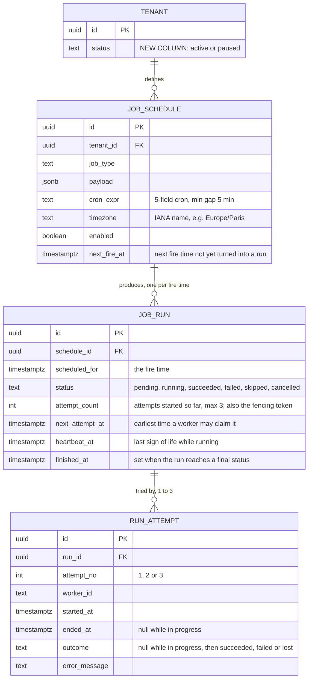

## Scheduled jobs per tenant: data model and mechanics

### Vocabulary

- **Schedule**: a tenant's recurring job definition (job type, JSON payload, cron expression, timezone).
- **Fire time**: one moment at which a schedule is due, computed from its cron expression in its timezone.
- **Run**: the unit of work for one fire time. A run has a status and may take several attempts.
- **Attempt**: one try at executing a run on one worker.
- **Active run**: a run whose status is `pending` or `running`. A run waiting for a retry is `pending`, so it is still active.
- **Fencing token**: the value of the run's `attempt_count` at the moment a worker claimed the run. Every later write by that worker must present this token, so the database can reject writes from a worker that has since lost the run (see step 3).

All "now" comparisons use the database clock (`now()`), never a worker's own clock, so workers with skewed clocks cannot disagree.

### Tables

Three tables are new. `tenants` already exists; we add one column, `status`.

Final run statuses are `succeeded`, `failed`, `skipped` and `cancelled`. Each sets `finished_at`.

**Constraints and indexes** (Mermaid cannot draw composite or partial constraints, so they are listed here):

| Rule | Mechanism |
|---|---|
| At most one run per fire time, however many workers notice it | `UNIQUE (schedule_id, scheduled_for)` on `job_run`; creation uses `INSERT ... ON CONFLICT DO NOTHING` |
| At most one active run per schedule | Partial unique index on `job_run (schedule_id) WHERE status IN ('pending','running')`. This is a safety net; the creation step also checks |
| At most 3 attempts | `CHECK (attempt_count <= 3)` on `job_run`; `UNIQUE (run_id, attempt_no)` on `run_attempt` |
| At most 50 schedules per tenant | Checked in the insert transaction after locking the tenant row (`SELECT ... FOR UPDATE`), so two concurrent inserts cannot both pass |
| Minimum interval 5 minutes | Checked when a schedule is saved: compute its next fire times and reject if any gap is under 5 minutes. The cron expression and timezone are validated at the same time |
| Fast lookups | Partial indexes: `job_schedule (next_fire_at) WHERE enabled`; `job_run (next_attempt_at) WHERE status = 'pending'`; `job_run (heartbeat_at) WHERE status = 'running'` |

`run_attempt` rows are deleted with their run (`ON DELETE CASCADE`), and runs are deleted with their schedule. If history must outlive a deleted schedule, use a soft delete (`enabled = false` plus a `deleted_at` column) instead.

### How it works

Every worker is identical and runs the same four background loops: create runs, claim runs, reap dead runs, and purge history. The loops coordinate only through Postgres row locks. Where a step says "skip locked", it means `FOR UPDATE SKIP LOCKED`: the worker takes only the rows no one else has locked and moves on. Workers therefore never wait on each other or process the same row twice.

**1. Run creation** (every few seconds, on every worker). In one transaction:
1. Select schedules where `enabled`, `next_fire_at <= now()` and the tenant is `active`, locking them with skip locked. Only one worker gets each schedule.
2. For each, compute its fire times up to now and keep only the most recent one, F. Older fire times exist only if no worker was running for a while. They are dropped with no history entry.
3. Insert a run for F with `ON CONFLICT (schedule_id, scheduled_for) DO NOTHING`. Its status is `skipped` if the schedule already has an active run, otherwise `pending`. A skipped run is created already finished (`finished_at` set) and appears in history.
4. Set `next_fire_at` to the first fire time after now, then commit.

Even if two workers somehow processed the same schedule, the unique constraint still yields one run per fire time.

**2. Claiming.** A worker with free capacity runs one atomic statement. It picks a `pending` run with `next_attempt_at <= now()` (skip locked) whose schedule is enabled and whose tenant is active. It then sets `status = 'running'`, `attempt_count = attempt_count + 1` and `heartbeat_at = now()`. In the same transaction it inserts a `run_attempt` row carrying the worker's id. The new `attempt_count` is the worker's fencing token.

**3. Heartbeats and fencing.** While executing, the worker updates `heartbeat_at` every 30 seconds. Every write a worker makes to its run, meaning heartbeats and the final result, includes `WHERE id = :run AND status = 'running' AND attempt_count = :my_token`. If another worker has taken over, the token no longer matches, the update changes zero rows, and the stale worker stops and discards its result. This is how a worker presumed dead is prevented from overwriting the outcome of the worker that took over. The final write updates the run and its attempt in one transaction, and the attempt is updated only if the run update changed a row.

**4. Finishing and retries.** On success, the worker sets the run to `succeeded` and sets `finished_at`. When a handler fails, the worker records the attempt as `failed` with its error, then does one of the following:
- If the run's schedule is disabled or its tenant is paused, it sets the run to `cancelled` (see step 6).
- Otherwise, if `attempt_count < 3`, it sets the run back to `pending` with `next_attempt_at = now() + 1 minute` (after attempt 1) or `now() + 5 minutes` (after attempt 2).
- Otherwise it sets the run to `failed` and sets `finished_at`.

Handlers are idempotent, so a retry that repeats partial work is acceptable.

**5. Crash recovery (the reaper).** Every worker periodically selects `running` runs with `heartbeat_at < now() - 2 minutes` (skip locked). For each one, in a single transaction:
- Mark the open attempt `lost`. A lost attempt counts as a used attempt.
- Apply the same rule as a failure in step 4: `cancelled` if the schedule is disabled or the tenant is paused, otherwise `pending` with the 1 or 5 minute backoff if fewer than 3 attempts were used, otherwise `failed`.

The next claim increments `attempt_count`, which fences out the old worker if it was merely slow and not dead. If no worker is alive at all, nothing runs until one returns. Then the reaper handles the stuck runs, and run creation handles missed fire times as described in step 1.

**6. Pausing and disabling.** These stop new runs and cancel unstarted ones, in one transaction:
- *Disable schedule* sets `enabled = false`. *Pause tenant* sets `tenant.status = 'paused'`.
- Then every `pending` run of that schedule or tenant is set to `cancelled` (with `finished_at` set). This includes runs waiting for a retry, since no attempt is executing. Runs in `running` are left alone and finish normally. If one of them later fails or is lost, steps 4 and 5 set it to `cancelled` instead of `pending`.
- Run creation and claiming also check the enabled and active conditions, so a race with the pause cannot start new work.
- *Re-enable* and *resume* recompute `next_fire_at` as the first fire time after now, in the same transaction. Run creation only handles fire times at or before `next_fire_at`, so nothing missed during the pause is caught up. A tenant resume does this for each of the tenant's enabled schedules (at most 50).

**7. History cleanup.** One cheap job runs daily on any worker. A Postgres advisory lock stops two workers from running it at once. It deletes finished runs older than 90 days in batches, repeating until none are left, for example:

`DELETE FROM job_run WHERE id IN (SELECT id FROM job_run WHERE finished_at < now() - interval '90 days' LIMIT 1000)`

Their attempts go with them through the cascade. Tenants read history from `job_run` joined to `run_attempt`: each run with its fire time and final status, and each attempt with its worker, start and end times, and error.

### Assumptions to confirm

- A run waiting for a retry counts as in progress, so a fire time arriving then is recorded as `skipped`.
- A run waiting for a retry counts as "not yet started" for pausing, and is cancelled.
- A presumed-dead run waits the normal 1 or 5 minute backoff, measured from when the reaper detects it.