# Failover plan: Region A to Region B

## Summary

Today, region A serves all traffic. Its PostgreSQL primary takes every write, region B holds an asynchronous copy of that database, B's workers are scaled to zero, and one DNS name points at A. Failover is one command that a person runs. It checks how much data could be lost, fences A so it cannot take writes, promotes B's database, reconciles jobs, starts B's workers, scales up B's web tier, checks its health, and moves DNS last. A fences itself through a small service on its own database host, so the command never needs a path to A, and the two databases are never both writable.

The timings below are estimates to verify in a game day, not measured results.

## Terms

- **RPO** (recovery point objective): the most recent data we accept losing, measured as time. Target: 30 s.
- **RTO** (recovery time objective): how long service may be down, measured from when on-call starts the failover command. Target: 15 min.
- **WAL**: PostgreSQL's log of every change. A replica receives it and replays it.
- **Replay lag**: how far B's copy trails A. It is typically under 5 s in normal running.
- **Recorded replay lag**: the replay lag value B records each time it receives WAL from A. The brief's check reads this value.
- **Standby**: a database that copies another and cannot take writes. `pg_is_in_recovery` is true for a standby.
- **Promote**: turn a standby into a writable primary, with `pg_promote`.
- **Epoch**: a whole number that counts database primaries. A is epoch n. Failover makes B epoch n+1.
- **Lease store**: a small store that holds one record (see its section below). It has 3 voters, and a write needs 2 of 3, which is a majority. No product is chosen yet.
- **Active region**: the field in the store that names the region serving users.
- **Compare-and-set**: a write that succeeds only if the stored value is still the one the writer last read.
- **Lease**: A's time-limited permission to keep its database running. It expires 30 s after the store last received a renewal.
- **Fencer**: a small service on A's database host, separate from Postgres and the app. It renews A's lease, and it stops Postgres when it cannot.
- **Fence request**: a record the command writes to the store, asking A's fencer to stop Postgres.
- **Fenced**: A's Postgres has been stopped, so A cannot take writes. The command treats A as fenced once the fencer confirms the stop, or once A's lease has expired plus 5 s. The second case relies on the fencer having stopped Postgres by then.
- **Monotonic clock**: a clock that only moves forward and is not changed by time corrections. The fencer times its stop with one.
- **Postmaster**: the main PostgreSQL process. Stopping Postgres means stopping this process.
- **Job claim**: a worker's hold on a job row while it works. The claim stores the worker's ID, the epoch and an expiry time.
- **Heartbeat**: a periodic "still working" update that moves a claim's expiry later.
- **Reaper**: a process that requeues jobs whose claim has expired.
- **Dead-letter**: the parked state of a job that failed too many times. A person looks at it.
- **needs_review**: a job status for a job a person must decide on. Workers skip these rows.
- **Idempotency key**: a unique key sent with an external action, so that a repeat does not repeat the action.
- **Side-effect ledger**: a record of each external action a job made, such as an email or a charge, keyed by idempotency key. The job's code writes its entry right after the external call.
- **/healthz**: the health check. It passes when the app answers and reaches its database.
- **Global traffic manager**: the service that answers the one DNS name users reach. In this plan, its automatic health failover is off.

## Flowchart

```mermaid
flowchart TD
    subgraph S1 ["1 Detect: automatic, pages only"]
        P["Probes call A /healthz every 10 s from 3 sites"]
        D{"2 of 3 sites see 3 consecutive failures?"}
        PG["Page on-call. Nothing else happens automatically"]
        P --> D
        D -->|No| P
        D -->|Yes| PG
    end

    subgraph S2 ["2 Decide: a person runs one command"]
        OC["On-call decides it is a real regional loss and runs the command. RTO clock starts"]
        R0["Command reads lease store: active region, epoch n, last finished step"]
        RS{"Fresh run, or a re-run?"}
        G{"RPO gate: all 3 loss checks 30 s or less?"}
        OV{"Accept-data-loss override given?"}
        STOP1["Stop. Report loss estimate. Nothing changes"]
        OC --> R0 --> RS
        RS -->|Fresh run| G
        G -->|No| OV
        OV -->|No| STOP1
    end

    subgraph S3 ["3 Fence A: works with A unreachable"]
        F1["Write fence request for A at epoch n to store. Fencer reads it on its next renewal"]
        F2{"Fencer reports Postgres stopped, or A lease expired plus 5 s?"}
        F3["Record A fenced at epoch n. Store refuses A renewals at epoch n"]
        G2{"Post-fence gate re-run with A's final position passes, or override given?"}
        STOP2["Stop. A stays fenced. Nothing promoted. Service down until override"]
        F1 --> F2
        F2 -->|"No: keep polling"| F2
        F2 -->|Yes| F3
        F3 --> G2
        G2 -->|No| STOP2
    end

    subgraph S4 ["4 Promote B database"]
        PRE["Store: record promoting at epoch n+1, compare-and-set on n"]
        PRF{"Store accepted the write?"}
        PRSTOP["Stop before promotion. B stays standby, A stays fenced"]
        PR["Check B in recovery, then pg_promote"]
        PV{"B writable? Read-only off and test write works"}
        PRFAIL["Stop. Fix forward and re-run. A stays fenced"]
        PREC["Store: record db_promoted at epoch n+1"]
        PRE --> PRF
        PRF -->|No| PRSTOP
        PRF -->|Yes| PR --> PV
        PV -->|No| PRFAIL
        PV -->|Yes| PREC
    end

    subgraph S5 ["5 Reconcile jobs, then start B workers"]
        RC["Reconcile every unfinished job row, before any worker starts"]
        L{"Side-effect ledger shows job done?"}
        J3["Mark done on B. Print ID. Do not re-run"]
        RUN{"Row running under an epoch below n+1?"}
        J7["Leave as is. Queued rows run normally"]
        J4{"Job has idempotency key?"}
        J5["Requeue with attempt plus 1. Print ID"]
        J6["Set needs_review. Print ID. A person decides"]
        WK["Start B workers at epoch n+1. Reaper starts with them"]
        RC --> L
        L -->|Yes| J3 --> WK
        L -->|No| RUN
        RUN -->|No| J7 --> WK
        RUN -->|Yes| J4
        J4 -->|Yes| J5 --> WK
        J4 -->|No| J6 --> WK
    end

    subgraph S6 ["6 Scale B and check health"]
        SC["Scale B web/API from 2 to 12, as on A. Runs alongside step 5"]
        HC{"B /healthz passes at full size, and every B worker has polled jobs?"}
        HF["Stop. DNS stays on A. B database stays primary. Fix forward"]
        SC --> HC
        HC -->|No| HF
    end

    subgraph S7 ["7 Move traffic to B"]
        SA["Store: record active region B at epoch n+1"]
        DNS["Move global DNS name to B. TTL 60 s"]
        UO["Users reach B with empty sessions and sign in again"]
        SA --> DNS --> UO
    end

    subgraph RUNB ["Job run on B"]
        JC["Worker claims queued row: running, its ID, epoch n+1, expiry. Heartbeats extend expiry"]
        JD{"Job commits before its claim expires?"}
        JOK["Job complete"]
        JR["Claim expires. Reaper requeues with attempt plus 1. Capped, then dead-letter"]
        JC --> JD
        JD -->|Yes| JOK
        JD -->|"No: error or worker died"| JR
        JR -.-> JC
    end

    subgraph INTR ["Re-run after a crash or stop"]
        INT["Re-run reads last finished step from store and resumes there, re-checking its precondition"]
    end

    subgraph AFTER ["After A returns"]
        AR["Wipe A database, rebuild as replica of B. Postgres does not auto-start as primary"]
        FB["Failback is a separate planned switchover with its own gate"]
        AR -.-> FB
    end

    PG -.->|on-call decides| OC
    G -->|Yes| F1
    OV -->|"Yes, logged"| F1
    G2 -->|Yes| PRE
    RS -->|"Fence recorded, not promoted"| G2
    RS -->|"Promotion started"| PR
    RS -->|"DB promoted"| RC
    RS -->|"DB promoted"| SC
    RS -->|"Store says active B"| HC
    PREC --> RC
    PREC --> SC
    WK --> JC
    WK --> HC
    HC -->|Yes| SA
    PR -.->|crash| INT
    RC -.->|crash| INT
    SC -.->|crash| INT
    DNS -.->|write fails| INT
    INT --> R0
    UO -.->|later| AR
```

## Notes on the flowchart

- Each subgraph is one step. The numbers match the Steps section.
- A solid arrow is the normal path. A dashed arrow happens only if something goes wrong or on-call decides.
- After a crash or stop, the re-run reads the last finished step from the lease store and resumes there. Each step re-checks its own precondition first. The branches from the re-run decision show where it can resume.
- The "Job run on B" subgraph shows what happens to jobs after B's workers start.

## The lease store: where the active-region record lives

The lease store holds one record with these fields: `active_region`, `epoch`, `lease_holder`, `lease_expires_at`, `failover_state`, any fence request and fence record, and any override with its approver.

- It has 3 voters: one in A, one in B and one at a third site. Losing either region leaves 2 of 3 voters, so the store still works. With one voter lost, writes continue normally.
- Do not place the store in A alone. It is new infrastructure, and a new dependency for this plan.
- Two writers: the failover command writes start and finish markers, the epoch, the fence request, the fence record and any override. A's fencer writes its lease renewals, each with A's commit position and time, and its stop report.
- DNS is a copy of the store's record. It is written after the store and does not write to the store.
- If the store has no majority before any change, the command stops before changing anything. If it loses majority mid-run, the command stops at its next write, and a re-run resumes when majority returns.
- If both the A voter and the B voter are lost, there is no majority. The command reads and writes nothing. A's fencer stops A's Postgres 25 s after its last renewal, because it can no longer renew. Service stays down until the store has a majority again. The plan does not cover losing 2 of 3 voters.

## Data loss

- Rows committed on A after B's replayed position are not on B. This includes invoices and payments, not only jobs. The loss is bounded by the unreplicated commit age that the gate measures. The command cannot list the lost rows from B.
- After promotion, the command records the gate values, the final loss estimate and any override approver in the store, and prints them for on-call. Nobody is told which rows were lost.
- The gate is an admission check, not a guarantee. Steady-state lag under 5 s fits the 30 s target, but unreplicated commits can still be lost.

## Steps

### 1 Detect (automatic, pages only)

- **Trigger:** each of 3 probe sites calls A's `/healthz` every 10 s. A is down when 2 of the 3 sites see 3 consecutive failures.
- **Action:** page on-call. Nothing else happens automatically. There is no promotion.
- **Data:** each probe site keeps its own results.
- **If it goes wrong:** a false alarm costs only a page. If fewer than 2 sites see failures, nothing happens. The page does not show the cause, because `/healthz` also fails when only the web tier is down.

### 2 Decide (a person runs one command)

- **Trigger:** on-call decides that the page shows a real regional loss, and runs the failover command. The RTO clock starts when the command starts. The brief sets no on-call checklist (see Open questions). The command does not diagnose the cause.
- **Where it runs:** an operator host that can reach the lease store, B's database, B's scaling and DNS. It needs no path to A. If it cannot reach the store or B's database, it stops before changing anything.
- **Action:** the command reads the store. A fresh run expects active region A, epoch n, and no finished failover step. Then it runs the RPO gate. All three checks must be 30 s or less:
  1. **Recorded replay lag.** This is the brief's check. It does not grow while A is down, so it can miss a large loss. Example: the link breaks 10 minutes before A dies, with 2 s of lag at the break. A then commits 10 minutes of data that B never received, and this check still reads 2 s. The brief does not say where B keeps this value.
  2. **Seconds since B last received WAL from A.** B's own record of its last receipt time. This value grows while A is down.
  3. **Estimated unreplicated commit age.** The command computes it from A's commit position and time in its last acknowledged renewal (held in the store), plus up to 25 s of commits made before the fencer stops Postgres. It compares that with B's replayed position.
  The gate changes nothing.
- **Data:** the store holds A's last acknowledged renewal. B holds its own lag and receipt records.
- **If it goes wrong:** if any check is over 30 s, the command stops and reports the loss estimate. It continues only if the operator gives the accept-data-loss override. The override is written to the store with its approver. A is left as it is.

### 3 Fence A (works with A unreachable)

- **Trigger:** the gate passes, or an override is recorded.
- **Action:** the command writes a fence request for A at epoch n to the store. It does not contact the fencer directly, because it cannot reach A. The fencer reads the request on its next renewal, which is at most 10 s later. It then stops Postgres at once, and writes "stopped" with its final commit position to the store.
- The command polls the store once per second. It continues when either the "stopped" record appears, or the store shows A's lease expired plus a 5 s margin. The store decides expiry, so the command needs no path to A. It then writes "A fenced at epoch n" to the store. From then on, the store refuses A's renewals at epoch n.
- The command re-runs the gate with A's final position. That position is the fencer's stop report if it arrived. Otherwise it is A's last acknowledged renewal position plus 25 s. The same override rule applies. If the re-run fails and no override is given, the command stops. A stays fenced, nothing is promoted, and service stays down until an override is given. The command never unfences A.
- **Data:** the store holds the lease, the fence request and the fence record.
- **If it goes wrong:**
  - If neither condition holds, the command keeps polling and does not promote. It has no timeout of its own. A timeout that proceeded would break the no-early-promotion rule, and a timeout that stopped would leave the same state. On-call sees progress every 30 s and can stop the command. A re-run resumes here.
  - If the fencer cannot reach the store, it never reads the request. It stops Postgres 25 s after sending its last acknowledged renewal, on its own timer. The store expires the lease 30 s after it received that renewal. So the command continues about 35 s after that receipt at the latest, and sooner if it started polling later.
  - If A's lease keeps renewing, the fencer is alive but has not stopped Postgres. The lease never expires, so the command keeps waiting and never promotes.
- **Outage starts here.** A's database is stopped, but traffic still reaches A, so users see failures until step 7.

### 4 Promote B's database

- **Trigger:** A is fenced, and the post-fence gate passes or an override is recorded.
- **Action, in order:**
  1. Store: one compare-and-set that records "promoting" and epoch n+1, expecting epoch n. If the store refuses it, the command stops before promotion. B stays a standby and A stays fenced.
  2. Check that B is in recovery (`pg_is_in_recovery`), then run `pg_promote`.
  3. Check that B is writable: `transaction_read_only` is off and a test write succeeds.
  4. Store: record `db_promoted` at epoch n+1. From this point, B's database is the only primary.
  The command also records the loss estimate in the store and prints it for on-call (see Data loss).
- **Data:** B's database holds the data. The store holds the epoch. `active_region` still says A until step 7, and DNS still points at A until step 7.
- **If it goes wrong:**
  - B is not writable after promotion: the command stops. A stays fenced. Fix forward on B and re-run.
  - The command fails before `pg_promote`: nothing is promoted and A stays fenced. A re-run resumes at promotion.
  - The command crashes after `pg_promote`: a re-run finds "promoting" from the same failover, so it skips step 1. If B is no longer in recovery, it skips `pg_promote` and goes to the writable check. If B is still in recovery, it runs `pg_promote`.

### 5 Reconcile jobs, then start B's workers

- **Trigger:** `db_promoted` is recorded.
- **Action:** reconcile runs before any worker starts, so no worker claims a row that A left half done. It works through every unfinished job row, whether queued or running:
  1. If the side-effect ledger shows the job done (by idempotency key), mark the row `done` on B and do not re-run the job. This covers a queued row on B whose effect already happened on A, because B cannot see A's claims.
  2. Otherwise, if the row is running under an epoch below n+1 and the job has an idempotency key, requeue it with attempt plus 1.
  3. Otherwise, if the row is running under an epoch below n+1 and has no key, set `needs_review`. A person decides.
  4. Otherwise, the row is queued with no ledger entry, and it runs normally.
  The command prints the ID of every row it marks done, the ID and attempt count of every row it requeues, and the ID and count of every `needs_review` row. On-call can then check external systems for repeats.
  Then the command scales B's workers up. It gives each worker it starts epoch n+1 as a start setting, and each worker stamps that epoch on the claims it makes. "Each worker the command started" means each instance that the scale-up launches. The reaper starts with the workers, after reconcile. Reconcile must see the old-epoch running rows first, so the reaper handles only epoch n+1 claims.
- **Data:** the `jobs` table and the ledger, both read from B.
- **If it goes wrong:**
  - If the ledger cannot be read from B, the command stops before starting workers. A stays fenced. Service is down until this is fixed.
  - If a worker fails to start, the command stops. DNS does not move. Fix forward on B.
  - Reconcile has no timeout and runs to completion.
  - A row whose claim and completion were both lost in replication looks queued on B. Rule 1 is the only thing that stops it running again.

### 6 Scale B and check health

- **Trigger:** `db_promoted` is recorded. This step runs alongside step 5.
- **Action:** the command scales B's web/API tier from 2 instances to full size, which is 12 as on A. Then it polls B's `/healthz` at full size and the B workers every 15 s. Both must pass. Workers count as running when each one the command started has polled the `jobs` table.
- Workers start only after reconcile, so this poll waits for reconcile to finish. No user reaches B before step 7, so B serves nobody while reconcile runs.
- **Data:** none.
- **If it goes wrong:** if the health check fails, the command stops. DNS stays on A, and B's database stays primary. Fix forward on B. Users are down until B is healthy. That is an outage, not split brain. Do not unfence A, because its data has diverged from B's timeline. The brief sets no failure deadline for this check (see Open questions).

### 7 Move traffic to B

- **Trigger:** step 6 passes.
- **Action:** the command records `active_region` B and epoch n+1 in the store. Then it moves the global DNS name to B. The traffic manager's automatic health failover is off, so DNS changes only from this command. The DNS TTL is 60 s.
- **Data:** the store is the source of truth, and DNS is a copy of its record. Sessions live in a Redis cluster in each region, which is not replicated between regions, so users arrive on B with empty sessions and sign in again. The brief accepts this.
- **If it goes wrong:** if the DNS write fails, the store already says B. A re-run re-checks B's health and repeats the DNS write. Until that succeeds, DNS points at A, which is fenced, so users keep getting failures.

## Fencing: why it works without A's cloud API

- The fencer runs on A's database host, outside Postgres and the app tier. It renews A's lease every 10 s with a 30 s TTL, by writing to the store's voters. Each renewal also sends A's commit position and time. On each renewal, the fencer also reads any fence request. A cut off from the store can neither renew nor read requests.
- If a fence request arrives, the fencer stops Postgres at once and writes "stopped" with its final commit position to the store.
- If renewal fails, the fencer stops Postgres when its monotonic clock reaches 25 s after sending its last acknowledged renewal. It uses `pg_ctl stop -m immediate`, and kills the postmaster if that hangs.
- The store expires the lease 30 s after it receives a renewal. Receipt comes after the send, so the store's expiry is always later than the fencer's stop. The 5 s margin covers clock drift.
- Commits made after the last acknowledged renewal, up to the stop, are not in the store. That window is at most 25 s. The gate counts it as 25 s, unless the fencer's stop report gives the real final position. If the fencer can still reach the store, the stop report arrives with the real value.
- Postgres does not check the lease. The lease only tells the fencer that A may keep Postgres running. Stopping the database, not just the app, is what fences A. Workers in A keep writing when only the web tier is down.
- Once stopped, the fencer never starts Postgres as primary. Postgres is not set to start on boot, so A comes back only as a standby.
- Renewals at epoch n are refused once the fence is recorded. Promotion moves the epoch to n+1, which also makes old-epoch renewals invalid. If A returns during a failover, it stays stopped, and Postgres is never started as primary.
- Network or storage isolation through the cloud API is an optional extra layer, never a requirement.
- Limit: this assumes that clocks run at similar rates on both sides. A wedged host with a live postmaster is not covered by the timing. It is the case to test in a game day.

## Jobs in flight on A

- Jobs are rows in A's database. Once A is fenced, its workers cannot claim or complete jobs.
- A job's external side effect may happen before its status update is committed. So B's replica can show a job as queued (its claim did not replicate), running (the claim replicated, but completion did not) or done. Step 5 handles each case.
- Prerequisite: every job type needs an idempotency key and a claim epoch. The job's code sets the key and writes its ledger entry right after the external call. A crash between the two can repeat the action, and the key is what prevents that.
- On B, a worker claims a queued row with one update. The update sets the row to `running` and stamps the worker's ID, epoch n+1 and an expiry time. While it works, the worker sends heartbeats that move the expiry later. The claim length and heartbeat interval are open questions.
- If the expiry passes with no heartbeat, the reaper sets the row back to queued and adds one attempt. Attempts are capped, and then the job goes to dead-letter. A job that fails on B follows this same normal path.
- A `needs_review` row is set by step 5, rule 3. Workers poll only queued rows, so they skip these until a person acts. A person sets the row to queued to run it again, or to done after checking the ledger.

## Interrupted and repeated runs

- Each step writes a start marker and a finish marker to the store: the step name, the epoch, the time and the operator.
- A re-run reads the last finished step and resumes at the next one. Each step first re-checks its precondition. For example, it checks `pg_is_in_recovery` before `pg_promote`, so a crash after promotion but before recording is handled.
- If the fence is already recorded, the re-run does not fence again. If promotion has not started, the re-run first repeats the post-fence gate with A's final position, because that check is read-only and must hold before B is promoted.
- After a stop, on-call fixes the cause that the command printed. The causes are: B is not writable, B fails its health check, the ledger is unreadable, or a gate failure after the fence (which needs an override). Then on-call runs the command again. The re-run uses the same failover epoch and resumes at the next unfinished step.
- Two people cannot run it at once. The start marker is a compare-and-set on the last finished step, so the second run loses and stops. No separate lock is used. A slow run that has not crashed could still overlap a re-run (see Open questions).
- Rolling back to A after promotion is not a supported step.

## Timing against RTO 15 min

The times below are measured from when the command starts. They are estimates.

| Phase | Estimate |
|---|---|
| Gate checks | Under 5 s |
| Fence, worst case (lease expiry) | About 35 s after the last renewal the store received |
| Promote and writable check | Under 30 s |
| Reconcile | About 2 min, depends on the number of unfinished rows |
| Scale B web tier from 2 to full size, then health | About 5 to 8 min, the largest unknown |
| DNS propagation (60 s TTL, some resolvers ignore it) | About 1 to 3 min |
| Total, worst case | About 12 to 14 min, tight |

To keep margin, pre-scale B's web tier to full size, or keep it warm at full size. Bound the number of unfinished rows so that reconcile stays short. Detection (about 20 to 30 s) and on-call's response time are outside the RTO clock.

## After A returns

- Wipe A's database and rebuild it as a replica of B from a fresh base backup. A's old database is never reused as primary.
- Keep A's app and workers scaled to zero until the replica has caught up.
- Failback is a separate planned switchover with its own gate. There is no automatic failback.

## Building and rolling out

Settings to verify before go-live:
- Global traffic manager: no health-based automatic failover. DNS changes only from the command.
- Any replica tooling: automatic promotion off.
- The 3 probe sites are independent of A's network.

Build and test:
- Build the lease store. It is a new dependency.
- Choose the fencer's stop mechanism and its monitoring.
- Confirm idempotency keys and side-effect ledgers for every job type, and whether each external system honours a repeated key.
- Game day: simulate a partition of A. Verify that A stops taking writes within about 25 s, that the command completes within RTO, and that a wedged host with a live postmaster is stopped.

## Open questions

- Which lease store product?
- Where does the side-effect ledger live, and can B read it while A is down? If it is only in A's database, the command stops at step 5.
- Do external systems honour a repeated idempotency key? Without that, a side effect whose ledger entry did not replicate can repeat.
- Should A's old database be kept until someone compares it with B for lost rows, before the rebuild wipes it? The plan does not identify lost rows.
- Will users get a notice during the outage window? The plan adds none.
- What is the deadline for B's health check at full size before it counts as failed? The game day should set it from the measured scale-up time.
- If A keeps renewing its lease but the fencer does not stop Postgres, what does on-call do? The command waits and never promotes.
- Who may approve an accept-data-loss override?
- Which stop mechanism and monitoring does the fencer use?
- Do all job types have idempotency keys and ledgers?
- Where does the team see `needs_review` rows? The command prints their count and IDs. A person sets each row to queued to run it again, or to done.
- If a failover is abandoned after A is fenced, there is no path to restart A. Is one needed?
- What are the claim length and heartbeat interval for jobs on B?
- How many B workers does the scale-up start? The brief gives no count, and B's workers are scaled to zero today.
- Which host runs the reaper on B? The brief does not say.
- What checklist should on-call follow before running the command? It must tell a web-tier outage from a regional loss, because `/healthz` fails in both cases.
- A slow run that has not crashed could overlap a re-run. The compare-and-set and precondition checks reduce this risk but do not remove it. Is a lock needed?