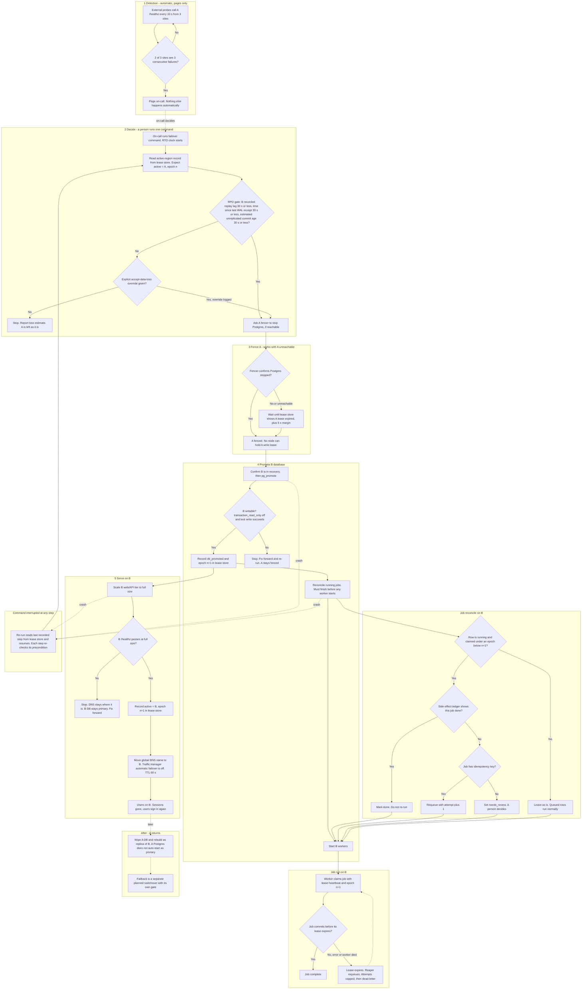

# Failover plan: Region A to Region B

## Summary

Failover is a single manual command. It runs in this order: read-only checks, fence A, promote B's database, reconcile jobs, start B's workers, scale B's web tier, pass a health check, then move DNS. Fencing is done at the database layer with a lease. A's database host stops Postgres when it can no longer renew its lease, so fencing does not depend on A's cloud API or network. The lease store is the single source of truth for which region is active.

The timings below are estimates to be verified in a game day. They are not measured results.

## Flowchart

## Triggers and owners

| Step | Trigger | Who or what |
|---|---|---|
| Detection and page | 2 of 3 probe sites see 3 consecutive failures | Probes and pager. No promotion |
| Start failover | On-call decides | Person runs the single command |
| RPO gate | Command start | Command, read-only |
| Fence A | Gate passes, or override logged | Fencer ack, or lease expiry |
| Promote B database | A fenced | Command |
| Reconcile jobs | B DB writable | Command, before workers |
| Start B workers | Reconcile finished | Command |
| Scale B web tier | B DB writable | Command |
| DNS move | B health passes at full size | Command, last write |

## Where the active-region record is kept

The active-region record lives in a 3-voter lease store. Put one voter in A, one in B, and one at a third site, so that losing either region leaves quorum. The record holds `active_region`, `epoch`, `lease_holder`, `lease_expires_at`, `failover_state`, and any override with its approver. The DNS record is a projection written last. Do not place the lease store in A alone. This is new infrastructure and a dependency for the plan.

## Fencing (why it works without A's cloud API)

- A's database host runs a fencer service, separate from Postgres and the app tier. It renews A's write lease every 10 s with a 30 s TTL.
- If the fencer cannot renew, it stops Postgres when its monotonic clock reaches 25 s after its last renewal send. It uses `pg_ctl stop -m immediate`, and kills the postmaster if that hangs.
- Stopping the database, not just the app, is what fences A. Workers in A keep writing when only the web tier is down.
- The command promotes B only when either the fencer confirms the stop, or the lease store shows A's lease expired plus a 5 s margin. The worst-case wait is about 35 s. The store, not the command, decides expiry, so the command does not need to reach A.
- A's Postgres and workers are not enabled to start on boot. When A returns, it starts only as a standby.
- Network or storage isolation through the cloud API is an optional extra layer, never a requirement.
- Limit: this assumes clocks run at similar rates on both sides. A wedged host with a live postmaster is the case to test in a game day.

## The RPO gate needs more than the brief's check

The brief's check reads B's replay lag as recorded when B last received WAL. That value does not grow while A is down, so it can pass while the loss is large. Example: the replication link breaks 10 minutes before A dies, with 2 s of lag at the moment of the break. A then commits 10 minutes of data that never reached B, and the check still shows 2 s.

Add two checks:
1. Seconds since B last received WAL from A. This value does grow.
2. An estimated unreplicated commit age, from A's last lease heartbeat (its commit position and time) compared with B's replayed position.

Require all checks to be at most 30 s, or log an override. After a fencer ack, re-run the gate with A's final position. The gate is an admission check, not a guarantee. Steady-state async lag is under 5 s, which is consistent with RPO 30 s, but unreplicated commits can still be lost.

## Jobs in flight on A

- Jobs are rows in A's database. Once A is fenced, its workers cannot claim or complete jobs. A job's external side effects, such as an email or a charge, may already have happened without the status update being committed.
- B's replica may show a job as queued (claim not replicated), running (claim replicated, completion not), or done.
- B's reconcile runs before any worker starts. For each row that is running and claimed under an old epoch:
  1. If the side-effect ledger shows the job done (by idempotency key), mark it done and do not re-run it.
  2. Otherwise, if the job has an idempotency key, requeue it with attempt plus 1.
  3. Otherwise, set `needs_review` and let a person decide.
- Queued rows run normally. Completions on A that were never replicated are lost from the database. Their side effects are in the ledgers, which is what step 1 checks.
- Prerequisite: every job type needs an idempotency key and a claim epoch.

## Failed or interrupted runs

- After each step, the command writes its state to the lease store: step name, epoch, time, and operator. A re-run reads that state and resumes at the next step. Each step re-checks its precondition. For example, it checks `pg_is_in_recovery` before `pg_promote`, so a crash between promotion and recording is handled.
- Failure before `pg_promote`: nothing has changed on B. A stays fenced. Retry. Service is down until then, and that is the accepted state.
- Promotion done, but B's app fails its health check: no DNS move. Do not unfence A. Its data has diverged from B's timeline. Fix forward on B. Users see errors until B is healthy, which is an outage, not split brain.
- Rolling back to A is not a supported step after promotion.
- A job failure on B is handled by the normal path: lease expiry, requeue, capped attempts, then dead-letter.

## Timing against RTO 15 min

Times are measured from when the command starts. These are estimates.

| Phase | Estimate |
|---|---|
| Gate checks | Under 5 s |
| Fence (worst case, lease expiry) | About 35 s |
| Promote and writable check | Under 30 s |
| Reconcile | About 2 min, depends on running-row count |
| Scale B web tier from 2 to full size, then health | About 5 to 8 min, the largest unknown |
| DNS propagation (60 s TTL, some resolvers ignore it) | About 1 to 3 min |
| Total, worst case | About 12 to 14 min, tight |

To keep margin, pre-scale B's web tier to full size, or keep it warm at full size. Bound the number of running rows so the reconcile stays short. Detection (about 20 to 30 s) and on-call's response time are outside the RTO clock.

## Settings to verify or disable

- Global traffic manager: no health-based automatic failover. DNS changes only from the command.
- Any replica tooling: automatic promotion off.
- A's probes: confirm the 3 probe sites are independent of A's network.
- A's Postgres and workers: not enabled to start on boot.
- Sessions: B's Redis starts empty. Users must sign in again, as the brief accepts.

## After A returns

- Wipe A's database and rebuild it as a replica of B from a fresh base backup. A's old database is never reused as primary.
- Keep A's app and workers scaled to zero until the replica has caught up.
- Failback is a separate planned switchover with its own gate.

## Open items

- Build the lease store. It is a new dependency.
- Choose the fencer's stop mechanism and its monitoring.
- Set the RPO gate threshold and name who can approve an override.
- Confirm idempotency keys and side-effect ledgers for every job type.
- Run a game day: simulate a partition of A and verify that A stops taking writes within about 25 s, and that the command completes within RTO.