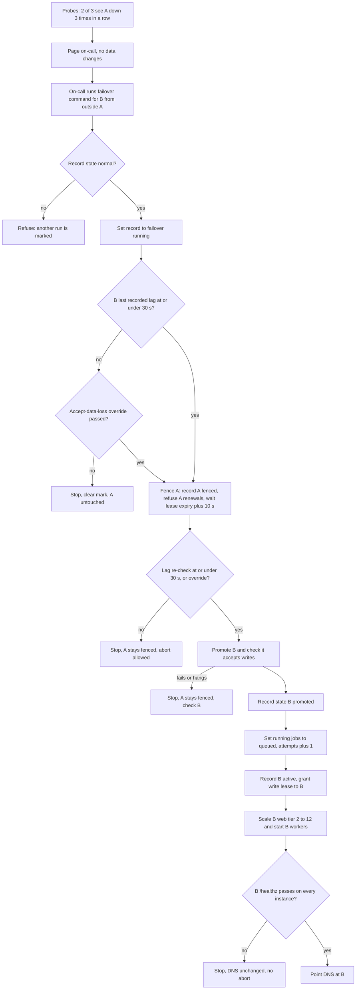

# Failover plan: Region A to Region B

## Summary

Today, region A serves all traffic. Region B holds a PostgreSQL replica of A's database, typically under 5 s behind, plus 2 web instances that run but serve no users, and no background workers. When A is lost, one person runs one failover command. The command makes B's database the only writable one, then moves users to B. It never writes to two databases: before B is promoted, the command makes A stop writing. It does this without contacting A. It refuses A's write-lease renewals and waits for A's lease to run out.

Targets: RPO 30 s (how much recent data may be lost) and RTO 15 min, measured from when on-call starts the failover.

Nothing fails over by itself. Detection only pages on-call.

## Terms

- **Replica**: a database copy that receives changes from the primary and cannot take writes. **Primary**: the database that takes writes. **Promote**: turn a replica into a primary.
- **WAL**: the write-ahead log, the stream of database changes that A sends to B.
- **Replay lag**: how far B's copy trails A. B records it each time it receives WAL from A. The command reads the last recorded value.
- **Control store**: a small store outside region A that both regions can reach. It holds the active-region record. The product is not chosen yet (see open questions).
- **Active-region record**: the control store's record of which region holds the write lease, the lease expiry, the failover state and the step log. The state is one of `normal`, `failover running`, `A fenced`, `B promoted` or `B active`. While a run is marked `failover running`, a second run refuses to start.
- **Write lease**: permission to write, held by one region at a time. A's apps and workers renew it every 20 s, and each renewal lasts 60 s. If renewal stops, writes stop when the lease runs out.
- **Fence**: stopping A from writing. We fence by refusing A's renewals and waiting for its lease to run out, so no contact with A is needed.
- **Step log**: the list of completed steps, kept in the record, so any machine can resume the command.
- **Jobs table**: the PostgreSQL table of background jobs. Workers poll it. A worker marks a row `running` while it works on the job.
- **Idempotent**: running a job twice has the same effect as running it once.
- **Sessions**: each signed-in user's login state. They are kept in Redis, an in-memory store, once per region.
- **`/healthz`**: a URL on each app instance that answers when the instance is working.
- **Global traffic manager**: the service that answers the one DNS name and points it at a region. **TTL**: how long clients may keep a DNS answer before asking again. Here it is 60 s.

## Diagram

The diagram shows the main path and each stop. The steps below add the trigger, the data and the handling for each one.

## Steps

Each step runs only after the one before it is done. Each completed step is written to the step log. Each step first checks whether it already happened, so a resumed run does not repeat finished work.

1. **Detect (automatic, pages only).** Trigger: three outside probes call A's `/healthz` every 10 s, from three locations. A counts as down when 2 of the 3 see 3 failures in a row. This pages on-call. It changes no data and never fails over by itself.

2. **Start (manual).** Trigger: on-call runs the failover command for region B from outside region A, because A may be unreachable. The operator's name is an input. If the record is `normal`, the command sets it to `failover running`. If it is in any other state, the command refuses to start. The record stays marked for the whole run, so a second run is refused until the first is resumed or aborted. Data kept in: the active-region record.

3. **Check lag.** Trigger: step 2 done. The command reads B's last recorded replay lag. That value stops moving while A is silent, so it does not grow while A is down. At or under 30 s, the command continues. Over 30 s, it stops, clears the mark and changes nothing else, unless the operator passes the accept-data-loss override. The override is logged with the operator's name and the lag value. Data kept in: the active-region record.

4. **Fence A.** Trigger: step 3 passed. The command sets the record to `A fenced`. The control store now refuses A's renewals, so A stops writing when its current lease runs out, at most 60 s after its last renewal. The command waits for lease expiry plus 10 s, which covers clock differences. Then it re-reads B's lag and applies the same 30 s rule, or the override. Writes A makes during the wait count toward the RPO only if B received them. Writes B never got are lost. The re-read measures the gap that exists when A stops. A's data stays in region A. Data kept in: the control store, for the fence.

5. **Promote B.** Trigger: step 4 passed. The command promotes B's database to primary and checks that it accepts writes. On success it sets the record to `B promoted`. From here, B is the only writable database. Data kept in: B's database.

6. **Fix up jobs.** Trigger: step 5 done. On B's database, every row marked `running` is set to `queued`, and its attempt count goes up by one. No B worker runs yet, so every `running` row was started on A. These jobs restart from the beginning, so jobs must be idempotent. A side effect A made but did not record may repeat. The command writes step 6 to the step log before step 7 starts. A rerun after resume skips this step when the log shows it done. If the log write was lost, the rerun still runs before any worker starts, so it resets only A's jobs. Data kept in: the jobs table in B's database.

7. **Grant B's lease.** Trigger: step 6 logged. The command sets the record to `B active` and grants the write lease to B. B's apps and workers then renew it the same way A's do. Until this step, nothing in B writes except the command. Data kept in: the active-region record.

8. **Scale up B.** Trigger: step 7 done. The command takes B's web tier from 2 instances to 12, which matches A today, and starts B's workers. Workers start only now, after B's database accepts writes and B holds the lease. Jobs that B's web tier adds later are `queued`, so step 6 never touches them. Data kept in: the jobs table in B's database.

9. **Health check.** Trigger: step 8 done. The command checks `/healthz` on every B instance through B's load balancer. Every instance must pass before DNS moves. Data kept in: none.

10. **Switch DNS.** Trigger: step 9 passed. The command tells the global traffic manager to point the one DNS name at B's load balancer. With the 60 s TTL, most clients reach B within about a minute. Data kept in: the traffic manager's DNS record.

11. **Users.** No action. Sessions are not copied to B. Users who were signed in at failover time must sign in again. This is accepted.

Failures at any step are in the table below.

## What happens when a step fails

| Step | Failure | What happens | How to finish |
|---|---|---|---|
| 1 Detect | Probes are wrong | Nothing changes | On-call decides |
| 2 Start | Another run is marked | Refuses to start | Clear the mark only after confirming the other run is dead |
| 3 Lag | Over 30 s, no override | Stops, mark cleared, A untouched | Wait, or rerun with the override |
| 4 Fence | Control store write fails | Stops, A untouched and still writing | Resume when the store is reachable |
| 4 Re-check | Lag over 30 s after the wait, no override | Stops, A stays fenced, B not promoted | Resume, or abort |
| 5 Promote | Fails or hangs | The command reads B's state. A replica means B was not promoted, so A stays fenced. A primary means the promotion worked, so the command continues | Resume to retry, or abort while B is still a replica |
| 5 Promote | B cannot be read | Stops, A stays fenced | Operator checks B by hand, then resumes |
| 6 Fix jobs | Fails part way | Safe to rerun, because it only touches `running` rows, and no B worker has started | Resume |
| 7 Grant lease | Control store write fails | B promoted with no lease, so no B app or worker writes. A stays fenced | Resume |
| 8 Scale up | Fails | DNS not moved. Users still reach A, which is down and fenced | Resume |
| 9 Health check | Fails | B promoted, DNS not moved | Fix B, then resume. No abort |
| 10 DNS | Traffic manager call fails | DNS not moved. Users still reach A, which is down and fenced | Resume |

## Resume or abort

- **Resume** is the default. The command continues from the last completed step in the step log.
- **Abort** is allowed only before promotion.
  - Before fencing: clear the mark. Nothing changed.
  - After fencing, before promotion: the command confirms B is still a replica. Then the operator clears `A fenced`, and A's apps take the lease again. Nothing was written to B, so no data is lost.
- After promotion, abort is refused. B is now the writer, so resume is the only way forward.
- After DNS has moved, there is no abort. Moving traffic back is a planned switchover.
- The operator chooses between resume and abort.

## After the failover

- A's old database is never used as primary again. When A returns, it is rebuilt as a replica of B.
- There is no automatic failback. Moving back to A is a separate, planned switchover.

## Open questions

- Which product is the control store, and will it stay reachable when A is lost? The brief does not name one.
- The lease stops our apps and workers, not the database. A partitioned A that is still running but ignores its lease could keep writing, which the brief forbids. This plan does not yet prevent that. Do we need a network or database-level fence?
- B's recorded lag does not grow while A is silent, so it may understate lost writes. Should we measure the time since B last received data instead?
- What does B's `/healthz` check?
- How is the traffic manager changed, by API or console? Do some resolvers ignore the 60 s TTL?
- Who may use the accept-data-loss override?
- If B's health check keeps failing, the plan sets no time limit and offers no path back to A, because A's old database is never primary again. Should there be a deadline against the 15 min RTO? For now, on-call decides when to stop fixing B. It is not known how long users may stay down, or who sets that limit.
- The 60 s lease, 20 s renewal, 10 s margin and 12 web instances are our choices. Confirm them.