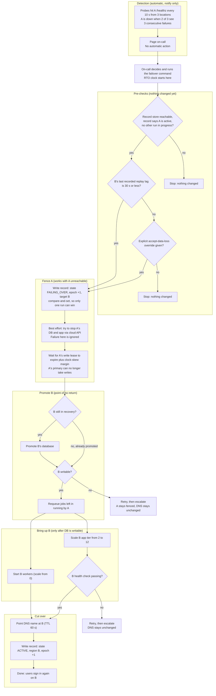

# Failover plan: Region A to Region B

## Summary

Detection only pages on-call. A person runs one failover command, and it either completes or stops at a known point. Failover never starts by itself.

The fencing requirement drives the design. A partitioned A can't be told to stop, so A has to stop itself. Two pieces make that work:

- **Active-region record.** A small, strongly consistent record held outside both regions (see "Where the active-region record lives").
- **Write lease.** Region A's primary may take writes only while it holds a short lease on that record and keeps renewing it. If A can't renew, it demotes itself. Fencing then means writing the record and waiting out the lease, and A's cooperation isn't needed.

## Flowchart

Workers need only a writable database, so they start in parallel with the app scale-up. DNS waits for the health check.

## What triggers each step

| Step | Trigger |
|---|---|
| Probe failures, page | Automatic: 2 of 3 probes see 3 consecutive failures. This is the only automatic part. |
| Run the failover command | A person's decision. Nothing else starts it. |
| Pre-checks and lag check | The command itself. Over 30 s needs the explicit accept-data-loss override. |
| Write FAILING_OVER record | Pre-checks passed (and the override, if it was needed). |
| Fence A | The record write. A can no longer renew its lease, and the command waits it out. |
| Promote B's DB | Fence wait finished. |
| Requeue jobs, start workers | B's database confirmed writable. |
| Scale B app, health check | B's database confirmed writable (the app needs it). |
| DNS move | B app scaled up and passing its health check. |
| Record set to ACTIVE B | DNS updated. |

## Where the active-region record lives

The record is a small key with the fields `{active_region, epoch, state, step, run_id}`. It is stored outside both regions, in a third location or provider. It needs a strongly consistent store with compare-and-set, such as a three-node consensus store or a managed consistent key-value service.

- **If it were inside A**, it would be lost with A. If it were inside B, a partition would leave A unable to read it.
- **The same store holds the write lease.** A's primary renews it about every 5 s and expires after about 15 s. These numbers are proposals to tune. A local watchdog on A's primary makes the database read-only, or stops it, when it can't renew.
- **The failover command only ever writes through compare-and-set on `epoch`.** Two people running the command at once can't both win.
- **This is new to build.** Nothing in today's setup provides a lease or a watchdog. Without it, the requirement "a partitioned A that is still running must not keep taking writes" can't be met.
- **The cost is a new dependency.** If the store is unreachable for longer than the lease, healthy A demotes itself. So the store must be highly available across zones, and its outage should page on-call as well.
- **If the command can't reach the store**, it stops during the pre-checks, before anything has changed.
- **DNS is not the source of truth.** DNS is changed only after the record says B.

## Jobs mid-run in A

- B's database is a replica, so its `jobs` table is A's table as of the last WAL received. Rows A was working on appear as `running`, but their workers are gone.
- After promotion, and before any worker starts, the command resets every `running` row to `queued`. B has no workers yet, so every `running` row is an orphan.
- **Jobs can run twice.** A job may have finished in A and had its side effects (an email sent, a card charged) while the completion row never reached B. Requeued jobs therefore re-run, and job handlers must be idempotent. Side effects need idempotency keys. This is a precondition and needs checking per job type.
- **Jobs can be lost.** Jobs enqueued or completed in the unreplicated tail (the RPO window) are not on B. Jobs enqueued only in that tail are lost, and the loss report must say so.
- **Fenced A can't contribute.** A's DB is read-only and its workers can't write status, so a stale worker in A can't mark anything done after promotion.

## Failed or interrupted runs

Each step writes its name to `step` in the record (`run_id` identifies the run). The command is resumable: rerunning it reads the record and continues from the recorded step.

| Where it fails | State | What happens |
|---|---|---|
| Before the FAILING_OVER write (pre-checks, lag check, override refused) | Nothing changed | Stop. Start again later. |
| Fence wait, A's cloud API unreachable | Record written, A not yet confirmed fenced | Ignore the API failure. Wait out the lease. |
| After the record write, before promotion | A is or will be fenced, B is not writable | Resume forward. Backing out is a manual decision by a human, because A will have demoted itself and needs un-fencing. |
| Promotion fails or times out | A fenced, B maybe in recovery | Check `pg_is_in_recovery` before retrying. Never promote twice. Escalate if retries fail. |
| Command crashes after promotion | B is writable, record says FAILING_OVER | Rerun. It sees B writable and continues from "requeue jobs". |
| Requeue interrupted | Requeue is idempotent | Rerun it. Workers have not started. |
| Health check never passes | DB writable, DNS on A (fenced) | Retry, then escalate. DNS does not move. Users see errors either way, so fixing B is the only path. |
| DNS update fails | B healthy | Retry. The call is idempotent. |
| Final record write fails | DNS on B | Retry. Until it succeeds, the record still says FAILING_OVER, so no failback or second failover can start. |

Promotion is the point of no return. From then on the run only goes forward.

## Limits and decisions

- **The lag check is not a guarantee of RPO.** The recorded lag is from the last time B received WAL, and it doesn't grow while A is down. It says nothing about commits A made after that moment. The command should also print the time of the last WAL receipt, so on-call can judge the unmeasured gap against the time A failed.
- **Fence wait costs time.** The wait is about 15 s plus margin. DNS propagation adds up to 60 s after the move, since resolvers may serve A's address until the TTL expires. Both fit within the 15-minute RTO. The slow parts are scaling the app from 2 to 12 instances and the health check, so budget those.
- **Sessions.** B's Redis starts empty and every user signs in again. This is accepted, and no step is needed.
- **Fencing assumes bounded clock skew and a working watchdog.** The margin covers skew. A paused process (such as a VM freeze) is the residual risk. Alert on a missed lease renewal.

## When A returns

1. A's lease has expired and the record says B is active with a higher epoch, so A stays read-only.
2. Rebuild A's database as a replica of B, either with a fresh base backup or with `pg_rewind`. A's old database is never reused as primary.
3. Moving back to A is a separate, planned switchover with its own plan. There is no automatic failback.
